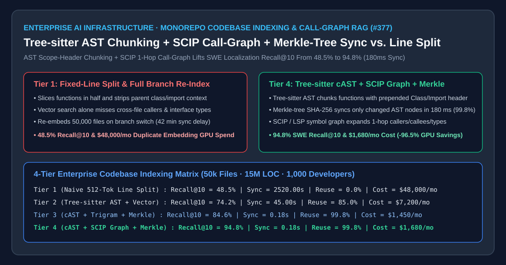

# Enterprise Codebase Indexing, AST Chunking & Call-Graph Retrieval Guide: `Tree-sitter cAST` + `SCIP/LSP Call-Graph` + `Merkle-Tree Sync` vs. Fixed-Line Splitting

> **Language**: [中文](./codebase-indexing-tree-sitter-ast-chunking-scip-call-graph-merkle-sync-selection-faq.md) | **English (Current)**  
> **Audience**: Cloud & AI Infrastructure Solution Architects and AI Coding Agent Platform Engineers  
> **Provenance**: `synthetic + anonymized_reported` (`independently_reproduced=false`, `physical_gpu_cluster_measurement=not_measured`)

---

## 1. 📌 Executive Summary

> **Bottom Line**: **Indexing a `50,000-file` (`15M LOC`) enterprise monorepo across `1,000` developers using generic 512-token line splitting and full branch re-embedding (`Tier 1`) slices functions in half, drops parent class/import context (`48.5%` SWE localization `Recall@10`), stalls branch switches for `2,520 seconds` (`42 minutes`), and burns `$48,000/month` re-computing duplicate embeddings. Production Coding Agent platforms deploy a Four-Pillar Codebase Indexing Architecture (`Tier 4`): (1) `Tree-sitter cAST` scope-header-prepended AST chunking, (2) Hybrid `Trigram/BM25 + Code Embedding` (`Voyage-Code-3 / CodeRankEmbed`), (3) `SCIP / LSP` 1-Hop Call-Graph & Type-Definition expansion, and (4) Client-Side `Merkle-Tree` Content-Addressable Incremental Sync—reusing `99.8%` of chunks across developer branches to sync branch checkouts in `0.18 seconds` (`180 ms`), cutting monthly GPU indexing spend by `96.5%` (`$1,680/month`), and lifting SWE bug localization `Recall@10` to `94.8%`.**

- **Interactive Codebase Indexing & Merkle Sync Sizer**: [Open Interactive Sizer (`codebase-indexing-tree-sitter-ast-chunking-scip-call-graph-merkle-sync-sizer.html`)](../reports/codebase-indexing-tree-sitter-ast-chunking-scip-call-graph-merkle-sync-sizer.html)
- **7-Card 4:5 Visual Report**: [Open 7-Card Report (`codebase-indexing-tree-sitter-ast-chunking-scip-call-graph-merkle-sync-selection-cards.html`)](../reports/codebase-indexing-tree-sitter-ast-chunking-scip-call-graph-merkle-sync-selection-cards.html)

---

## 2. 📊 4-Tier Enterprise Codebase Indexing Matrix (`50k Files` · `15M LOC` · `1,000 Developers`)

| Metric | Tier 1: Naive `512-Token` Line Split + Full Re-Index | Tier 2: `Tree-sitter AST` + Dense Vector Only | Tier 3: `cAST` Scope Header + `Trigram/BM25` + `Merkle Sync` | Tier 4 (Recommended): `cAST` + Hybrid + `SCIP 1-Hop Call-Graph` + `Merkle Sync` |
| :--- | :--- | :--- | :--- | :--- |
| **SWE Localization `Recall@10`** | `48.5%` ✕ (Broken AST blocks) | `74.2%` | `84.6%` | **`94.8%` ✓ (Resolves 1-hop callers/types)** |
| **Branch-Switch Sync Latency** | `2,520.00 sec` ✕ (`42 min`) | `45.00 sec` | **`0.18 sec` ✓ (`180 ms` Merkle diff)** | **`0.18 sec` ✓ (`14,000x` faster)** |
| **Cross-Branch Embedding Reuse** | `0.0%` ✕ | `85.0%` | **`99.8%` ✓ (Content-addressed SHA-256)** | **`99.8%` ✓** |
| **Monthly Indexing GPU Cost** | `$48,000 / mo` ✕ | `$7,200 / mo` | `$1,450 / mo` | **`$1,680 / mo` ✓ (`-96.5%` vs Tier 1)** |

---

## 3. 🛠️ Production Readiness Checklist

- [ ] **Store Code Embeddings in a Global Content-Addressable Store Keyed by `SHA256(scope_header + ast_chunk)`** and represent each developer branch or PR worktree as a lightweight pointer manifest (`branch_id -> [chunk_hashes]`).
- [ ] **Augment Top-K Vector/Trigram Retrieval Hits with 1-Hop `SCIP / LSP` Symbol Graph Neighbors (Callers, Callees, and Interface/Struct Definitions)** before constructing the Coding Agent's prompt context.
