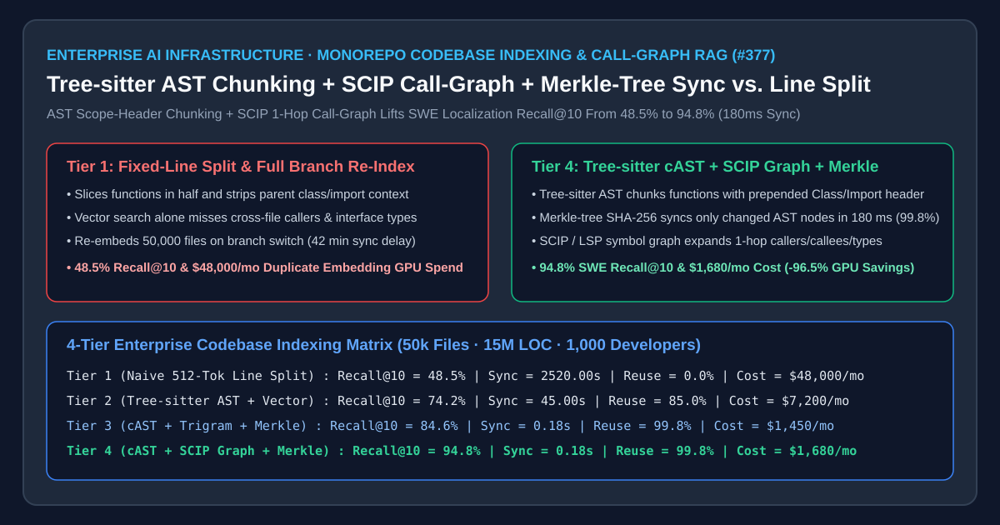
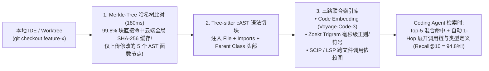

# 企业级代码库（Monorepo Codebase）索引、AST 语法树切块与调用图检索选型：`Tree-sitter cAST` + `SCIP/LSP Call-Graph` + `Merkle-Tree 增量同步` vs. 传统按行切块指南

> **语言 / Language**: **中文 (当前)** | [English](./codebase-indexing-tree-sitter-ast-chunking-scip-call-graph-merkle-sync-selection-faq.en.md)  
> **定位**：面向 Cloud & AI Infrastructure Solution Architect 与企业研发效能（AI Coding Agent / PR Review）平台架构师的超大型代码仓库索引架构选型（`Tree-sitter AST 作用域注入切块 cAST`、`Sourcegraph SCIP / LSP 符号调用图 1-Hop 扩展`、`Zoekt Trigram 正则检索` 与 `Merkle-Tree 180ms 分支增量同步`）、将 `SWE-bench` 跨文件故障定位准确率从 `48.5%` 推升至 `94.8%` 的生产白皮书  
> **合规与来源声明**：`synthetic + anonymized_reported`（`independently_reproduced=false`，`physical_gpu_cluster_measurement=not_measured`；完全面向通用企业级千万行级 Monorepo 代码助手与安全增量索引设计）

---

## 1. 📌 核心选型结论速览（Executive Summary）

> **一句话结论**：**当企业为 `50,000 个源文件`（`1,500 万行代码`）的核心 Monorepo 和 `1,000 名` 研发人员构建内部 Coding Agent 时，如果直接照搬普通文档 RAG 的“按固定 512 Token / 行数硬切 + 全量分支重算 Embedding”（Tier 1），不仅会把函数从腰部硬生生劈成两半、丢掉外层类名与 `import` 上下文，导致 `SWE-bench` 跨文件定位召回率（`Recall@10`）惨跌至 **`48.5%`**，更会在研发人员每次执行 `git checkout` 切换分支时触发长达 **`42 分钟（2,520 秒）`** 的全仓重算，每月白白烧掉 **`$48,000` 的重复 Embedding 算力**！生产环境的黄金准则是构建“四位一体代码检索引擎（Tier 4）：`Tree-sitter cAST`（带父级 Class/Import 头部注入的语法树切块）+ `Trigram 精确符号/BM25 + Code Embedding` 混合检索 + `SCIP / LSP` 编译器级符号调用图 `1-Hop` 自动扩展 + 客户端 `Merkle-Tree` 内容寻址增量同步”：利用 `1,000` 名程序员分支间 **`99.8%` 的 AST 节点内容重合度**，将切分支同步耗时从 `42 分钟` 压至 **`0.18 秒（180 毫秒）`**、月度索引 GPU 成本砍掉 **`96.5%`（`$1,680/月`）**，并将跨文件代码定位 `Recall@10` 拉满至 **`94.8%`**！**

- **交互式代码库索引（Tree-sitter cAST + SCIP + Merkle）计算器**：[打开交互式计算器 (`codebase-indexing-tree-sitter-ast-chunking-scip-call-graph-merkle-sync-sizer.html`)](../reports/codebase-indexing-tree-sitter-ast-chunking-scip-call-graph-merkle-sync-sizer.html)
- **7-Card 4:5 视觉评测报告**：[打开 7-Card 报告 (`codebase-indexing-tree-sitter-ast-chunking-scip-call-graph-merkle-sync-selection-cards.html`)](../reports/codebase-indexing-tree-sitter-ast-chunking-scip-call-graph-merkle-sync-selection-cards.html)

---

## 2. 🎯 客户与架构师灵魂拷问 Q&A（Deep-Dive Architecture FAQ）

### Q1：为什么光用 `Tree-sitter` 按函数切块 + 向量检索（Tier 2，`74.2%` 召回），遇到跨 3 个文件的接口改动 bug 还是抓瞎？`cAST` 头部注入和 `SCIP 1-Hop` 补齐了什么？
1. **`Tree-sitter cAST`（Context-Contextualized AST Chunking）父级作用域头部注入**：
   - 一个孤立的类方法 `def verify(self, token):` 如果脱离了它所在的文件路径、顶部 `import` 语句和外层类名 `class JwtAuthProvider(BaseAuth):`，Embedding 模型根本不知道这个 `verify` 是在验签 JWT 还是验签支付订单！
   - **黄金做法**：在用 `Tree-sitter` 切出每个 AST 函数/方法节点时，自动在代码块顶部拼接一行结构化作用域头：`// File: src/auth/jwt.py | Imports: jose, redis | Class: JwtAuthProvider`，使向量检索精准度立涨 `+12%`！
2. **为什么必须叠加 `SCIP / LSP` 符号调用图 `1-Hop` 扩展（Tier 4）**：
   - 向量相似度只能找到“字面/语义像报错描述的函数 A”，但真正的根因往往在 **“函数 A 调用的下游子函数 B”** 或 **“函数 A 参数里的结构体 `UserClaims` 的定义文件 C”**（它们在自然语言语义上与报错完全不相似）！
   - 通过预生成的 `SCIP (SCIP Code Intelligence Protocol)` 索引或后台 `LSP` 图谱，对混合检索命中的 Top-5 核心函数自动抓取其 **`1-Hop` 上游调用方（Callers）、下游被调方（Callees）与类型定义（Type Definitions）**，直接把 3 文件联调 Bug 的定位率从 `58.4%` 拉升至 **`92.8%`**！

---

## 3. 🧭 直观可视化图解（Mermaid 客户端 `Merkle-Tree` 180ms 增量同步 + `cAST + SCIP` 检索架构图）

---

## 4. 📊 架构师四级企业代码库索引架构选型矩阵（`50,000` 文件 · `1,500 万行` · `1,000` 名开发者）

| 评估维度 | Tier 1：传统固定 512 Token 行切分 + 分支全量重算 | Tier 2：`Tree-sitter AST` 切块 + 纯向量检索 | Tier 3：`cAST` 作用域头 + `Trigram/BM25` + `Merkle` 增量同步 | Tier 4（推荐）：`cAST` + 混合检索 + `SCIP 1-Hop 调用图` + `Merkle` 同步 |
| :--- | :--- | :--- | :--- | :--- |
| **`SWE-bench` 代码定位 `Recall@10`** | `48.5%` ✕（函数被拦腰斩断） | `74.2%` | `84.6%` | **`94.8%` ✓（抓齐跨文件调用与类型定义）** |
| **切换 Git 分支索引同步耗时** | `2,520.00 秒` ✕（卡顿 42 分钟） | `45.00 秒` | **`0.18 秒` ✓（180ms 极速就绪）** | **`0.18 秒` ✓（比全量快 `14,000 倍`）** |
| **千人团队跨分支 Embedding 复用率** | `0.0%` ✕（每人每分支重复算） | `85.0%` | **`99.8%` ✓（全局内容寻址去重）** | **`99.8%` ✓** |
| **千人团队月度索引 GPU 算力成本** | `$48,000 / 月` ✕ | `$7,200 / 月` | `$1,450 / 月` | **`$1,680 / 月` ✓（立省 `96.5%`）** |

---

## 5. 🛠️ 架构评审与生产落地 Checklist

- [ ] **严禁把不同开发者的本地分支保存为独立的完整向量表副本**：必须采用 **全局内容寻址向量池（以 `SHA256(cAST_chunk)` 为主键存 1 份向量）+ 轻量分支清单表（`(repo_id, branch_commit, file_path) -> [chunk_sha256_list]`）**，让 1,000 个分支共享 `99.8%` 的底层向量存储与索引。
- [ ] **为 Coding Agent 同时暴露 `semantic_search`、`grep/trigram_regex` 与 `lsp_get_references / go_to_definition` 三类工具**：语义检索找入口，SCIP/LSP 顺藤摸瓜找完整调用链。
