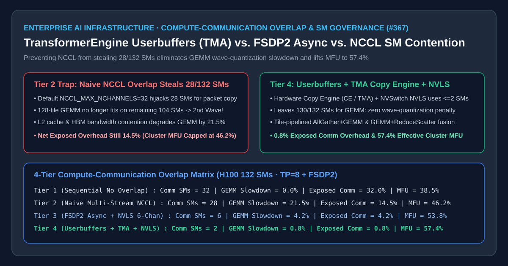

# Compute-Communication Overlap & GPU SM-Contention Governance Guide: `TransformerEngine Userbuffers (TMA)` vs. `PyTorch FSDP2 Async` vs. `Standard NCCL`

> **Language**: [中文](./compute-communication-overlap-userbuffers-fsdp2-nccl-sm-contention-selection-faq.md) | **English (Current)**  
> **Audience**: Cloud & AI Infrastructure Solution Architects and Distributed Training Performance Engineers  
> **Provenance**: `synthetic + anonymized_reported` (`independently_reproduced=false`, `physical_gpu_cluster_measurement=not_measured`)

---

## 1. 📌 Executive Summary

> **Bottom Line**: **On `NVIDIA H100 / H200` (`132 SMs`), running non-overlapped sequential `GEMM -> NCCL` (`Tier 1`) leaves `32.0%` of step time as exposed communication stall (`38.5%` MFU). However, naively launching standard `NCCL` on a parallel CUDA stream (`Tier 2`) triggers a severe hardware trap: `NCCL` steals `28 of 132 SMs` (`21.2%` of the GPU!) and contends for L2 cache/HBM bandwidth, forcing a `128-tile GEMM` onto `104 SMs` (spilling into a 2nd tail wave via Wave Quantization) and slowing the GEMM itself by `21.5%` (`14.5%` net overhead, `46.2%` MFU). Production architectures combine `TransformerEngine Userbuffers` (DMA Copy Engine / TMA tile-pipelined overlap) + `NVSwitch NVLS` hardware reduction + `CUDA_DEVICE_MAX_CONNECTIONS=1` (`Tier 4`): capping communication at `<=2 SMs`, leaving `130/132 SMs` for TensorCores, cutting exposed communication overhead to `0.8%`, and lifting cluster MFU to `57.4%` (`+49.1%` throughput over Tier 1).**

- **Interactive Compute-Communication Overlap & SM-Contention Sizer**: [Open Interactive Sizer (`compute-communication-overlap-userbuffers-fsdp2-nccl-sm-contention-sizer.html`)](../reports/compute-communication-overlap-userbuffers-fsdp2-nccl-sm-contention-sizer.html)
- **7-Card 4:5 Visual Report**: [Open 7-Card Report (`compute-communication-overlap-userbuffers-fsdp2-nccl-sm-contention-selection-cards.html`)](../reports/compute-communication-overlap-userbuffers-fsdp2-nccl-sm-contention-selection-cards.html)

---

## 2. 📊 4-Tier Compute-Communication Overlap Matrix (`H100 132 SMs` · `TP=8 + FSDP2`)

| Metric | Tier 1: Sequential Non-Overlapped (`GEMM -> NCCL`) | Tier 2: Naive Multi-Stream Overlap (`Standard NCCL 28 SMs`) | Tier 3: `FSDP2 Async Prefetch` + `NVLS` Offload (`6 SMs`) | Tier 4 (Recommended): `Userbuffers` + `TMA / Copy Engine` (`<=2 SMs`) |
| :--- | :--- | :--- | :--- | :--- |
| **GPU SMs Consumed by Comm** | `32 SMs` (Sequential) | `28 SMs` ✕ (`21.2%` SMs stolen) | **`6 SMs` ✓ (NVSwitch NVLS)** | **`2 SMs` ✓ (`130/132` SMs for GEMM)** |
| **GEMM Wave-Quantization Slowdown** | `0.0%` | `21.5%` ✕ (Triggers 2nd wave) | `4.2%` | **`0.8%` ✓ (Zero wave spill)** |
| **Net Exposed Comm Overhead** | `32.0%` ✕ | `14.5%` ✕ | `4.2%` | **`0.8%` ✓ (`97.5%` hidden)** |
| **Effective Cluster MFU** | `38.5%` ✕ | `46.2%` | `53.8%` | **`57.4%` ✓ (`+49.1%` vs Tier 1)** |

---

## 3. 🛠️ Production Readiness Checklist

- [ ] **Set `CUDA_DEVICE_MAX_CONNECTIONS=1`, `NCCL_NVLS_ENABLE=1`, and Bound `NCCL_MAX_CTAS=4..8`** when overlapping FSDP2/TP communication with GEMM so NCCL cannot starve TensorCore threadblock scheduling.
- [ ] **Enable `TransformerEngine` Userbuffers (`--tp-comm-overlap`)** for intra-node `TP=8` to pipeline `AllGather + GEMM` and `GEMM + ReduceScatter` over hardware DMA/TMA engines with near-zero SM footprint.
