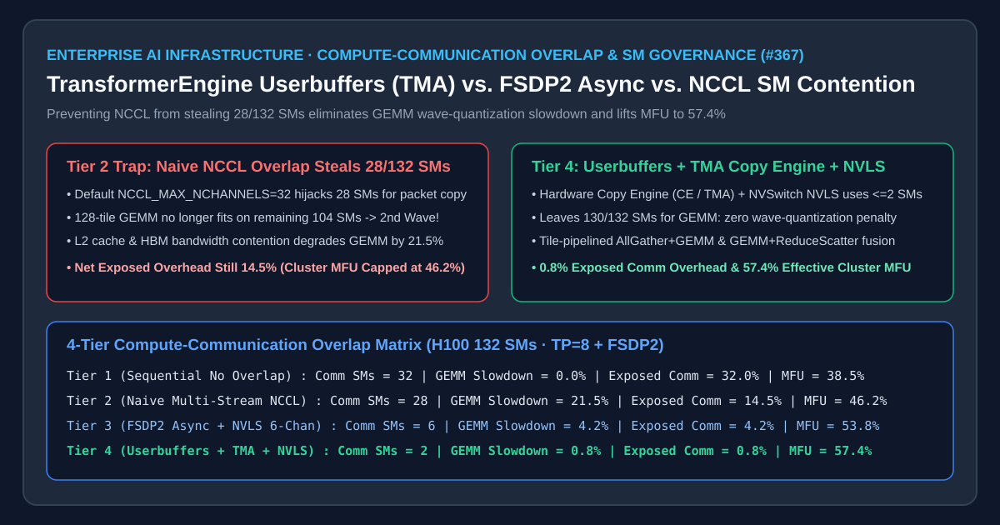
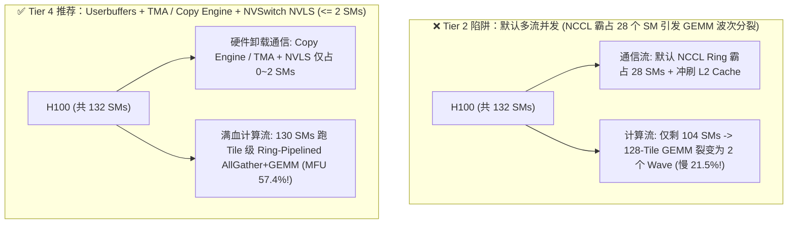

# 大模型计算-通信重叠（Compute-Communication Overlap）与 GPU SM 争抢治理选型：`TransformerEngine Userbuffers (TMA)` vs. `PyTorch FSDP2 Async` vs. `NCCL SM-Contention` 降速排障指南

> **语言 / Language**: **中文 (当前)** | [English](./compute-communication-overlap-userbuffers-fsdp2-nccl-sm-contention-selection-faq.en.md)  
> **定位**：面向 Cloud & AI Infrastructure Solution Architect 与集群性能架构师的计算-通信重叠架构选型（`TransformerEngine Userbuffers + Hopper/Blackwell TMA`、`PyTorch FSDP2 Async Prefetch`、`NVSwitch NVLS SHARP`）、破解“开启 NCCL 异步重叠后矩阵乘（GEMM）反而变慢 `21.5%`”的 Wave Quantization（波次量化）陷阱白皮书  
> **合规与来源声明**：`synthetic + anonymized_reported`（`independently_reproduced=false`，`physical_gpu_cluster_measurement=not_measured`；完全面向通用企业级大模型训练与长上下文 Prefill 集群 MFU 调优设计）

---

## 1. 📌 核心选型结论速览（Executive Summary）

> **一句话结论**：**在 `H100 / H200`（`132 个 SM` 流式多处理器）集群中，如果不做计算-通信重叠（Tier 1），`AllGather` 与 `ReduceScatter` 会产生高达 **`32.0%`** 的纯网络等待气泡（集群 MFU 仅 `38.5%`）；但若简单粗暴地在独立 CUDA Stream 上开启默认 `NCCL` 与 `GEMM` 并发重叠（Tier 2），你会遭遇极其反直觉的性能踩坑——**默认 `NCCL` 通信内核会强行霸占 `28 个 SM`（占全卡 `21.2%` 的算力核心）去搬运数据包并争抢 L2 Cache 带宽，导致原本刚好 1 个 Wave 跑完的 `128-Tile GEMM` 被迫溢出一截跑第 2 个尾波（Wave Quantization），使矩阵乘自身暴跌 `21.5%`**，最终仍有 `14.5%` 净开销（MFU 卡在 `46.2%`）！生产环境破局标准是采用“细粒度分块流水线重叠 `TransformerEngine Userbuffers` + 硬件 DMA/TMA 拷贝引擎 + `NVSwitch NVLS` 交换机内归约 + `CUDA_DEVICE_MAX_CONNECTIONS=1`（Tier 4）”：将通信占用的 SM 数量从 `28 个` 压至 **`<= 2 个 SM`**（把 `130/132` 个 SM 完整留给 Tensor Core），彻底消除 GEMM 波次分裂惩罚，将暴露通信开销从 `32.0%` 压至 **`0.8%`**，推动集群有效 MFU 跃升至 **`57.4%`（相对吞吐暴涨 `+49.1%`）**！**

- **交互式计算-通信重叠与 SM 争抢治理计算器**：[打开交互式计算器 (`compute-communication-overlap-userbuffers-fsdp2-nccl-sm-contention-sizer.html`)](../reports/compute-communication-overlap-userbuffers-fsdp2-nccl-sm-contention-sizer.html)
- **7-Card 4:5 视觉评测报告**：[打开 7-Card 报告 (`compute-communication-overlap-userbuffers-fsdp2-nccl-sm-contention-selection-cards.html`)](../reports/compute-communication-overlap-userbuffers-fsdp2-nccl-sm-contention-selection-cards.html)

---

## 2. 🎯 客户与架构师灵魂拷问 Q&A（Deep-Dive Architecture FAQ）

### Q1：为什么明明 `NCCL` 是通信库，却会抢占做矩阵乘法的 GPU `SM` 核心？什么是“GEMM 波次量化灾难（Wave Quantization）”？
1. **为什么标准 `NCCL` 要消耗 `16~32` 个 SM**：
   - 标准 `NCCL`（Ring / Tree）并不是靠独立网卡或 DMA 硬件自己在后台静默做加法的——它实际启动了一个常驻 GPU 的 **CUDA 通信 Kernel**！每一个 `NCCL Channel` 都会绑定 1 个或多个线程块（CTA）常驻在 SM 上，轮询 FIFO 缓冲区、执行 `float16/bfloat16` 向量相加并向 NVLink/RDMA 写数据。当 `NCCL_MAX_NCHANNELS=28~32` 时，整整 `28 个 SM` 被通信死死占住！
2. **Wave Quantization（波次量化翻倍效应）算例**：
   - `H100` 共有 **`132 个 SM`**。假设一个高度优化的 `cuBLAS GEMM` 切分出了 **`128 个 Threadblock (Tiles)`**：
     - **独占 GPU 时（`132 SMs` 可用）**：`128` 个 Tile 一次性全部塞进 `132` 个 SM，**`1 个 Wave`（耗时 `1.0 ms`）全部算完**！
     - **与默认 `NCCL` 并发重叠时（`NCCL` 抢走 `28 SMs`，仅剩 `104 SMs`）**：第 1 个 Wave 只能放下 `104` 个 Tile，剩下的 `128 - 104 = 24` 个 Tile 被迫排到**第 2 个 Wave** 执行（而此时 `80` 个 SM 处于陪跑空转状态）！叠加 L2 Cache 冲刷，原本 `1.0 ms` 的 GEMM 硬生生膨胀了 **`+21.5%`**！

---

## 3. 🧭 直观可视化图解（Mermaid 粗粒度并发 SM 争抢 vs. 细粒度硬件卸载流水线重叠对比图）

---

## 4. 📊 架构师四级计算-通信重叠选型矩阵（`H100 132 SMs` · `TP=8 + FSDP2`）

| 评估维度 | Tier 1：串行不重叠 (`GEMM -> NCCL`) | Tier 2：粗放双流重叠（默认 `NCCL 28~32 Channels` 抢 SM） | Tier 3：`FSDP2 Async Prefetch` + `NVLS` 硬件卸载 (`6 SMs`) | Tier 4（推荐）：`TransformerEngine Userbuffers` + `TMA / Copy Engine` (`<=2 SMs`) |
| :--- | :--- | :--- | :--- | :--- |
| **通信内核抢占的 GPU SM 数** | `32 SMs`（串行独占） | `28 SMs` ✕（抢走 `21.2%` 算力核） | **`6 SMs` ✓（NVSwitch 硬件归约）** | **`2 SMs` ✓（保留 `98.5%` SM 给计算）** |
| **并发时 GEMM 波次分裂降速幅度** | `0.0%` | `21.5%` ✕（触发第 2 尾波） | `4.2%` | **`0.8%` ✓（零波次分裂）** |
| **净暴露通信等待占比 (`Exposed Comm`)** | `32.0%` ✕ | `14.5%` ✕ | `4.2%` | **`0.8%` ✓（几乎 100% 隐藏）** |
| **集群有效算力利用率 (`Effective MFU`)** | `38.5%` ✕ | `46.2%` | `53.8%` | **`57.4%` ✓（比串行提升 `+49.1%`）** |

---

## 5. 🛠️ 架构评审与生产落地 Checklist

- [ ] **训练脚本必配 `export CUDA_DEVICE_MAX_CONNECTIONS=1` 与 `NCCL_NVLS_ENABLE=1`**：强制 GPU 硬件工作队列严格按提交顺序调度计算与通信 Kernel，并启用 Hopper/Blackwell `NVSwitch SHARP (NVLS)` 将机内归约 SM 占用从 `28 个` 降至 `4~6 个`。
- [ ] **在 `FSDP2` / `Megatron-Core` 中限制并发通信 CTA 数量（`NCCL_MAX_CTAS=4` 或 `TORCH_NCCL_AVOID_RECORD_STREAMS=1`）并开启 `--tp-comm-overlap` (`Userbuffers`)**：通过硬件 Copy Engine / TMA 实现零 SM 争抢的 Tile 级流水线隐藏。
