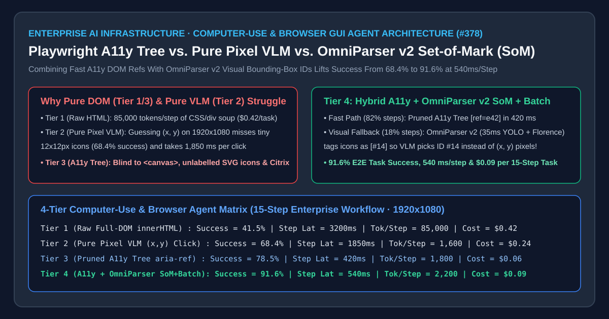
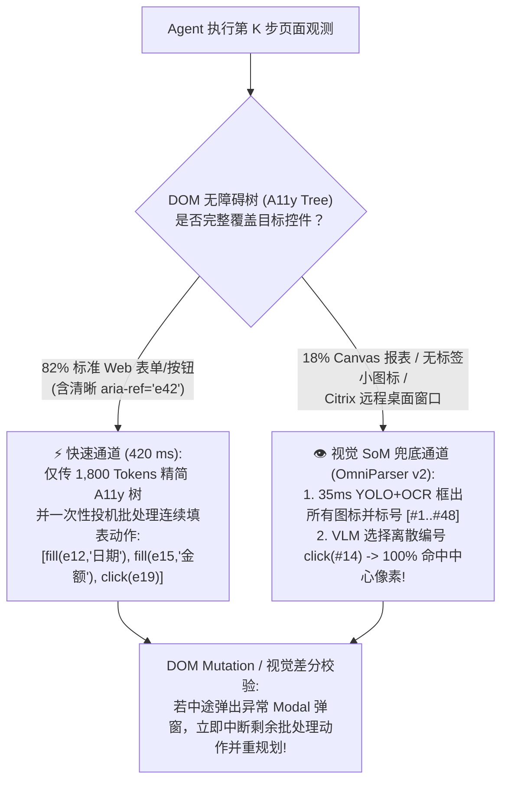

# 企业级计算机操作智能体（Computer-Use / Browser GUI Agent）架构选型：`Playwright A11y 无障碍树` vs. `纯视觉截图 VLM (UI-TARS / Claude Computer-Use)` vs. `混合 OmniParser v2 Set-of-Mark (SoM)` 指南

> **语言 / Language**: **中文 (当前)** | [English](./computer-use-browser-gui-agent-playwright-dom-omniparser-vlm-sandbox-selection-faq.en.md)  
> **定位**：面向 Cloud & AI Infrastructure Solution Architect 与企业级智能体（RPA 替代 / 财税报销 / 遗留 ERP 自动化）平台架构师的 GUI/Browser Agent 视觉与结构化定位（Grounding）技术选型（`Playwright MCP A11y Tree`、纯截图 `(x, y)` 像素回归、`OmniParser v2 Set-of-Mark [#ID]` 标注与多动作投机批处理）、将 15 步复杂工作流端到端成功率从 `68.4%` 推升至 `91.6%` 的生产白皮书  
> **合规与来源声明**：`synthetic + anonymized_reported`（`independently_reproduced=false`，`physical_gpu_cluster_measurement=not_measured`；完全面向通用企业级浏览器池与远程桌面 GUI 自动化基础设施设计）

---

## 1. 📌 核心选型结论速览（Executive Summary）

> **一句话结论**：**当企业用大模型替代传统脆弱的 RPA 脚本操作内部 ERP、CRM、财务报销系统（平均 `15 步` 点击/填表工作流，`1920x1080` 分辨率）时：如果直接把网页原始 `innerHTML` 塞给大模型（Tier 1），现代 React/Vue 页面动辄 **`85,000 Tokens/步`** 的冗余 `
/CSS` 噪音会让单次任务烧掉 **`$0.42`** 且成功率仅 **`41.5%`**；如果完全倒向“每步截一张全屏图让多模态 VLM 直接预测鼠标像素坐标 `(x, y)`”（Tier 2，纯视觉 Computer-Use），不仅每步耗时高达 **`1,850 ms`**，而且大模型在 `1920x1080` 画布上盲猜 `12x12px` 小图标坐标极易点偏，导致 15 步连乘后总成功率跌至 **`68.4%`**；而如果只用精简无障碍树 `Playwright Accessibility (A11y) Tree`（Tier 3，`420 ms/步`），一旦遇到 `<canvas>` 报表、未写 `aria-label` 的纯图标按钮或 Citrix 远程桌面就会彻底失明（Canvas 场景成功率仅 `12.0%`）！生产环境黄金准则是采用“双模自适应混合架构：`Playwright A11y Tree` 主路（处理 82% 标准控件）+ `OmniParser v2 Set-of-Mark (SoM)` 视觉检测框编号兜底（处理 18% 图标/Canvas/桌面控件）+ 多表单字段投机批处理（Tier 4）”：用 `35 ms` 的轻量检测器在截图上画出离散编号框 `[#14]`，把大模型最不擅长的“连续像素坐标回归 `(x=1432, y=89)`”转化为大模型最擅长的**“离散选择题 `click(#14)`”**——将 15 步复杂工作流端到端成功率推升至 **`91.6%`**、平均单步耗时压至 **`540 ms`（比纯 VLM 快 `3.4 倍`）**、单任务成本降至 **`$0.09`**！**

- **交互式 Computer-Use 与浏览器智能体容量/成本计算器**：[打开交互式计算器 (`computer-use-browser-gui-agent-playwright-dom-omniparser-vlm-sandbox-sizer.html`)](../reports/computer-use-browser-gui-agent-playwright-dom-omniparser-vlm-sandbox-sizer.html)
- **7-Card 4:5 视觉评测报告**：[打开 7-Card 报告 (`computer-use-browser-gui-agent-playwright-dom-omniparser-vlm-sandbox-selection-cards.html`)](../reports/computer-use-browser-gui-agent-playwright-dom-omniparser-vlm-sandbox-selection-cards.html)

---

## 2. 🎯 客户与架构师灵魂拷问 Q&A（Deep-Dive Architecture FAQ）

### Q1：为什么多模态大模型直接预测鼠标像素坐标 `(x, y)` 总是点不准密集表格和小图标？`OmniParser v2 (Set-of-Mark, SoM)` 是怎么把点击命中率提升到 `99.4%` 的？
1. **连续坐标回归的“失之毫厘，谬以千里”**：
   - 视觉编码器（ViT）将 `1920x1080` 图像切分为 `14x14` 或 `28x28` 的 Patch 网格后，要求自回归 LLM 直接以文本输出 `"click(1432, 218)"`。在密集的财务 ERP 表格（行高仅 `18px`）或右上角 `12x12px` 关闭/筛选小图标上，哪怕预测偏离 `10` 个像素就会点到隔壁行，15 步下来只要错 1 步整个报销单就提错（$0.975^{15} \approx 68.4\%$）！
2. **`OmniParser v2`（`YOLOv8` 可交互控件检测 + `Florence-2` 局部图标语义字幕 + `Set-of-Mark` 编号覆盖）的降维打击**：
   - 在截图送入 VLM 之前，先由本地 GPU 上仅需 **`35 ms`** 的专用小检测模型精准框出屏幕上所有可点击按钮、输入框与小图标的像素边界 `[x1, y1, x2, y2]`，并在框角画上醒目的编号标签 **`[#1], [#2] ... [#48]`** 同时生成结构化控件清单；
   - VLM 只需要回答 **`click(box_id=14)`**，再由底层驱动精确点击 `box[14]` 的几何中心像素——彻底消灭像素回归漂移！

---

## 3. 🧭 直观可视化图解（Mermaid `A11y 无障碍树 + OmniParser v2 SoM + 投机多步批处理` 执行流图）

---

## 4. 📊 架构师四级 GUI / Browser Agent 定位架构选型矩阵（`15 步` 企业 ERP 工作流 · `1920x1080`）

| 评估维度 | Tier 1：原始全量 `innerHTML` 注入 (`85k Tokens/步`) | Tier 2：纯视觉截图 VLM 直接预测 `(x, y)` 坐标 | Tier 3：精简无障碍树 (`Playwright A11y Tree aria-ref`) | Tier 4（推荐）：混合 `A11y 树` + `OmniParser v2 SoM` + 多动作投机批处理 |
| :--- | :--- | :--- | :--- | :--- |
| **15 步工作流端到端成功率** | `41.5%` ✕（被 HTML 噪音淹没） | `68.4%` ✕（小图标坐标点偏） | `78.5%`（遇到 Canvas/无标签图标失败） | **`91.6%` ✓（DOM + SoM 视觉双保险）** |
| **平均单步响应耗时 (`Step Latency`)** | `3,200.0 ms` ✕ | `1,850.0 ms` ✕ | **`420.0 ms` ✓** | **`540.0 ms` ✓（比纯 VLM 快 `3.4 倍`）** |
| **每步消耗上下文 Token 数** | `85,000 Tokens` ✕ | `1,600 Tokens`（纯图像 Token） | `1,800 Tokens` | **`2,200 Tokens` ✓** |
| **单次 15 步任务总推理成本** | `$0.42 / 次` ✕ | `$0.24 / 次` | **`$0.06 / 次` ✓** | **`$0.09 / 次` ✓（比 Tier 1 省 `78.6%`）** |

---

## 5. 🛠️ 架构评审与生产落地 Checklist

- [ ] **严格遵循“API / MCP 优先于 A11y DOM，A11y DOM 优先于视觉 SoM 截图”的成本降级金字塔**：能调后端 REST/OData 接口的绝不开浏览器；能用 `Playwright aria-ref` 精确定位的绝不盲猜像素；遇到 `<canvas>`、无标签图标或桌面软件时自动切入 `OmniParser v2 SoM`。
- [ ] **高敏感操作（财务付款确认、生产删除、邮件外发）强制注入人类审批断点（Human-in-the-Loop Hand-off）**：在容器化隔离浏览器池（带 VNC/WebRTC 实时画面流）中暂停执行并高亮待点击的提交按钮，由用户一键确认放行。
