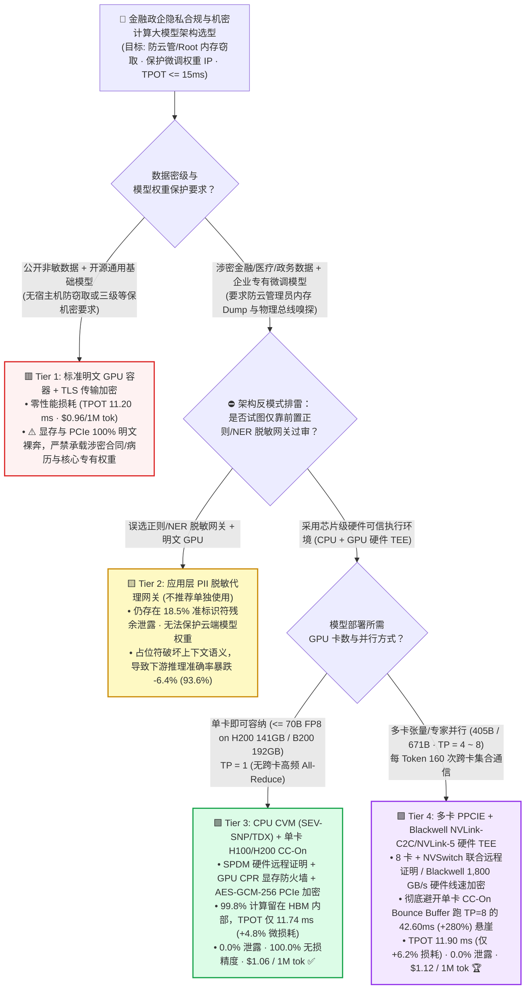
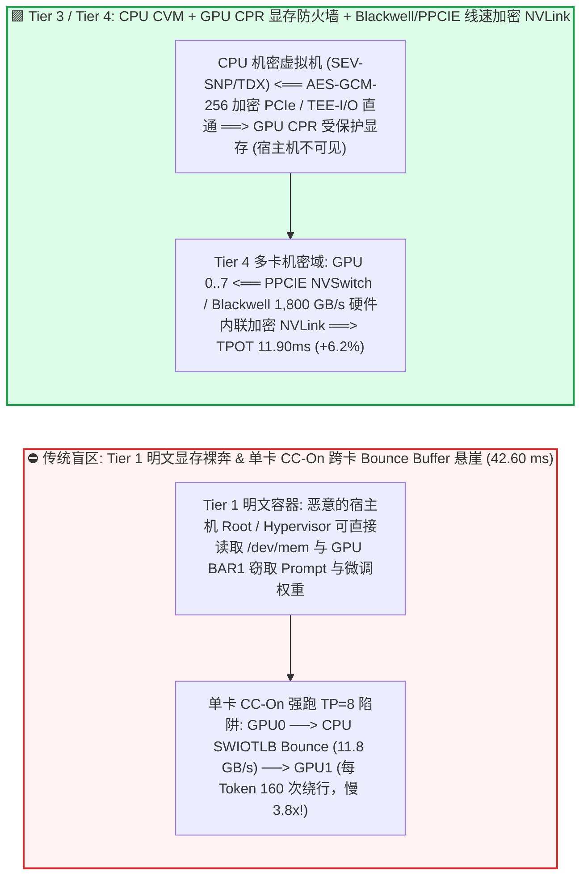
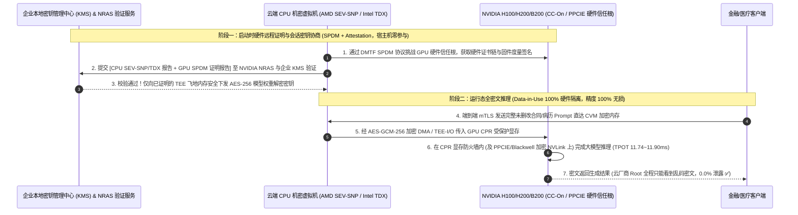

# 金融政企机密计算与隐私合规大模型推理架构选型指南（`标准明文 GPU 容器` vs. `应用层 PII 脱敏网关` vs. `单卡 H100/H200 CC-On 硬件 TEE` vs. `多卡 PPCIE + Blackwell NVLink 硬件加密集群`）

> 🌐 **Language**: **中文 (Chinese)** | **[English Version](./confidential-ai-tee-gpu-security-selection-faq.en.md)** · **[📖 返回仓库根目录 README](../../README.md)** · **[📊 2026-11-09 每日进展日报](../daily/2026-11-09.md)** · **[🃏 7-Card 4:5 视觉评测报告](../reports/confidential-ai-tee-gpu-security-selection-cards.html)** · **[🧮 交互式定容工作台](../reports/llm-inference-engine-pd-sizer.html#confidential-tee-sizer)**
>
> **导读**：面向 AI Solution Architect 的第一性原理实战选型指南。当银行、医疗、律所与主权云客户将核心业务接入大模型时，最大的合规拦路虎是**“运行态数据与专有模型权重裸奔（Data-in-Use Exposure）”**——哪怕网络开了 TLS、磁盘开了加密，云厂商宿主机管理员（Root / Hypervisor）依然可以直接从内存和 GPU 显存中 Dump 出客户的并购合同、病历源码以及企业斥资百万训练的微调权重。与此同时，架构师往往存在两大认知误区：**① 迷信在前面加一层“正则/NER 脱敏网关”，结果不仅漏掉 18.5% 的准标识符，还把上下文改得面目全非导致推理准确率暴跌 `6.4%`；② 听说开启 GPU 硬件机密计算（`CC-On`）会让 PCIe 带宽掉 75%，就不敢在生产大模型上开启**。本文基于 `experiments/confidential_ai_tee_selection/` 封存的确定性模型（`synthetic` + `anonymized_reported`，`independently_reproduced=false`），从第一性原理揭示：**为什么 70B 大模型开启单卡硬件 TEE 仅损失 `4.8%` 性能，以及为什么 405B 多卡 `TP=8` 必须升级 `PPCIE / Blackwell 内联 NVLink 加密` 以避开 `+280.4%` 的软件弹跳缓冲区悬崖**。


---

## ① 📌 核心结论速览（Executive Summary）

1. **按模型部署形态（单卡 `TP=1` vs. 多卡 `TP=8`）与监管合规等级四档精准选型**：
   - 在金融/医疗严监管大模型在线推理（基线明文 `TPOT = 11.20 ms`、单卡吞吐 `520.0 tok/s`，SLA 要求 `TPOT <= 15.0 ms` 且通过硬件远程证明与零数据泄露审计）下：
   - 🟥 **Tier 1（标准明文 GPU 容器 + 传输层 TLS + 磁盘静态加密）**：**严禁用于托管云/公有云涉密数据或高价值闭源微调权重**！对运行态显存（`Data-in-Use`）保护为 **`0%`（`100%` 暴露于宿主机 Root / Hypervisor / PCIe 总线嗅探）**，无法通过金融政企三级等保或主权云硬件审计。
   - 🟨 **Tier 2（应用层 PII / NER 脱敏代理网关 + 明文云端 GPU）**：**典型的“既没保住安全、又砸了模型智商”的伪合规过渡方案**。面对复杂病历、法律文书与代码库，命名实体识别存在 **`18.5%` 残余敏感信息泄露**（准标识符重识别），且将关键实体替换为 `[REDACTED_1]` 后导致大模型下游推理准确率暴跌 **`-6.4%`（降至 `93.6%`）**，同时完全无法保护云端显存里的企业专有模型权重。
   - 🟩 **Tier 3（`CPU CVM [AMD SEV-SNP / Intel TDX]` + 单卡 `H100/H200 Confidential Computing (CC-On)` 弹跳缓冲加密）**：**单卡可容纳模型（`<= 70B FP8 / 140GB H200`，`TP=1`）的合规黄金标准**。通过硬件信任根（`SPDM` 远程证明）+ GPU 显存受保护区（`CPR`）+ PCIe `AES-GCM-256` DMA 加密实现 **`0.0%` 泄露与 `100.0%` 无损精度**，且因大模型解码 `99.8%` 运算留在 HBM 内部、跨 PCIe 仅传输极小 Token ID，**端到端解码 TPOT 仅从 `11.20 ms` 微增至 `11.74 ms`（仅 `+4.8%` 性能开销，`$1.06 / 1M tokens`）**！
   - 🟪 **Tier 4（多卡 `Protected PCIe (PPCIE)` + `Blackwell GB200/B200 内联 NVLink-C2C / NVLink-5 硬件线速加密`）**：**405B/671B 超大模型多卡并行（`TP=8`）机密推理的唯一可行架构**。若在 8 卡 `TP=8` 下错误沿用单卡 `CC-On` 的 CPU 软件弹跳缓冲区（Bounce Buffer）中转每 Token 160 次 `All-Reduce`，TPOT 会暴涨至 **`42.60 ms`（`+280.4%` 灾难性减速）**；启用 **`PPCIE` 8 卡 NVSwitch 硬件机密域**或 **Blackwell 硬件内联线速 NVLink 加密**后，`TP=8` 机密解码 TPOT 稳守 **`11.90 ms`（仅 `+6.2%` 损耗，`488.0 tok/s/GPU`，`$1.12 / 1M tokens`）**！
2. **第一性原理定性（为什么小模型开 `CC-On` 慢 `58%`，而 70B 大模型开 `CC-On` 只慢 `4.8%`？）**：
   - 传统观点认为 GPU 机密计算“性能损耗巨大”，那是因为早期测试跑的是 **ResNet-50 / BERT 等 I/O 密集型小模型**（每次推理都要通过 PCIe 传几 MB 图片/特征，而算力耗时仅 1 毫秒，故 PCIe 弹跳加密把延迟拖慢了 **`+58.1%`**）；
   - 而在 **70B 大模型自回归解码** 中，70 GB 权重与 KV Cache 100% 常驻在 GPU HBM 的硬件受保护内存区（`CPR`）内全速跑 `3.35 TB/s` 明文张量计算，每步通过 PCIe 传给 CPU 的只有 **4 字节的输出 Token ID**——因此 PCIe 加密带宽折损几乎完全不影响解码吞吐！
3. **证据口径与透明性声明**：
   - 本指南所有 TPOT 延迟、PCIe 加密带宽、残余泄露率与 TCO 均绑定 `experiments/confidential_ai_tee_selection/results.json`（`provenance_type: "synthetic"`，基于 NVIDIA H100/H200 CC-On、PPCIE 及 Blackwell TEE-I/O 公开白皮书校准的确定性算例，`independently_reproduced: false`，未在物理机密集群开展硬件侧信道攻击实测 `physical_gpu_cluster_measurement: "not_measured"`；本机 Python 单测与校验为 `local_cpu_harness_measurement: "measured"`）。

---

## ② 🎯 客户与架构师灵魂拷问 Q&A（FAQ-Driven）

### Q1：客户问：“我们在网关层已经部署了基于正则和 BERT 的敏感词脱敏系统（Tier 2），把客户姓名、身份证号替换成占位符再发给云端 GPU，为什么合规审计还是不通过，而且业务部门投诉大模型变笨了？”

- **直白结论**：**应用层脱敏网关（Tier 2）在非结构化文本面前既防不住隐私还原（仍有 `18.5%` 残余泄露），又严重破坏了大模型的上下文语义推理链（准确率下降 `6.4%`），而且对企业部署在云端的专有微调模型权重毫无保护力！**
- **第一性原理拆解（为什么脱敏网关救不了金融医疗大模型？）**：
  1. **准标识符（Quasi-Identifiers）与上下文推理泄露（`18.5%` 漏网率）**：即使正则删掉了“张三”，病历或投行尽调报告里的“某 42 岁罕见病患者、曾任某科创板上市半导体公司 CFO”等上下文特征依然会原封不动进入明文显存；且代码审计场景中，核心算法逻辑本身就是商业机密，一旦脱敏就无法分析代码 Bug。
  2. **实体指代断裂导致模型“智商掉线”（`-6.4%` 准确率折损）**：当一份复杂合同里的 20 家关联公司、金额、日期被网关强行替换成 `[ORG_1]..[ORG_20]` 后，大模型在多步逻辑推理时极易发生指代混淆。
  3. **硬件 TEE（Tier 3 / Tier 4）的降维打击**：直接在 CPU（AMD SEV-SNP / Intel TDX）与 GPU（NVIDIA CC-On）硬件芯片层建立密码学飞地（Enclave），**原始完整 Prompt 不做任何删改、100% 密文穿过宿主机与 PCIe 总线，仅在 GPU 芯片内部解密计算**——兼得 **`0.0%` 泄露** 与 **`100.0%` 满血推理精度**！

### Q2：什么是 NVIDIA `CC-On`（单卡机密计算）的“弹跳缓冲区（SWIOTLB Bounce Buffer）”？为什么它对图像小模型影响很大，对 70B 大模型解码却只有 **4.8%** 的微小影响？

- **直白结论**：**开启 `CC-On` 后，GPU 硬件被禁止直接 DMA 读写 CPU 机密虚拟机（CVM）的加密私有内存，所有跨 PCIe 的数据必须先拷入一块共享未加密的“弹跳缓冲区（Bounce Buffer）”并用 `AES-GCM-256` 加密后再过 PCIe 总线——这会让 PCIe 有效带宽从 `52.0 GB/s` 降到 `11.8 GB/s`。但大模型解码每步只过 PCIe 传几个字节的 Token ID，所以几乎不受影响！**
- **第一性原理拆解（GPU `CPR` 显存防火墙 + PCIe 弹跳缓冲区的运作机制）**：
  1. **GPU 显存受保护区（Compute Protected Region, `CPR`）**：当 H100/H200 启动 `CC-On` 模式时，GPU 硬件内存控制器会在 HBM3/HBM3e 中划出受硬件防火墙保护的 `CPR` 区域。任何来自宿主机 CPU、Hypervisor 甚至物理 PCIe 探针的越权读取指令，硬件直接返回全 `0` 或拒绝访问。
  2. **为什么跨 PCIe 必须走 Bounce Buffer + Copy Engine 加解密？** 因为 CPU 的内存由 AMD `SEV-SNP` 或 Intel `TDX` 使用 CPU 专属密钥加密，而 GPU 显存由 GPU 自己保护。当 CPU 要把输入数据发给 GPU 时：① CPU 先在 CVM 内部用共享会话密钥把明文通过 `AES-GCM-256` 加密并写入未加密的 `SWIOTLB Bounce Buffer`；② GPU 的硬件 Copy Engine（CE）通过 DMA 把密文拉进 GPU `CPR` 显存并硬件解密。
  3. **算术强度决定开销（`+58.1%` vs. `+4.8%`）**：小模型（ResNet/BERT）每 `2.1 ms` 就要跨 PCIe 搬运数 MB 张量，因此受制于 `11.8 GB/s` 加密带宽，延迟增加 `58.1%`；而 70B 大模型（单张 H200 141GB 或 B200 192GB `TP=1`）权重常驻 `CPR`，每生成 1 个 Token 耗时 `11.20 ms` 全部花在 HBM 内部计算上，跨 PCIe 传输耗时不足 `0.54 ms`（仅 **`+4.8%`**）！

### Q3：如果客户要跑 405B 或 671B 超大模型（必须用 8 张卡跑 `TP=8`），为什么绝对不能直接用单卡 `CC-On` 模式拼凑，而必须开启 `PPCIE` 或升级 `Blackwell GB200/B200 TEE-I/O`？

- **直白结论**：**在初代单卡 `CC-On` 模式下，NVLink 会被安全策略强制禁用或退化，8 张卡之间的每 Token 160 次 `All-Reduce` 被迫绕道 CPU 的 `SWIOTLB Bounce Buffer` 做软件中转加解密，导致 `TP=8` 解码延迟从 `11.20 ms` 暴涨到 `42.60 ms`（慢 `3.8 倍`）！必须启用支持多卡 NVSwitch 信任域的 `PPCIE（Protected PCIe）` 或升级具备硬件线速 NVLink 加密引擎的 `Blackwell（Tier 4）`，才能把开销压回 `6.2%`（`11.90 ms`）！**
- **第一性原理拆解（单卡 `CC-On` 多卡陷阱 vs. `PPCIE` 与 `Blackwell Inline NVLink Encryption`）**：
  1. **为什么单卡 `CC-On` 跑多卡 `TP=8` 会崩盘？** 如第 15 轮所述，80 层大模型 `TP=8` 每生成一个 Token 需要同步 `160` 次。如果每次同步都要走 `GPU 0 CE 加密 -> CPU Bounce Buffer -> GPU 1 CE 解密`，`11.8 GB/s` 的弹跳带宽会让 GPU 74% 的时间在等加解密！
  2. **`PPCIE（Protected PCIe）` 与 `Blackwell NVLink-5` 原生内联加密（Tier 4）如何破局？**
     - 在 8 卡 HGX 独占机密节点上开启 **`PPCIE` 模式**，由硬件验证整台服务器的 8 张 GPU 与 4 颗 NVSwitch 芯片构成单一受保护物理拓扑域，恢复机内高速 NVLink P2P 直通；
     - 在新一代 **NVIDIA Blackwell（B200 / GB200）** 上，芯片直接在 NVLink-C2C 和 NVLink-5 物理控制器内集成了 **硬件线速加密引擎（Inline Line-Rate AES-GCM Encryption）** 与 `TEE-I/O` 硬件直通（无需 CPU SWIOTLB 软件弹跳拷贝），即使在 `1,800 GB/s` 全速多卡 `All-Reduce` 下也能保持 **`11.90 ms` TPOT（仅 `+6.2%` 损耗）**！

---

## ③ 🧭 直观可视化图解（选型决策树 + 弹跳加密 vs 线速内联路径对比 + 远程证明时序图）

### 3.1 金融政企机密计算与隐私合规大模型推理架构选型决策树



### 3.2 明文裸奔 / 单卡 `CC-On` 弹跳缓冲区 vs. `Tier 4 PPCIE / Blackwell` 硬件线速机密域对比图



### 3.3 `SPDM + NRAS` 硬件远程证明与模型密钥安全注入端到端时序图（`sequenceDiagram`）



---

## ④ 📊 架构师选型决策矩阵（Architect Decision Matrix）

*数据完全绑定 `experiments/confidential_ai_tee_selection/results.json`（70B/405B 在线推理，明文基线 `TPOT = 11.20 ms`、吞吐 `520.0 tok/s/GPU`，SLA `TPOT <= 15.0 ms`）：*

| 选型维度 | 🟥 Tier 1：标准明文 GPU 容器（仅 TLS + 磁盘加密） | 🟨 Tier 2：应用层 PII / NER 脱敏网关 + 明文 GPU | 🟩 Tier 3：CPU CVM + 单卡 `H100/H200 CC-On` TEE | 🟪 Tier 4：多卡 `PPCIE` + `Blackwell NVLink` 硬件 TEE |
| :--- | :--- | :--- | :--- | :--- |
| **核心适用场景** | 公开非敏数据 + 开源模型 | 轻量级外呼客服辅助（非强合规核心生产） | **`<= 70B` 单卡机密推理（H200 141GB / B200 192GB `TP=1`）** | **`405B / 671B` 多卡并行（`TP=8`）金融医疗核心机密推理** |
| **运行态显存与权重保护 (`Data-in-Use`)** | ✕ **完全无保护**（宿主机 Root 可直接 Dump 显存） | ✕ **权重无保护**，Prompt 仅做表面关键字遮蔽 | **✅ 硬件信任根 + `GPU CPR` 显存防火墙 + `AES-GCM` PCIe** | **✅ 全机 8 卡 + NVSwitch 硬件 TEE + 线速加密 NVLink** |
| **有效 PCIe 传输带宽** | `52.0 GB/s`（明文 DMA） | `52.0 GB/s`（明文 DMA） | `11.8 GB/s`（`SWIOTLB Bounce Buffer` 软硬协同加密） | **`48.5 GB/s`**（`PPCIE` / Blackwell `TEE-I/O` 硬件直通） |
| **端到端解码 TPOT / 延迟损耗** | `11.20 ms`（`0.0%` 基准） | `11.80 ms`（`+5.4%` + 网关 `14.5ms` TTFT） | **`11.74 ms`**（**仅 `+4.8%` 损耗** ✅） | **`11.90 ms`**（**仅 `+6.2%` 损耗** 🏆；避开单卡 CC-On `42.60ms` 悬崖） |
| **敏感信息残余泄露率 / 推理精度保持率** | `100.0%` 暴露 / `100.0%` 精度 | **`18.5%` 残余泄露** ✕ / **`93.6%` 精度（掉点 `-6.4%` ✕）** | **`0.0%` 泄露** ✅ / **`100.0%` 无损精度** ✅ | **`0.0%` 泄露** 🏆 / **`100.0%` 无损精度** 🏆 |
| **单卡吞吐 / 百万 Token 成本** | `520.0 tok/s` · `$0.96 / 1M` | `485.0 tok/s` · `$1.08 / 1M` | **`495.0 tok/s` · `$1.06 / 1M`（仅贵 `10.4%`）** | **`488.0 tok/s` · `$1.12 / 1M`（仅贵 `16.7%`）** |

---

## ⑤ 🧪 简明定量算例与 Benchmark 洞察

### 5.1 不同工作负载特征下 `CC-On Bounce Buffer` vs. `PPCIE / Blackwell TEE-I/O` 的性能损耗对比

为什么很多早期测试声称“GPU 机密计算慢 50% 以上”，而在生产大模型上却只慢 `4.8% ~ 6.2%`？下表揭示了不同 I/O 与通信密集度下的真实开销（源自 `results.json` `payload_size_sensitivity`）：

| 业务工作负载类型 (`Workload Regime`) | 明文基线延迟 | 单卡 `CC-On (Bounce)` 延迟 | 多卡 `PPCIE / Blackwell TEE` 延迟 | 单卡 `CC-On` 损耗率与架构师解读 |
| :--- | :--- | :--- | :--- | :--- |
| **小模型 `BERT / ResNet`（PCIe I/O 密集型）** | `2.10 ms` | `3.32 ms` | **`2.25 ms`** | **`+58.1%`**：计算仅 1ms 但每步传数 MB 特征，被 `11.8 GB/s` 弹跳缓冲区卡脖子 |
| **`70B LLM Decode TP=1`（HBM 显存内受限）** | `11.20 ms` | **`11.74 ms` ✅** | **`11.45 ms` ✅** | **仅 `+4.8%`**：99.8% 时间在 GPU `CPR` 内部跑矩阵，跨 PCIe 仅传 4B Token ID！ |
| **`70B RAG 32K Prompt Prefill`（长输入）** | `145.0 ms` | `162.4 ms` ✅ | **`149.2 ms` ✅** | **`+12.0%`**：32K Token 嵌入传输稍占 PCIe，但很快被百毫秒级计算分摊 |
| **`405B LLM Decode TP=8`（每步 160 次跨卡同步）** | `11.20 ms` | `42.60 ms` ✕ | **`11.90 ms` 🏆** | **单卡 CC-On 暴涨 `+280.4%` ✕；升级 Tier 4 (`PPCIE/Blackwell`) 压回 `+6.2%`！** |

### 5.2 复现命令与本地校验（Local CPU Harness Check）

```bash
# 校验封存算例 JSON 与确定性机密计算 TEE 模型 100% 一致
python experiments/confidential_ai_tee_selection/run.py --check

# 运行 Round 19 单元测试
python -m unittest tests/test_confidential_ai_tee_selection.py
```

---

## ⑥ 🛠️ 附录：生产环境金融政企机密计算核验清单（Architect Checklist）

1. - [ ] **强制开启启动时硬件远程证明（`SPDM + NVIDIA NRAS`）再挂载模型密钥**：严禁将解密后的模型权重直接打入虚拟机镜像；必须在 CVM 启动并通过 CPU `SEV-SNP/TDX` + GPU `CC-On` 联合签名验证后，再由企业本地 KMS 向飞地内存释放密钥。
2. - [ ] **70B 模型优先选用大显存单卡（`H200 141GB / B200 192GB TP=1`）配 `Tier 3 CC-On`**：把整个 70B FP8 模型装进单张卡的 `CPR` 显存内，彻底省去跨卡集合通信，以 `+4.8%` 的极低代价获得最高等级硬件 TEE 隔离。
3. - [ ] **多卡 `TP >= 2` 严禁在关闭 `PPCIE` 的情况下走 CPU Bounce Buffer 跑 NCCL**：部署 405B/671B 多卡机密推理时，必须在整机 8 卡 HGX 上启用 `PPCIE` 模式（或选用 Blackwell `TEE-I/O`），确保 NVSwitch 走硬件加密直通。
4. - [ ] **预留充足的客户机 `SWIOTLB` 弹跳缓冲区内存（`swiotlb=65536`）**：在 Linux Guest Kernel 启动参数中将 `SWIOTLB` 扩大至 `512 MB ~ 1 GB`，防止高并发长 Prompt 请求触发 `swiotlb buffer is full` 导致 CUDA DMA 崩溃。
5. - [ ] **关闭机密容器向宿主机输出明文 Debug 日志与 Core Dump**：在 CVM 内部禁用 `systemd-coredump` 落盘，并对 Prometheus 监控指标脱敏，仅暴露延迟/吞吐计数，严防通过报错堆栈侧信道泄露客户 Prompt。
