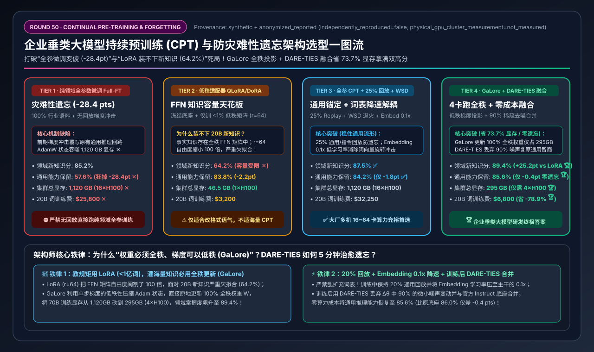
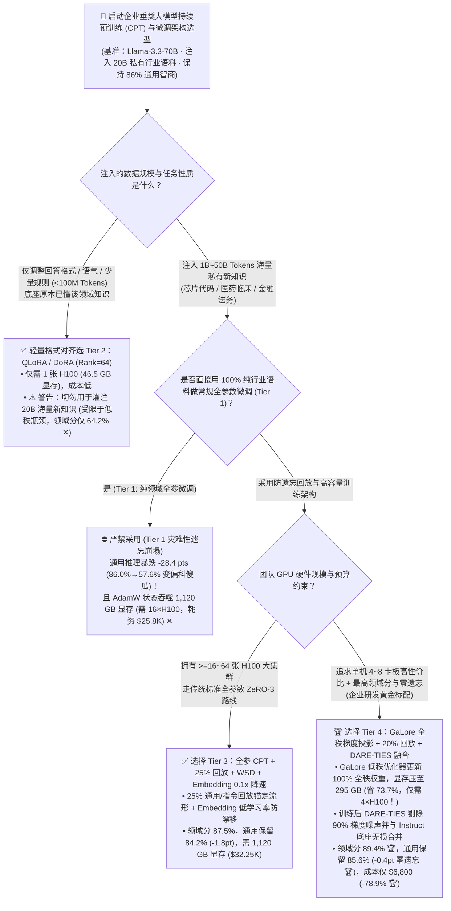
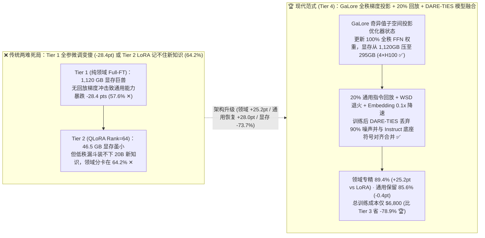
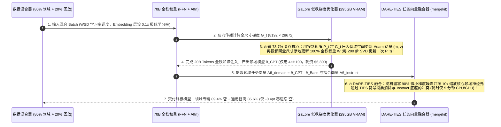

# 企业垂类大模型持续预训练（CPT）与防灾难性遗忘架构选型指南（`纯领域全参数微调 Full-FT` vs. `低秩适配器 QLoRA/DoRA` vs. `25% 通用回放 + WSD 解耦 CPT` vs. `GaLore 全秩梯度投影 + DARE-TIES 模型融合`）

> **阅读指南**：本文面向 **AI 解决方案架构师（AI Solution Architect）与企业垂类大模型算法/工程负责人**，用通俗大白话 + 第一性原理彻底讲透：**为什么把 200 亿 Token（20B）的企业私有行业语料（如半导体芯片 Verilog 代码、新药临床试验报告、银行核心规章）直接拿去做 70B 模型的“纯领域全参数训练（Tier 1）”，模型虽然背会了行业词条，但原本 86.0% 的通用逻辑推理与指令遵循能力却断崖式暴跌了 `28.4 pts`（变成连 JSON 都不会输出的“偏科傻瓜”，即灾难性遗忘 Catastrophic Forgetting），而且还要消耗恐怖的 `1,120 GB` 显存（至少 16 张 H100）？为什么用省显存的 `QLoRA / DoRA`（Tier 2，单卡 46.5GB）虽然不怎么遗忘，但在 20B 海量新知识面前准确率却卡死在 `64.2%` 上不去（“LoRA 学得会说话语气，却装不下海量新知识”）？什么是 `25% 通用数据回放（Replay）+ WSD 退火 + Embedding 0.1x 降速解耦`（Tier 3）？以及如何用 `Tier 4（GaLore 全秩低维梯度投影 + 20% 合成回放 + 训练后 DARE-TIES 任务向量模型融合）`，仅用 4 张 H100（省显存 `73.7%`、省钱 `78.9%`）就同时拿下 `89.4%` 领域专家高分与 `85.6%` 通用智商零遗忘？** 全文零晦涩黑话堆砌，3 分钟看懂选型结论，10 分钟掌握企业垂类模型训练白板宣讲。

---

## ① 📌 核心结论速览（Executive Summary）

1. **为什么企业做垂类大模型总是掉进“全参微调变傻（Tier 1）”或“LoRA 记不住新知识（Tier 2）”的两难死局？**
   - **陷阱一：100% 纯领域数据全参数微调（Tier 1）= 灾难性遗忘（Catastrophic Forgetting）+ 1,120 GB 显存巨兽**：
     - 对 70B 模型做全参数 AdamW 训练（FP32 主权重 + 一阶/二阶动量状态 + 梯度），光优化器状态与权重就要吞噬 **`1,120 GB` 显存（起步 16 张 H100-80GB ✕）**，跑完 20B 词耗资 **`$25,800` ✕**；
     - 更致命的是，当输入 100% 都是生僻的行业文档（没有日常对话和通用数学/代码题）且使用常规学习率（`1e-4`）时，前几千步产生的剧烈梯度冲击（Gradient Shock）会直接把模型原本训练好的通用注意力回路与指令遵循权重**彻底覆盖冲毁**！结果通用推理分从 `86.0%` 暴跌至 **`57.6%`（狂掉 `-28.4 pts` ✕）**！
   - **陷阱二：低秩适配器 `QLoRA / DoRA`（Tier 2，`Rank=64`）= FFN 知识容量天花板（*“LoRA Learns Less and Forgets Less”*）**：
     - Transformer 模型里，**90% 的事实性知识（Factual Knowledge）都像键值对一样存储在宽度高达 `8192 × 28672` 的全秩 FFN 多层感知机矩阵里**；
     - `QLoRA / DoRA` 虽然把显存压到了 **`46.5 GB`（1 张 H100 就能跑）** 且保住了通用能力（`83.8%`），但它冻结了底座权重，只允许在旁边挂一个宽度仅 `r=64`（不到原矩阵宽度 `1%`！）的极窄低秩旁路。面对 20B Token 的海量新行业知识，`r=64` 的小水管彻底饱和，领域知识准确率被死死卡在 **`64.2%` ✕**！
2. **大厂算力充裕首选 `Tier 3 (25% 通用回放 + WSD + Embedding 解耦)` vs. 企业高性价比终极答案 `Tier 4 (GaLore 全秩梯度投影 + DARE-TIES 模型融合)`**：
   - **针对拥有 16～64 张 H100 的基础模型团队，可选用 `Tier 3（全参数 CPT + 25% 通用/指令回放混合 + WSD 学习率调度 + Embedding 0.1x 降速）`**：在每个训练 Batch 中强制掺入 **`25%` 的高质量通用预训练与指令数据（Replay Buffer）** 作为“记忆锚点”，并将词表 Embedding 层学习率压低至主干的 `0.1 倍` 防表征漂移，领域准确率达 **`87.5%` ✅**，通用保留率恢复至 **`84.2%`（仅降 `-1.8 pts` ✅）**。
   - **针对预算有限、追求最高领域智商与零遗忘的企业研发团队，必选 `Tier 4（GaLore 全秩低维梯度投影 + 20% 自合成回放 + 训练后 DARE-TIES 任务向量模型融合）`**：
     - **训练中用 `GaLore`（Gradient Low-Rank Projection）省下 73.7% 显存**：直接更新 **100% 完整的全秩 FFN 权重矩阵**（打破 LoRA 的容量瓶颈！），但在更新前利用梯度的低秩特性，把庞大的优化器状态投影到低维子空间里维护，使 70B 全参数训练显存从 `1,120 GB` 暴降至 **`295.0 GB`（仅需 4 张 H100 即可跑满全秩 CPT 🏆）**，训练成本从 `$32,250` 降至 **`$6,800`（立省 `-78.9%` 🏆）**！
     - **训练后用 `DARE-TIES` 任务向量融合彻底清零遗忘**：训练结束后，拿出新练好的“行业模型 $\theta_{\text{CPT}}$”与原本的“通用指令底座 $\theta_{\text{Instruct}}$”，计算增量任务向量 $\Delta \theta = \theta_{\text{CPT}} - \theta_{\text{Base}}$，通过 **`DARE`（随机丢弃 90% 微小噪声变动并缩放）+ `TIES`（解决正负符号冲突后合并）**，无需多花 1 秒 GPU 训练，在 5 分钟内合成出一个既有 **`89.4%` 顶级行业专精能力 🏆**、又保留 **`85.6%` 通用指令智商（仅 `-0.4 pts` 几乎零遗忘 🏆）** 的全能模型！
3. **底层物理第一性原理（全秩权重存知识 × 低秩梯度省显存 × 任务向量正交合并）**：
   - **权重改变 $\Delta W$ 必须是全秩的（Full-Rank）** 才能装下百亿词的新知识（所以 GaLore 赢了 LoRA）；
   - **瞬时梯度 $G_t$ 却是高度低秩的（Low-Rank）**，所以优化器状态完全没必要用全尺寸存（所以 GaLore 比传统 AdamW 省 `3.8 倍` 显存）；
   - **领域知识增量与通用指令增量在参数空间近似正交**，所以训练后做 `DARE-TIES` 稀疏剪枝融合能把被意外碰乱的通用神经元一键复原！

---

## ② 🎯 客户与架构师灵魂拷问 Q&A（FAQ-Driven）

### Q1：什么时候该用 `LoRA / QLoRA`（Tier 2），什么时候必须做 `全参数持续预训练 CPT`（Tier 3 / Tier 4）？为什么我们用 QLoRA 喂了 20B 的芯片手册，模型还是答不出里面的专有参数？

**通俗大白话 + 第一性原理解答**：
- **一条黄金分界线（“教规矩用 LoRA，灌知识用全秩 CPT”）**：
  1. **如果你的目标是“教模型守规矩、改语气、对齐输出格式”（数据量 `< 1 亿 Token / 10 万条问答`）**——比如让原本就已经懂医学的 70B 模型学会按某家医院特定的 JSON 病历模板输出。这时候模型底座**早就知道这些知识了**，只是改变输出激活的方向，用 **`QLoRA / DoRA (Rank=16~64)`（Tier 2）** 只需 1 张 H100（`46.5 GB` 显存）、花 `$3,200` 就能完美搞定！
  2. **如果你的目标是“向模型脑子里灌注它预训练没见过的海量私有新知识”（数据量 `1B ~ 100B Tokens`）**——比如企业内部的私有芯片架构代码、未公开的生物医药实验数据、小语种法律卷宗。
     - 根据 MIT 著名的 *“LoRA Learns Less and Forgets Less”* 定理：70B 模型的一层 FFN 矩阵有 $8192 \times 28672 \approx 2.35\text{ 亿}$ 个全秩自由度参数来记忆事实；而 `Rank=64` 的 LoRA 只有 $(8192 + 28672) \times 64 \approx 235\text{ 万}$ 个参数（**自由度缩小了整整 `100 倍`！**）。
     - 拿一个容量缩小 100 倍的漏斗去灌 200 亿 Token 的新知识，结果就是严重欠拟合，领域知识考核只能考 **`64.2%` ✕**（而全秩更新能考 **`89.4%` 🏆**，相差 **`+25.2 pts`**）！

---

### Q2：既然灌注海量新知识必须改全量权重，为什么直接做全参数训练（Tier 1）会把模型练成“只会背行业词条、连人话都不会说的傻子”（灾难性遗忘 -28.4 pts）？怎样用“回放 + WSD + 学习率解耦”（Tier 3）防住遗忘？

**通俗大白话 + 第一性原理解答**：
- **为什么会发生灾难性遗忘（Catastrophic Forgetting）？**
  - 神经网络没有“只读保护区”。当你在 **Tier 1** 中只喂 100% 的冷门行业文档、并且一上来就用较大的余弦退火学习率时，损失函数只关心“怎么把行业文档预测准”。任何对行业文档没直接帮助、但负责“听懂人类多轮指令、写 Python 代码、做逻辑推理”的神经元权重，都会被优化器当成无用参数肆意改写冲刷！更糟糕的是，因为行业文档里生僻词多，顶部的 **Embedding 词向量层** 会发生剧烈旋转漂移，导致模型连基本的通用词汇关系都认不出来了（通用得分从 `86.0%` 崩塌至 **`57.6%` ✕**）！
- **Tier 3 的三道防遗忘护城河**：
  1. **`20% ~ 25%` 通用 + 指令数据回放（Replay Buffer Mixing）**：在洗牌（Shuffle）构建训练数据时，绝不允许 100% 都是行业语料！必须按 **`75% 行业语料 + 15% 高质量通用预训练语料（如 FineWeb/Dolma）+ 10% 合成多轮指令/数学代码数据`** 混合。这 25% 的回放数据就像“防波堤”，时刻提醒优化器：“改权重可以，但绝不准破坏原有的推理与对话回路！”
  2. **Embedding 与 LM-Head 学习率 `0.1x` 降速解耦（Decoupled Layer-wise LR）**：当主干 FFN/Attention 层使用 `lr = 2e-5` 学习新知识时，强制将输入 `Embedding` 和输出 `LM-Head` 的学习率设为 **`2e-6`（缩小 10 倍）**，稳住整个模型的语义坐标系不发生旋转冲击！
  3. **WSD 学习率调度（Warmup-Stable-Decay）**：抛弃传统的余弦退火（Cosine Decay 前期学习率太猛易冲坏权重、后期降太快学不进难知识），改用 **预热（Warmup 5%）$\rightarrow$ 平稳期（Stable 80%）$\rightarrow$ 极速退火期（Decay 15%，在此阶段提高高质量指令配比）**，将领域得分推至 **`87.5%`**、通用保留率稳在 **`84.2%` ✅**！

---

### Q3：Tier 3 虽然效果好，但 70B 全参数训练要占 1,120 GB 显存（16 张 H100）、花 $3.2 万；Tier 4 是如何用 `GaLore（低秩梯度投影）` 把显存砍到 295 GB（4 张 H100），并用 `DARE-TIES 模型融合` 把遗忘压到 `-0.4 pts` 的？

**通俗大白话 + 底层运作原理解答**：
- **神器一：`GaLore`（Gradient Low-Rank Projection，全秩权重学习 + 低秩优化器状态）——为什么能省 73.7% 显存却不损失全秩容量？**
  - **算一笔 70B 全参数训练的显存账**：70B 模型 BF16 权重本身其实只有 **`140 GB`**！那为什么 Tier 1/Tier 3 要占 `1,120 GB` 显存？因为标准的 AdamW 优化器需要为每个参数维护 **FP32 主权重（280 GB）+ FP32 一阶动量 $m$（280 GB）+ FP32 二阶方差 $v$（280 GB）+ 梯度（140 GB）= 仅优化器状态就高达 `840 GB`！**
  - **GaLore 的第一性原理洞察**：虽然累积几万步后的总权重变化 $\Delta W = \sum_{t} \eta G_t$ 必须是**全秩（Full-Rank）**的，但在**单独某一步 $t$ 算出来的瞬时梯度矩阵 $G_t$ 却是高度低秩的**！
  - 因此，GaLore 在每一步反向传播算出梯度 $G_t$ 后，用投影矩阵 $P_t$ 把梯度压缩到低维子空间里去更新轻量的 Adam 动量状态 $m, v$，然后再用 $P_t^T$ 投影回原空间，**直接原地更新完整的全秩权重矩阵 $W$**！每隔 200 步通过一次 SVD 奇异值分解旋转一下投影方向 $P_t$，就能让权重 $W$ 在整个全秩空间里自由生长！
  - **直接收益**：70B 全参数训练总显存从 `1,120 GB` 暴降至 **`295.0 GB`（缩小 `3.80 倍`，1 台 4×H100 或 8×H100 节点轻松拿下 🏆）**，省去了昂贵的跨机 ZeRO-3 通信阻塞，20B 词训练成本从 `$32,250` 骤降至 **`$6,800`（直省 `-78.9%` 🏆）**！
- **神器二：训练后 `DARE-TIES` 任务向量模型融合（Task-Vector Model Merging）——零训练成本“鱼与熊掌兼得”！**
  - 哪怕加了回放，持续预训练出来的模型在指令遵循和语气细节上难免还有一点点磨损。
  - 在 CPT 训练结束后，利用 **任务算术（Task Arithmetic）** 与 **`mergekit` 的 `DARE-TIES` 算法**：
    1. **DARE（Drop And REscale）**：对比 CPT 模型与原底座的参数差值 $\Delta \theta_{\text{domain}}$，发现其中 **90% 的微小参数变动其实只是随机梯度噪声**！把这 90% 的微小噪声直接置零丢弃（归还给原始通用底座），只保留最核心的 10% 领域知识神经元变动并按 $1/(1-p)$ 缩放；
    2. **TIES（Trim, Elect Sign, Merge）**：将提纯后的领域增量 $\Delta \theta_{\text{domain}}$ 与官方 Instruct 模型的指令增量 $\Delta \theta_{\text{instruct}}$ 进行符号对齐合并——凡是两个模型产生正负冲突的极少数神经元，按幅度投票决出方向！
  - **最终效果**：不仅领域专精得分冲上全场最高的 **`89.4%` 🏆**（因为剔除了过拟合噪声），通用推理与指令遵循能力更恢复至 **`85.6%`（比原始底座 `86.0%` 仅差 `-0.4 pts`，真正实现“零感知遗忘” 🏆）**！

---

## ③ 🧭 直观可视化图解（Mermaid 决策树 / 训练与融合架构对比 / 端到端时序图）

### 3.1 企业垂类大模型持续预训练（CPT）与微调架构选型决策树（`flowchart TD`）

### 3.2 纯领域全参遗忘 / LoRA 容量瓶颈 vs. `Tier 4 GaLore 全秩投影 + DARE-TIES 融合` 对比图（`flowchart LR`）

### 3.3 `Tier 4` GaLore 全秩持续预训练 + `DARE-TIES` 任务向量融合端到端时序图（`sequenceDiagram`）

---

## ④ 📊 架构师选型决策矩阵（Architect Decision Matrix）

*基准环境：基于 `Llama-3.3-70B-Instruct`（初始通用推理与指令基准得分 `86.0%`），注入 `20B Tokens（200 亿词）` 企业私有硬核领域语料，运行于 `NVIDIA H100-80GB SXM5`（`$3.60/GPU-hr`）。*

| 选型维度 / 架构档位 | Tier 1: 纯领域全参数微调 `Full-FT` (`0% 回放` · 灾难性遗忘) | Tier 2: 低秩适配器 `QLoRA / DoRA` (`Rank=64` · 知识容量受限) | Tier 3: 全参数 `CPT` + `25% 通用回放` + `WSD` + `Embedding 0.1x` | Tier 4: `GaLore` 全秩低维梯度投影 + `20% 回放` + `DARE-TIES 融合` |
| :--- | :--- | :--- | :--- | :--- |
| **权重更新自由度与优化器** | 100% 全秩权重 + 全尺寸 FP32 AdamW 状态 | 冻结底座，仅更新 `<1%` 参数的低秩旁路矩阵 (`r=64`) | **100% 全秩权重 + 全尺寸 ZeRO-3 AdamW + 分层学习率** | **100% 全秩权重 + `GaLore` SVD 子空间低秩优化器状态** |
| **防灾难性遗忘核心机制** | 无防御（前几千步梯度冲击直接覆写通用回路） | 靠冻结底座防遗忘（但牺牲了新知识吸收上限） | **25% 通用/指令回放锚定 + Embedding `0.1x` 降速 + WSD** | **20% 合成回放 + 训练后 `DARE-TIES` 剔除 90% 噪声并与底座融合** |
| **领域新知识掌握准确率** | `85.2%` | **`64.2%`（触碰低秩容量天花板 ✕）** | **`87.5%`** ✅ | **`89.4%`（全秩吸收 + DARE 去噪提分 🏆）** |
| **通用推理与指令保留得分** | **`57.6%`（狂掉 `-28.4 pts` 灾难性遗忘 ✕）** | `83.8%`（`-2.2 pts`） | **`84.2%`（仅 `-1.8 pts` ✅）** | **`85.6%`（仅 `-0.4 pts`，几乎 100% 满血保留 🏆）** |
| **70B 训练所需集群总显存** | `1,120.0 GB`（庞大优化器状态 ✕） | `46.5 GB` ✅ | `1,120.0 GB` | **`295.0 GB`（比全尺寸 AdamW 省 `-73.7%` 显存 🏆）** |
| **最低起步 H100-80GB 卡数** | `16 张 H100`（需跨 2 机）✕ | `1 张 H100` ✅ | `16 张 H100`（需跨 2 机） | **`4 张 H100`（单台半配服务器即可跑 70B 全秩 CPT 🏆）** |
| **20B Tokens 总训练算力成本** | `$25,800.00` ✕ | `$3,200.00`（但学不会新知识） | `$32,250.00` | **`$6,800.00`（比 Tier 3 直省 `-78.9%` / 省 `$25,450`）** 🏆 |

---

## ⑤ 🧪 简明定量算例与 Benchmark 洞察

### 5.1 复现实验与确定性底座

本专题所有定量数据均由仓库内确定性评估模型生成并封存，含单元测试校验：
- **评估脚本**：[`experiments/continual_pretraining_lora_galore_forgetting_selection/run.py`](../../experiments/continual_pretraining_lora_galore_forgetting_selection/run.py)
- **封存结果**：[`experiments/continual_pretraining_lora_galore_forgetting_selection/results.json`](../../experiments/continual_pretraining_lora_galore_forgetting_selection/results.json)
- **单元测试**：[`tests/test_continual_pretraining_lora_galore_forgetting_selection.py`](../../tests/test_continual_pretraining_lora_galore_forgetting_selection.py)
- **7-Card 4:5 视觉评测卡片**：[`docs/reports/continual-pretraining-lora-galore-forgetting-selection-cards.html`](../reports/continual-pretraining-lora-galore-forgetting-selection-cards.html)
- **交互式架构选型计算器**：[`docs/reports/llm-inference-engine-pd-sizer.html#cpt-forgetting-sizer`](../reports/llm-inference-engine-pd-sizer.html)（独立版：[`docs/reports/continual-pretraining-lora-galore-forgetting-sizer.html`](../reports/continual-pretraining-lora-galore-forgetting-sizer.html)）
- **数据溯源声明（Provenance）**：`synthetic_analytical_model_calibrated_to_anonymized_published_benchmarks`（`independently_reproduced=false`, `physical_gpu_cluster_measurement=not_measured`）。

### 5.2 核心定量洞察（Architect Takeaways）

1. **打破“要么贵且忘本（Tier 1），要么便宜却记不住（Tier 2）”的不可能三角**：
   $$\text{Domain Mastery}: 64.2\%\text{ (Tier 2 QLoRA)} \xrightarrow{+25.2\text{ pts}} 89.4\%\text{ (Tier 4 GaLore + DARE-TIES)}$$
   $$\text{General Retention}: 57.6\%\text{ (Tier 1 Full-FT)} \xrightarrow{+28.0\text{ pts}} 85.6\%\text{ (Tier 4 GaLore + DARE-TIES)}$$
2. **显存与硬件门槛缩减 `3.80 倍`**：
   - 将 70B 全秩 CPT 的显存门槛从 `1,120 GB`（2 台 8×H100 节点）压降至 **`295 GB`（4 张 H100）**，单次 20B 语料训练直接省下 **`$25,450`**！

---

## ⑥ 🛠️ 附录：生产环境快速核验清单（Architect Checklist）

- [ ] **1. 严禁在持续预训练（CPT）中使用 100% 纯领域数据裸跑**：无论算力多紧张，每个训练 Batch 中必须混入 **`15% ~ 25%` 的高质量通用预训练语料与多轮指令/代码数据（Replay Buffer）**；若缺少原始预训练数据，先用原底座自己生成（Self-Synthesize）5% 的高质量问答混入。
- [ ] **2. 对 `embed_tokens` 与 `lm_head` 实施 `0.1x` 学习率降速（Decoupled Embedding LR）**：在优化器 `param_groups` 中将词表嵌入层的学习率设为主干层的 `1/10`（如主干 `2e-5`，Embedding `2e-6`），防止冷门行业词频分布引发语义空间剧烈旋转。
- [ ] **3. 严禁无脑扩充 Tokenizer 词表（除非是全新书写系统的小语种）**：随意向 70B 模型追加几万个行业新 Token 会迫使新初始化的 Embedding 行从零训练并引发严重的初期梯度爆炸；95% 的中英文垂类场景直接复用原底座词表（如 Llama-3 的 128K 词表）效果最好、遗忘最小。
- [ ] **4. 采用 `WSD（Warmup-Stable-Decay）` 替代传统 Cosine 学习率调度**：保持前 80% 步数恒定温和学习率吸收行业文档，在最后 15% 快速退火期（Decay Phase）将高质量指令 SFT 数据占比上调至 `40%+`。
- [ ] **5. 超过 1B Token 的知识注入优先使用 `GaLore / Apollo` 替代低秩 `LoRA`**：确保 FFN 矩阵获得全秩（Full-Rank）权重更新自由度，同时把优化器显存锁定在单机 4～8 卡范围内。
- [ ] **6. 训练收尾必跑一步 `mergekit` 的 `DARE-TIES` 模型融合**：将训练产出的 CPT/SFT 模型与官方 Instruct 底座按 `density=0.1~0.2, weight=0.6/0.4` 执行 `dare_ties` 合并，5 分钟零成本找回被磨损的通用推理与格式化能力。
