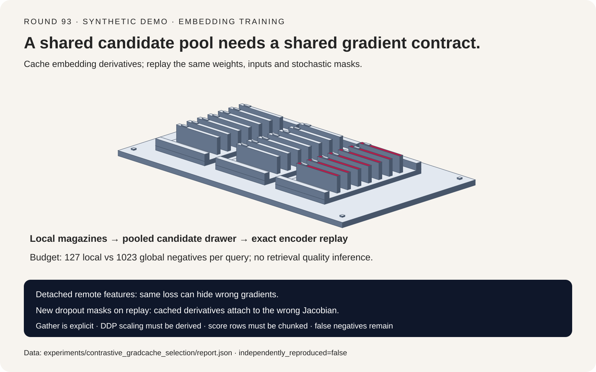
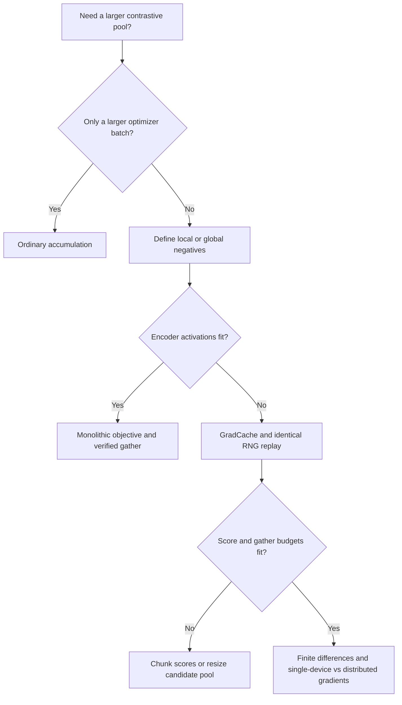
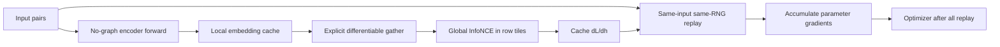
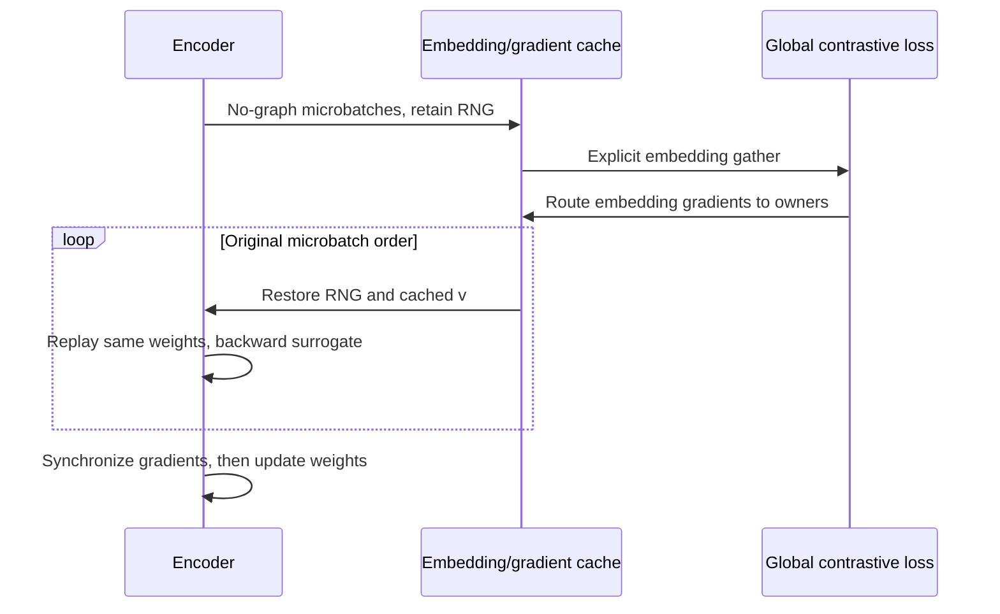

# Contrastive embedding training FAQ: global negatives, differentiable All-Gather and exact GradCache replay

> **Language**: [中文](contrastive-embedding-global-negatives-gradcache-selection-faq.md) | English
>
> **Round 93 · 2026-11-14 (second round of the November 13 night)** · [SVG](../../assets/svg/contrastive-embedding-global-negatives-gradcache-selection-faq-summary.svg) · [7-card report](../reports/contrastive-embedding-global-negatives-gradcache-selection-cards.html) · [H5 workbench](../reports/contrastive-embedding-global-negatives-gradcache-sizer.html) · [Sealed data](../../experiments/contrastive_gradcache_selection/report.json)
>
> **`synthetic` · `independently_reproduced=false`**: original numerical toy and budget formulas only. No embedding model training, retrieval-quality result, GPU latency or measured peak-HBM claim.



## 1. Executive summary: gradient accumulation does not pool softmax negatives

**A larger optimizer batch, a larger InfoNCE candidate set and lower encoder
activation memory solve different problems.** Ordinary accumulation delays the
optimizer step. If each microbatch computes its own softmax, it does not add
other microbatches' documents to that denominator. DDP synchronizes parameter
gradients; it does not automatically gather embeddings for the loss.

| Need | Engineering mechanism | Invalid assumption |
| :--- | :--- | :--- |
| More samples per optimizer step | Gradient accumulation | Each query sees all accumulated negatives |
| Cross-device negatives | Explicit differentiable embedding gather and label offsets | DDP already gathered them |
| Global objective with limited activation memory | No-graph encoding, embedding gradients, encoder replay | Entire memory is constant or compute becomes free |
| Score matrix still too large | Query-row chunking with correct softmax/backward | Encoder microbatching removes quadratic score cost |
| Duplicate or equivalent positives | Deduplication, multi-positive policy, quality evaluation | More negatives always improve retrieval |

The default budget uses eight workers, 128 local pairs and dimension 768:
negatives per query grow from `127` local to `1,023` global. That is a count,
not an accuracy gain. Assuming `64 MiB` encoder activations per pair, replay
microbatch eight and score tile sixteen rows, the **incomplete memory proxy**
shrinks `15.72×`. Assumed forward cost `0.5 ms/pair` and backward `1 ms/pair`
make the extra forward increase compute by `33.33%`, not reduce it.

Unlike the earlier [embedding/reranker serving FAQ](embedding-reranker-serving-hardware-engine-selection-faq.en.md),
this topic concerns training objectives and backward graphs, not online vector
indexing or inference throughput. It follows the night's verified open-infra
efficiency theme, but GradCache dates to 2021; it is not presented as a new
algorithm or an unaudited popularity winner.

## 2. Architect Q&A: how can equal loss values hide unequal gradients?

### Q1: Why is ordinary gradient accumulation not one large contrastive batch?

For `N` query/document pairs, one-way InfoNCE is:

```text
s_ij = dot(q_i, d_j) / temperature
L = (1/N) sum_i [-s_ii + log(sum_j exp(s_ij))]
```

Every query in the large objective sees the same candidate set. Separate
microbatch losses use smaller, different sums over `j`; averaging their
gradients cannot reconstruct missing cross-microbatch softmax probabilities.
This changes the **objective**, not merely a constant learning-rate scale.

In the original four-pair, two-dimensional toy, global loss is `0.617097`;
the average of two local objectives is `0.128750`. Lower local loss does not
mean a better model: fewer negatives make a different, easier objective.
Its parameter gradient differs from the global finite-difference reference
by `25.42%`.

### Q2: Why not detach remote embeddings and reconnect only the local slice?

A document is both its own query's positive and a candidate for other queries.
Contributions from remote query rows must reach that document's encoder:

```text
dL/dq_i = sum_j (p_ij - 1[i=j]) d_j / (N temperature)
dL/dd_j = sum_i (p_ij - 1[i=j]) q_i / (N temperature)
```

When each rank computes local query rows and detaches remote candidates,
reconnecting its own document slice still omits other ranks' query
contributions to its documents. **Forward loss can remain identical while
backward is wrong.**

The local control keeps loss `0.617097` but has `45.18%` parameter-gradient
relative error. The differentiable global analytical path differs from the
independent central-difference derivative by about `1.04e-10` absolute error.
This tests the original toy, not every framework's gather implementation.

### Q3: Does differentiable All-Gather require multiplying loss by world size?

Do not multiply blindly. Derive normalization jointly from **per-rank loss
reduction, SUM versus AVG in gather backward, whether queries/candidates both
pass through gather, and DDP parameter-gradient averaging**.

In a typical equal-shard arrangement, each rank computes the mean of local
query rows; differentiable gather sums embedding-gradient contributions back
to owners; DDP then averages parameter gradients. Together these can already
produce the global mean objective. Another factor of `W` can over-scale it.
Some implementations gather candidates only, so a missing factor on one
branch cannot always be repaired by scaling the entire loss.

Unequal shards need sample weighting and prefix-sum label offsets, not a
universal `rank × local_batch + index`. The toy covers equal logical shards,
not real DDP, asynchronous streams or uneven collectives.

The pinned Sentence Transformers implementation defaults
`gather_across_devices` to **`False`**. Only enabling it explicitly invokes
`all_gather_with_grad`; constructing a DDP Trainer does not establish that
the option is enabled.

### Q4: How do the three GradCache passes preserve the large-batch gradient?

1. **No encoder graph:** encode microbatches, retain embeddings and each microbatch's RNG context, discard full encoder activations.
2. **Global loss to embedding derivatives:** calculate the pooled objective and cache `v_i = dL/dh_i`; chunk score rows to avoid keeping the entire score matrix live.
3. **Exact encoder replay:** re-encode identical inputs with identical weights and randomness; backpropagate the surrogate `dot(h_replay, stop_gradient(v))`; update parameters only after all replay chunks.

This is the chain rule, not stale-feature training. Changing replay dropout
attaches an old embedding derivative to a different encoder Jacobian.
Updating weights between passes similarly changes the function being
differentiated.

BatchNorm cross-sample statistics, mutable buffers, random augmentation,
dynamic token packing and stateful modules can violate the conditions.
RNG snapshots are not a universal proof for arbitrary models. The pinned
implementation also propagates outer `grad_output`, accumulation and
gradient-scaler factors; custom replay must not lose those scales.

### Q5: Does caching make total memory independent of batch size?

Only **encoder activation memory** is primarily controlled by replay
microbatch size. Embeddings and embedding gradients still grow with the
candidate pool. A score matrix can cost `O(b_local × N_global)` per rank,
with quadratic aggregate all-pairs work. A query tile of `c` rows reduces the
live score tile to `O(c × N_global)` but does not remove total work or
softmax temporaries.

Gather forward/backward also require network, collective buffers and
synchronization. The budget conservatively counts two global embedding
groups plus FP32 embedding gradients; actual implementation lifetimes may
retain different replica counts.

Larger pools can contain false negatives: duplicate text, equivalent answers
or related passages from the same document. A local no-duplicates sampler
does not prove global cross-rank deduplication. Multi-positive objectives
change the label/gradient contract and require separate verification.

## 3. Visual architecture: selection tree, three passes and replay sequence







## 4. Selection matrix and fit boundaries

| Path | Negative scope | Memory/compute | Reference conclusion |
| :--- | :--- | :--- | :--- |
| Small batches plus accumulation | Each microbatch only | Low activation memory, no extra replay | Not an equivalent large-pool objective |
| Global candidates with remote detach | Apparently global candidates | Missing candidate-side backward paths | Same loss does not prove correct gradients |
| Monolithic global loss with differentiable gather | Explicit global pool | Full activations and score costs | Gradient reference under correct normalization |
| Exact GradCache replay | Same as global reference | Lower activations, extra forward and caches | Preserves chain rule when conditions hold |
| Replay with new masks or weights | Reported loss may remain the old value | Cached derivative and Jacobian mismatch | Reject an “exact” label |

Production A/B holds pair count, candidate pool, temperature, direction,
sampling/deduplication, optimizer and evaluation data fixed. The toy verifies
one-way dot-product InfoNCE, not measured cosine normalization, symmetric
CLIP loss or multi-column hard-negative training.

## 5. Worked example and seven cards: verify gradients, keep quality unknown

The numerical model is `mask × tanh(theta × input)` with one shared scalar
parameter, four pairs and two-dimensional representations. Each analytical
embedding derivative is checked coordinate-wise against central differences;
the parameter derivative is independently checked against full-loss finite
differences.

| Path, seed 3 | Relative parameter-gradient error | Conclusion |
| :--- | ---: | :--- |
| Global differentiable analytical path | `<0.000001%` | Within `1e-8` absolute-error tolerance |
| Detached remote candidates | `45.18%` | Same loss, wrong gradient |
| Independent local-negative accumulation | `25.42%` | Different objective |
| Cached replay with identical masks | `<0.000001%` | Matches global reference |
| Changed replay masks | `22.03%` | Cached derivative/Jacobian mismatch |

The separate budget does **not** present the toy's Python runtime as GPU
latency:

```text
N = local_batch × workers
global_negatives_per_query = N - 1
cache_bytes = 2 × N × dimension × (embedding_bytes + 4)
dense_score_bytes = 4 × local_batch × N
score_tile_bytes = 4 × score_rows × N
monolithic_compute = local_batch × (F + B)
cached_compute = local_batch × (2F + B)
```

The two embedding groups are queries/documents; `+4` assumes FP32 embedding
gradients. Activation cost is already per query/document pair, avoiding an
extra factor of two. Model/optimizer memory, collective buffers, allocator
and softmax temporaries are excluded: this is **not a peak-HBM bound**.
The H5 exposes every assumption and rejects invalid input explicitly.

The cards show overview, equal loss/wrong gradient, five-path matrix,
chain-rule protocol, dropout perturbation, extra-forward compute and fit
boundaries. Every error, bar, denominator and time binds to `report.json`.
Retrieval quality and communication latency remain `null`; no invented
Recall, confidence or production approval rate is supplied.

```powershell
python -m experiments.contrastive_gradcache_selection.run --check
python -m unittest tests.test_contrastive_gradcache_selection
```

The static deck has a strict self-contained CSP and no scripts or network
requests. The H5 separately permits inline JavaScript. No third-party fonts,
models or datasets are loaded.

## 6. Production pre-flight checklist and pinned sources

- **Define the objective:** local/global candidates, one-way/symmetric loss, temperature, hard negatives and duplicate policy.
- **Check actual gather settings:** the pinned default is `False`; do not infer candidate scope from GPU count.
- **Verify parameter gradients:** compare a tiny single-device global reference to distributed execution, not just scalar loss; include detached controls and uneven final batches.
- **Derive normalization:** reconcile local mean, gather backward, DDP average, scaler and accumulation without duplicated world-size factors.
- **Control replay:** preserve inputs, weights, RNG, token packing and mutable buffers; no optimizer update between passes.
- **Measure real memory/latency:** distinguish activations, embedding cache, score tiles, collective temporaries and communication; this workbench is a budget only.
- **Evaluate quality and false negatives:** check Recall/MRR and cross-rank deduplication; surface protocol/non-finite failures rather than continuing with empty gradients.

Sources verified November 14, 2026 BJT. The fixed commit is the one linked by
the official documentation:

| First-party source | Read scope | Purpose |
| :--- | :--- | :--- |
| [CachedMNRL](https://github.com/huggingface/sentence-transformers/blob/cddcaee3405a5efde83c1d98f89c6ebd6733dab6/sentence_transformers/sentence_transformer/losses/cached_multiple_negatives_ranking.py) | Default L34, three phases L55–57, gather L254–260 | Explicit pool switch, differentiable gathering and score chunks |
| [GradCache mixin](https://github.com/huggingface/sentence-transformers/blob/cddcaee3405a5efde83c1d98f89c6ebd6733dab6/sentence_transformers/base/losses/gradcache.py) | RNG L33–63, replay hook L313–410, passes L485–547 | RNG, embedding gradients, outer scaling and replay |
| [GradCache paper v2](https://arxiv.org/abs/2101.06983v2) | Abstract and method motivation | Established method context; paper benchmarks not reproduced |
| [Official loss docs](https://sbert.net/docs/package_reference/sentence_transformer/losses.html) | Public API and linked fixed source | Version discovery, not local performance evidence |

Sentence Transformers retains Apache-2.0 and associated rights; the paper
retains its authors' rights. Only links and original analysis are included,
not mirrored code, paper text, figures or models. No repository-wide license
is added. Related: [embedding/reranker serving](embedding-reranker-serving-hardware-engine-selection-faq.en.md),
[activation recomputation](activation-checkpointing-selective-recompute-host-offload-selection-faq.en.md),
[DDP communication compression](ddp-gradient-compression-powersgd-error-feedback-selection-faq.en.md).
