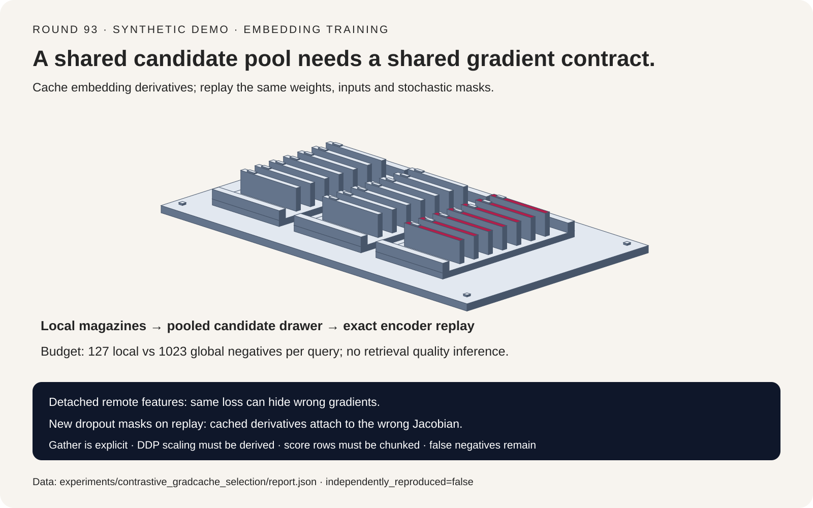
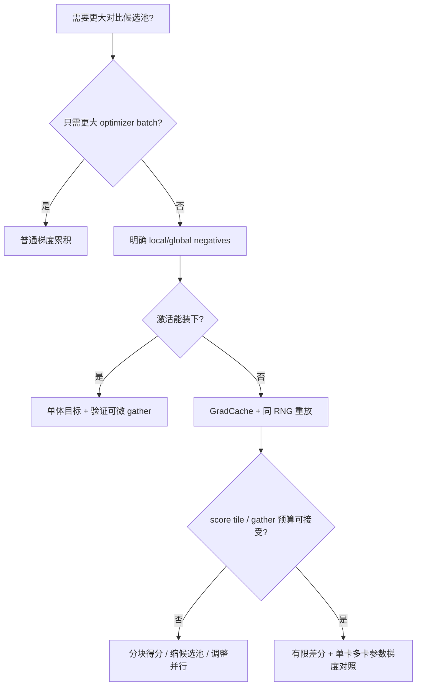
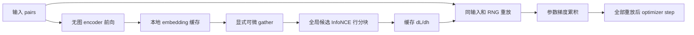
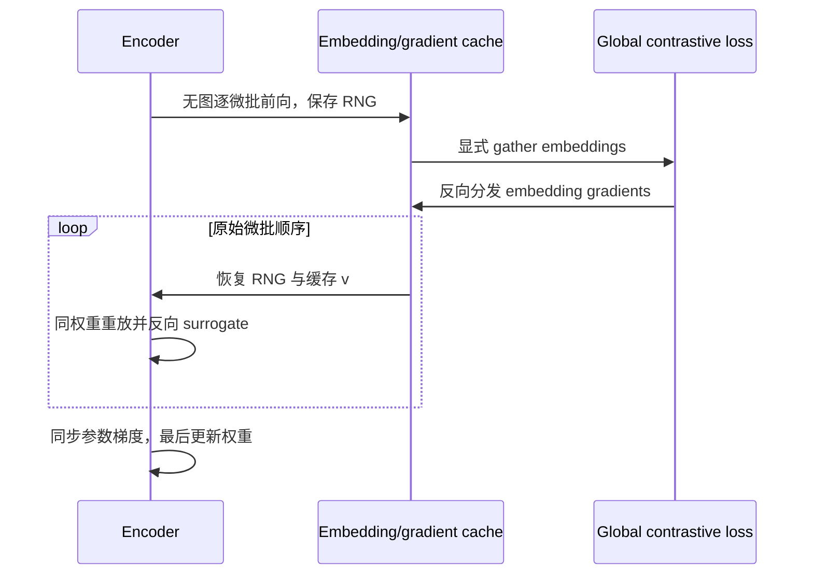

# 对比式 Embedding 训练选型 FAQ：全局负样本、可微 All-Gather 与 GradCache 精确重放

> **语言**：中文 | [English](contrastive-embedding-global-negatives-gradcache-selection-faq.en.md)
>
> **Round 93 · 2026-11-14（11-13 夜班第 2 轮）** · [高清 SVG](../../assets/svg/contrastive-embedding-global-negatives-gradcache-selection-faq-summary.svg) · [7-Card 报告](../reports/contrastive-embedding-global-negatives-gradcache-selection-cards.html) · [交互 H5](../reports/contrastive-embedding-global-negatives-gradcache-sizer.html) · [封存数据](../../experiments/contrastive_gradcache_selection/report.json)
>
> **`synthetic` · `independently_reproduced=false`**：只验证原始小型数值模型与预算公式，没有训练 Embedding 模型；没有 Recall/MRR 改善、真实 HBM 峰值或 GPU 延迟结论。



## 一、核心结论速览：梯度累积不会自动扩大负样本分母

**增大 optimizer 的有效 batch、扩大 InfoNCE 的候选池、降低 encoder 激活显存，是三个不同问题。** 普通梯度累积只延后 optimizer step；若每个微批各算自己的 softmax，它不会把其他微批的文档纳入同一个负样本池。DDP 同步参数梯度，也不会自动替 loss 收集跨卡 embeddings。

| 需求 | 首选工程手段 | 不能默认成立的结论 |
| :--- | :--- | :--- |
| 增加单步训练样本量 | 梯度累积 | 每条 query 看到了所有累积微批的 negatives |
| 增加跨卡 negatives | 显式、可反传的 embedding gather + 正确标签偏移 | DDP 已自动完成 gather |
| 保持大候选池又装不下激活 | GradCache：无图编码、求嵌入梯度、重放 encoder | 显存完全恒定或计算更快 |
| 得分矩阵仍过大 | query 行分块、精确 softmax/反向实现 | 只切 encoder 微批就消除了二次方 score 成本 |
| 文档中存在同义/重复 positives | 去重、显式多正例策略、质量验证 | negatives 越多准确率一定越高 |

默认预算为 8 个 worker、每卡 128 对、维度 768：每 query 的候选 negatives 从本地 `127` 增至全局 `1,023`。这只是基数，不是质量提升。假设每对 encoder 激活 `64 MiB`、重放微批 8、score 行块 16，本文的**不完整内存代理**减少 `15.72×`；按假设前向 `0.5 ms/对`、反向 `1 ms/对`，多一次前向反而增加 `33.33%` 计算时间。不能将这些假设当成实测。

本专题与此前 [Embedding/Reranker Serving](embedding-reranker-serving-hardware-engine-selection-faq.md) 不同：讨论训练目标与反向图，不是在线检索索引、推理硬件或 reranker 吞吐。延续当夜核验的开放基础设施效率议题，但 GradCache 原方法发表于 2021 年，不宣称它是今日新算法或未经证明的“最热突破”。

## 二、客户与架构师 Q&A：同一个 loss 数字，为什么仍能算错梯度？

### Q1：普通梯度累积为什么不等于一个大对比 batch？

对 `N` 对 query/document，单向 InfoNCE 为：

```text
s_ij = dot(q_i, d_j) / temperature
L = (1/N) sum_i [-s_ii + log(sum_j exp(s_ij))]
```

大 batch 的每条 query 都看到同一个全局候选集合。独立微批目标的 `sum_j` 只覆盖各自的小集合；再平均这些 loss/梯度，无法重建跨微批的 softmax 概率。差别是**目标函数本身**，不是一个可通过学习率缩放补回的常数因子。

本地四对、两维 toy 中，全局 loss 为 `0.617097`，两个本地小目标平均为 `0.128750`；后者更低不代表模型更好，而是 negatives 更少、问题更容易。对应参数梯度与全局有限差分参考相差 `25.42%`。

### Q2：把远端 embedding detach，仅保留本卡切片有梯度，不就够了吗？

不够。每个 document 不仅是自己的 query 的正例，还是其他 query 的候选项；远端 query 对这个 document 的梯度也必须回到它的 encoder。

```text
dL/dq_i = sum_j (p_ij - 1[i=j]) d_j / (N temperature)
dL/dd_j = sum_i (p_ij - 1[i=j]) q_i / (N temperature)
```

若各 rank 只算本地 query 行，远端候选被 detach，即使本地 document 切片重新接上计算图，也丢失了其他 rank 的 query 行对本地 document 的贡献。**前向数值完全可能相同，反向仍错误。**

本地控制实验恰好保持相同 loss `0.617097`，却得到 `45.18%` 参数梯度相对误差。另一个可微全局解析路径与独立中心有限差分的绝对误差约 `1.04e-10`。这些数字只支持这个原始 toy，不代表所有框架 gather 变体都已经被测试。

### Q3：可微 All-Gather 还需要额外乘 world size 吗？

不能盲目乘。必须联立核对 **每 rank 的 loss 归一化、gather backward 是 SUM 还是 AVG、query/candidate 是否都经过 gather，以及 DDP 对参数梯度的平均语义**。

典型等长分片中，每 rank 计算本地行的平均 loss，可微 gather 将各 rank 对每份 embedding 的梯度贡献求和送回所有者，DDP 随后平均参数梯度，便可得到全局平均目标的梯度。若再随意乘 `W`，可能重复放大。不同实现可能只在 candidate 侧 gather；不能将一侧缺失的系数用整个 loss 的固定倍数一概补齐。

不等长分片还需要样本加权与 prefix-sum 标签偏移，不能假设正例列始终是 `rank × local_batch + index`。本 toy 只覆盖等长逻辑分片，不声称验证了真实 DDP、异步流或不等长 collective。

固定核验的 Sentence Transformers 实现中，`gather_across_devices` **默认是 `False`**；开启后才显式调用 `all_gather_with_grad`。构造了 DDP Trainer 不等于这个开关自动开启。

### Q4：GradCache 三阶段怎样保持同一个大 batch 的梯度？

1. **无 encoder 图的前向**：逐微批得到 embeddings，保存每个微批的 RNG 上下文，不保留全部 encoder 激活。
2. **全局对比目标反向至 embeddings**：在 pooled embeddings 上计算 loss，缓存 `v_i = dL/dh_i`；score 行分块避免整张得分矩阵常驻。
3. **逐微批精确重放**：相同输入、权重与随机状态重新编码，通过 `dot(h_replay, stop_gradient(v))` 的 surrogate 将缓存梯度传回 encoder；所有重放结束后才更新参数。

这是链式法则，不是拿旧 embedding 训练新权重。若重放时 dropout mask 改变，`v` 对应旧表示，却被乘上了另一组 Jacobian；如果在两遍中间更新权重，也不再是同一目标梯度。

BatchNorm 的跨样本统计、mutable buffers、随机数据增强、动态 token packing 或有状态模块都可能破坏条件。保存 RNG 不是对任意模型的万能精确性证明。固定实现还处理外层 `grad_output`、梯度累积与 scaler 的缩放，不能在自定义 replay 里丢掉这些因子。

### Q5：缓存是不是让 batch 和显存彻底解耦？为什么还会 OOM？

只有 **encoder 激活**可以主要由重放微批控制。embedding 与其梯度缓存仍随候选池增大；全矩阵 logits 可达 `O(b_local × N_global)`，全局所有行的总工作量可为二次方。query 行块 `c` 只将当前 score tile 缩为 `O(c × N_global)`，不会免掉总体计算，也不会自动消除 softmax 临时量。

跨卡 gather 的前向和反向还消耗网络、collective buffer 与同步时间。本文保守计入两组全局 embeddings 和 FP32 嵌入梯度，但不声称某个库一定同时持有相同数量的副本；真实持有期由具体实现决定。

false negatives 随大池增加的风险不能忽略：同一段文本、同义答案或同一文档多个片段可能被误当负例。单卡无重复 sampler 不自动证明跨卡全局去重。多正例 loss 会改变标签与梯度契约，应单独验证。

## 三、直观可视化：选型树、三阶段架构与重放时序







## 四、架构师选型决策矩阵与适用边界

| 方案 | negatives 范围 | 显存/计算特征 | 对照结论 |
| :--- | :--- | :--- | :--- |
| 独立小批 + 梯度累积 | 每个微批内部 | 低激活显存；无额外重放 | 不是大池目标的等价替代 |
| 全局候选、远端 detach | 候选数看似全局 | 缺候选反向路径 | 同 loss 不能证明参数梯度正确 |
| 单体全局目标 + 可微 gather | 显式定义的全局池 | 全部激活与较大 score 开销 | 正确归一化下作为梯度参考 |
| GradCache 精确重放 | 与全局参考相同 | 降 encoder 激活、增一次前向及缓存 | 条件满足时保持链式法则 |
| 新 dropout/新权重的重放 | 数值 loss 可保持旧值 | 缓存梯度与 Jacobian 不对应 | 必须拒绝伪“精确”标签 |

生产 A/B 需要固定训练对数、候选池定义、温度、方向（单向/对称）、采样/去重、优化器与评估数据。本文验证单向 dot-product InfoNCE；不把结果自动外推为 cosine 归一化、CLIP 双向目标或 hard-negative 多列实现的实测结论。

## 五、定量算例与七卡报告：梯度可验，质量和真实延迟保持未知

数值实验使用共享标量参数的 `mask × tanh(theta × input)` encoder，四对输入、两维表示。解析 embedding 梯度逐坐标对照中心有限差分；参数梯度再对照独立的完整 loss 有限差分。

| 路径（种子 3） | 相对参数梯度误差 | 结论 |
| :--- | ---: | :--- |
| 全局可微解析路径 | `<0.000001%` | 在 `1e-8` 绝对误差门槛内 |
| 远端 candidate detach | `45.18%` | loss 相同但梯度错误 |
| 独立本地 negatives 累积 | `25.42%` | 目标不同 |
| 相同 mask 的缓存重放 | `<0.000001%` | 与全局参考一致 |
| 改变 replay mask | `22.03%` | 缓存梯度与重放 Jacobian 不匹配 |

内存/计算预算与这个小 toy **分开**：它不拿四对输入的 Python 运行时间冒充 GPU 延迟。预算显式采用：

```text
N = local_batch × workers
global_negatives_per_query = N - 1
cache_bytes = 2 × N × dimension × (embedding_bytes + 4)
dense_score_bytes = 4 × local_batch × N
score_tile_bytes = 4 × score_rows × N
monolithic_compute = local_batch × (F + B)
cached_compute = local_batch × (2F + B)
```

两份 embedding 表示 query/document；`+4` 为假设的 FP32 嵌入梯度。激活参数已按一对 query/document 合计，避免重复乘二。模型/优化器、通信缓冲、allocator 和 softmax 临时量均排除，因此**不是 HBM 峰值上限**。H5 暴露每项输入，非法输入显式拒绝。

七卡依次展示概览、同 loss 错梯度、五路径矩阵、链式法则、dropout 扰动、额外前向计算预算和适用边界。所有误差、条宽、分母与耗时均绑定 `report.json`；质量/通信延迟保持 `null`，无伪造 Recall、置信度或生产放行率。

```powershell
python -m experiments.contrastive_gradcache_selection.run --check
python -m unittest tests.test_contrastive_gradcache_selection
```

静态七卡采用严格自包含 CSP，无脚本或网络请求；交互 H5 单独允许内联 JavaScript。没有加载第三方字体、模型或数据集。

## 六、生产快速核验清单与固定版本来源

- **先定义目标**：明确本地/全局候选、单向/对称 loss、温度、显式 hard negatives 与重复样本策略。
- **检查 gather 默认值**：固定实现 `gather_across_devices=False`；记录真实配置而非由 GPU 数猜测候选池。
- **验证参数梯度**：在极小固定输入上逐参数比较单设备全局参考与多卡版本，不只比较标量 loss；加入 detached 控制与不等长末批测试。
- **推导归一化**：核对 local mean、gather backward、DDP average、scaler 与 accumulation，避免重复除法/乘 world size。
- **重放契约完整**：输入、权重、RNG、token packing 和 mutable buffers 在两遍之间必须受控；不要在重放完成前 optimizer step。
- **量测真实峰值与延迟**：分别记录 encoder 激活、embedding cache、score tile、collective 临时量和通信；本工作台只是预算工具。
- **质量与 false negatives**：评估 Recall/MRR/任务质量，核验跨 rank 去重；发现协议错误或非有限值必须告警，不能以空梯度静默继续。

来源于 2026-11-14 BJT 核验；固定提交取自版本化文档提供的源码链接：

| 一手来源 | 阅读范围 | 用途 |
| :--- | :--- | :--- |
| [CachedMNRL](https://github.com/huggingface/sentence-transformers/blob/cddcaee3405a5efde83c1d98f89c6ebd6733dab6/sentence_transformers/sentence_transformer/losses/cached_multiple_negatives_ranking.py) | 默认 gather L34，三阶段说明 L55–57，gather L254–260 | 候选池开关、可微收集、score 分块 |
| [GradCache mixin](https://github.com/huggingface/sentence-transformers/blob/cddcaee3405a5efde83c1d98f89c6ebd6733dab6/sentence_transformers/base/losses/gradcache.py) | RNG L33–63，重放钩子 L313–410，三阶段 L485–547 | RNG、缓存梯度、外层缩放与 replay |
| [GradCache 原论文 v2](https://arxiv.org/abs/2101.06983v2) | 摘要及方法动机 | 经典方法背景；未复现论文性能 |
| [官方 loss 文档](https://sbert.net/docs/package_reference/sentence_transformer/losses.html) | 公共 API 与对应固定源码链接 | 版本定位，不作为本地性能证据 |

Sentence Transformers 保留 Apache-2.0 许可与相应版权，论文保留其作者权利。此处仅链接与独立分析，不镜像实现、论文正文、图表或模型；本仓库不增加统一许可。关联：[Embedding/Reranker 推理选型](embedding-reranker-serving-hardware-engine-selection-faq.md)、[激活重算](activation-checkpointing-selective-recompute-host-offload-selection-faq.md)、[DDP 梯度通信压缩](ddp-gradient-compression-powersgd-error-feedback-selection-faq.md)。
