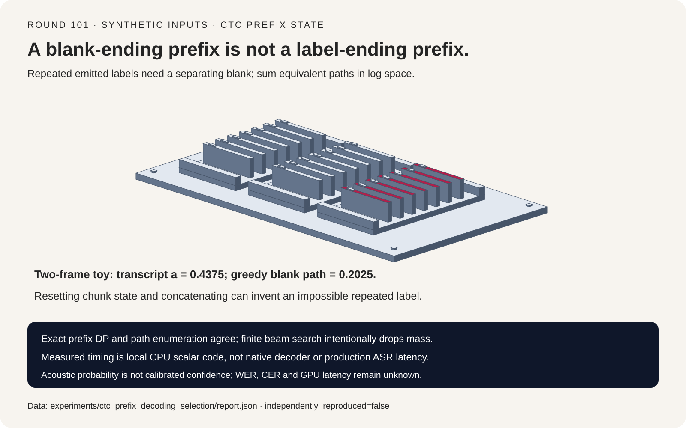
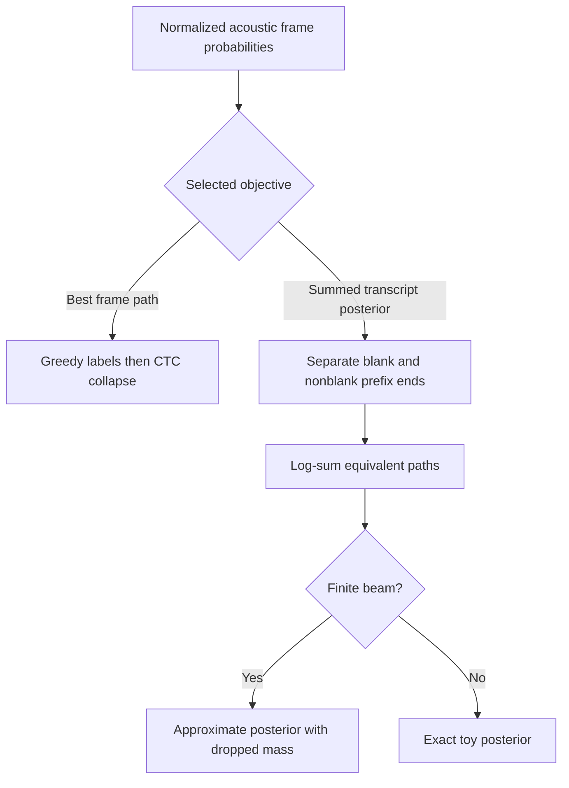
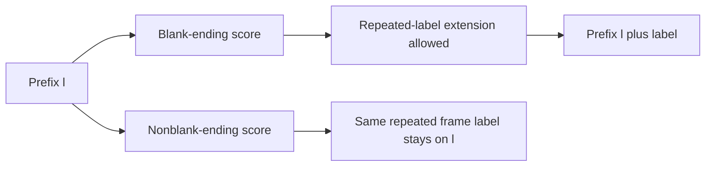
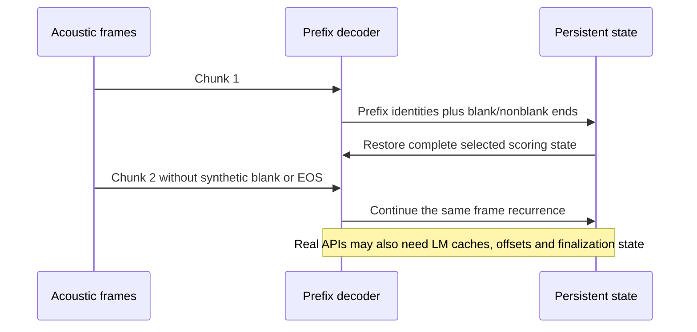

# CTC decoding FAQ: blank/repeat semantics, prefix scores and streaming state

> **Language**: [中文](ctc-prefix-beam-blank-streaming-state-selection-faq.md) | English
>
> **Round 101 · 2026-11-14 (tenth round of the November 13 night)** · [SVG](../../assets/svg/ctc-prefix-beam-blank-streaming-state-selection-faq-summary.svg) · [7-card report](../reports/ctc-prefix-beam-blank-streaming-state-selection-cards.html) · [H5 workbench](../reports/ctc-prefix-beam-blank-streaming-state-sizer.html) · [Sealed report](../../experiments/ctc_prefix_decoding_selection/report.json)
>
> **Synthetic acoustic probabilities, `independently_reproduced=false`.** Timing alone is measured local execution of original scalar CPU functions. No trained speech model, native pyctcdecode/NeMo execution, WER/CER, GPU latency or calibrated confidence.



## 1. Executive summary: best path is not most probable transcript

Connectionist Temporal Classification (CTC) maps many frame-label paths
onto one transcript. First merge adjacent repeated labels, **then** remove
blank. A transcript probability sums the probabilities of every compatible
path. Greedy frame argmax instead selects one path.

Both frames in the first fixture are `[blank=.45,a=.35,b=.20]`.
Greedy chooses blank/blank, yielding the empty transcript with path
probability `.2025`. The three paths blank/a, a/blank and a/a collapse to
`a`; their probabilities sum to **`.4375`**. There is no contradiction.

| Choice | Answers | Does not establish |
| :--- | :--- | :--- |
| Greedy best frame path | Which independent labels maximize path probability? | Best summed transcript |
| Exact prefix log-sum DP | Acoustic posterior over all transcripts | Recognition quality |
| Finite beam | Approximate search within retained hypotheses | Exact posterior mass |
| LM/hotword rescoring | A selected combined scoring objective | Calibrated probability |

This study examines established mechanics, not a newly announced decoder.
The pinned pyctcdecode file has April 2023 partial-streaming history.
A contemporary NeMo wrapper still exposes pyctcdecode, beam/pruning and
LM parameters; its inspected September 2026 file update was license-only,
not evidence of a new decoding capability or daily popularity.

## 2. Architect Q&A: what state must survive a decoder step?

### Q1: Why does blank-removal order matter?

`a a blank a` becomes `a blank a` when adjacent repeats are merged,
then `aa` when blank is removed. Removing blank first changes the path
to `a a a`, which incorrectly collapses to `a`.

The three-frame repeated-label fixture gives path `a blank a` probability
`.8 × .6 × .8 = .384`. In this fixture, that is the only path yielding
`aa`; the wrong collapse order loses it.

### Q2: Why keep blank-ending and label-ending scores separately?

For prefix `l`, retain `pb(l)` and `pnb(l)`. A blank updates `pb(l)`
from their total. If the next label equals the prefix's last label:

```text
same prefix, repeated frame label:
    pnb_new(l) += pnb(l) * P(label)
extended repeated emitted label:
    pnb_new(l + label) += pb(l) * P(label)
different-label extension:
    pnb_new(l + label) += (pb(l) + pnb(l)) * P(label)
```

Only a previous blank allows an additional identical emitted label.
Replacing `pb(l)` with the total on that extension invents illegal paths.
On the two-frame streaming fixture it assigns `.64` to impossible `aa`
and produces total score mass `1.65`.

The original implementation computes this recurrence in log space with
stable log-add. The notation above is a linear-probability explanation,
not the actual numerical implementation.

### Q3: Can chunk results simply be concatenated?

No. In the streaming fixture both frames are
`[blank=.1,a=.8,b=.1]`. Correct whole-sequence collapse has transcript `a`
probability `.8` and cannot produce `aa` in only two frames.

Resetting the decoder for each one-frame chunk and concatenating its
transcripts invents `aa` with probability `.8 × .8 = .64`. A chunk boundary
is not an inserted blank or an end-of-sequence event.

Carrying the complete prefix-to-`(pb,pnb)` map reproduces all four
partitions of the three-frame fixture within floating-point tolerance.
For a fixed finite beam, carrying the same pruned map at each identical
frame step preserves the same search policy; it does not restore mass
previously pruned.

### Q4: Does the acoustic prefix map reproduce a production streaming API?

No. The inspected pyctcdecode implementation log-sum-merges compatible
beams and tracks text/partial-word/last-character identity. Its partial
decoding path also accepts cached LM states, processed frames and
finalization behavior. NeMo exposes additional beam, LM and pruning
controls.

Our original character-label model excludes language models, hotwords,
BPE, timestamps, word boundaries and finalization. A real integration
must preserve all state relevant to its selected scoring contract,
not substitute this toy's two-score map for the whole API.

### Q5: Does a float probability of zero mean the event is impossible?

Not necessarily. For 2,000 independent binary blank/a frames, transcript
`a` arises from one nonempty contiguous run of a labels. There are
`T*(T+1)/2` such paths, each with probability `2^-T`.

The linear product underflows to zero, while a separately implemented
fixed-target forward automaton returns log probability
`-1371.7852035062601`; the closed form is
`log(T*(T+1)/2) - T*log(2) = -1371.7852035063247`.
That positive event is not mathematically impossible. Neither value
is an empirically calibrated confidence score.

## 3. Visual architecture: paths, prefix ends and chunk lifecycle







## 4. Selection matrix and calculator boundaries

| Requirement | Evaluate | Reject this shortcut |
| :--- | :--- | :--- |
| Small exact reference | Enumeration and independent forward agreement | Calling beam output exact |
| Repeated emitted labels | Blank/nonblank transition identities | Remove blank before repeats |
| Streaming | Whole-state carry with consistent frame steps | Independent transcript concatenation |
| Numerical stability | Log-space events and impossible-path distinction | Underflow as zero confidence |
| Deployment | WER/CER, native timing and scoring options | Toy CPU timing as ASR performance |

For `V` nonblank labels, `T` frames and beam cap `B`:

```text
unmerged frame paths = (V + 1)^T
per-frame transition contribution bound = B * (V + 2)
two float64 log-score payload = B * 16 bytes
prefix token-index payload upper bound = B * T * index_bytes
```

The extra contribution handles a same-label non-emission alongside its
blank-separated extension. These are loose logical bounds, not actual
retained states, Python object memory or native allocations.

Default `T=100,V=32,B=64,index_bytes=4,frame_ms=20` gives
`2,176` contributions per frame, `1,024` log-score bytes,
`25,600` prefix-index bytes and `2,000 ms` of represented audio.
Audio span is not decoding latency. Exact path count is null outside
the JavaScript safe-integer range; its base-10 logarithm remains a
formula, not an observed state count. Index capacity and derived exact
integer ranges are validated explicitly.

## 5. Worked evaluation and seven-card report

| Control | Maximum score difference | Interpretation |
| :--- | ---: | :--- |
| Exact prefix versus enumeration | `1.11e-16` | Same acoustic posterior |
| Best path per transcript | `.28` | Different Viterbi objective |
| Remove blank before collapse | `.384` | Loses separated repeated label |
| Merge repeat-end states | `.64` | Adds illegal paths |
| Carry chunk state | `3.47e-18` | Same full-sequence posterior |
| Reset and concatenate | `.64` | Invents impossible `aa` |
| Beam one | `.4375` | Intentional pruning, drops the winning transcript |

The sealed CPU timing file contains two warmups and seven alternating
repeats per function, including input validation:

| Frames | Unmerged paths | Exact prefix median ms | Enumerated median ms |
| ---: | ---: | ---: | ---: |
| 3 | 27 | `.0247` | `.0283` |
| 5 | 243 | `.0878` | `.2987` |
| 7 | 2,187 | `.2595` | `3.1156` |
| 9 | 19,683 | `.7647` | `36.1236` |

Environment: Windows ARM64, Python 3.12.10, Qualcomm ARMv8 CPU identity
recorded in `latency.json`. These are original scalar implementations,
not optimized/native decoder benchmarks, and do not include acoustic
model inference. Exact prefix DP can also grow rapidly; this is not a
production complexity guarantee.

All seven-card bars use sealed scores or timings. The original sorter
illustration represents separate hypothesis-end trays, not actual decoder
hardware. Browser visual verification was not performed; the earlier
browser approval refusal remains respected.

## 6. Reproduction, provenance and readiness boundaries

```powershell
python -m experiments.ctc_prefix_decoding_selection.run
python -m experiments.ctc_prefix_decoding_selection.run --check
python -m unittest tests.test_ctc_prefix_decoding_selection
python scripts\validate_research.py
```

Rendering/checking loads `latency.json` without remeasurement. Only an
explicit `--measure` replaces those local samples; `--check --measure`
is rejected. Eight tests cover independent exact references, path versus
transcript scoring, blank/repeat controls, every chunk split, underflow,
invalid inputs, payload/index limits, sealed timing medians, CSP/SVG and
Python/Node calculator parity.

First-party references:
[pinned pyctcdecode decoder](https://github.com/kensho-technologies/pyctcdecode/blob/afecb67622c1395b85b6a55d2902a780c0c927d4/pyctcdecode/decoder.py),
[Apache-2.0 license](https://github.com/kensho-technologies/pyctcdecode/blob/afecb67622c1395b85b6a55d2902a780c0c927d4/LICENSE),
[pinned NeMo integration](https://github.com/NVIDIA/NeMo/blob/1f73a910bc0f5ab774d100706329730b81457591/nemo/collections/asr/parts/submodules/ctc_beam_decoding.py).
Upstream rights remain with their holders. No decoder implementation or
model weights were copied. Cards are script-free with
`default-src 'none'; style-src 'unsafe-inline'`.

**Ready for:** reviewing acoustic CTC scoring and streaming-state
contracts. **Not ready for:** production ASR selection, calibrated
confidence, LM/BPE/timestamp parity or accelerator performance claims.
