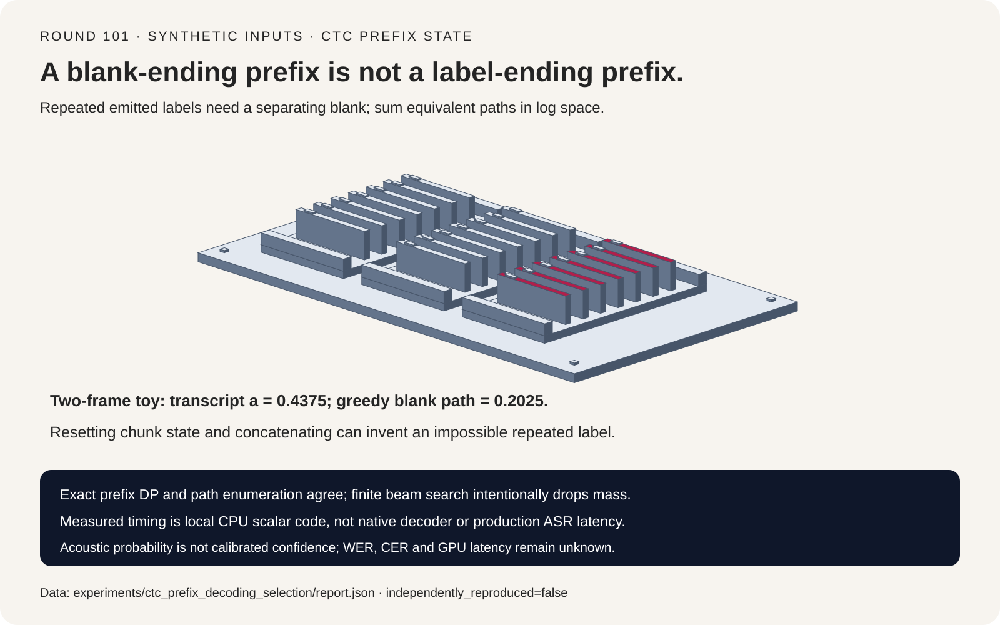
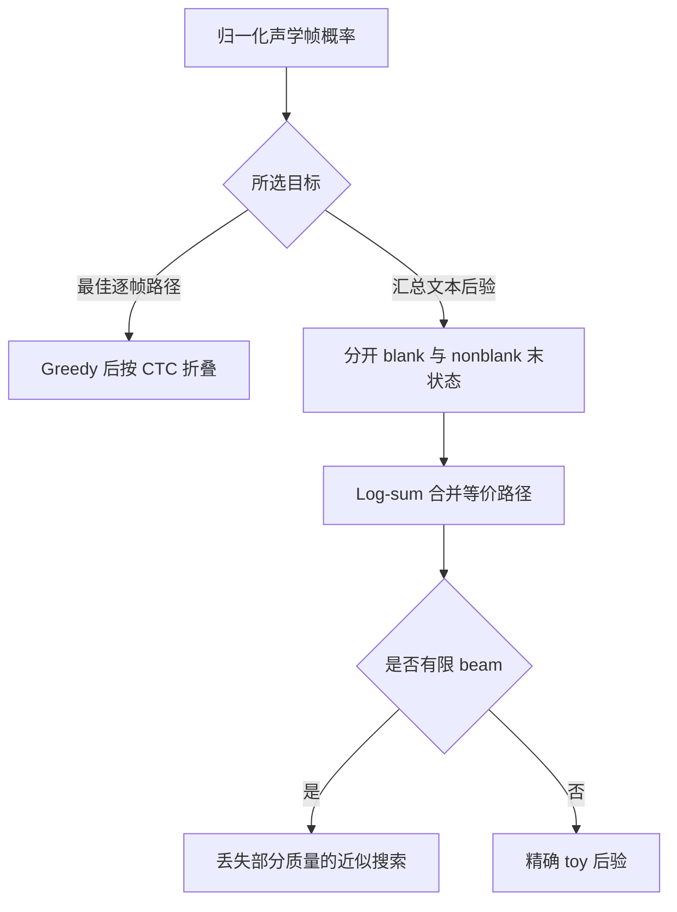
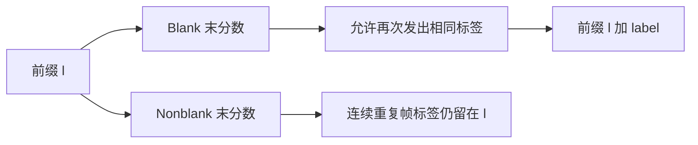
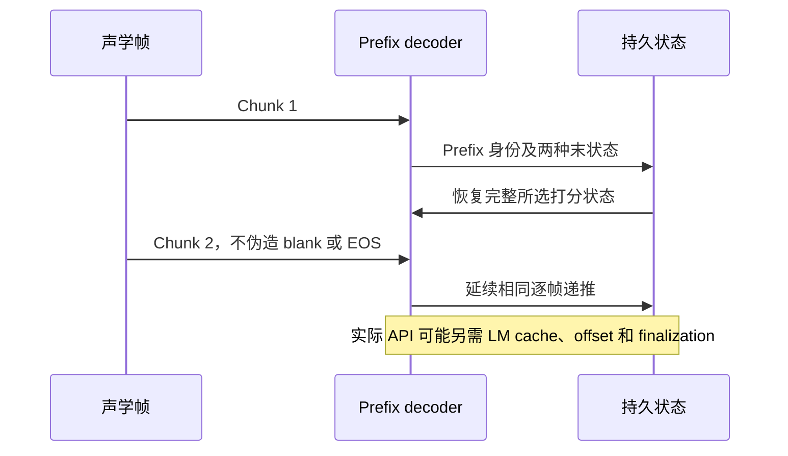

# CTC 解码选型 FAQ：Blank/Repeat、Prefix 分数与流式状态

> **语言**：中文 | [English](ctc-prefix-beam-blank-streaming-state-selection-faq.en.md)
>
> **Round 101 · 2026-11-14（11 月 13 日夜班第十轮）** · [高清 SVG](../../assets/svg/ctc-prefix-beam-blank-streaming-state-selection-faq-summary.svg) · [七卡报告](../reports/ctc-prefix-beam-blank-streaming-state-selection-cards.html) · [H5 工作台](../reports/ctc-prefix-beam-blank-streaming-state-sizer.html) · [封存数据](../../experiments/ctc_prefix_decoding_selection/report.json)
>
> **声学概率为 synthetic，`independently_reproduced=false`。** 仅 timing 是原创标量函数的本地 CPU 实测；未运行语音模型或原生 pyctcdecode/NeMo，不含 WER/CER、GPU 延迟和校准 confidence。



## 1. 执行摘要：最佳路径不等于最大概率文本

CTC 把多条逐帧标签路径映射成同一文本：**先合并相邻重复标签，再移除
blank**。文本概率需要累加所有能折叠到该文本的路径概率；greedy 逐帧
argmax 只取一条最优路径。

本例两帧均为 `[blank=.45,a=.35,b=.20]`。Greedy 得到 blank/blank，
折叠为空串，路径概率 `.2025`。但 blank/a、a/blank、a/a 都折叠成 `a`，
合计概率 **`.4375`**。两者并不矛盾，而是在回答不同问题。

| 方案 | 回答的问题 | 不能证明 |
| :--- | :--- | :--- |
| Greedy best path | 哪条逐帧标签路径概率最高 | 哪个文本汇总概率最高 |
| 精确 prefix log-sum DP | 所有文本的纯声学后验 | 识别质量 |
| 有限 beam | 保留候选内的近似搜索 | 精确后验总质量 |
| LM/hotword rescoring | 特定复合打分目标 | 校准概率 |

本轮研究成熟底层机制，不冒充当日新品。固定 pyctcdecode 文件的 partial
streaming 历史来自 2023 年 4 月；当代 NeMo wrapper 仍集成该解码路径、
beam/pruning 与 LM 参数。所查 2026 年 9 月文件变更仅涉及许可，不能
据此宣称新增能力或每日热度排名。

## 2. 架构师 Q&A：解码一步必须保留什么状态？

### Q1：Blank 为什么不能先移除？

`a a blank a` 先合并相邻重复得到 `a blank a`，再去 blank 得到 `aa`。
若先去 blank，则成为 `a a a`，最后被错误压成 `a`。

三帧 fixture 中，路径 `a blank a` 概率为 `.8×.6×.8=.384`，也是该
fixture 唯一产生 `aa` 的路径。错误顺序会丢失全部这部分文本质量。

### Q2：同一 Prefix 为什么需要 Blank / Nonblank 两个末分数？

设前缀为 `l`，分别保存 `pb(l)` 与 `pnb(l)`。Blank 转移使用二者总和。
当下一帧标签等于 `l` 的最后标签时：

```text
重复帧标签，但不产生新标签：
    pnb_new(l) += pnb(l) * P(label)
再发出一个相同标签，必须由 blank 隔开：
    pnb_new(l + label) += pb(l) * P(label)
发出不同标签：
    pnb_new(l + label) += (pb(l) + pnb(l)) * P(label)
```

若把第二条的 `pb(l)` 偷换为总和，就会把合法连续重复和新增重复标签
混为一谈。在两帧 streaming fixture 中，它为不可能的 `aa` 分配 `.64`，
总 score mass 达到 `1.65`。

以上是便于理解的线性概率写法；原创实现使用稳定 log-add，不直接乘
大量小概率。这里的两类状态是转移条件，不是可以提前合并的冗余缓存。

### Q3：流式分块可以各自解码后直接拼文本吗？

不能。Streaming fixture 的两帧均为 `[blank=.1,a=.8,b=.1]`。
整段 CTC 中 `a` 的概率为 `.8`，仅两帧不可能生成需要 blank 隔开的 `aa`。

如果每帧重置 decoder 后把文本拼接，会凭空得到概率 `.8×.8=.64` 的
`aa`。Chunk boundary 并不自动插入 blank，也不等于 EOS。

携带完整 prefix→`(pb,pnb)` 映射，可让三帧 fixture 的四种分块方式
与整段结果在浮点容差内一致。若使用相同有限 beam，则必须在同一逐帧
位置采用相同 pruning；携带状态不能恢复前面已经裁掉的路径质量。

### Q4：这张纯声学状态表是否复现了生产流式 API？

没有。所读 pyctcdecode 对兼容 beam 做 log-sum merge，并保留
text/partial-word/last-character 身份。Partial decoding 还涉及 LM
cache、processed frames 和结束标记；NeMo wrapper 提供更多 LM、
beam 与 pruning 参数。

本轮原创模型只有离散字符标签和纯声学 CTC，不含 LM、hotword、BPE、
时间戳、词边界和 finalization。真实系统要保存所选打分契约需要的
**全部状态**，不能用 toy 的两分数映射替代整套 API。

### Q5：浮点概率为 0，就一定是不可能事件吗？

不一定。2,000 帧独立二元 blank/a 中，文本 `a` 对应一段非空连续 a。
合法路径数量为 `T*(T+1)/2`，每条概率 `2^-T`。

线性浮点乘积下溢为 0；独立固定 target forward automaton 却保留有限
log probability `-1371.7852035062601`，与闭式
`log(T*(T+1)/2)-T*log(2)=-1371.7852035063247` 一致。
这是正概率事件的数值下溢，不是数学上的不可能事件，更不是零 confidence。

## 3. 可视化架构：路径、末状态与流式生命周期







## 4. 选型矩阵与计算器边界

| 需求 | 应验证 | 不可替代的捷径 |
| :--- | :--- | :--- |
| 小规模精确参照 | Enumeration 与独立 target forward 一致 | 把 beam 结果叫精确后验 |
| 重复输出标签 | Blank/nonblank 转移身份 | 先删 blank 再合并 |
| Streaming | 同一逐帧递推下携带完整状态 | 独立分段文本拼接 |
| 稳定性 | 区分 log-space 正事件与不可能事件 | 下溢等于零 confidence |
| 生产部署 | WER/CER、原生 timing、打分选项 | Toy CPU 时间等于 ASR 性能 |

非 blank 标签数 `V`、帧数 `T`、beam cap `B`：

```text
未合并逐帧路径数 = (V + 1)^T
每帧转移 contribution 上界 = B * (V + 2)
两份 float64 log 分数 payload = B * 16 bytes
Prefix token 索引 payload 上界 = B * T * index_bytes
```

额外 contribution 对应同标签不新增输出与 blank 分隔扩展的两种转移。
这些是宽松逻辑上界，不是实际 retained states、Python 对象内存或原生分配。

默认 `T=100,V=32,B=64,index_bytes=4,frame_ms=20`，得到每帧 `2,176`
个 contribution 上界、`1,024` 字节分数、`25,600` 字节 token 索引和
`2,000 ms` 被表示的音频跨度。音频时长不是计算延迟。

精确路径数超出 JavaScript safe integer 时保留 null，另显示其十进对数
公式；这不代表观测了这些状态。选定无符号索引的 label 容量与派生
整数范围均显式校验，不把非法输入变成成功估算。

## 5. 评测案例与七卡报告

| 对照 | 最大分数差 | 解释 |
| :--- | ---: | :--- |
| Exact prefix 对 enumeration | `1.11e-16` | 同一纯声学后验 |
| 每文本只保留最佳路径 | `.28` | 不同 Viterbi 目标 |
| 先删 blank 再折叠 | `.384` | 丢失分隔重复标签 |
| 合并 repeat 末状态 | `.64` | 新增非法路径 |
| 携带 chunk state | `3.47e-18` | 与整段一致 |
| 重置并拼接 | `.64` | 凭空产生 `aa` |
| Beam one | `.4375` | 主动裁剪，丢失获胜文本 |

CPU 封存文件记录每函数两次 warmup、七次交替顺序重复，计入输入校验：

| 帧数 | 未合并路径数 | Exact prefix 中位数 ms | Enumeration 中位数 ms |
| ---: | ---: | ---: | ---: |
| 3 | 27 | `.0247` | `.0283` |
| 5 | 243 | `.0878` | `.2987` |
| 7 | 2,187 | `.2595` | `3.1156` |
| 9 | 19,683 | `.7647` | `36.1236` |

环境为 Windows ARM64、Python 3.12.10，Qualcomm ARMv8 CPU 身份保存在
`latency.json`。这是原创标量参照函数，不是优化原生 decoder benchmark，
也不含声学模型推理。精确 prefix DP 自身也可能快速增长，不能据此
承诺生产复杂度或识别性能。

七卡全部条形坐标来自封存分数或 timing；原创实体分拣器表示两类假设
末状态，并非真实硬件。H5 中英输入、明确错误、亮暗主题均沿用本库约定。
未做浏览器视觉验收；此前浏览器 approval 拒绝保持有效，没有换通道绕过。

## 6. 复现、出处与就绪边界

```powershell
python -m experiments.ctc_prefix_decoding_selection.run
python -m experiments.ctc_prefix_decoding_selection.run --check
python -m unittest tests.test_ctc_prefix_decoding_selection
python scripts\validate_research.py
```

普通渲染及 `--check` 只读取封存 timing；显式 `--measure` 才会替换本地
样本，`--check --measure` 被拒绝。八项测试覆盖独立精确参照、路径与文本
打分区别、blank/repeat 错误、所有分块切法、下溢和非法输入、payload/
索引边界、封存中位数、CSP/SVG，以及 Python/Node 公式一致性。

一手资料：
[固定 pyctcdecode decoder](https://github.com/kensho-technologies/pyctcdecode/blob/afecb67622c1395b85b6a55d2902a780c0c927d4/pyctcdecode/decoder.py)、
[Apache-2.0 许可](https://github.com/kensho-technologies/pyctcdecode/blob/afecb67622c1395b85b6a55d2902a780c0c927d4/LICENSE)、
[固定 NeMo 集成](https://github.com/NVIDIA/NeMo/blob/1f73a910bc0f5ab774d100706329730b81457591/nemo/collections/asr/parts/submodules/ctc_beam_decoding.py)。
上游权利保留；未复制 decoder 实现或模型权重。七卡无脚本，严格 CSP
为 `default-src 'none'; style-src 'unsafe-inline'`。

**适合**：审查纯声学 CTC 分数、blank/repeat 递推和流式状态契约。
**不适合**：生产 ASR 选型、校准 confidence、LM/BPE/时间戳一致性或
加速器性能结论。
