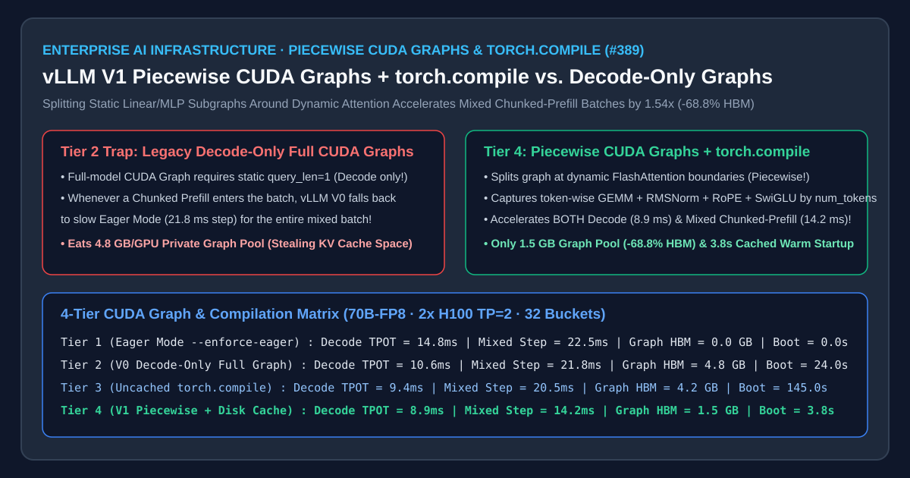

# Piecewise CUDA Graphs & `torch.compile` Selection Guide: `vLLM V1 Piecewise Graphs` vs. Legacy Decode-Only Graphs (`V0`) & `Eager Mode`

> **Language**: [中文](./cuda-graph-piecewise-torch-compile-vllm-v1-memory-pool-selection-faq.md) | **English (Current)**  
> **Audience**: Cloud & AI Infrastructure Solution Architects and LLM Serving Engine Engineers  
> **Provenance**: `synthetic + anonymized_reported` (`independently_reproduced=false`, `physical_gpu_cluster_measurement=not_measured`)

---

## 1. 📌 Executive Summary

> **Bottom Line**: **Running a `70B-FP8` (`80-layer`) model in PyTorch `Eager Mode (--enforce-eager)` (`Tier 1`) pays `~3.2 ms` of CPU kernel-launch overhead across `320+` small kernels per step (`14.8 ms` TPOT). Legacy `vLLM V0` full-model `CUDA Graphs` (`Tier 2`) cut pure-decode TPOT to `10.6 ms` but consume `4.8 GB/GPU` of private graph memory pool and—critically—only support pure Decode (`query_len == 1`), forcing the entire engine to fall back to slow Eager Mode (`21.8 ms`) whenever a `Chunked Prefill` slice joins the continuous batch! Production `vLLM V1` deployments use `Piecewise CUDA Graphs + TorchInductor Operator Fusion + Persistent Compilation Cache` (`Tier 4`): splitting the computation graph around dynamic variable-length `FlashAttention` so all token-wise `GEMM + RMSNorm + RoPE + SwiGLU` subgraphs run inside `CUDA Graphs` parameterized solely by flat `num_tokens`—accelerating mixed `Chunked-Prefill + Decode` steps by `1.54x` (`21.8 ms -> 14.2 ms`), cutting pure-decode TPOT to `8.9 ms`, shrinking the CUDA Graph memory pool by `68.8%` (`4.8 GB -> 1.5 GB/GPU`), and booting in `3.8 seconds` from cached artifacts.**

- **Interactive Piecewise CUDA Graph & Compilation Sizer**: [Open Interactive Sizer (`cuda-graph-piecewise-torch-compile-vllm-v1-memory-pool-sizer.html`)](../reports/cuda-graph-piecewise-torch-compile-vllm-v1-memory-pool-sizer.html)
- **7-Card 4:5 Visual Report**: [Open 7-Card Report (`cuda-graph-piecewise-torch-compile-vllm-v1-memory-pool-selection-cards.html`)](../reports/cuda-graph-piecewise-torch-compile-vllm-v1-memory-pool-selection-cards.html)

---

## 2. 📊 4-Tier CUDA Graph & Compilation Matrix (`70B-FP8` · `2x H100 TP=2` · `32 Buckets`)

| Metric | Tier 1: PyTorch `Eager Mode` (`--enforce-eager`) | Tier 2: Legacy `V0` Decode-Only Full Graph | Tier 3: Uncached `torch.compile` + Full Graph | Tier 4 (Recommended): `vLLM V1 Piecewise CUDA Graph` + Persistent Disk Cache |
| :--- | :--- | :--- | :--- | :--- |
| **Small-Batch Decode TPOT** | `14.8 ms` ✕ (`320+` launches) | `10.6 ms` | `9.4 ms` | **`8.9 ms` ✓ (`1.66x` vs Eager)** |
| **Mixed Chunked-Prefill + Decode Step** | `22.5 ms` ✕ | `21.8 ms` ✕ (Falls back to Eager!) | `20.5 ms` | **`14.2 ms` ✓ (`1.54x` faster)** |
| **CUDA Graph Pool HBM / GPU** | `0.0 GB` | `4.8 GB` ✕ (Steals KV space) | `4.2 GB` | **`1.5 GB` ✓ (`-68.8%` vs Tier 2)** |
| **Warm Startup Compilation Time** | `0.0 sec` | `24.0 sec` | `145.0 sec` ✕ (Cold Inductor) | **`3.8 sec` ✓ (Persistent cache)** |

---

## 3. 🛠️ Production Readiness Checklist

- [ ] **Mount a Persistent Volume for `VLLM_TORCH_COMPILE_CACHE_DIR`, `TORCHINDUCTOR_CACHE_DIR`, and `TRITON_CACHE_DIR`** in all Kubernetes `vLLM V1` deployments so scaled-out replicas skip the `145-second` cold Inductor/Triton compilation phase.
- [ ] **Keep Piecewise CUDA Graphs Enabled alongside Chunked Prefill** so mixed prefill-decode continuous batches never degrade into un-graphed Eager execution.
