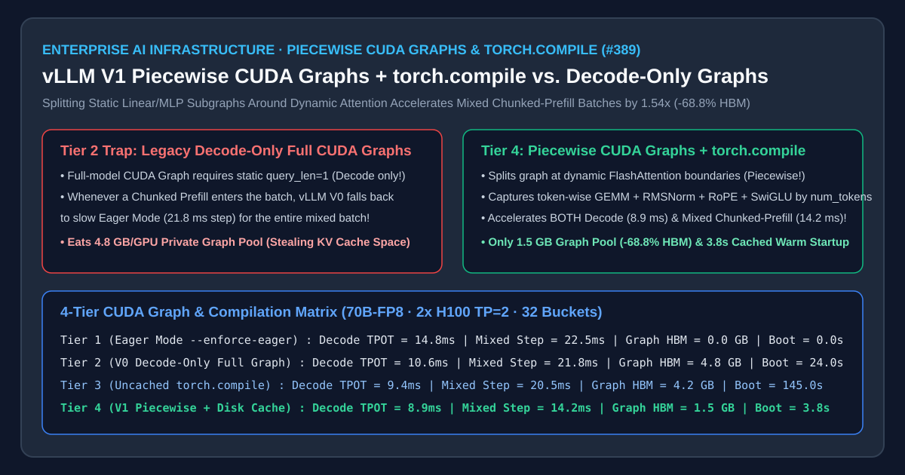
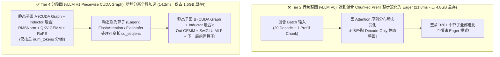

# 大模型分段 CUDA Graph（Piecewise CUDA Graphs）与 `torch.compile` 编译缓存选型：`vLLM V1 Piecewise Graph` vs. 传统仅 Decode 静态图（`V0`）vs. `Eager Mode` 显存池与延迟指南

> **语言 / Language**: **中文 (当前)** | [English](./cuda-graph-piecewise-torch-compile-vllm-v1-memory-pool-selection-faq.en.md)  
> **定位**：面向 Cloud & AI Infrastructure Solution Architect 与推理引擎架构师的运行时图捕获与算子编译融合选型（`vLLM V1 Piecewise CUDA Graphs + TorchInductor 融合 + 持久化编译缓存` vs. `vLLM V0 全图仅 Decode CUDA Graph` vs. `--enforce-eager`）、破解“为什么开启 Chunked Prefill 后传统 CUDA Graph 会频繁回退到慢速 Eager 模式且吃掉 `4.8 GB/卡` 私有显存池”的白皮书  
> **合规与来源声明**：`synthetic + anonymized_reported`（`independently_reproduced=false`，`physical_gpu_cluster_measurement=not_measured`；完全面向通用企业级高吞吐混部推理引擎参数调优与冷启动加速设计）

---

## 1. 📌 核心选型结论速览（Executive Summary）

> **一句话结论**：**在部署 `70B-FP8`（`80 层`）推理服务时，如果为了省显存或避开冷启动直接加 `--enforce-eager` 关闭 CUDA Graph（Tier 1），CPU 每步发射 `320+` 个碎小 Kernel 的启动开销会让小 Batch TPOT 劣化 **`+66%`（从 `8.9 ms` 慢至 `14.8 ms`）**；但如果停留在传统的“整模型静态 `CUDA Graph`”（Tier 2，`vLLM V0` 模式），它不仅要为 35 档 Batch Size 预分配高达 **`4.8 GB/GPU` 的私有图显存池**（直接挤占宝贵的 KV Cache 空间！），更存在一个致命死穴——**传统整图只支持纯 Decode（即所有请求 `query_len == 1`），一旦开启了生产必备的 `Chunked Prefill` 且当前 Step 混入了哪怕 1 条预填充请求，整张 CUDA Graph 就会当场失效并回退到极慢的 Eager 模式（耗时从 `14.2 ms` 飙至 `21.8 ms`）**！生产环境黄金准则是采用“`vLLM V1 分段式 Piecewise CUDA Graphs` + `torch.compile` 算子融合 + 挂载共享 `VLLM_TORCH_COMPILE_CACHE_DIR` 持久化编译盘（Tier 4）”：以动态 Attention 算子为分界线将模型切分为多个静态计算子图（按扁平化总 Token 数 `num_tokens` 录制全部 `GEMM + RMSNorm + RoPE + SwiGLU`），**首次让 `Chunked Prefill` 与混合 Batch 也能全程享受 CUDA Graph 加速（混合步提速 `1.54 倍` 至 `14.2 ms`）**，同时将图私有显存池暴砍 **`68.8%`（从 `4.8 GB` 降至 `1.5 GB/GPU`）**，并将二次热启动编译耗时从 `145 秒` 压至 **`3.8 秒`**！**

- **交互式分段 CUDA Graph 与编译缓存计算器**：[打开交互式计算器 (`cuda-graph-piecewise-torch-compile-vllm-v1-memory-pool-sizer.html`)](../reports/cuda-graph-piecewise-torch-compile-vllm-v1-memory-pool-sizer.html)
- **7-Card 4:5 视觉评测报告**：[打开 7-Card 报告 (`cuda-graph-piecewise-torch-compile-vllm-v1-memory-pool-selection-cards.html`)](../reports/cuda-graph-piecewise-torch-compile-vllm-v1-memory-pool-selection-cards.html)

---

## 2. 🎯 客户与架构师灵魂拷问 Q&A（Deep-Dive Architecture FAQ）

### Q1：为什么传统的整模型 `CUDA Graph`（`vLLM V0`）一遇到 `Chunked Prefill` 就会失效退化？`vLLM V1` 的 `Piecewise CUDA Graph`（分段图）是怎么绕过动态 Attention 限制的？
1. **传统整图（Full-Model CUDA Graph）的死穴**：
   - `CUDA Graph` 要求图内每一个 Kernel 的网格大小（Grid Size）和张量形状完全静态固定。在 `Chunked Prefill` 混合批次中，同一个 Batch 里可能包含“20 个各占 1 Token 的 Decode 请求 + 1 个占 512 Token 的 Prefill 切片”（总 Token 数 `= 532`）。
   - 虽然对于 **线性层（`QKV/O GEMM`、`MLP`）、`RMSNorm` 和 `RoPE`** 来说，它们根本不关心这 532 个 Token 来自几条请求（它们的输入永远是规整的二维矩阵 `[num_tokens, hidden_size]`！）；但中间的 **`FlashAttention / PagedAttention` 算子** 却高度依赖每条请求各自不同的历史上下文长度和动态 `cu_seqlens` 表！
   - 因为夹在中间的 Attention 是动态的，旧版 `V0` 就只能放弃录制整个混合步，退回慢吞吞的 PyTorch Eager 模式！
2. **`Piecewise CUDA Graph`（分段捕获 + 动态 Attention 豁免）的巧思**：
   - `vLLM V1` 利用 `torch.fx` 图切分，把每一层的 **`[RMSNorm + QKV Linear + RoPE]`** 录成第 1 段静态 CUDA Graph，然后跳出图外用 Eager 模式执行 1 次动态的 **`FlashAttention`**，紧接着再跳进第 2 段静态 CUDA Graph 一口气跑完 **`[O_Proj + Residual + RMSNorm + SwiGLU MLP + Next Layer QKV]`**！
   - 这样一来，无论 Batch 怎么混合 Prefill 和 Decode，占模型 **90% Kernel 数量的线性与逐元素算子 100% 全部跑在融合后的静态 CUDA Graph 里**！

---

## 3. 🧭 直观可视化图解（Mermaid 传统整图遇 Chunked Prefill 退化 vs. `vLLM V1 Piecewise CUDA Graph` 架构图）

---

## 4. 📊 架构师四级 CUDA Graph 与编译加速选型矩阵（`70B-FP8` · `2x H100 TP=2` · `32` 档分桶）

| 评估维度 | Tier 1：纯 `Eager Mode` (`--enforce-eager`) | Tier 2：传统仅 Decode 整图 (`vLLM V0 Full Graph`) | Tier 3：无缓存 `torch.compile` + 整图（每次冷编译） | Tier 4（推荐）：`vLLM V1 Piecewise CUDA Graph` + `Inductor` 融合 + 持久化编译盘 |
| :--- | :--- | :--- | :--- | :--- |
| **纯小 Batch 解码延迟 (`Decode TPOT`)** | `14.8 ms` ✕（CPU 发射瓶颈） | `10.6 ms` | `9.4 ms` | **`8.9 ms` ✓（比 Eager 快 `1.66 倍`）** |
| **混合 `Chunked Prefill` 步耗时** | `22.5 ms` ✕ | `21.8 ms` ✕（被迫退回 Eager！） | `20.5 ms` | **`14.2 ms` ✓（分段图全程生效，快 `1.54 倍`）** |
| **单卡 CUDA Graph 私有显存池开销** | `0.0 GB` | `4.8 GB / 卡` ✕（挤占 KV 显存） | `4.2 GB / 卡` | **`1.5 GB / 卡` ✓（显存池开销大降 `68.8%`）** |
| **Pod 启动图捕获与编译就绪耗时** | `0.0 秒` | `24.0 秒` | `145.0 秒` ✕（每次重编 Triton） | **`3.8 秒` ✓（命中共享盘编译缓存）** |

---

## 5. 🛠️ 架构评审与生产落地 Checklist

- [ ] **K8s 生产部署开启 `vLLM V1`（或 `-O2 / -O3` 编译优化）时，必须挂载持久化编译缓存卷**：将环境变量 `VLLM_TORCH_COMPILE_CACHE_DIR`、`TORCHINDUCTOR_CACHE_DIR` 与 `TRITON_CACHE_DIR` 指向宿主机本地 NVMe `HostPath` 或共享 PVC，确保扩容新 Pod 在 **`<4 秒`** 内直接加载已编译好的二进制 Kernel。
- [ ] **根据业务实际最大并发合理收敛 `--cuda-graph-sizes / max_capture_size`**：若单实例最大并发永远不超过 `64`，无需默认向上录制到 `256/512` 档位，可进一步省下 `0.6~1.2 GB` 显存池。
