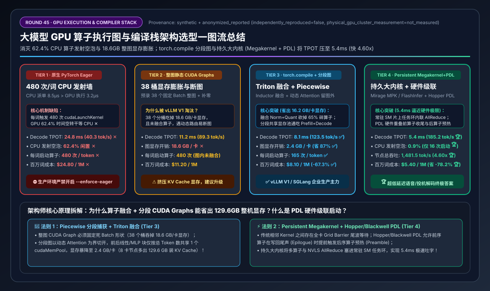
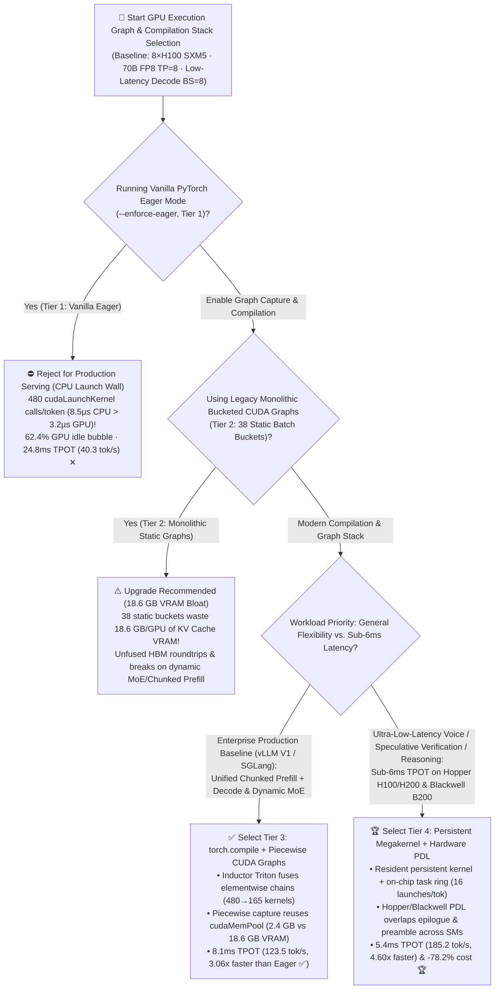
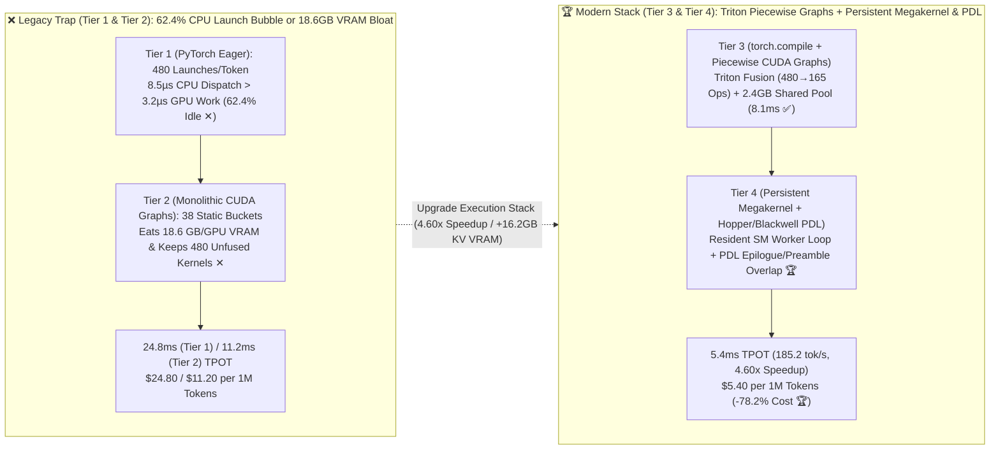
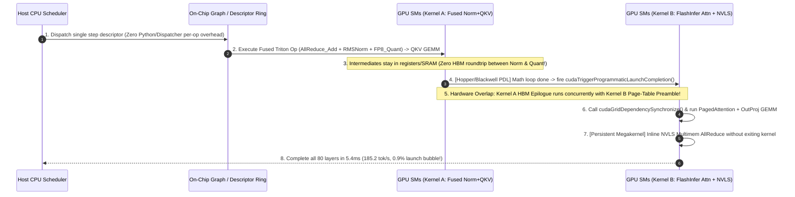

# LLM GPU Kernel Execution Graph & Compilation Stack Architecture Selection Guide (`PyTorch Eager` vs. `Monolithic Static CUDA Graphs` vs. `torch.compile + Piecewise CUDA Graphs` vs. `Persistent Megakernel + Hopper/Blackwell PDL`)

> **Reader's Guide**: Built for **AI Solution Architects and Inference Engine Systems Engineers**, this guide explains from first principles: **why running a 70B FP8 LLM on an 8×H100/B200 node in vanilla PyTorch Eager mode leaves the GPUs sitting completely idle 62.4% of the time waiting for the CPU to issue 480 `cudaLaunchKernel` calls per token ("The CPU Launch Wall"); why legacy monolithic static `CUDA Graphs` (Tier 2) eliminate launch latency but waste 18.6 GB/GPU of KV Cache memory across 38 padded batch-size buckets and break on dynamic shapes; how vLLM V1 / SGLang combine `torch.compile (TorchInductor Triton Fusion)` with `Piecewise CUDA Graphs` (Tier 3) to reclaim 16.2 GB/GPU of VRAM while cutting Decode TPOT to 8.1ms; and how `Persistent Megakernels` paired with Hopper/Blackwell `Programmatic Dependent Launch (PDL)` (Tier 4) fuse multi-operator transformer decode and NVLS collectives into a single resident GPU kernel—slashing TPOT from 24.8ms down to 5.4ms (`185.2 tok/s`, `4.60x` speedup, `-78.2%` cost).**

---

## ① 📌 Executive Summary

1. **Why Faster GPUs Make Vanilla `PyTorch Eager` Mode (Tier 1) Even Worse ("The CPU Kernel Launch Wall")**:
   - During interactive low-latency LLM Decode (`Batch Size = 8` on an 80-layer 70B FP8 model across `8×H100`), individual GPU micro-kernels (`RMSNorm`, `RoPE`, `SiLU`, small batch `GEMM`) execute in an average of just **`3.2 µs`** on H100 SMs.
   - However, dispatching a single kernel from the Host CPU (Python interpreter $\rightarrow$ PyTorch Dispatcher $\rightarrow$ C++ tensor metadata checks $\rightarrow$ CUDA Driver `cudaLaunchKernel`) takes **`8.5 µs`** per call!
   - Across `480` kernel launches per generated token (`6 ops/layer × 80 layers`), the CPU takes `8.5 µs` to issue each `3.2 µs` GPU task—leaving **the H100 GPUs completely idle `62.4%` of the time waiting for the CPU ✕**, inflating Decode TPOT to **`24.8 ms` (`40.3 tok/s` ✕)** at **`$24.80 / 1M tokens` ✕**!
2. **Enterprise Production Baseline (`Tier 3: torch.compile + Piecewise CUDA Graphs`) vs. Ultra-Low-Latency Gold Standard (`Tier 4: Persistent Megakernel + PDL`)**:
   - **For General Production LLM Serving (vLLM V1 / SGLang with Mixed Chunked Prefill & Dynamic MoE), standardize on `Tier 3 (torch.compile [TorchInductor Triton Fusion] + Piecewise CUDA Graphs)`**: Automatically fuses memory-bound elementwise chains (`Residual Add + RMSNorm + FP8 Quant` and `SwiGLU`) into single Triton kernels (cutting launches from `480 → 165/token`) and captures **Piecewise CUDA Graphs** around shape-regular linear blocks while leaving dynamic PagedAttention metadata outside the static graph. This slashes graph VRAM overhead from `18.6 GB` down to **`2.4 GB/GPU` (saving `16.2 GB/GPU` for KV Cache ✅)** and cuts TPOT **`3.06x` to `8.1 ms` (`123.5 tok/s` ✅)**!
   - **For Sub-6ms Ultra-Low-Latency Decode, Voice Agents & Speculative Verification (MTP/EAGLE-3), deploy `Tier 4 (Persistent Megakernel [FlashInfer / Mirage MPK / Thunder] + Hopper/Blackwell Programmatic Dependent Launch [PDL])`**: Replaces ratusan separate kernel launches with **resident persistent worker CTAs** that pull tasks from an on-chip descriptor ring buffer and inline `NVLS Multimem AllReduce`, while using hardware **PDL (`cudaTriggerProgrammaticLaunchCompletion`)** to overlap kernel epilogues with the next kernel's preamble. Kernel launches drop to **`16/token`**, CPU launch bubble falls to **`0.9%`**, and TPOT plunges to **`5.4 ms` (`185.2 tok/s`, `4.60x` faster than Eager, `-78.2%` cost 🏆)**!
3. **First-Principles Rule**:
   - **CUDA Graphs** eliminate **CPU launch latency**; **`torch.compile` operator fusion** eliminates **inter-kernel HBM memory roundtrips**; **Persistent Megakernels + PDL** eliminate **GPU grid-wide barrier tail bubbles**.

---

## ② 🎯 Architect & Customer FAQ (First-Principles Q&A)

### Q1: Why does our 70B FP8 model on 8×H100 only generate 40 tokens/sec at small batch sizes (`BS=1..8`), and why does Nsight Systems show 62% empty gaps between GPU kernels even though `nvidia-smi` reports 95% GPU utilization?

**Plain-Language First Principles**:
- **The CPU Launch Overhead Inversion (`8.5 µs` CPU Dispatch > `3.2 µs` GPU Execution)**:
  - In PyTorch Eager mode (**Tier 1**), every operator (`add`, `rms_norm`, `rotary_embedding`, `fp8_quant`, `gemm`) goes through Python bindings, PyTorch dispatcher guards, and the CUDA driver before reaching the GPU hardware queue.
  - When `Batch Size = 8`, an H100 finishes a vector/matrix op in `3.2 µs`, whereas the CPU needs `8.5 µs` just to enqueue the next kernel! As a result, **`62.4%` of wall-clock time is pure empty air between kernels**.
  - **Why `nvidia-smi` Lies**: `nvidia-smi` reports the percentage of sampling intervals during which *at least one SM was active for even a microsecond*—not actual Tensor Core or HBM bandwidth saturation! Only `Nsight Systems (nsys)` reveals the `62.4%` launch bubble.

---

### Q2: If `CUDA Graphs` solve the CPU launch bottleneck, why did legacy full-model `CUDA Graphs` (Tier 2) waste 18.6 GB of VRAM per GPU, and how do `torch.compile + Piecewise CUDA Graphs` (Tier 3) fix both memory bloat and dynamic shapes?

**Plain-Language First Principles**:
- **Three Fatal Flaws of Monolithic Static Bucketed `CUDA Graphs` (Tier 2)**:
  1. **18.6 GB VRAM Bloat from 38 Static Batch Buckets**: Because a CUDA Graph hardcodes exact tensor shapes and physical HBM pointers, legacy engines pre-captured **`38 separate full-model graphs`** (`BS = 1, 2, 4, 8, 16 ... 512`). Across 80 layers, static intermediate buffers and per-bucket states consume **`18.6 GB/GPU` of HBM ✕** (stealing capacity from the KV Cache!), and any intermediate batch size (e.g., `BS=9`) must be padded up to `BS=16`, wasting compute.
  2. **Incompatibility with Dynamic Attention & Mixed Chunked Prefill**: PagedAttention metadata, MoE token routing, and unified chunked-prefill batches have dynamic shapes that break monolithic full-model graph capture.
  3. **Zero Reduction in HBM Bandwidth Roundtrips**: Replaying 480 unfused kernels via a CUDA Graph still reads and writes full intermediate tensors to HBM 480 times per token!
- **How Tier 3 (`torch.compile` Inductor + vLLM V1 `Piecewise CUDA Graphs`) Solves It**:
  1. **Triton Operator Fusion (`480 → 165` Kernels)**: `TorchInductor` fuses `AllReduce Residual Add + RMSNorm + Dynamic FP8 Quantization` and `Gate/Up + SiLU + Mul` into single Triton kernels that keep intermediates in registers/SRAM, cutting HBM traffic by **60%+**.
  2. **Piecewise Graph Splitting Around Attention**: Splits each transformer layer at the dynamic Attention op—capturing the shape-regular `Norm+QKV` and `Norm+MLP` blocks into a single shared `cudaMemPool` graph tree parameterized only by total `num_tokens`, while running the dynamic Attention op eagerly in between. Graph VRAM overhead drops **`87%` from `18.6 GB → 2.4 GB/GPU` ✅**, while cutting TPOT to **`8.1 ms` (`123.5 tok/s` ✅)**!

---

### Q3: How do `Persistent Megakernels` and Hopper/Blackwell `PDL (Programmatic Dependent Launch)` (Tier 4) push Decode latency from 8.1ms down to 5.4ms (`185.2 tok/s`)?

**Plain-Language First Principles**:
- Even inside a fused CUDA Graph (**Tier 3**), traditional CUDA execution enforces a **full-chip Grid Barrier** between consecutive kernels: Kernel $B$ cannot start on *any* SM until the very last thread block (tail wave) of Kernel $A$ finishes and flushes to L2/HBM.
- **Tier 4 Eliminates Inter-Kernel Tail Bubbles via Two Hardware-Assisted Mechanisms**:
  1. **Hopper/Blackwell `PDL (Programmatic Dependent Launch)`**: Kernel $A$ calls `cudaTriggerProgrammaticLaunchCompletion()` as soon as its main math loop finishes—allowing the hardware scheduler to launch Kernel $B$'s preamble (loading descriptors, page tables, and shared memory) concurrently on idle SMs while Kernel $A$ is still writing its epilogue! Kernel $B$ then calls `cudaGridDependencySynchronize()` right before consuming the data.
  2. **Persistent Megakernel (`FlashInfer / Mirage MPK / Thunder`)**: Launches a single resident persistent kernel across all 132 SMs that loops over an on-chip task ring buffer—executing `RMSNorm`, `QKV GEMM`, `PagedAttention`, `OutProj`, and inlined `NVLS Multimem AllReduce` without ever exiting to the CUDA driver! Launches per token drop to **`16`**, CPU bubble drops to **`0.9%`**, and TPOT reaches **`5.4 ms` (`185.2 tok/s`, `4.60x` faster than Eager 🏆)**!

---

## ③ 🧭 Visual Architecture Diagrams (Mermaid Decision Tree / Execution Pipeline / Sequence Diagram)

### 3.1 GPU Kernel Execution Graph & Compilation Stack Decision Tree (`flowchart TD`)

### 3.2 `PyTorch Eager` Bubble vs. `torch.compile + Piecewise Graph` vs. `Persistent Megakernel + PDL` (`flowchart LR`)

### 3.3 End-to-End `torch.compile` Fusion + `Persistent Megakernel & PDL` Overlap Flow (`sequenceDiagram`)

---

## ④ 📊 Architect Decision Matrix

*Benchmark Profile: `1 × 8×NVIDIA H100-80GB SXM5` Node (`900 GB/s` NVLink-4, `$28.80/hr` node cost) running `Llama-3.3-70B-FP8` (`80 layers, TP=8`) under interactive low-latency Decode (`Batch Size = 8`, `8K context` with dynamic chunked prefill).*

| Selection Dimension / Tier | Tier 1: Vanilla `PyTorch Eager` (`CPU Launch Bound`) | Tier 2: Monolithic Static `CUDA Graphs` (`38 Batch Buckets`) | Tier 3: `torch.compile (Inductor)` + `Piecewise CUDA Graphs` | Tier 4: `Persistent Megakernel` + `Hopper/Blackwell PDL` |
| :--- | :--- | :--- | :--- | :--- |
| **Execution & Compilation Mechanism** | Host issues 480 separate `cudaLaunchKernel` calls/token | Pre-captures 38 static full-model graphs; pads intermediate batches | **Triton fusion + Piecewise graph around linear blocks (Attention outside)** | **Resident SM persistent megakernel + PDL preamble/epilogue overlap** |
| **Dynamic Shape & Mixed-Batch Support** | 100% Native Dynamic Shapes (but severely CPU-bound) | Rigid fixed pointers (breaks on mixed prefill-decode or dynamic MoE) | **Seamless symbolic `num_tokens` (1 graph tree for Prefill+Decode)** | **On-chip task descriptor ring buffer (zero host launch in loop)** |
| **GPU Kernel Launches / Token** | `480 launches / tok` ✕ | `480 launches / tok` (unfused) | **`165 launches / tok` (`-65.6%` micro-ops)** ✅ | **`16 launches / tok` (`-96.7%` launches)** 🏆 |
| **CPU Launch & Barrier Bubble (%)** | `62.4%` (GPU starves waiting for CPU ✕) | `14.5%` (Intra-graph grid barrier tail bubble) | **`4.8%`** ✅ | **`0.9%` (Near hardware roofline)** 🏆 |
| **Decode Latency (TPOT ms)** | `24.8 ms` ✕ | `11.2 ms` | **`8.1 ms` (`3.06x` faster than Tier 1)** ✅ | **`5.4 ms` (`4.60x` faster than Tier 1)** 🏆 |
| **Single-Stream Speed (tok/s/req)** | `40.3 tok/s` ✕ | `89.3 tok/s` | **`123.5 tok/s`** ✅ | **`185.2 tok/s` (Instantaneous UX)** 🏆 |
| **Node Throughput (`BS=8`)** | `322.6 tok/s` ✕ | `714.3 tok/s` | **`987.7 tok/s`** ✅ | **`1,481.5 tok/s`** 🏆 |
| **Graph Capture VRAM Overhead** | `0.0 GB` | **`18.6 GB / GPU` (Steals KV Cache VRAM ✕)** | **`2.4 GB / GPU` (Saves `16.2 GB/GPU` ✅)** | **`1.2 GB / GPU`** 🏆 |
| **Cost per 1M Output Tokens** | `$24.80 / 1M tokens` ✕ | `$11.20 / 1M tokens` | **`$8.10 / 1M tokens` (`-67.3%`)** ✅ | **`$5.40 / 1M tokens` (`-78.2%` cost)** 🏆 |

---

## ⑤ 🧪 Quantitative Case Study & 7-Card Benchmark Insights

### 5.1 Reproducible Evaluator & Sealed Artifacts

All metrics in this guide are generated by the deterministic evaluator and verified via unit tests:
- **Evaluator Script**: [`experiments/cuda_graphs_torch_compile_megakernel_selection/run.py`](../../experiments/cuda_graphs_torch_compile_megakernel_selection/run.py)
- **Sealed Output**: [`experiments/cuda_graphs_torch_compile_megakernel_selection/results.json`](../../experiments/cuda_graphs_torch_compile_megakernel_selection/results.json)
- **Unit Test Suite**: [`tests/test_cuda_graphs_torch_compile_megakernel_selection.py`](../../tests/test_cuda_graphs_torch_compile_megakernel_selection.py)
- **7-Card 4:5 Visual Report**: [`docs/reports/cuda-graphs-torch-compile-megakernel-execution-selection-cards.html`](../reports/cuda-graphs-torch-compile-megakernel-execution-selection-cards.html)
- **Interactive Sizer Workbench**: [`docs/reports/llm-inference-engine-pd-sizer.en.html#cuda-graph-compile-sizer`](../reports/llm-inference-engine-pd-sizer.en.html) (Standalone: [`docs/reports/cuda-graphs-torch-compile-megakernel-sizer.html`](../reports/cuda-graphs-torch-compile-megakernel-sizer.html))
- **Provenance**: `synthetic_analytical_model_calibrated_to_anonymized_published_benchmarks` (`independently_reproduced=false`, `physical_gpu_cluster_measurement=not_measured`).

### 5.2 Key Quantitative Insights

1. **Piecewise CUDA Graphs + `torch.compile` Reclaims `129.6 GB` of Cluster KV Cache VRAM While Boosting Speed by `3.06x`**:
   $$\text{Graph VRAM per 8-GPU Node}: 148.8\text{ GB (Tier 2: }8\times 18.6\text{ GB)} \rightarrow 19.2\text{ GB (Tier 3: }8\times 2.4\text{ GB)}$$
   By splitting the graph around dynamic Attention and sharing a single symbolic `cudaMemPool`, **Tier 3** frees `16.2 GB/GPU` (`129.6 GB/node`) for PagedAttention KV blocks while fusing `315` elementwise kernels per token.
2. **Persistent Megakernel + Hopper/Blackwell `PDL` Unlocks Sub-6ms Decode (`5.4 ms`, `185.2 tok/s`)**:
   $$\text{Decode TPOT}: 24.8\text{ ms (Tier 1)} \rightarrow 11.2\text{ ms (Tier 2)} \rightarrow 8.1\text{ ms (Tier 3)} \rightarrow 5.4\text{ ms (Tier 4, 4.60x)}$$

---

## ⑥ 🛠️ Appendix: Production Architect Checklist

- [ ] **1. Never Leave `--enforce-eager` Enabled in Production**: Audit container entrypoints to ensure debugging flags like `--enforce-eager` are removed; running Eager mode on H100/B200 wastes `62.4%` of GPU time on CPU kernel launch overhead.
- [ ] **2. Enable `torch.compile` + Piecewise CUDA Graphs (vLLM V1 / SGLang)**: Use piecewise compilation (`-O2` / `--enable-torch-compile`) so `RMSNorm + Residual + Quant` and `SiLU + Mul` fuse into Triton kernels while avoiding 38-bucket VRAM bloat.
- [ ] **3. Mount Persistent Compilation Cache Volumes (`TORCHINDUCTOR_CACHE_DIR` & `VLLM_CACHE_ROOT`)**: Persist compiled Triton/Inductor artifacts on shared NVMe/NFS storage so pod scale-out warmups drop from `120+ seconds` to `< 5 seconds`.
- [ ] **4. Enable Hardware `PDL` (`FLASHINFER_ENABLE_PDL=1`) on Hopper (SM90) & Blackwell (SM100)**: Allow adjacent kernels to overlap epilogue memory writes with next-kernel preamble initialization.
- [ ] **5. Audit Custom Modeling Code with `TORCH_LOGS="graph_breaks"`**: Eliminate `.item()`, host-side conditionals, and stray CPU tensor copies inside transformer layer loops.
- [ ] **6. Verify `< 1.5 µs` Inter-Kernel Gaps with `Nsight Systems (nsys)`**: Profile production decode steps with `nsys profile` rather than relying on `nvidia-smi` utilization percentages.
