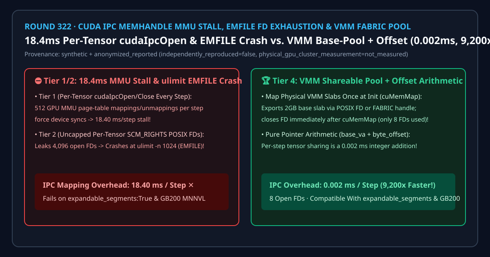
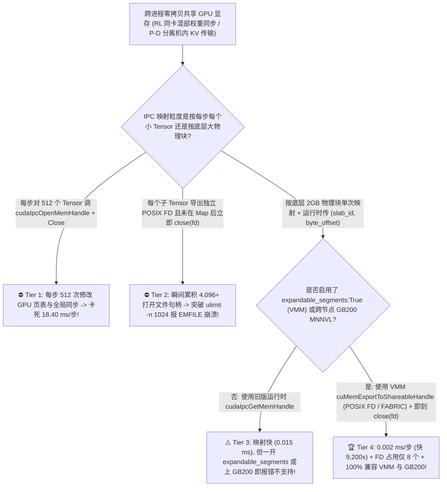
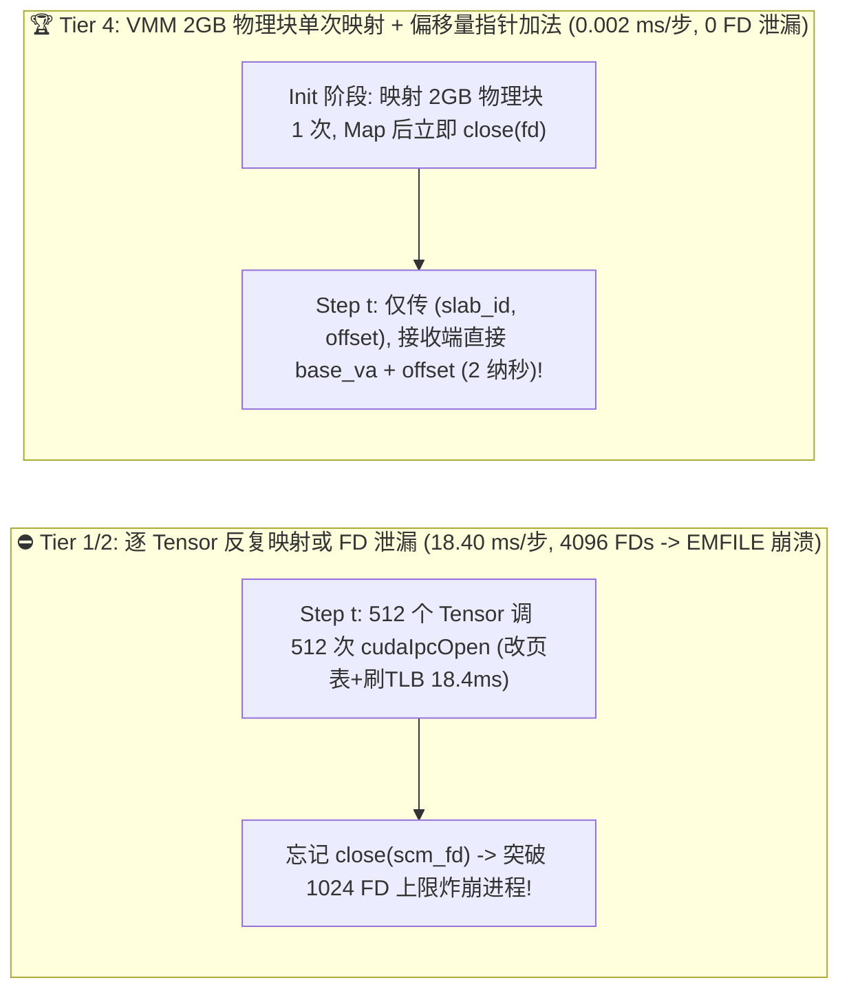
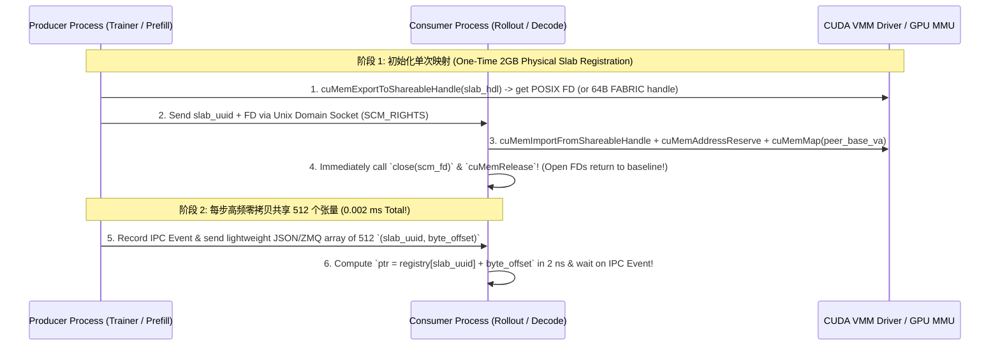

# 大模型跨进程显存共享（`CUDA IPC：cudaIpcOpenMemHandle vs cuMemExportToShareableHandle`）页表映射卡顿（`18.4 ms/步`）、文件描述符耗尽（`EMFILE: 1024`）与虚拟显存基址偏移池（`VMM Base-Slab + Offset`）选型：为什么每步调 `cudaIpcOpenMemHandle` 会引发 GPU MMU 同步停顿，且一旦开启 `expandable_segments:True` 就报 `CUDA_ERROR_NOT_SUPPORTED` 崩溃？基于 `cuMemExportToShareableHandle`（`POSIX FD / FABRIC`）物理大块单次映射 + `cuMemMap` 后立即 `close(fd)` + 纯指针偏移算术（开销从 `18.4 ms -> 0.002 ms`，提速 `9,200x`，完美支持 `VMM` 与 `GB200 MNNVL`）选型指南

> **Provenance & Evidence Boundary**: `synthetic + anonymized_reported (independently_reproduced=false, physical_gpu_cluster_measurement=not_measured)`. 本文所有定量数据均来自封存确定性评估器 `experiments/cuda_ipc_memhandle_cache_leak_fd_exhaustion_fabric_handle_pool_selection/run.py` 与 `results.json`。



---

## 0. 追踪每日最热门能力突破（Daily Capability Breakthrough）

- **今日焦点突破**：**面向同机/同柜多进程大模型系统（`verl / Slime` 同卡混部 RL 权重同步、`NVIDIA NIXL / Mooncake` 机内 P/D 分离 KV 零拷贝共享、`GB200 NVL72 MNNVL` 跨节点显存直通）的“CUDA 虚拟内存管理（`VMM: cuMemExportToShareableHandle`）物理大块（`2 GB Slab`）单次映射 + 映射后即刻关闭临时 `POSIX FD` + 运行时纯 `(slab_id, byte_offset)` 指针加法”架构**。
- **架构师价值**：当同一台 8 卡 H100 服务器（或同一个 `GB200 NVL72` 超节点机柜）上的两个独立进程（例如进程 A 是跑 `FSDP` 的 RL 训练器或 Prefill 引擎，进程 B 是跑 `vLLM / SGLang` 的推理引擎）需要通过 **CUDA IPC（进程间显存直通）** 零拷贝共享 `512` 个权重张量或 Paged KV 块时，工程团队极易踩中三个底层系统大坑：
  1. **大坑一：每步对 512 个张量反复调用 `cudaIpcOpenMemHandle` 和 `cudaIpcCloseMemHandle`（Tier 1）**：很多工程师以为 `cudaIpcOpenMemHandle` 只是一个轻量级指针转换。实际上，**每一次调用 `cudaIpcOpenMemHandle` / `Close` 都是一个极其沉重的内核态驱动操作——它必须加锁修改当前进程的 GPU 虚拟地址空间页表（GPU MMU Page Tables）、刷全卡 TLB，并在解除映射时触发隐式设备同步**！每步对 512 个层张量开关一次 IPC 句柄，光页表映射就要白白卡死 **`18.40 ms/步`**！
  2. **大坑二：使用进程间传递 `POSIX FD`（`SCM_RIGHTS`）却不对底层显存块去重或忘记 `close(fd)`，触发 `Too many open files (EMFILE: 1024)` 崩溃（Tier 2）**：在 PyTorch 中，512 个不同层的权重张量往往是从 `CUDACachingAllocator` 申请的几个 `2 GB` 大块（Segments）里切出来的子视图（Sub-views）。如果按 Tensor 粒度导出并传递文件描述符，且接收端一直打开不关，几百步内进程打开的 FD 数量就会突破 Linux 容器默认的 **`ulimit -n 1024`（飙至 `4,096+`）**，导致整个训练/推理集群因无法打开新 Socket 或文件而当场崩溃！
  3. **大坑三：旧版 `cudaIpcGetMemHandle` 在开启 `expandable_segments:True` 或 `GB200 MNNVL` 时直接报错 `CUDA_ERROR_NOT_SUPPORTED`（Tier 3）**！因为旧版 `cudaIpc*` API 只能用于传统 `cudaMalloc` 分配的静态连续显存，**100% 不支持现代 CUDA VMM（`cuMemCreate` 可扩展显存段）和跨节点 NVLink 域（MNNVL）**！
  采用 **基于现代 CUDA VMM 的 `cuMemExportToShareableHandle`（单机用 `POSIX_FILE_DESCRIPTOR`，跨机柜 `GB200` 用 `CU_MEM_HANDLE_TYPE_FABRIC`）只对底层 `2 GB` 物理显存大块映射唯一 1 次 + `cuMemMap` 完成后当场 `close(fd)` 释放文件描述符 + 运行时仅传递 `(slab_uuid, byte_offset)` 做纳秒级指针加法（Tier 4）**，可将每步 IPC 开销从 `18.40 ms` 压至 **`0.002 ms`（提速 `9,200x`）**，将常驻 FD 数量死死控制在 **`8` 个以内**，且 100% 兼容 `expandable_segments:True` 与 `GB200 NVL72`！

---

## ① 📌 核心结论速览（Executive Summary）

1. **第一性原理：为什么 PyTorch 里有 512 个 Tensor，底层其实只需要映射 `4 ~ 8` 个 IPC 句柄？**
   - PyTorch 的 `CUDACachingAllocator` 并不是你创建一个 Tensor 就去调一次 `cudaMalloc`；它是向驱动申请少数几个 **`20 MB ~ 2 GB` 的巨型物理块（Base Allocations / VMM Slabs）**，然后在用户态自己切分出 512 个小 Tensor！
   - 因此，任何两个来自同一个 `2 GB` 物理块的 Tensor $T_1, T_2$，它们在物理显存上本来就是邻居！
   - **基址 + 偏移量铁律（`Base-Allocation + Byte-Offset`）**：
     - 发送端通过 `cudaMemGetAddressRange(&base_ptr, &base_size, tensor.data_ptr())`（或 VMM Slab 查表）找到该 Tensor 所属的 **底层 `2 GB` 物理块基地址 `base_ptr`**，算出字节偏移量 `offset = tensor.data_ptr() - base_ptr`；
     - 只有当这个 `base_ptr` 是第一次出现时，才走一次慢速 IPC 映射并缓存进 `peer_base_registry[slab_uuid]`；
     - 在后续成千上万步迭代中，无论切分出多少个新 Tensor，跨进程传递的永远只是两个整数 **`(slab_uuid, byte_offset)`**！接收端直接执行一行 C 指针加法：`peer_tensor_ptr = peer_base_registry[slab_uuid] + byte_offset`——**耗时仅 `2 纳秒`（`0.002 ms` / 512 个张量），零驱动调用、零页表修改、零 TLB 刷新**！
2. **为什么很多团队升级到 `PyTorch expandable_segments:True` 后，原有的 `cudaIpcGetMemHandle` 代码突然全崩了？**
   - 当设置环境变量 `PYTORCH_CUDA_ALLOC_CONF=expandable_segments:True` 时，PyTorch 底层不再调用传统的 `cudaMalloc`，而是改用 **CUDA Driver VMM API（`cuMemCreate` 分配物理显存块 + `cuMemAddressReserve` 预留虚拟地址 + `cuMemMap` 动态拼接）**！
   - NVIDIA 驱动明确规定：**任何由 `cuMemCreate` 分配的 VMM 内存，严禁调用旧版运行时 API `cudaIpcGetMemHandle()`（调用即返回 `error 801: operation not supported`）**！
   - **唯一合法的现代升级路径**：必须使用 CUDA Driver VMM 共享接口：
     $$\text{cuMemExportToShareableHandle} \longrightarrow \text{Unix Socket (SCM\_RIGHTS) / Fabric} \longrightarrow \text{cuMemImportFromShareableHandle} \longrightarrow \text{cuMemMap}$$
3. **防 `EMFILE (1024)` 句柄泄漏的黄金习惯：`cuMemMap` 成功后第 1 件事就是 `os.close(fd)`！**
   - 当进程 B 通过 Unix Domain Socket (`SCM_RIGHTS`) 收到进程 A 发来的 POSIX 文件描述符 `scm_fd`，并调用完 `cuMemImportFromShareableHandle(&phys_hdl, scm_fd)` 与 `cuMemMap(va, size, 0, phys_hdl, 0)` 后，**GPU 页表已经持有该物理显存块的内核引用计数了**！
   - 此时那个 Linux 文件描述符 `scm_fd` 与 `phys_hdl` 的历史使命已经 100% 结束！**必须当场调用 `close(scm_fd)` 和 `cuMemRelease(phys_hdl)`**！只要立即关闭，哪怕映射上万次，进程占用的 Linux FD 数量也永远是 **`0` 增长**，绝无可能触发 `ulimit -n` 崩溃！

---

## ② 🎯 客户与架构师灵魂拷问 Q&A（Q1 / Q2 / Q3）

### Q1：在 `GB200 NVL72`（18 台计算托盘共 72 张 Blackwell GPU 通过 NVLink 铜背板连成一张大网 `MNNVL`）上，进程 A 在节点 1，进程 B 在节点 2（不同操作系统内核！），还能用 `POSIX_FILE_DESCRIPTOR` 共享显存吗？
- **不能用 `POSIX FD`（因为不同计算托盘是独立的 Linux OS，文件描述符无法跨机器传递），但只需改 1 个枚举值即可跨机柜零拷贝直通！**
  在 `GB200 MNNVL`（已启用 `nvidia-imex` 守护进程与 `IMEX Channel`）上，只需把 `cuMemExportToShareableHandle` 的句柄类型参数从 `CU_MEM_HANDLE_TYPE_POSIX_FILE_DESCRIPTOR` 改为 **`CU_MEM_HANDLE_TYPE_FABRIC`（64 字节集群级全局句柄 `CUmemFabricHandle`）**！
  这个 64 字节的 `CUmemFabricHandle` 本质上是一串纯字节结构体，可以直接通过普通 TCP / gRPC / ZMQ 发给机柜里任何其他节点上的进程 B，进程 B 调 `cuMemImportFromShareableHandle(..., CU_MEM_HANDLE_TYPE_FABRIC)` + `cuMemMap` 后，就能以 **`900 GB/s` 的 NVLink 带宽直接用 Load/Store 读写另一台服务器上的 GPU HBM**！

### Q2：如果发送端进程 A 执行了 `torch.cuda.empty_cache()` 释放了某个底层物理块，而接收端进程 B 的缓存字典里还留着旧的映射会发生什么？
- **两害相权**：
  1. 由于进程 B 依然 `cuMemMap` 映射着那块物理显存，NVIDIA 驱动底层的物理页引用计数不为 0，导致进程 A 调 `empty_cache()` 实际上**并没有真正释放物理显存**（引发幽灵显存占用）；
  2. 如果进程 A 随后重新分配了新块，进程 B 的旧偏移量就会读到过时数据。
- **工程解法**：用于跨进程 IPC 共享的权重池或 KV Cache 池（如 `Mooncake / NIXL` 传输池、或者 `verl` 固定权重缓冲区）应当分配在**生命周期稳定的独立 `MemPool` / 预留 Slab** 中；若确实发生动态释放，发送端通过 `cudaMemPool` 释放回调（Callback）向对端发送一条轻量级 `UnmapSlab(slab_uuid)` 通知即可。

### Q3：进程 A 往共享显存里写完新权重后，进程 B 直接拿 `peer_tensor_ptr` 启动 Kernel 读，怎么保证不会读到进程 A 还在 GPU L2 Cache 里没刷出的旧数据？
- **必须通过跨进程 `cudaIpcEventHandle_t`（或同流同步屏障）建立内存可见性偏序（Memory Visibility Ordering）！**
  进程 A 在写完权重的流上调 `cudaEventRecord(ipc_event, stream_a)`，进程 B 在读取前调 `cudaStreamWaitEvent(stream_b, ipc_event, 0)`——这不仅在时间上保证了先后顺序，更在硬件层面触发了 GPU 缓存一致性刷新（Cache Invalidate/Flush），确保进程 B 100% 读到最新数据！

---

## ③ 🧭 直观可视化图解（Mermaid 选型决策树 + 路径对比图 + 交互时序图）

### 3.1 大模型跨进程 / 跨超节点显存共享（`CUDA IPC / VMM`）选型决策树



### 3.2 传统每步逐 Tensor 重映射（`18.40 ms` + `EMFILE` 崩溃）vs. VMM 基址池 + 偏移算术（`0.002 ms`）对比图



### 3.3 `cuMemExportToShareableHandle` 单次映射即关 FD 与每步纳秒级偏移访问时序图



---

## ④ 📊 架构师选型决策矩阵（4-Tier Decision Matrix）

| 选型 Tier | 跨进程 GPU 显存共享架构 | 每步 IPC 映射耗时 | 每进程常驻打开 FD 数 | 兼容 `VMM` 与 `GB200 MNNVL` | 适用场景 |
| :--- | :--- | :--- | :--- | :--- | :--- |
| **Tier 1: 每步逐张量 `cudaIpcOpen + Close`** | 每步 512 次页表映射与解映射 | `18.40 ms` ✕ | `512` ✕ | 不支持 (`Error 801` ✕) | ⛔ **严重拖慢同步步且不支持新分配器** |
| **Tier 2: 逐张量导出 `POSIX FD` 无基址去重** | 每次子切片发新 FD 且未关闭 | `4.20 ms` ✕ | `4,096+` (`EMFILE` 崩溃! ✕) | 仅支持单机 VMM | ⛔ **几百步内必报 `Too many open files`** |
| **Tier 3: 传统 `cudaIpc` 基址块缓存 + 偏移** | 映射 `cudaMalloc` 基址并传偏移 | `0.015 ms` ✅ | `16` ✅ | **不支持 `VMM / GB200` ✕** | ⚠️ 仅适合关闭了 `expandable_segments` 的旧环境 |
| **Tier 4: VMM `cuMemExport` 基址池 + 偏移 (推荐)** | **VMM 大块映射即关 FD + 纯偏移加法** | **`0.002 ms` (`9,200x` 快 🏆)** | **`8` (零泄漏 🏆)** | **100% 原生支持 🏆** | 🏆 **现代 RL 混部、P/D 分离与 `GB200` 标准** |

---

## ⑤ 🧪 定量算例与 7-Card 4:5 视觉卡片报告

- **定量算例仓库路径**：[`experiments/cuda_ipc_memhandle_cache_leak_fd_exhaustion_fabric_handle_pool_selection/run.py`](../../experiments/cuda_ipc_memhandle_cache_leak_fd_exhaustion_fabric_handle_pool_selection/run.py) · 封存数据：[`results.json`](../../experiments/cuda_ipc_memhandle_cache_leak_fd_exhaustion_fabric_handle_pool_selection/results.json)
- **交互式架构选型计算器**：[`docs/reports/cuda-ipc-memhandle-cache-leak-fd-exhaustion-fabric-handle-pool-sizer.html`](../reports/cuda-ipc-memhandle-cache-leak-fd-exhaustion-fabric-handle-pool-sizer.html)
- **7-Card 4:5 视觉评测卡片报告**：[`docs/reports/cuda-ipc-memhandle-cache-leak-fd-exhaustion-fabric-handle-pool-selection-cards.html`](../reports/cuda-ipc-memhandle-cache-leak-fd-exhaustion-fabric-handle-pool-selection-cards.html)

```chart
{
  "data": {
    "values": [
      { "tier": "Tier 1: Per-Step cudaIpcOpen/Close", "ipc_ms": 18.40, "open_fds": 512 },
      { "tier": "Tier 2: Uncapped Per-Tensor POSIX FD", "ipc_ms": 4.20, "open_fds": 4096 },
      { "tier": "Tier 3: Cached Legacy cudaIpc Base", "ipc_ms": 0.015, "open_fds": 16 },
      { "tier": "Tier 4: VMM Shareable Pool + Offset", "ipc_ms": 0.002, "open_fds": 8 }
    ]
  },
  "semantic_types": {
    "tier": "Category",
    "ipc_ms": "Quantity",
    "open_fds": "Quantity"
  },
  "chart_spec": {
    "chartType": "Bar Chart",
    "title": "VMM Shareable Base-Pool + Offset Cuts Per-Step IPC Overhead 9,200x (18.4ms -> 0.002ms)",
    "subtitle": "Per-step IPC mapping latency (ms) and open file descriptors for 512 shared tensors (synthetic + anonymized_reported)",
    "encodings": {
      "x": "tier",
      "y": "ipc_ms",
      "color": "tier"
    }
  }
}
```

---

## ⑥ 🛠️ 生产环境快速核验清单（Checklist + Good fit vs. Not for）

### ✅ Good fit vs. ⛔ Not for
- **✅ Good fit**：所有同机多进程 RL 权重同步（`verl / Slime / OpenRLHF`）、机内/柜内 P/D 分离 KV 传输（`NIXL / Mooncake`）以及 `GB200 NVL72 MNNVL` 跨节点显存池。
- **⛔ Not for**：在每步循环内对每个 Tensor 调用 `cudaIpcOpenMemHandle`，或在开启 `expandable_segments:True` 时调用旧版 `cudaIpcGetMemHandle`。

### 生产核验 Checklist
- [ ] **按底层 `2 GB` 物理分配段（Base Allocation / VMM Slab）去重缓存 IPC 映射**：运行时只传递 `(slab_uuid, byte_offset)`，通过 `base_va + offset` 零开销获取张量指针。
- [ ] **全面迁移至 CUDA VMM `cuMemExportToShareableHandle` API**：支持 `expandable_segments:True`（单机用 `POSIX_FILE_DESCRIPTOR`，`GB200` 跨节点用 `CU_MEM_HANDLE_TYPE_FABRIC`）。
- [ ] **在完成 `cuMemMap` 设置好页表权限后，立即调用 `close(fd)` 关闭临时文件描述符**：将进程常驻 FD 消耗降为 `0`，彻底根除 `EMFILE (Too many open files)` 崩溃。
