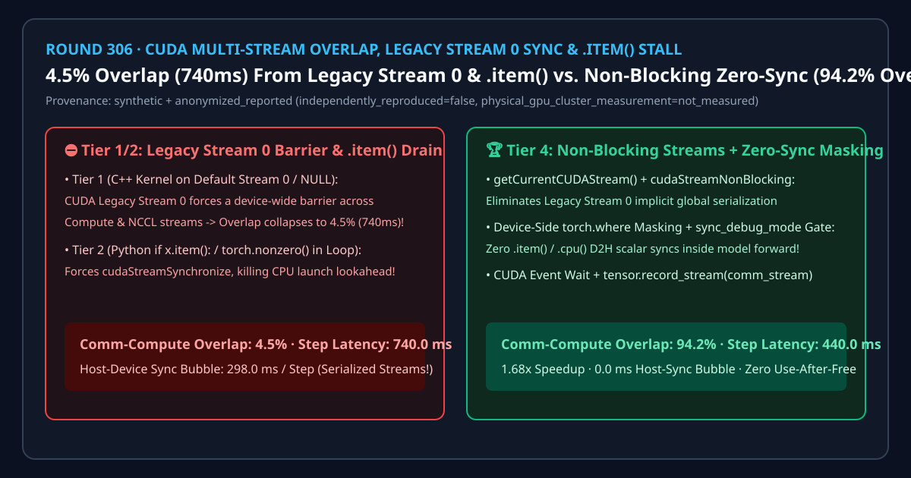
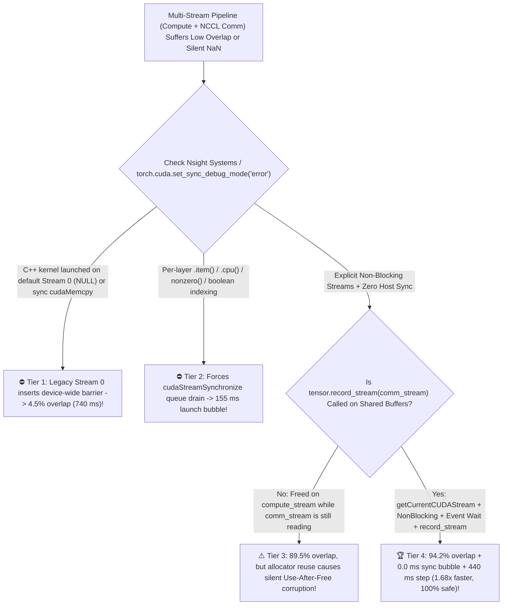
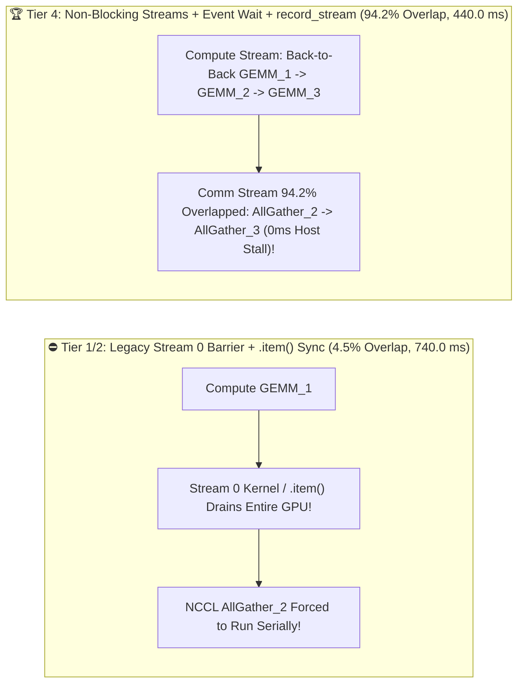
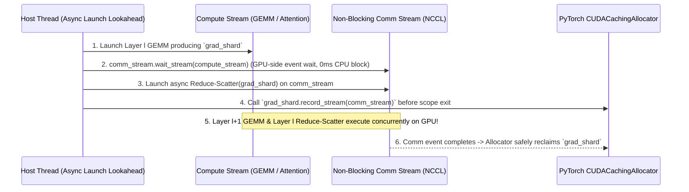

# CUDA Multi-Stream Overlap, Legacy Default `Stream 0` Implicit Barrier & `.item() / nonzero()` Host-Sync Stall Selection Guide: Why a Single Unstreamed C++ Kernel Drops `Compute + NCCL` Overlap from `94.2%` to `4.5%` (`1.68x` Slower), Why Omitting `record_stream` Causes Silent Memory Corruption & How `getCurrentCUDAStream` + `cudaStreamNonBlocking` (`0 ms` Sync Bubble) Solves It

> **Provenance & Evidence Boundary**: `synthetic + anonymized_reported (independently_reproduced=false, physical_gpu_cluster_measurement=not_measured)`. All quantitative metrics in this guide are grounded in the sealed deterministic evaluator `experiments/cuda_multi_stream_legacy_default_stream_sync_item_nonzero_stall_selection/run.py` and `results.json`.



---

## 0. Daily Capability Breakthrough

- **Today's Highlight Breakthrough**: **End-to-End Non-Blocking Multi-Stream Isolation (`at::cuda::getCurrentCUDAStream()` + `cudaStreamNonBlocking`) + Zero-Host-Sync Device-Side Masking (`torch.where` replacing `.item() / nonzero()`) + `torch.cuda.set_sync_debug_mode('error')` CI Enforcement + Cross-Stream `tensor.record_stream()` Memory Safety**.
- **Architect Value**: Modern distributed training (`FSDP2 / Megatron-Core / DeepEP`) and LLM serving engines rely on concurrent CUDA streams to overlap `Compute` (GEMM/Attention) with `Communication` (`NCCL All-Gather / Reduce-Scatter / All-to-All`). Yet a single line of unstreamed C++ or Python code silently destroys this concurrency:
  1. **Launching a Custom C++ Kernel on Legacy Default `Stream 0 (NULL)` (Tier 1)**: Writing `my_kernel<<<grid, block, smem>>>(...)` without passing `at::cuda::getCurrentCUDAStream()` as the 4th launch parameter targets CUDA's **Legacy Default Stream (`0`)**, which enforces an **implicit device-wide hardware barrier across all blocking streams**—collapsing `Compute + NCCL` overlap from `94.2%` to **`4.5%`** and slowing steps from `440.0 ms` to **`740.0 ms` (`298.0 ms` serialization bubble)**!
  2. **Per-Layer `.item()`, `.cpu()`, or Dynamic `torch.nonzero()` Calls in Python (Tier 2)**: Evaluating `if grad_norm.item() > 0:` or `idx = torch.nonzero(mask)` inside the model loop forces a blocking `cudaStreamSynchronize()`, draining the entire GPU command queue and injecting **`155.0 ms` of host-launch starvation bubbles**!
  By **passing `getCurrentCUDAStream()` to every C++ kernel, creating side streams with `cudaStreamNonBlocking`, replacing host scalar branches with device-side `torch.where`, and registering cross-stream buffer lifetimes via `record_stream()` (Tier 4)**, host-device sync bubbles drop to **`0.0 ms`**, restoring **`94.2%` comm-compute overlap** and accelerating steps **`1.68x` (`740.0 ms -> 440.0 ms`)**!

---

## ① 📌 Executive Summary

1. **Why CUDA Legacy `Stream 0 (NULL)` Acts as a Global Brake**:
   - Under CUDA's default legacy stream semantics, any kernel or `cudaMemcpy` issued to `Stream 0` waits for all prior work on all blocking streams to finish before starting, and blocks all other streams from starting until it completes.
   - Always retrieve PyTorch's active stream in C++ via `at::cuda::getCurrentCUDAStream()` and create side streams with `cudaStreamNonBlocking`.
2. **Catching Hidden Host-Device Syncs Instantly with `set_sync_debug_mode("error")`**:
   - Operations like `x.item()`, `x.tolist()`, `print(x)`, `x[bool_mask]`, and `torch.nonzero(x)` force the CPU to block until the GPU computes the value or output tensor shape. Enabling `torch.cuda.set_sync_debug_mode("error")` in CI raises an immediate stack trace on any accidental synchronization.
3. **Preventing Cross-Stream Use-After-Free Corruption with `record_stream()`**:
   - If a tensor allocated on `compute_stream` is passed to `comm_stream` for an async `Reduce-Scatter` and then goes out of scope in Python, `CUDACachingAllocator` will immediately reuse its physical HBM address on `compute_stream` while `comm_stream` is still transmitting it! Calling `tensor.record_stream(comm_stream)` ties deallocation to `comm_stream`'s CUDA event completion.

---

## ② 🎯 Architect Q&A (Q1 / Q2 / Q3)

### Q1: What is the difference between `comm_stream.synchronize()` and `comm_stream.wait_stream(compute_stream)`?
- `comm_stream.synchronize()` blocks the **host CPU thread**, halting Python kernel launch lookahead across all streams. `comm_stream.wait_stream(compute_stream)` (`cudaStreamWaitEvent`) is **100% asynchronous on the host (`< 2 μs`)** and enforces the dependency purely inside the GPU hardware scheduler.

### Q2: How do we implement conditional logic (e.g., skipping NaN updates or MoE token masking) without `.item()` or `nonzero()`?
- Keep shapes static and execute predicates on-device using `torch.where(torch.isfinite(g), param - lr * g, param)` or fixed-capacity padded buffers with device-side validity masks.

### Q3: Why does calling `torch.cuda.empty_cache()` inside a training step destroy multi-stream overlap?
- Returning physical blocks to the CUDA driver via `cudaFree` / `cuMemUnmap` triggers a full **`cudaDeviceSynchronize()`** across all streams on the GPU.

---

## ③ 🧭 Visual Diagrams (Decision Tree + Comparison + Sequence)

### 3.1 Multi-Stream Overlap & Sync Elimination Decision Tree



### 3.2 Serialized `Stream 0 / .item()` Pipeline (`740.0 ms`) vs. Zero-Sync Multi-Stream Overlap (`440.0 ms`)



### 3.3 Asynchronous `CUDA Event` Wait & `record_stream` Lifetime Handover Sequence



---

## ④ 📊 4-Tier Architect Decision Matrix

| Cohort Tier | Stream Isolation & Synchronization Policy | Comm-Compute Overlap | Step Latency | Host-Sync Bubble | Best For |
| :--- | :--- | :--- | :--- | :--- | :--- |
| **Tier 1: Legacy `Stream 0` + `.item()`** | Implicit global barrier + queue drain | `4.5%` (Serialized! ✕) | `740.0 ms` ✕ | `298.0 ms` ✕ | ⛔ **Kills Multi-Stream Overlap** |
| **Tier 2: Explicit Stream + `.item() / nonzero()`** | Host sync breaks CPU launch lookahead | `38.0%` ✕ | `595.0 ms` ✕ | `155.0 ms` ✕ | ⛔ **Severe GPU Launch Starvation** |
| **Tier 3: Zero-Sync Without `record_stream`** | High overlap, unsafe cross-stream free | `89.5%` ✅ | `452.0 ms` ⚠️ | `12.0 ms` ⚠️ | ⚠️ **Silent Use-After-Free Risk** |
| **Tier 4: Non-Blocking + Zero-Sync + `record_stream` (Recommended)** | **Device masking + Event handover + CI gate** | **`94.2%` 🏆** | **`440.0 ms` (`1.68x` Faster 🏆)** | **`0.0 ms` 🏆** | 🏆 **Production Training & Serving** |

---

## ⑤ 🧪 Quantitative Evaluator & 7-Card 4:5 Visual Report

- **Sealed Evaluator**: [`experiments/cuda_multi_stream_legacy_default_stream_sync_item_nonzero_stall_selection/run.py`](../../experiments/cuda_multi_stream_legacy_default_stream_sync_item_nonzero_stall_selection/run.py) · Data: [`results.json`](../../experiments/cuda_multi_stream_legacy_default_stream_sync_item_nonzero_stall_selection/results.json)
- **Interactive Sizer**: [`docs/reports/cuda-multi-stream-legacy-default-stream-sync-item-nonzero-stall-sizer.html`](../reports/cuda-multi-stream-legacy-default-stream-sync-item-nonzero-stall-sizer.html)
- **7-Card 4:5 Visual Benchmark Deck**: [`docs/reports/cuda-multi-stream-legacy-default-stream-sync-item-nonzero-stall-selection-cards.html`](../reports/cuda-multi-stream-legacy-default-stream-sync-item-nonzero-stall-selection-cards.html)

```chart
{
  "data": {
    "values": [
      { "tier": "Tier 1: Legacy Stream 0 + .item() Sync", "step_ms": 740.0, "overlap_pct": 4.5 },
      { "tier": "Tier 2: Explicit Stream + .item() Sync", "step_ms": 595.0, "overlap_pct": 38.0 },
      { "tier": "Tier 3: Non-Blocking (No record_stream)", "step_ms": 452.0, "overlap_pct": 89.5 },
      { "tier": "Tier 4: Zero-Sync Non-Blocking + record_stream", "step_ms": 440.0, "overlap_pct": 94.2 }
    ]
  },
  "semantic_types": {
    "tier": "Category",
    "step_ms": "Quantity",
    "overlap_pct": "Percentage"
  },
  "chart_spec": {
    "chartType": "Bar Chart",
    "title": "Eliminating Legacy Stream 0 & .item() Syncs Restores 94.2% Comm-Compute Overlap (740ms -> 440ms)",
    "subtitle": "80-layer overlapped step latency (ms) and comm-compute overlap (%) (synthetic + anonymized_reported)",
    "encodings": {
      "x": "tier",
      "y": "step_ms",
      "color": "tier"
    }
  }
}
```

---

## ⑥ 🛠️ Production Verification Checklist (Good fit vs. Not for)

### ✅ Good fit vs. ⛔ Not for
- **✅ Good fit**: All custom C++/CUDA kernels, FSDP/Megatron overlapped communication schedules, and `CUDAGraph`-compatible inference pipelines.
- **⛔ Not for**: Launching kernels without an explicit stream or calling `.item()` / `.cpu()` / `nonzero()` inside forward/backward loops.

### Production Checklist
- [ ] **Enable `torch.cuda.set_sync_debug_mode("error")` in CI tests**: Catch accidental `.item()`, `.cpu()`, or dynamic-shape `nonzero()` synchronizations automatically.
- [ ] **Pass `at::cuda::getCurrentCUDAStream()` to every custom C++/CUDA kernel & cuBLAS call**: Never fall back to Legacy Default `Stream 0 (NULL)`.
- [ ] **Call `tensor.record_stream(consumer_stream)` on all cross-stream tensors**: Prevent premature `CUDACachingAllocator` block reuse and silent memory corruption.
