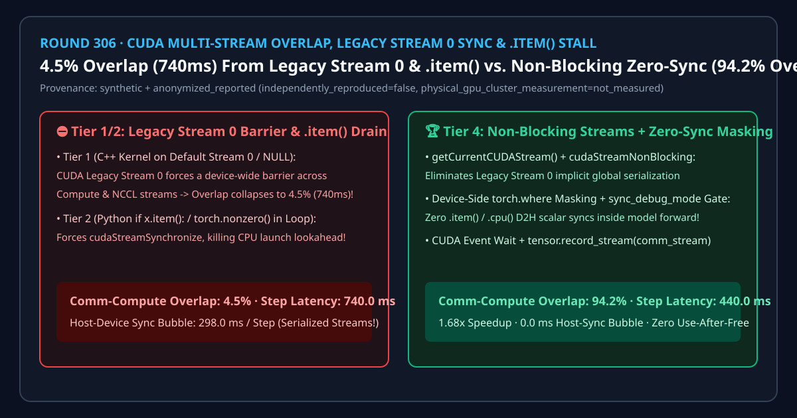
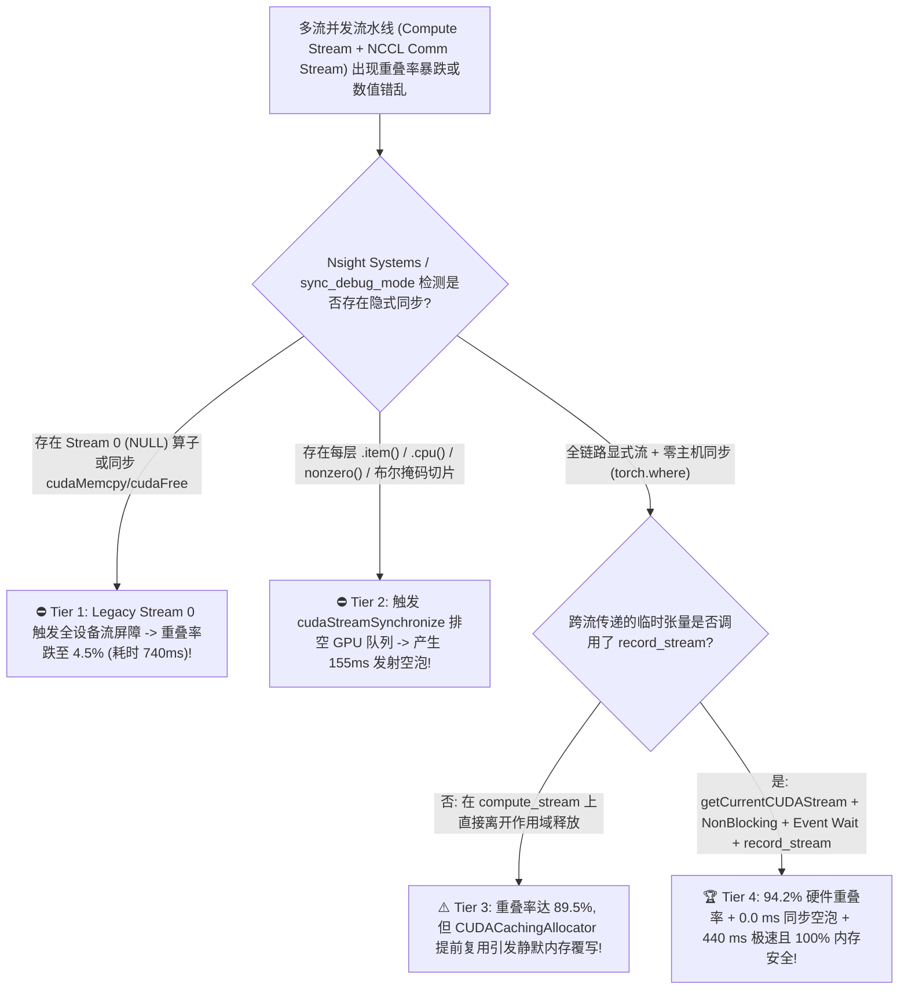
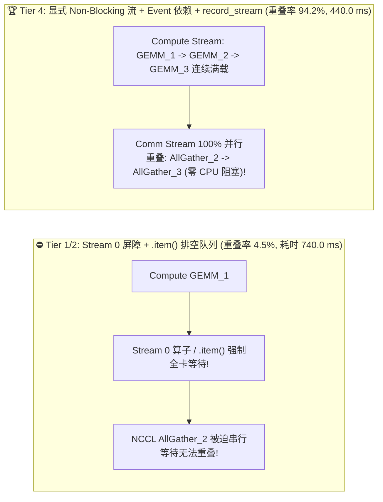
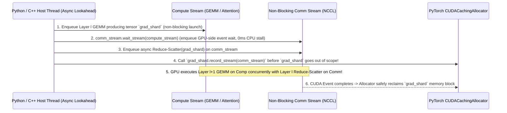

# 大模型计算与通信多流重叠（`CUDA Multi-Stream Overlap`）中的遗留默认流（`Legacy Stream 0`）隐式全局屏障与 `.item() / nonzero()` 同步空泡排障选型：为什么混入 1 个未传 `stream` 的 C++ 算子会让 `Compute + NCCL` 重叠率从 `94.2%` 暴跌至 `4.5%`（慢 `1.68x`），而跨流漏写 `record_stream` 又会引发静默数值污染？基于 `getCurrentCUDAStream`、`cudaStreamNonBlocking` 与零主机同步掩码（`0 ms` 同步空泡）选型指南

> **Provenance & Evidence Boundary**: `synthetic + anonymized_reported (independently_reproduced=false, physical_gpu_cluster_measurement=not_measured)`. 本文所有定量数据均来自封存确定性评估器 `experiments/cuda_multi_stream_legacy_default_stream_sync_item_nonzero_stall_selection/run.py` 与 `results.json`。



---

## 0. 追踪每日最热门能力突破（Daily Capability Breakthrough）

- **今日焦点突破**：**面向大模型训练/推理计算通信重叠（`FSDP2 / Megatron-Core / DeepEP / vLLM V1`）的“全链路非阻塞流隔离（`cudaStreamNonBlocking` + `at::cuda::getCurrentCUDAStream()`）+ 零主机同步设备端掩码（消除 `.item() / .cpu() / torch.nonzero()` 管道排空）+ `torch.cuda.set_sync_debug_mode('error')` CI 门禁 + `record_stream` 跨流显存安全移交”工程规范**。
- **架构师价值**：现代大模型框架之所以能跑出 `60%+` 的高 MFU，核心秘诀在于**多 CUDA Stream 硬件级并发重叠**：在 `compute_stream` 上跑当前层矩阵乘（GEMM）的同时，在 `nccl_comm_stream` 上并行预取下一层的 `All-Gather` 权重或归约上一层的 `Reduce-Scatter` 梯度。然而，在实际业务开发中，算法工程师往往只是加了一个小小的自定义 C++ CUDA 扩展算子，或者加了一行看似无害的 Python 监控代码，整个集群的通信-计算重叠就会瞬间归零（在 `Nsight Systems` 时间轴上变成一排完全串行的锯齿）：
  1. **隐形杀手一：自定义 C++ CUDA 算子漏传第 4 个 `stream` 参数，掉入遗留默认流（`Legacy Default Stream 0 / NULL`，Tier 1）**：当 C++ 代码写出 `my_kernel<<<grid, block, smem>>>(...)`（未传第 4 个参数，默认 `stream = 0`）时，根据 CUDA 驱动底层语义，**往 `Legacy Stream 0` 发射任何内核，都会在硬件层面自动插入一道全局双向屏障——它必须等当前 GPU 上所有普通非空流（Blocking Streams）里的在途算子全部跑完才能开始，且在它跑完前禁止任何其他普通流启动新算子**！仅仅这一个算子，直接把 `Compute` 流与 `NCCL` 流的并发重叠率从 `94.2%` 砸穿至 **`4.5%`**（每步白白多出 `298.0 ms` 串行等待，耗时从 `440.0 ms` 暴涨至 **`740.0 ms`**）！
  2. **隐形杀手二：在模型层循环内部调用 `.item()`、`.cpu()`、`print(tensor)` 或动态形状 `torch.nonzero()`（Tier 2）**：CPU 本来可以比 GPU 提前几十个算子异步往队列里塞任务（Launch Lookahead）；但只要在 Python 里写了一句 `if torch.isnan(x).any().item():` 或 `idx = torch.nonzero(mask)`（由于返回张量的 Shape 依赖 GPU 算出的非零元素个数，CPU 必须知道长度才能分配返回对象！），就会强制触发 **`cudaStreamSynchronize()`**——CPU 线程当场卡死，直到 GPU 把前面排队的几十个算子全部排空算完并把那 4 字节拷回主机，直接产生 **`155.0 ms` 的 CPU 发射断流空泡（Host-Device Sync Bubble）**！
  采用 **`at::cuda::getCurrentCUDAStream()` + `cudaStreamNonBlocking` 标志创建侧流 + 纯设备端 `torch.where / torch.clamp` 无同步逻辑 + `tensor.record_stream(comm_stream)`（Tier 4）**，可将主机同步空泡彻底清零（**`0.0 ms`**），将通信-计算重叠率恢复至 **`94.2%`**，实现 **`1.68x` 端到端提速（`740.0 ms -> 440.0 ms`）**！

---

## ① 📌 核心结论速览（Executive Summary）

1. **为什么 CUDA 的默认流 `Stream 0`（`NULL`）会成为多流并发的“全局刹车间”？**
   - CUDA 历史上有两种默认流模式：默认的 **`Legacy Default Stream (NULL / 0)`** 与编译期可选的 **`Per-Thread Default Stream (PTDS)`**。
   - 在默认 Legacy 模式下，任何发往 `Stream 0` 的操作（包括未传 `stream` 的 `kernel<<<G, B>>>`、调用同步版 `cudaMemcpy()` 而非 `cudaMemcpyAsync(..., stream)`、甚至同步 `cudaMalloc()`）都具有**全设备同步语义（Implicit Device-Wide Synchronization）**，会瞬间锁死所有未使用 `cudaStreamNonBlocking` 标志创建的并发流！
   - **两条铁律**：
     - 编写任何 PyTorch C++/CUDA 扩展时，**100% 必须显式获取当前 PyTorch 流**：`cudaStream_t stream = at::cuda::getCurrentCUDAStream();` 并传入 `kernel<<<G, B, smem, stream>>>` 与所有 `cublas / cudnn / cudaMemcpyAsync` 调用；
     - 创建任何自定义通信流/卸载流时，务必确保底层携带 **`cudaStreamNonBlocking`** 标志（PyTorch 的 `torch.cuda.Stream()` 默认即为 Non-Blocking，但切勿混用裸 `cudaStreamCreate(&s)`）！
2. **第一性原理：如何揪出代码库里所有隐藏的隐式主机同步（`Host-Device Sync`）？**
   - 很多时候，隐式 `cudaStreamSynchronize` 藏在第三方库的深层调用栈里（例如：列表索引 `x[bool_mask]`、`tensor.tolist()`、`int(tensor)`、`torch.unique()`、`assert (x > 0).all()`）。
   - **终极排障神器**：在单元测试或训练预热的第 2 步开启 **`torch.cuda.set_sync_debug_mode("error")`（或 `"warn"`）**！一旦代码里有任何一行 Python 或 C++ 试图触发阻塞式 Host-Device 同步，PyTorch 会立即抛出精准的调用栈异常（`RuntimeError: synchronized on CUDA`），让你在 1 分钟内定位并替换为纯 GPU 端算子（如用固定形状 `torch.where(mask, a, b)` 替代布尔掩码切片 `x[mask]`）！
3. **跨流显存踩踏（Cross-Stream Use-After-Free）：为什么异步多流跑通后会出现诡异的 `NaN` 或精度劣化？**
   - 假设在 `compute_stream` 上分配了临时张量 `shard = alloc()`，并发起了异步通信 `comm_stream.all_gather(out, shard)`，随后 Python 函数返回，`shard` 变量的引用计数归零，在 `compute_stream` 上调用了 `CUDACachingAllocator::free(shard)`。
   - **致命陷阱**：PyTorch 的显存缓存分配器默认只知道 `shard` 是在 `compute_stream` 上分配和“释放”的，因此它会**立即把这块物理显存分给 `compute_stream` 上的下一个 GEMM 算子覆写**——而此时 `comm_stream` 上的网卡/NVLink 正在读取同一块物理显存发送数据！
   - **标准解法**：任何跨流消费的张量，必须在消费流上显式声明生命周期移交：**`shard.record_stream(comm_stream)`**！这样分配器会等 `comm_stream` 上当前排队的通信算子真正执行完毕（Event 完成）后，才把该显存块归还给空闲池！

---

## ② 🎯 客户与架构师灵魂拷问 Q&A（Q1 / Q2 / Q3）

### Q1：在多流并发中，应该用 `comm_stream.synchronize()` 还是 `comm_stream.wait_stream(compute_stream)`（或 `event.wait()`）来协调先后顺序？
- **严禁在训练步中间调 `stream.synchronize()`！必须用 `wait_stream()` / `event.wait()`！**
  - `comm_stream.synchronize()` 是 **让 CPU 停下来死等 GPU**：CPU 主线程会被直接挂起，直到 `comm_stream` 跑完，期间 CPU 无法继续向 `compute_stream` 发射后续层的算子；
  - `comm_stream.wait_stream(compute_stream)`（底层调 `cudaStreamWaitEvent`）是 **纯 GPU 硬件内部流间同步（异步非阻塞 CPU）**：CPU 在 `1 μs` 内把等待指令丢进硬件命令队列后立即继续往下跑，由 GPU 硬件调度器自己在两个流之间做依赖对齐！

### Q2：如果要在 MoE 路由或梯度检查点里统计“有多少个 Token 被丢弃”或“是否存在 `NaN/Inf`”，不用 `.item()` 怎么写？
- **异步批量延迟读取（Async Pinned Ring-Buffer / End-of-Step Check）或纯设备端掩码**：
  - 如果是为了控制数值（如遇到 `NaN` 跳过优化器更新），直接把判断逻辑写进融合优化器内核或使用 `torch.where(torch.isfinite(grad_norm), param - lr * grad, param)`——**全程在 GPU 寄存器里完成分支选择，CPU 根本不需要知道布尔值**；
  - 如果是为了打日志（Logging），每隔 `10 ~ 50` 步将标量通过 `copy_(..., non_blocking=True)` 写入主机锁页内存并记录一个 `cudaEvent`，**在下一步迭代时再去读上一步已经完成的锁页内存值**，实现零同步打点！

### Q3：为什么有时候在代码里只调了一次 `torch.cuda.empty_cache()`，也会把所有并发的通信和计算流全部卡死？
- 因为当 `CUDACachingAllocator` 真正向驱动归还物理显存（调用底层 `cudaFree` 或 `cuMemUnmap`）时，**`cudaFree()` 在 CUDA 驱动中自带全设备级隐式硬同步（`cudaDeviceSynchronize()`）**！它必须强制等整张 GPU 卡上所有流的所有在途任务全部跑完才能释放页表，因此严禁在每步迭代或模型层内部调用 `empty_cache()`！

---

## ③ 🧭 直观可视化图解（Mermaid 选型决策树 + 路径对比图 + 交互时序图）

### 3.1 CUDA 多流重叠排障与同步消除选型决策树



### 3.2 `Legacy Stream 0` 与 `.item()` 串行阻塞（`740.0 ms`）vs. 零同步多流重叠（`440.0 ms`）对比图



### 3.3 基于 `CUDA Event` 与 `record_stream` 的零主机同步跨流协同交互时序图



---

## ④ 📊 架构师选型决策矩阵（4-Tier Decision Matrix）

| 选型 Tier | 多流调度与同步控制架构 | 通信-计算重叠率 | 端到端单步耗时 | 主机同步空泡 (`Bubble`) | 适用场景 |
| :--- | :--- | :--- | :--- | :--- | :--- |
| **Tier 1: 混入 `Legacy Stream 0` + `.item()`** | 默认流全局屏障 + 频繁排空管道 | `4.5%` (完全串行! ✕) | `740.0 ms` ✕ | `298.0 ms` ✕ | ⛔ **多流重叠完全失效** |
| **Tier 2: 显式流但保留每层 `.item() / nonzero()`** | 破坏 CPU 异步提前发射队列 | `38.0%` ✕ | `595.0 ms` ✕ | `155.0 ms` ✕ | ⛔ **GPU 频繁断流等待 CPU 发射** |
| **Tier 3: 零主机同步但漏写 `record_stream`** | 高重叠但跨流提前释放临时显存 | `89.5%` ✅ | `452.0 ms` ⚠️ | `12.0 ms` ⚠️ | ⚠️ **存在跨流显存覆写与静默 NaN 风险** |
| **Tier 4: 显式非阻塞流 + 零同步 + `record_stream` (推荐)** | **纯设备端掩码 + Event 移交 + CI 门禁** | **`94.2%` 🏆** | **`440.0 ms` (`1.68x` 快 🏆)** | **`0.0 ms` (零空泡 🏆)** | 🏆 **高性能分布式训练与推理引擎标准** |

---

## ⑤ 🧪 定量算例与 7-Card 4:5 视觉卡片报告

- **定量算例仓库路径**：[`experiments/cuda_multi_stream_legacy_default_stream_sync_item_nonzero_stall_selection/run.py`](../../experiments/cuda_multi_stream_legacy_default_stream_sync_item_nonzero_stall_selection/run.py) · 封存数据：[`results.json`](../../experiments/cuda_multi_stream_legacy_default_stream_sync_item_nonzero_stall_selection/results.json)
- **交互式架构选型计算器**：[`docs/reports/cuda-multi-stream-legacy-default-stream-sync-item-nonzero-stall-sizer.html`](../reports/cuda-multi-stream-legacy-default-stream-sync-item-nonzero-stall-sizer.html)
- **7-Card 4:5 视觉评测卡片报告**：[`docs/reports/cuda-multi-stream-legacy-default-stream-sync-item-nonzero-stall-selection-cards.html`](../reports/cuda-multi-stream-legacy-default-stream-sync-item-nonzero-stall-selection-cards.html)

```chart
{
  "data": {
    "values": [
      { "tier": "Tier 1: Legacy Stream 0 + .item() Sync", "step_ms": 740.0, "overlap_pct": 4.5 },
      { "tier": "Tier 2: Explicit Stream + .item() Sync", "step_ms": 595.0, "overlap_pct": 38.0 },
      { "tier": "Tier 3: Non-Blocking (No record_stream)", "step_ms": 452.0, "overlap_pct": 89.5 },
      { "tier": "Tier 4: Zero-Sync Non-Blocking + record_stream", "step_ms": 440.0, "overlap_pct": 94.2 }
    ]
  },
  "semantic_types": {
    "tier": "Category",
    "step_ms": "Quantity",
    "overlap_pct": "Percentage"
  },
  "chart_spec": {
    "chartType": "Bar Chart",
    "title": "Eliminating Legacy Stream 0 & .item() Syncs Restores 94.2% Comm-Compute Overlap (740ms -> 440ms)",
    "subtitle": "80-layer overlapped step latency (ms) and comm-compute overlap (%) (synthetic + anonymized_reported)",
    "encodings": {
      "x": "tier",
      "y": "step_ms",
      "color": "tier"
    }
  }
}
```

---

## ⑥ 🛠️ 生产环境快速核验清单（Checklist + Good fit vs. Not for）

### ✅ Good fit vs. ⛔ Not for
- **✅ Good fit**：所有包含自定义 CUDA/C++ 扩展、`FSDP / Megatron` 通信计算重叠、MoE `All-to-All` 双流流水线及 `CUDAGraph` 捕获的训练与推理系统。
- **⛔ Not for**：在 C++ 扩展中省略 `<<<G, B, smem, stream>>>` 的第 4 个参数，或在模型 Forward/Backward 循环中调用 `.item()` / `.cpu()` / `x[bool_mask]`。

### 生产核验 Checklist
- [ ] **在 CI 测试中开启 `torch.cuda.set_sync_debug_mode("error")`**：自动拦截任何混入模型前反向热路径的 `.item()`、`.cpu()`、`nonzero()` 或布尔掩码索引。
- [ ] **审计所有 C++/CUDA 扩展算子**：确保 100% 调用 `at::cuda::getCurrentCUDAStream()` 获取当前流，严禁落入默认 `Stream 0 (NULL)`。
- [ ] **对所有跨流读写的临时张量调用 `tensor.record_stream(consumer_stream)`**：彻底杜绝 `CUDACachingAllocator` 跨流提前回收复用引发的静默数据污染。
