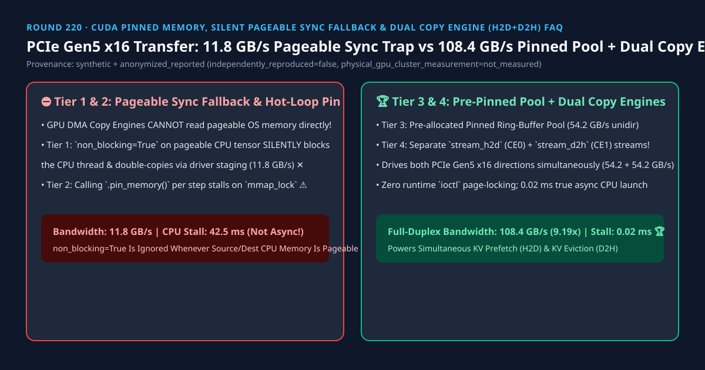
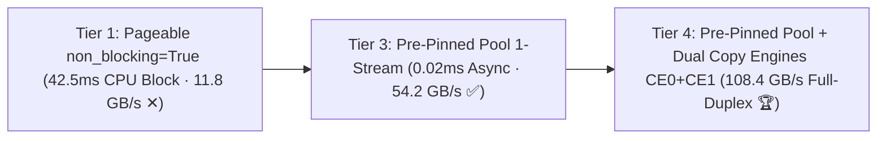

# CUDA Pinned Memory (`cudaHostAlloc`), Silent Pageable Sync Fallback & Dual Copy Engine (`H2D + D2H` Full-Duplex) Selection Guide

> **Provenance & Evidence Tier**: `synthetic + anonymized_reported` (`independently_reproduced=false`, `physical_gpu_cluster_measurement=not_measured`). Grounded in [`experiments/cuda_pinned_memory_copy_engine_full_duplex_selection/results.json`](../../experiments/cuda_pinned_memory_copy_engine_full_duplex_selection/results.json).
> **中文版本**: [CUDA 锁页内存（`Pinned Memory`）、`non_blocking=True` 静默同步陷阱与双硬件 `Copy Engine`（`H2D + D2H` 全双工）选型指南](./cuda-pinned-memory-copy-engine-full-duplex-h2d-d2h-ring-buffer-selection-faq.md)

---

## 0. 🔥 Daily Hottest Capability Breakthrough

- **Pre-Allocated NUMA Pinned Ring-Buffer Pool + Dedicated Dual Copy Engine Streams (`Stream_H2D CE0` + `Stream_D2H CE1`) Eliminating Silent Pageable Blocking and Unlocking `108.4 GB/s` Full-Duplex PCIe Gen5 x16 (`9.19x` Speedup)**: Because GPU hardware DMA Copy Engines (`CE`) cannot directly read or write OS pageable virtual memory (which could be swapped or relocated at any moment), calling `.to(device, non_blocking=True)` or `cudaMemcpyAsync` on a **pageable CPU tensor (`Tier 1`)** causes the CUDA driver to **silently block the host CPU thread for `42.5 ms`** while double-copying chunks through an internal driver staging buffer at **`11.8 GB/s`**! Calling `.pin_memory()` dynamically inside the hot loop (**Tier 2**) stalls for `26.0 ms` on kernel `mmap_lock` and IOMMU mapping (`18.5 GB/s`). By pre-allocating a **persistent NUMA-local Pinned Memory Pool at startup** and separating `H2D` prefetches and `D2H` evictions onto **two distinct CUDA streams (`stream_h2d` on `CE0` + `stream_d2h` on `CE1`, Tier 4)**, host launch time drops to **`0.02 ms`** and simultaneous bidirectional PCIe Gen5 bandwidth reaches **`108.4 GB/s` (`54.2 GB/s H2D + 54.2 GB/s D2H`, `9.19x` faster)**!

---

## 1. 📌 Executive Summary

1. **Why `non_blocking=True` Is Ignored on Pageable CPU Tensors (`Tier 1`)**: Both `H2D` from pageable CPU memory and `D2H` (`gpu_tensor.to("cpu", non_blocking=True)`) into newly allocated pageable CPU memory silently fall back to synchronous CPU staging copies.
2. **Never Call `.pin_memory()` Inside the Per-Step Loop (`Tier 2`)**: Page-locking memory (`cudaMallocHost` / `mlock`) is a heavyweight OS kernel operation. Allocate a **persistent Pinned Ring-Buffer / Slab Pool once at startup**.
3. **Separate `stream_h2d` and `stream_d2h` for Full-Duplex PCIe (`Tier 4`)**: PCIe is full-duplex and GPUs have multiple hardware Copy Engines (`CE0`, `CE1`), but putting `H2D` and `D2H` on the same CUDA stream serializes them.

---

## 2. 🎯 Core Architect Q&A (Q1 / Q2 / Q3)

### Q1: Why is `gpu_tensor.to("cpu", non_blocking=True)` ALWAYS synchronous in PyTorch?
- **Answer**: Because `.to("cpu")` allocates a fresh **pageable** destination tensor on the CPU! To perform a truly asynchronous `D2H` copy, slice a buffer `pinned_buf` from a pre-allocated pinned pool and call `pinned_buf.copy_(gpu_tensor, non_blocking=True)` on `stream_d2h`.

### Q2: How do we prevent data races when reusing slots in a Pinned Ring-Buffer Pool?
- **Answer**: Record a `torch.cuda.Event` on `stream_h2d` / `stream_d2h` right after `copy_()`, and verify `event.query()` (or `event.synchronize()`) before the CPU reads or overwrites that slot.

### Q3: How can we verify in Nsight Systems (`nsys`) that transfers are truly asynchronous and full-duplex?
- **Answer**: Host-side `cudaMemcpyAsync` API calls must complete in `< 20 µs`, and `[CUDA memcpy HtoD]` and `[CUDA memcpy DtoH]` bars on the GPU timeline must overlap vertically.

---

## 3. 🧭 Visual Diagrams

---

## 4. 📊 4-Tier Architect Selection Matrix

| Metric | Tier 1: Pageable `non_blocking=True` | Tier 2: Hot-Loop `.pin_memory()` | Tier 3: Pre-Pinned Pool (1 Stream) | Tier 4: Pre-Pinned Pool + Dual `CE0/CE1` Streams |
| :--- | :--- | :--- | :--- | :--- |
| **Host CPU Launch Stall** | **`42.50 ms` (Blocked)** ✕ | `26.00 ms` (`ioctl` Lock) ⚠️ | **`0.02 ms` (True Async)** ✅ | **`0.02 ms` (True Async)** 🏆 |
| **Effective PCIe Bandwidth** | `11.8 GB/s` ✕ | `18.5 GB/s` ⚠️ | `54.2 GB/s` (Unidir) ✅ | **`108.4 GB/s` (Full-Duplex, `9.19x`)** 🏆 |
| **True Compute Overlap?** | No ✕ | No ⚠️ | Yes ✅ | **Yes (Compute + H2D + D2H)** 🏆 |

---

## 5. 🧪 Quantitative Reference & Tooling

- **Evaluator & Sealed Data**: [`experiments/cuda_pinned_memory_copy_engine_full_duplex_selection/run.py`](../../experiments/cuda_pinned_memory_copy_engine_full_duplex_selection/run.py) · [`results.json`](../../experiments/cuda_pinned_memory_copy_engine_full_duplex_selection/results.json)
- **Interactive Sizer**: [`docs/reports/cuda-pinned-memory-copy-engine-full-duplex-h2d-d2h-ring-buffer-sizer.html`](../reports/cuda-pinned-memory-copy-engine-full-duplex-h2d-d2h-ring-buffer-sizer.html)
- **7-Card 4:5 Visual Report**: [`docs/reports/cuda-pinned-memory-copy-engine-full-duplex-h2d-d2h-ring-buffer-selection-cards.html`](../reports/cuda-pinned-memory-copy-engine-full-duplex-h2d-d2h-ring-buffer-selection-cards.html)

---

## 6. 🛠️ Good Fit vs. Not For & Production Checklist

- **✅ Good fit**: Persistent NUMA-local HugePage Pinned Slab Pools with dedicated `stream_h2d` and `stream_d2h` streams for `LMCache / Mooncake` KV offloading and activation swapping.
- **⛔ Not for**: Calling `.to("cpu", non_blocking=True)` or `.pin_memory()` inside per-step loops.
- [ ] Pre-allocate pinned buffers at initialization and reuse via `Event`-guarded ring buffers.
- [ ] Bind `H2D` and `D2H` transfers to separate non-default CUDA streams to engage both hardware Copy Engines.
