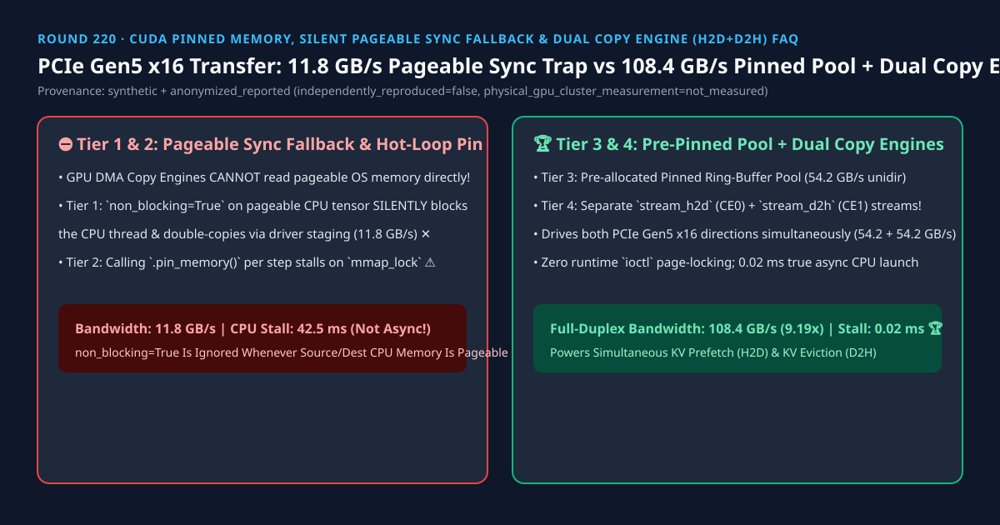
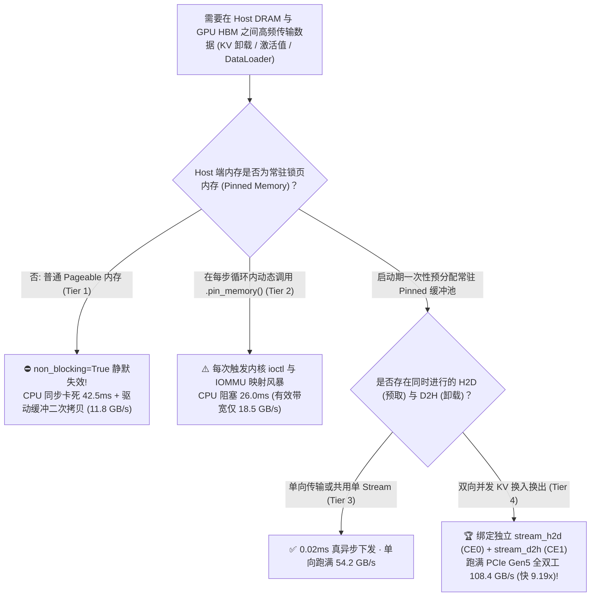
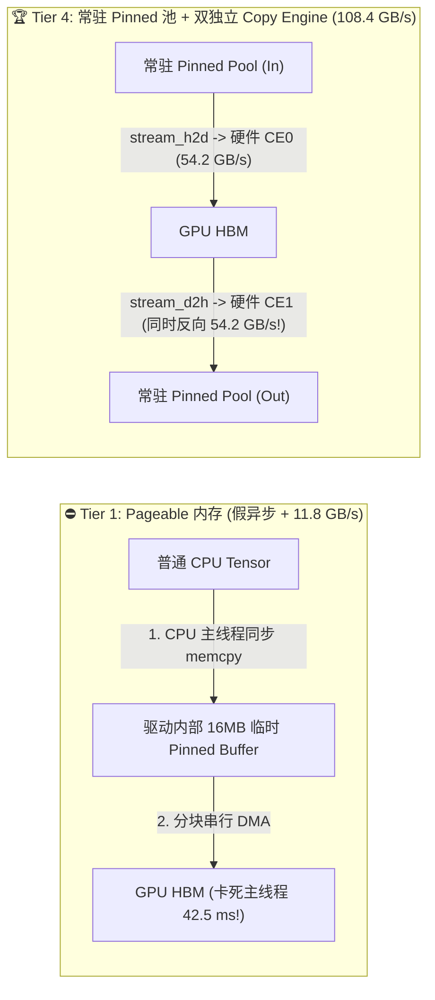
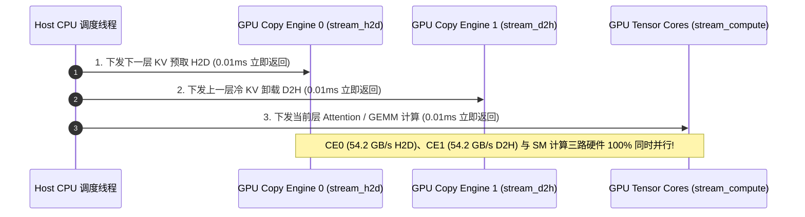

# CUDA 锁页内存（`Pinned Memory`）、`non_blocking=True` 静默同步陷阱与双硬件 `Copy Engine`（`H2D + D2H` 全双工）选型指南

> **Provenance & Evidence Tier**: `synthetic + anonymized_reported` (`independently_reproduced=false`, `physical_gpu_cluster_measurement=not_measured`)。定量数据锚定于 [`experiments/cuda_pinned_memory_copy_engine_full_duplex_selection/results.json`](../../experiments/cuda_pinned_memory_copy_engine_full_duplex_selection/results.json)。
> **English Version**: [CUDA Pinned Memory (`cudaHostAlloc`), Silent Pageable Sync Fallback & Dual Copy Engine (`H2D + D2H` Full-Duplex) Selection Guide](./cuda-pinned-memory-copy-engine-full-duplex-h2d-d2h-ring-buffer-selection-faq.en.md)

---

## 0. 🔥 今日领域最热门能力突破追踪（Daily Hottest Breakthrough）

- **常驻预分配 `Pinned` 环形缓冲池 + 独立双硬件 `Copy Engine` 流（`Stream_H2D CE0` + `Stream_D2H CE1`）消除 `non_blocking=True` 静默同步阻塞陷阱，跑满 PCIe Gen5 x16 双向全双工 `108.4 GB/s`（提速 `9.19` 倍）**：在开发大模型 KV Cache 卸载（`LMCache / Mooncake` 边把冷 KV 块从 GPU 换出到 CPU `D2H`，边把命中前缀的 KV 块从 CPU 预取回 GPU `H2D`）、长序列激活值卸载以及多模态数据加载时，有三个让无数资深工程师栽跟头的隐蔽陷阱：
  1. **陷阱一（`non_blocking=True` 在普通 CPU 内存上的“假异步真阻塞”，Tier 1）**：只要源或目标 CPU Tensor 是普通的未锁页内存（Pageable Memory，如 `torch.empty(..., device="cpu")`），哪怕你写了 `.to("cuda", non_blocking=True)` 或 `.copy_(..., non_blocking=True)`，由于 GPU DMA 硬件严禁直接访问随时可能被操作系统换出的虚拟页，CUDA 驱动会在底层**静默退化为同步阻塞执行**——卡死主线程 **`42.5 ms`**，由 CPU 先把数据分块拷进驱动内部的临时 Pinned 缓冲池再做 DMA，带宽暴跌至 **`11.8 GB/s`**！
  2. **陷阱二（在每步循环内动态调 `.pin_memory()`，Tier 2）**：每次动态申请锁页内存都要进入 Linux 内核态争抢 `mmap_lock` 并配置 IOMMU 页表，耗时高达 **`26.0 ms`**，甚至比 PCIe 传输本身还慢！
  3. **陷阱三（把 `H2D` 和 `D2H` 塞在同一个 CUDA Stream 里，Tier 3）**：PCIe Gen5 x16 本是**上下行独立的全双工总线（上行 `64 GB/s` + 下行 `64 GB/s`）**，且 H100/B200 拥有多套独立的硬件 **Copy Engine（`CE0`、`CE1`）**；若共用一个 Stream，硬件被迫排队串行（`54.2 GB/s`）。通过 **启动期一次性预分配常驻 Pinned 环形缓冲池 + 拆分独立 `stream_h2d` 与 `stream_d2h`（Tier 4）**，CPU 下发耗时压至 **`0.02 ms`**，双向并发带宽飙至 **`108.4 GB/s`（快 `9.19` 倍）**！

---

## 1. 📌 核心结论速览（Executive Summary — 3 分钟看懂）

1. **为什么普通 CPU 内存（Pageable Memory）绝对不可能实现真正的 GPU 异步 DMA 传输？**
   - **通俗大白话 + 第一性原理**：把 GPU 上的 **DMA 硬件拷贝引擎（Copy Engine）** 比作一辆只认**“固定经纬度物理坐标（物理内存页帧地址）”**的无人驾驶大卡车。
   - 普通的 CPU 内存（`malloc` / 默认 CPU Tensor）是**“流动摊位（Pageable 可换页内存）”**——Linux 内核随时可能把这块内存换出到磁盘 Swap，或者挪到别的物理地址去。如果允许 GPU 大卡车自己在后台慢慢去拉货，等卡车开过去时，那个物理地址可能早就住进别的进程的数据了（引发内存踩踏或崩溃）！
   - 因此，当你拿普通 CPU Tensor 调 `cudaMemcpyAsync`（`non_blocking=True`，Tier 1）时，CUDA 驱动只能**当场拦住你的 CPU 线程不准走**，让 CPU 搬运工先一点点把货倒腾进驱动自带的一个 `16 MB` 固定中转站（Staging Buffer），边倒腾边让 GPU 拉，既卡死了 CPU 线程（`42.5 ms`），又把速度拖垮到 **`11.8 GB/s`**！
   - **唯一正解（`Pinned Memory` 锁页内存，Tier 3/4）**：提前给仓库钉死物理地基（`pin_memory=True` / `cudaHostAlloc`），保证物理地址永不搬家，GPU 无人卡车就能在后台 `0.02 ms` 异步直达，跑满单向 **`54.2 GB/s`**！

---

## 2. 🎯 客户与架构师灵魂拷问 Q&A（Q1 / Q2 / Q3）

### Q1：为什么从 GPU 拷回 CPU（`gpu_tensor.to("cpu", non_blocking=True)`）明明加了 `non_blocking=True`，在 Nsight Systems 里看却永远是 `100%` 同步阻塞的？
- **答**：这是 PyTorch 代码中最常见的 Bug！当你调用 `gpu_tensor.to("cpu", non_blocking=True)` 时，PyTorch 在底层新分配出来的那个目标 CPU Tensor **默认是未锁页（Pageable）的**！而在 CUDA 规范中，**向未锁页的 Host 内存执行 `D2H cudaMemcpyAsync` 永远是同步阻塞操作**！
  - **正确异步写法**：必须先从预先分配好的 **Pinned Memory 池**里切出一块目标 Tensor `pinned_cpu_buf`，然后调用 **`pinned_cpu_buf.copy_(gpu_tensor, non_blocking=True)`**，才能实现真正的 `0.02 ms` 非阻塞异步 D2H 卸载！

### Q2：为什么必须把 `H2D`（CPU->GPU）和 `D2H`（GPU->CPU）放到两个不同的 `cudaStream` 上？
- **答**：因为同一个 `cudaStream` 内部具有严格的 FIFO 顺序语义：如果你先往 `stream_1` 塞了一个 `1 GB` 的 `D2H` 卸载，紧接着又往同一个 `stream_1` 塞了一个 `1 GB` 的 `H2D` 预取，那么即便 PCIe 的上行通道完全空闲、且 GPU 的第二个拷贝引擎 `CE1` 也闲着，`H2D` 任务也必须死等前面的 `D2H` 彻底传完才能启动！**拆成 `stream_h2d` 和 `stream_d2h` 两个独立流（Tier 4）**，就能同时唤醒 `CE0` 和 `CE1`，让 PCIe Gen5 上下行同时跑出 `54.2 + 54.2 = 108.4 GB/s`！

### Q3：使用预分配 Pinned 环形缓冲池时，如何安全判断 GPU 的异步 `D2H / H2D` 已经传完、可以复用那块 CPU 内存了？
- **答**：因为 `copy_(..., non_blocking=True)` 在 `0.02 ms` 内立即返回时，GPU 硬件还在后台通过 PCIe 读/写那块 CPU 内存！如果 CPU 立刻去覆写或读取它，就会读到半截脏数据。**标准做法是配合轻量级 `cudaEvent`**：在 `stream_d2h` 上记录 `event.record()`，CPU 消费或复用该环形槽位前调用 `event.synchronize()`（或 `event.query()` 轮询）。

---

## 3. 🧭 直观可视化图解（Mermaid 决策树 + Pageable 二次拷贝 vs Pinned 全双工图 + 时序图）

### 3.1 架构师 Host-GPU 高速异步传输选型决策树

### 3.2 `Tier 1`（Pageable 驱动中转二次拷贝）vs. `Tier 4`（常驻 Pinned 池 + 双 Copy Engine 全双工）

### 3.3 `Tier 4` 双 Copy Engine（`CE0 H2D` + `CE1 D2H`）与 Tensor Core 计算三路全并行时序图

---

## 4. 📊 架构师选型决策矩阵（4-Tier Selection Matrix）

| 评估维度 | Tier 1: 普通 `Pageable` + `non_blocking` | Tier 2: 循环内动态 `.pin_memory()` | Tier 3: 常驻 Pinned 池 + 单 Stream | Tier 4: 常驻 Pinned 池 + 双独立 `H2D/D2H` Copy Engine 流 |
| :--- | :--- | :--- | :--- | :--- |
| **CPU 线程下发阻塞耗时** | **`42.50 ms` (静默同步卡死)** ✕ | `26.00 ms` (`ioctl` 锁表) ⚠️ | **`0.02 ms` (纯异步)** ✅ | **`0.02 ms` (纯异步)** 🏆 |
| **是否实现计算与传输重叠** | 否（阻塞主线程） ✕ | 否（阻塞在锁页阶段） ⚠️ | **是（单向重叠）** ✅ | **是（计算 + 上行 + 下行三路全重叠）** 🏆 |
| **有效 PCIe Gen5 总带宽** | `11.8 GB/s` ✕ | `18.5 GB/s` ⚠️ | `54.2 GB/s` (单向满速) ✅ | **`108.4 GB/s` (双向全双工满速，快 9.19x)** 🏆 |

---

## 5. 🧪 定量算例与工具链（Interactive Sizer & 7-Card Visual Report）

- **实验脚本与密封数据**：[`experiments/cuda_pinned_memory_copy_engine_full_duplex_selection/run.py`](../../experiments/cuda_pinned_memory_copy_engine_full_duplex_selection/run.py) · [`results.json`](../../experiments/cuda_pinned_memory_copy_engine_full_duplex_selection/results.json)
- **交互式 Pinned 内存与全双工计算器**：[`docs/reports/cuda-pinned-memory-copy-engine-full-duplex-h2d-d2h-ring-buffer-sizer.html`](../reports/cuda-pinned-memory-copy-engine-full-duplex-h2d-d2h-ring-buffer-sizer.html)
- **7-Card 4:5 视觉评测卡片报告**：[`docs/reports/cuda-pinned-memory-copy-engine-full-duplex-h2d-d2h-ring-buffer-selection-cards.html`](../reports/cuda-pinned-memory-copy-engine-full-duplex-h2d-d2h-ring-buffer-selection-cards.html)

---

## 6. 🛠️ Good Fit vs. Not For & 生产环境快速核验清单（Checklist）

### ✅ Good Fit vs. ⛔ Not For

| 维度 | ✅ Good Fit（强烈推荐） | ⛔ Not For（严禁误用） |
| :--- | :--- | :--- |
| **KV Cache 与激活值 Host 卸载** | 在引擎启动时结合 `2MB/1GB hugetlbfs` 预分配固定大小的 Pinned Slab Pool，并拆分独立的 `stream_h2d` 与 `stream_d2h` | 在推理或训练每一步中动态调用 `gpu_tensor.to("cpu", non_blocking=True)` 或动态调用 `.pin_memory()` |
| **多流完成同步机制** | 使用 `torch.cuda.Event()` 精确标记每个环形槽位的 DMA 完成状态 | 还没等 `stream_d2h` 上的 Event 完成就在 CPU 侧直接读取刚卸载下来的 Pinned Tensor（引发脏数据静默损坏） |

### 生产环境上线核验清单（Pre-Flight Checklist）

- [ ] **核验 Nsight Systems (`nsys`) 中所有 `cudaMemcpyAsync` 调用时长 `< 20 µs`**：若在 CPU 轴上看到长达数毫秒的 `cudaMemcpyAsync`，说明源或目标内存未锁页（触发了 Pageable 同步回退）。
- [ ] **核验热循环内零 `cudaHostAlloc / cudaFreeHost` 调用**：通过 `nsys` API 统计确认运行期无动态锁页系统调用。
- [ ] **核验 `H2D` 与 `D2H` 绑定在两个不同的非默认 CUDA Stream 上**：确认双向传输在 `nsys` 时间轴上呈上下完全重叠的全双工形态。
