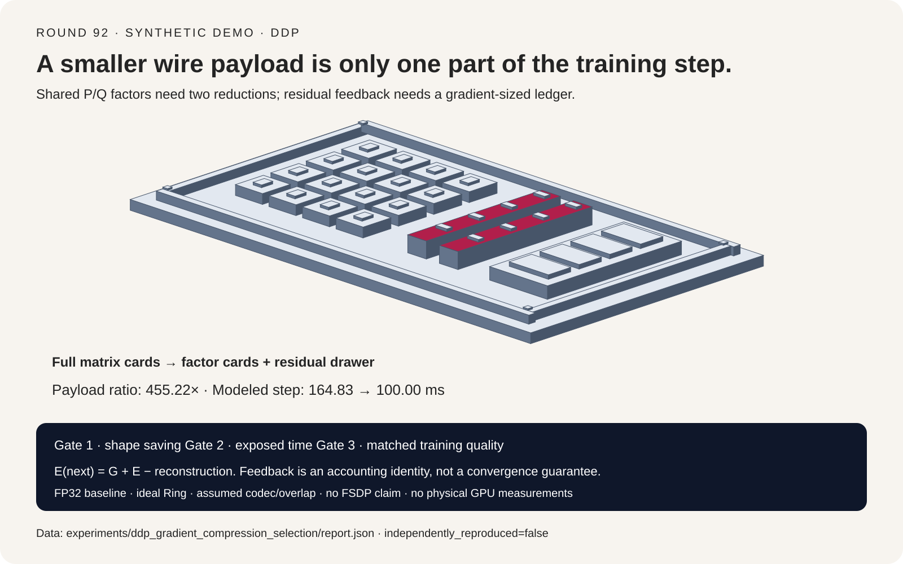
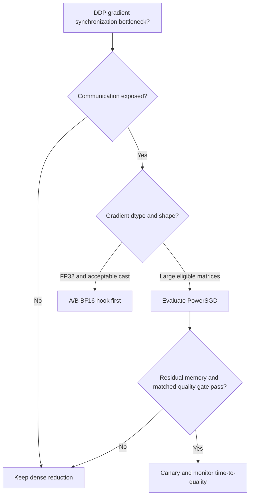
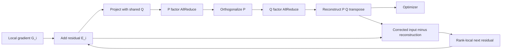
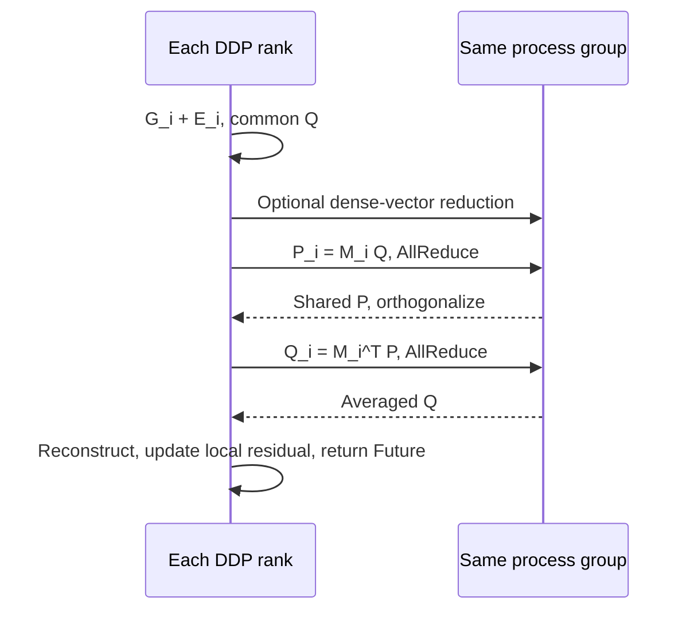

# DDP gradient communication compression FAQ: dense AllReduce, BF16 hooks, PowerSGD and error feedback

> **Language**: [中文](ddp-gradient-compression-powersgd-error-feedback-selection-faq.md) | English
>
> **Round 92 · 2026-11-13** · [High-resolution SVG](../../assets/svg/ddp-gradient-compression-powersgd-error-feedback-selection-faq-summary.svg) · [7-card 4:5 report](../reports/ddp-gradient-compression-powersgd-error-feedback-selection-cards.html) · [Interactive H5 workbench](../reports/ddp-gradient-compression-powersgd-error-feedback-sizer.html) · [Sealed data](../../experiments/ddp_gradient_compression_selection/report.json)
>
> **Evidence boundary**: `synthetic`, `independently_reproduced=false`. Milliseconds below are analytical outputs, not GPU/NCCL measurements. No model was trained; convergence, accuracy and production performance are unmeasured.



## 1. Executive summary: 455.22× fewer payload bytes is not 455.22× faster training

**First establish that communication is exposed on the critical path.** This topic differs from earlier optimizer-state compression, LoRA/GaLore parameterization, activation recomputation, low-precision weights and KV quantization: it changes the **representation of gradients synchronized between DDP replicas**, not model structure or the optimizer rule.

| Question | Selection principle |
| :--- | :--- |
| Communication already hidden by backward compute? | Retain dense reduction; fewer network bytes may yield no step benefit. |
| FP32 buckets and acceptable cast overhead? | Evaluate the simpler BF16 hook first; validate numerical quality separately. |
| Large matrices, constrained cross-node bandwidth and spare residual memory? | Consider a controlled PowerSGD A/B, counting two factor reductions and codec cost. |
| Small matrices, mostly vectors or excessive factor rank? | Fall back per tensor; total parameter count does not establish a saving. |
| FSDP/ZeRO sharded gradients? | A DDP hook is not a drop-in replacement for reduce-scatter. |

The local synthetic example assumes 64 workers, sixteen `4096×4096` FP32 matrices,
65,536 vector elements, rank 4, `25 GB/s` effective bandwidth, `100 ms` backward
floor and `20 ms` hideable overlap. **Payload shrinks `455.22×`, but modeled
step time falls only from `164.83 ms` to `100.00 ms`, or `1.65×`.** At
`200 GB/s`, dense communication is already hidden and modeled savings vanish.

**Daily signal and topic choice:** the November 12, 2026 LMSYS SGLang Consortium
announcement was verified directly. It provides context for open,
cross-hardware infrastructure efficiency, not a new PowerSGD release or
compression-speed evidence. Gradient communication compression was not a
standalone selection FAQ in R1–R91. The engineering analysis pins PyTorch
`v2.10.0`; it does not rebrand an established algorithm as a new breakthrough.
No auditable worldwide popularity ranking was available, so no such ranking
is asserted.

## 2. Architect Q&A: what is compressed, lost and carried forward?

### Q1: Does BF16 training already eliminate communication compression headroom?

Compute dtype, parameter dtype and gradient-bucket dtype are distinct. FP32
parameters with autocast do not imply BF16 DDP buckets: inspect
`bucket.buffer().dtype`. The built-in `bf16_compress_hook` casts the bucket to
BF16, divides by group size, performs AllReduce and copies the result back to
the original buffer. The modeled FP32-to-BF16 payload ratio is two, not an
additional universal twofold saving for every BF16 training job.

An already-BF16 bucket does not halve again. FP16 and BF16 also have different
exponent ranges and rounding behavior; equal storage width is not equal
training quality. The pinned documentation labels the BF16 hook experimental
and states an NCCL version requirement. Verify the actual wheel and backend,
not just the latest documentation.

A custom hook owns process-group selection, averaging rather than summation,
a compatible `Future[Tensor]`, output shape/dtype and identical collective
ordering across ranks. DDP does not automatically repair a missing average
inside an arbitrary user hook.

### Q2: Why two reductions rather than an independent local SVD on each rank?

For worker `i`, add its historical residual before compression:

```text
M_i = G_i + E_i
P   = orth(mean_i(M_i Q_shared))
Q'  = mean_i(M_i^T P)
G_hat = P Q'^T
```

Workers share the initial or warm-started Q, reduce P, orthogonalize it, reduce
Q' and reconstruct. The pinned implementation sums P before orthogonalization;
in nondegenerate exact arithmetic, scaling by worker count before
normalization leaves the subspace unchanged. The toy uses means for clarity.

Independent local low-rank factorizations need not use the same basis.
Separately averaging arbitrary local P and Q factors is not equivalent to
averaging gradients. Shared projection and ordered communication are essential.

For an FP32 `m×n` gradient with factor rank `r`:

```text
dense_payload = 4 m n bytes
factor_payload = 4 r (m+n) bytes
eligible iff r(m+n) × min_compression_rate < mn
```

The gate is strict: equality falls back. The normal hook operates on
per-parameter shapes, not an arbitrary square reshaping of the entire bucket.
Vectors and tensors failing the savings gate remain dense.
`batched_powerSGD_hook` is a different variant that may destroy per-parameter
row/column structure; its quality behavior cannot be inferred from this guide.

### Q3: Is error feedback lossless? What does it actually guarantee?

The pinned hook retains each rank's own corrected input minus the shared
reconstruction:

```text
E_i(t+1) = G_i(t) + E_i(t) - G_hat(t)
mean_i(sum_t G_i(t)) - sum_t G_hat(t) = mean_i E_i(T),  E_i(0)=0
```

This is a testable accounting identity: unsent information carries into later
steps instead of disappearing. **It does not make an individual gradient
exact, prove finite-time convergence or guarantee task accuracy.** With
nonlinear optimizers such as Adam or Muon, similar cumulative gradients do not
automatically imply the same parameter trajectory.

The local test is only a fixed synthetic gradient sequence: three workers,
`4×4` matrices, rank one, 24 steps. Cumulative relative gradient error falls
from `53.96%` to `8.11%` for seed 7 and from `54.08%` to `10.97%` for seed 11
when feedback is enabled. These are not losses or accuracy results. Tests
also check the gap between cumulative discrepancy and final mean residual is
below `1e-10`, rather than merely presenting an improved-looking score.

### Q4: Why can low-rank compression be slower or run out of memory?

Sequential collectives, matrix multiplication, orthogonalization,
reconstruction and memory all cost resources. Feedback usually adds a
gradient-sized persistent residual plus input copies, factor caches,
warm-start state and optional same-shape tensor stacking. **One gradient
buffer is not a peak-memory bound.**

Larger buckets can improve same-shape batching but delay readiness and reduce
compute/communication overlap. A no-compression overlap measurement is not
automatically valid after compression kernels contend for GPU resources.
The workbench deliberately treats overlap as one shared input for explanation;
production paths must be measured independently.

State cannot be cached arbitrarily before DDP rebuilds its buckets. When
feedback or warm start is enabled, pinned documentation requires
`start_powerSGD_iter` of at least two. This compatibility minimum is not a
recommended warm-up duration or convergence guarantee. Choose warm-up and rank
with quality/throughput A/B runs.

### Q5: Can FP8 bytes be directly AllReduced, or this hook replace FSDP?

Summing encoded integer bit patterns is not floating-point gradient addition.
Cross-rank and per-block scale factors, overflow, decoding and accumulation
precision belong in the protocol. Local eight-bit encoding does not
automatically define a valid cross-rank reduction. This guide neither
implements an FP8 hook nor claims one is impossible.

FSDP/ZeRO reduce-scatter assigns different gradient shards to different owners.
A DDP AllReduce hook returns the same full bucket to every rank. Replacing
one with the other requires layout, optimizer ownership, reconstruction and
collective-order changes outside this hook's integration boundary.

## 3. Visual architecture: selection tree, data path and two-stage sequence







## 4. Selection matrix and fit boundaries

| Path | Communication and extra cost | Good fit | Quality/integration boundary |
| :--- | :--- | :--- | :--- |
| Dense AllReduce in original dtype | One reduction path, no low-rank codec | Hidden communication, quality sensitivity, sufficient bandwidth | Floating-point reduction order can still affect bits; no universal bitwise reproducibility claim |
| BF16 cast hook | Half the FP32 payload, extra conversion | Lower-complexity first A/B | Not another halving of BF16 buckets; check backend and numerics |
| Per-parameter PowerSGD + EF | Two factor reductions, optional dense fallback, residual memory | Large matrices and bandwidth-bound network | Validate rank, warm-up, peak memory and restart semantics |
| PowerSGD without EF | No persistent feedback buffer, still codec work | Explicit controlled comparisons only | Biased projection error no longer carries forward automatically |
| FSDP/ZeRO or arbitrary FP8 protocol | Outside this model | Separate design and validation | Do not extrapolate DDP-hook findings |

Fair comparisons hold tokens, effective batch, optimizer, precision, seeds and
achieved validation quality constant. If compression needs more steps to
reach the same quality, shorter steps may still worsen **time-to-quality**.

## 5. Worked example and seven-card report: plot only sealed coordinates

For an ideal ring with `W` workers, payload `B` per reduction and hop startup α:

```text
send_bytes_per_rank = 2(W-1)/W × B
communication_ms = send_bytes_per_rank / (effective_GBps × 1e6)
                   + collective_count × 2(W-1) × alpha_us / 1000
service_ms = communication_ms + codec_ms
step_ms = backward_ms + max(0, service_ms - overlap_ms)
```

GB/s means decimal **bytes**, not bits. Do not enter `200 Gb/s` as `200 GB/s`.
The model covers one aggregate matrix group plus optional vectors in one
bucket. It does not predict NCCL Tree/Ring selection, schedule multiple
buckets, model topology contention or account for compression kernels slowing
backward compute. Codec, bandwidth and overlap are explicit assumptions.

| Synthetic condition | FP32 dense step | PowerSGD step | Saved |
| :--- | ---: | ---: | ---: |
| Effective bandwidth 10 GB/s | 291.70 ms | 100.00 ms | 191.70 ms |
| Effective bandwidth 25 GB/s | 164.83 ms | 100.00 ms | 64.83 ms |
| Effective bandwidth 100 GB/s | 101.40 ms | 100.00 ms | 1.40 ms |
| Effective bandwidth 200 GB/s | 100.00 ms | 100.00 ms | 0.00 ms |

Six timing cases cover bandwidth limitation, hidden communication on a fast
fabric, small-matrix fallback, high-rank fallback, vector domination and no
overlap. They are hand-designed analytical boundaries, not random-sample
accuracy. The seven cards show overview, one case, full matrix, protocol,
feedback-seed perturbations, bandwidth scaling and readiness.
**Every quantitative bar and value is generated from `report.json`.**
Training quality and confidence remain `null`, never coerced to zero or
invented auto-approval probabilities.

```powershell
python -m experiments.ddp_gradient_compression_selection.run --check
python -m unittest tests.test_ddp_gradient_compression_selection
```

Omit `--check` to regenerate. The static deck has
`default-src 'none'; style-src 'unsafe-inline'` CSP, no scripts, font downloads
or network dependencies. The separate H5 explicitly permits inline JavaScript
and fetches no remote data. Both open offline.

## 6. Production pre-flight checklist and pinned sources

- **Prove the bottleneck:** record bucket readiness, communication, SM activity and exposed tail time; cumulative NCCL duration is not necessarily removable step time.
- **Record actual dtype/shapes:** verify the bucket is not already BF16, apply the strict per-shape savings gate and quantify dense-vector fallback.
- **Keep quality controls:** compare loss, gradient norms, stability and matched-quality time-to-train for dense, BF16 and PowerSGD. No quality evidence means no automatic production approval.
- **Budget peak HBM:** measure simultaneous residuals, temporary copies, P/Q, same-shape batching, DDP buckets and optimizer allocations.
- **Preserve protocol order:** every rank needs the same process group, parameter order and collective path; one rank cannot privately skip a reduction.
- **Restore state carefully:** save rank-local residuals, warm-start factors, iteration, RNG and bucket mapping. Rank-zero residuals cannot be broadcast as every rank's residuals. Define remapping or explicit re-warm-up after world-size/layout changes; do not claim exact restart.
- **Canary and rollback:** surface non-finite values, quality regression and communication failures explicitly; terminate or roll back under a defined policy, never continue with silent zero gradients or a successful-looking no-op.

First-party sources verified November 13, 2026; links only, no third-party
source or article mirrors:

| Source | Pinned scope | Supported facts |
| :--- | :--- | :--- |
| [PyTorch PowerSGD implementation](https://github.com/pytorch/pytorch/blob/449b1768410104d3ed79d3bcfe4ba1d65c7f22c0/torch/distributed/algorithms/ddp_comm_hooks/powerSGD_hook.py) | `v2.10.0`; strict gate around L97–103, residual L421–437/L632–635, factors L562–617 | Shared factors, strict eligibility, rank-local residual update |
| [PyTorch default hooks](https://github.com/pytorch/pytorch/blob/449b1768410104d3ed79d3bcfe4ba1d65c7f22c0/torch/distributed/algorithms/ddp_comm_hooks/default_hooks.py) | Same commit, L57–134 | Cast, group averaging, reduction and copy to original dtype |
| [PyTorch 2.10 DDP hook documentation](https://docs.pytorch.org/docs/2.10/ddp_comm_hooks.html) | Versioned docs | Warm-up, bucket rebuilding, extra memory, serialization and batched variant limits |
| [LMSYS November 12 announcement](https://www.lmsys.org/blog/2026-11-12-sglang-consortium) | Daily context, not performance evidence | Open infrastructure collaboration |

**Rights and applicability:** PyTorch retains its BSD-3-Clause license and
rights. This repository's analysis, model and figures are original; no
third-party implementation is copied and no repository-wide license grant is
added. Related: [distributed training memory/parallelism](distributed-training-memory-parallelism-selection-faq.en.md),
[optimizer selection](distributed-optimizer-adamw-8bit-muon-shampoo-selection-faq.en.md),
[asynchronous TP overlap](async-tensor-parallelism-gemm-comm-overlap-symmetric-memory-selection-faq.en.md).
