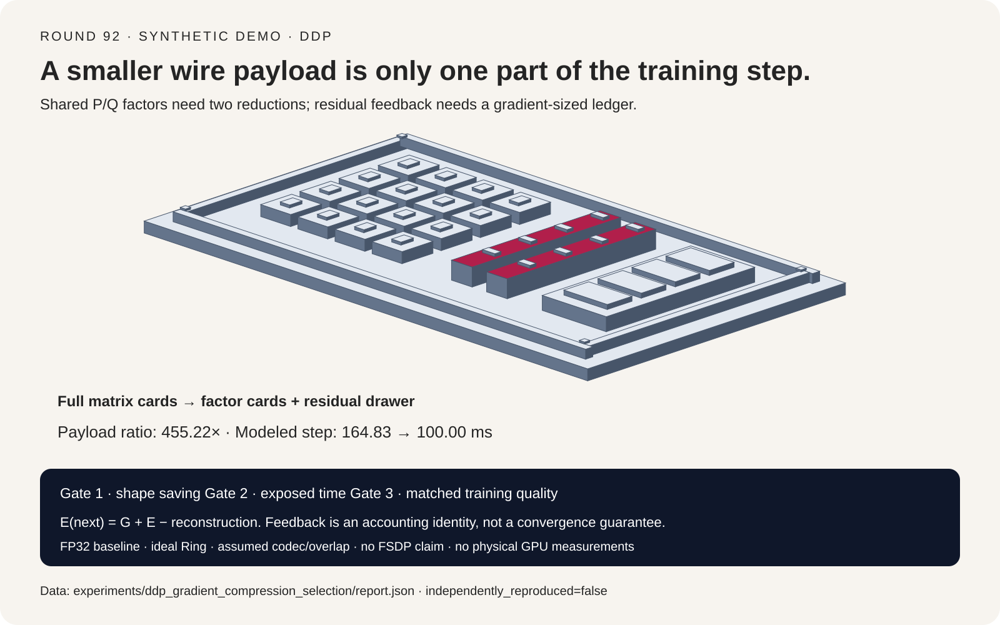
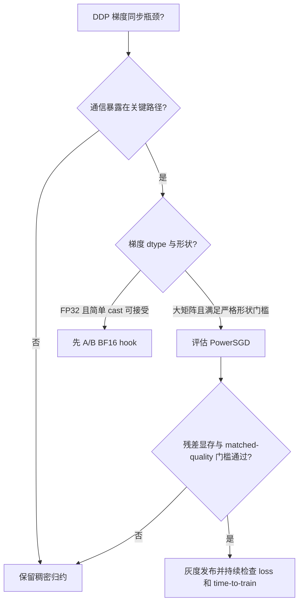
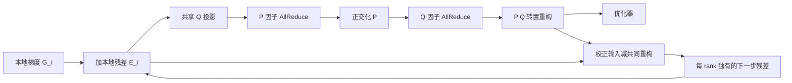
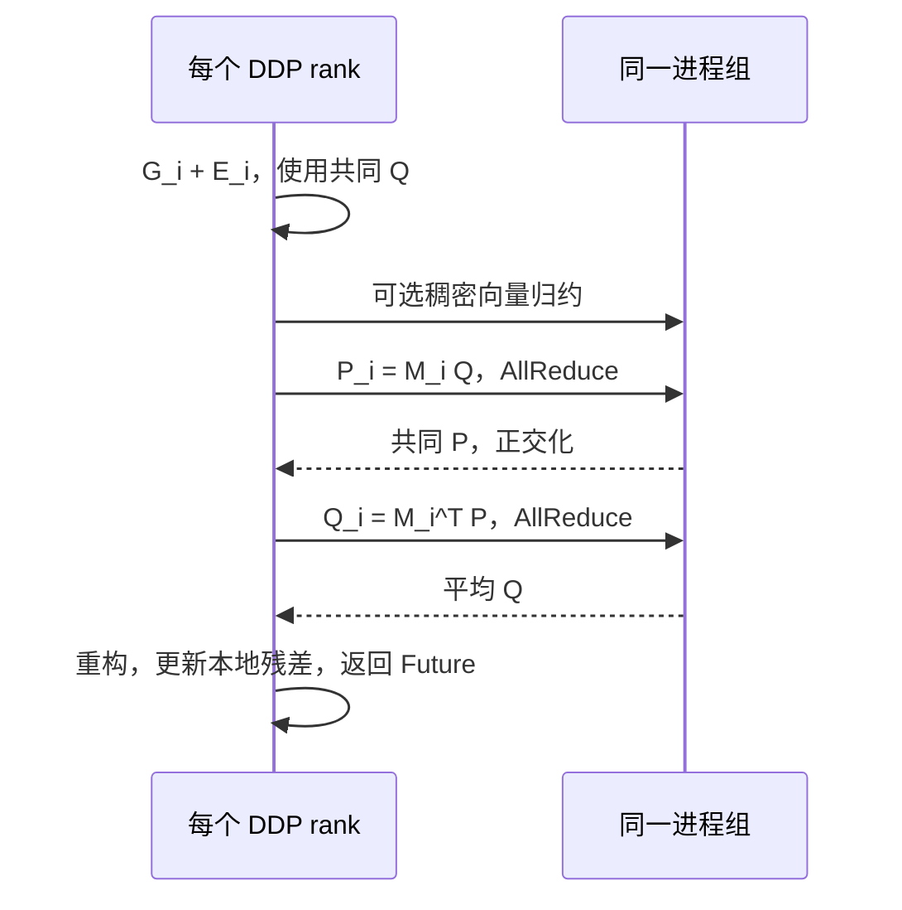

# DDP 梯度通信压缩选型 FAQ：稠密 AllReduce、BF16 钩子、PowerSGD 与误差反馈

> **语言**：中文 | [English](ddp-gradient-compression-powersgd-error-feedback-selection-faq.en.md)
>
> **Round 92 · 2026-11-13** · [高清 SVG](../../assets/svg/ddp-gradient-compression-powersgd-error-feedback-selection-faq-summary.svg) · [7-Card 4:5 报告](../reports/ddp-gradient-compression-powersgd-error-feedback-selection-cards.html) · [交互 H5 工作台](../reports/ddp-gradient-compression-powersgd-error-feedback-sizer.html) · [封存数据](../../experiments/ddp_gradient_compression_selection/report.json)
>
> **证据边界**：`synthetic`、`independently_reproduced=false`。以下毫秒数是公式输出，不是 GPU/NCCL 实测；没有训练模型，没有收敛、准确率或生产性能结论。



## 一、核心结论速览：压缩 455.22 倍字节，不等于训练加速 455.22 倍

**先查通信是否暴露在关键路径，再考虑压缩。** 本专题把数据并行梯度通信与前序的优化器状态压缩、LoRA/GaLore 参数化、训练激活重算、低精度权重和 KV Cache 量化分开：这里改变的是 **DDP 副本之间同步的梯度表示**，不是模型结构或优化器公式。

| 问题 | 决策原则 |
| :--- | :--- |
| 通信已被反向计算隐藏？ | 保留稠密归约；更少网络字节可能没有单步收益。 |
| FP32 梯度 bucket 且转换代价可接受？ | 先评估简单 BF16 钩子，减少协议复杂度；数值质量必须另测。 |
| 大矩阵、跨机带宽受限且有残差显存？ | PowerSGD 值得受控 A/B；至少计入两次因子归约、编码和重构。 |
| 小矩阵、向量占比高或压缩秩过大？ | 按张量回退稠密路径，不能用总参数量推断收益。 |
| FSDP/ZeRO 的分片梯度？ | 不是注册 DDP hook 就能替换 reduce-scatter；需不同集成与语义证明。 |

本地合成算例中，64 个进程、16 个 `4096×4096` FP32 矩阵、65,536 个向量元素、秩 4、有效带宽 `25 GB/s`、反向基础时间 `100 ms`、可隐藏窗口 `20 ms`：
**PowerSGD 载荷减少 `455.22×`，但模型单步仅从 `164.83 ms` 到 `100.00 ms`，即 `1.65×`**。有效带宽升至 `200 GB/s` 后，稠密路径也完全隐藏，模型收益为零。

**当日信号与选题依据**：已核验 LMSYS 在 2026-11-12 发布的 SGLang Consortium 公告；这反映开放基础设施的跨硬件效率议题，但不是 PowerSGD 的新发布，也不能作为梯度压缩速度证据。本专题选择 R1–R91 选型 FAQ 未单列的通信压缩机制，工程语义固定核验于 PyTorch `v2.10.0` 提交，而非将旧算法包装成今日突破。没有可审计的“全球最热”排名，因此不作排名断言。

## 二、客户与架构师 Q&A：究竟压缩什么、丢失什么、补回什么？

### Q1：BF16 训练已经用了低精度，为什么还可能有通信压缩空间？

混合精度计算 dtype、参数存储 dtype、梯度 bucket dtype 是不同维度。FP32 参数配合 autocast，并不意味着 DDP 梯度已经是 BF16；应直接记录 `bucket.buffer().dtype`。PyTorch 的 `bf16_compress_hook` 将 bucket 转为 BF16、除以进程组大小、执行 AllReduce，再复制回原 buffer。这里的 FP32→BF16 载荷比为 2，而不是“任何 BF16 训练都再减半”。

原生 BF16 bucket 再注册相同 cast 不会再获得 2 倍字节收益。FP16 与 BF16 的指数范围、舍入误差也不同，不能因为二者都是 2 字节就假定训练效果相同。固定版本文档将 BF16 hook 标为实验性，并注明 NCCL 版本要求；应核验实际 wheel、后端和部署环境，不能只看最新网页。

**自定义 hook 的语义责任**包括进程组选择、平均而非求和、返回兼容的 `Future[Tensor]`、保持形状与 dtype，以及各 rank 相同的集合通信顺序。DDP 不会替任意用户 hook 再自动修复遗漏的平均。

### Q2：PowerSGD 为什么需要两轮通信，而不是每个 rank 本地 SVD 后拼起来？

对第 `i` 个 rank 的矩阵梯度，先加本地历史残差：

```text
M_i = G_i + E_i
P   = orth(mean_i(M_i Q_shared))
Q'  = mean_i(M_i^T P)
G_hat = P Q'^T
```

所有 rank 共享同一个初始或 warm-start 的 `Q`，先对 `P` 因子归约，再正交化，随后归约 `Q'` 并重构。固定实现先求和再对 P 正交化；在非退化精确算术下，归一化前除以进程数不改变子空间。本地小实验采用平均写法以便直接验证。

**独立本地低秩分解的基并不一致**：不能把任意 rank 的 `P_i` 和 `Q_i` 分别平均就宣称得到了平均梯度。低秩因子对矩阵乘法友好、对归约兼容的前提，是算法规定的共享投影和顺序依赖。

对于 FP32 `m×n` 梯度、压缩秩 `r`：

```text
dense_payload = 4 m n bytes
factor_payload = 4 r (m+n) bytes
eligible iff r(m+n) × min_compression_rate < mn
```

这是严格小于；相等时应回退。原 hook 按参数形状处理，不把整桶任意重排成正方形。向量以及不满足收益门槛的张量保留稠密归约。`batched_powerSGD_hook` 是另一个方案，可能破坏每参数的行列结构；不能直接套用本专题的质量解释。

### Q3：Error feedback 能保证什么？是不是“无损压缩”？

固定实现为各 rank 留下 **自己的** 校正梯度与共同重构输出之差：

```text
E_i(t+1) = G_i(t) + E_i(t) - G_hat(t)
mean_i(sum_t G_i(t)) - sum_t G_hat(t) = mean_i E_i(T),  E_i(0)=0
```

右式是可直接检验的账本恒等式：没有发出的部分进入后续步骤，而不是直接消失。**它不等于任一步梯度精确，不等于任务准确率不降，也不等于已经证明有限时间收敛。** 对 Adam/Muon 等非线性优化器，累计梯度接近也不能直接推出参数轨迹相同。

本地只运行三 worker、`4×4`、秩 1、24 步的固定合成梯度序列；种子 7 的累计相对误差由 `53.96%` 降到 `8.11%`，种子 11 由 `54.08%` 到 `10.97%`。这不是 loss、正确率或模型训练实验。测试同时检查累计误差与最终平均残差的差小于 `1e-10`，避免只展示看起来更好的分数。

### Q4：为什么低秩压缩可能更慢、甚至 OOM？

通信依赖、矩阵乘法、正交化、重构和额外显存都要付费。带反馈的实现通常至少保留一个梯度大小的残差 buffer，还有输入副本、因子缓存、warm-start 状态及可选同形张量堆叠。因此 **“残差约等于一份梯度”不是峰值显存上界**。

把 bucket 调大可让同形批处理更有效，也可能延后梯度就绪、减少计算通信重叠。不能将无压缩时测到的 overlap 原封不动当作压缩后的真实 overlap；工作台为解释机制将其设为共同输入，真实部署必须分别测。

误差反馈或 warm start 不能在 DDP bucket 重建之前随意缓存形状。固定文档要求启用这些功能时 `start_powerSGD_iter` 至少为 2；这只是兼容下限，不是推荐暖身步数或收敛保证。实际 warm-up 和 rank 选择要由质量/吞吐 A/B 决定。

### Q5：能把 FP8 编码成字节后直接 AllReduce，或直接替换 FSDP 吗？

不能把编码后的整数位模式直接求和，当作浮点梯度相加。不同 rank、不同 block 的缩放因子、溢出处理、解码和规约精度都必须纳入协议；“本地压成 8 位”不自动等于“跨 rank 合法归约”。本文不实现 FP8 hook，也不宣称它不可实现。

FSDP/ZeRO 的 reduce-scatter 产生的是不同 rank 拥有的梯度分片，DDP AllReduce hook 则交付每 rank 相同的完整 bucket。替换涉及分片布局、优化器所有权、重构时机和通信顺序，不属于本 hook 的即插即用边界。

## 三、直观可视化：选择树、数据通路与两阶段时序







## 四、架构师选型矩阵与适用边界

| 路径 | 通信与额外成本 | 适用情形 | 质量/集成边界 |
| :--- | :--- | :--- | :--- |
| 原始 dtype 稠密 AllReduce | 一个归约路径，无低秩编解码 | 通信已隐藏、质量敏感、带宽充分 | 浮点归约顺序仍可能影响位级结果；不是任意拓扑的 bitwise 保证 |
| BF16 cast hook | FP32 bucket 的 wire payload 减半，增加转换 | 希望先试低复杂度方案 | 不适用于“已经 BF16 还再减半”的账法；检查后端支持与数值变化 |
| 逐参数 PowerSGD + EF | 两次因子归约，可选稠密回退归约，额外残差显存 | 大矩阵、网络带宽受限、可做训练质量对照 | rank、warm-up、显存峰值、恢复语义必须验证 |
| 禁用误差反馈的 PowerSGD | 少一份持久残差状态，但仍有编解码 | 仅在明确对照实验中评估 | 有偏投影误差不再自动积累回后续步骤 |
| FSDP / ZeRO 或任意 FP8 协议 | 不在本模型覆盖范围 | 单独设计并验证 | 不能从 DDP hook 的结果外推 |

稠密基线的公平性必须同时固定训练 token、有效 batch、优化器、精度、随机种子与达到的验证质量。若压缩使训练达到同样质量需要更多 step，即使 step 更短，**time-to-quality 也可能恶化**。

## 五、定量算例与七卡报告：只画封存数据能支持的坐标

对理想 Ring，`W` 个 rank、每次归约载荷 `B`、每跳启动 `α`：

```text
send_bytes_per_rank = 2(W-1)/W × B
communication_ms = send_bytes_per_rank / (effective_GBps × 1e6)
                   + collective_count × 2(W-1) × alpha_us / 1000
service_ms = communication_ms + codec_ms
step_ms = backward_ms + max(0, service_ms - overlap_ms)
```

`GB/s` 为十进制字节带宽，不能把 `200 Gb/s` 填成 `200 GB/s`。本模型只考虑一个聚合矩阵组加可选向量的 bucket；不预测 NCCL 的 Tree/Ring 选择，不模拟多桶调度、拓扑争用或压缩 kernel 占用 SM 后反向变慢。codec、带宽与 overlap 都是显式假设，不是测量值。

| 合成条件 | FP32 稠密单步 | PowerSGD 单步 | 节省 |
| :--- | ---: | ---: | ---: |
| 有效带宽 10 GB/s | 291.70 ms | 100.00 ms | 191.70 ms |
| 有效带宽 25 GB/s | 164.83 ms | 100.00 ms | 64.83 ms |
| 有效带宽 100 GB/s | 101.40 ms | 100.00 ms | 1.40 ms |
| 有效带宽 200 GB/s | 100.00 ms | 100.00 ms | 0.00 ms |

六个独立 timing 场景覆盖：带宽受限、快网络完全隐藏、小矩阵回退、高秩回退、向量主导及没有重叠。它们是手工设计的解析边界，不是随机样本准确率。七卡依次呈现工作台、单例、全矩阵、协议、误差反馈种子扰动、带宽扫描和就绪边界；**所有条宽与数字均由 `report.json` 生成**。训练质量和置信度保持 `null`，不补成零，也不伪造自动放行概率。

```powershell
python -m experiments.ddp_gradient_compression_selection.run --check
python -m unittest tests.test_ddp_gradient_compression_selection
```

重新生成使用同一模块去掉 `--check`。静态报告 CSP 为 `default-src 'none'; style-src 'unsafe-inline'`，无脚本、字体下载和网络依赖；H5 单独显式允许内联 JavaScript，不抓取远端数据。网页可以离线打开。

## 六、生产快速核验清单与固定版本来源

- **先证明有瓶颈**：分别记录 bucket 就绪时间、通信时间、SM 占用和暴露的尾部时间，避免把累计 NCCL 时间当作真实可节省时间。
- **记录真实 dtype/shape**：确认原始 bucket 不是已经 BF16；按参数形状与 rank 计算严格收益门槛，统计回退向量比例。
- **保留质量对照**：至少比较 dense、BF16、PowerSGD 的 loss、梯度范数、稳定性与 matched-quality time-to-train；没有质量数据就不生产自动放行。
- **预算峰值 HBM**：实测残差、临时复制、P/Q、同形批处理、DDP bucket 和优化器同时存在的高水位。
- **检查协议顺序**：所有 rank 使用同进程组、同参数顺序、同 collective 路径；不能某 rank 私自跳过归约。
- **有状态恢复**：按 rank 保存残差、P/Q warm start、迭代计数、RNG 和 bucket 映射；rank 0 的残差不能广播成所有 rank 的残差。对 world-size 或 bucket 布局改变定义重映射或显式重新暖身，不能宣称精确恢复。
- **灰度与回滚**：发现非有限值、质量回归或通信失败时显式告警并按既定方案终止/回滚；不能以零梯度或无通信成功形状回退继续训练。

一手来源（2026-11-13 核验；仅链接，不镜像第三方正文或代码）：

| 来源 | 固定范围 | 支持的事实 |
| :--- | :--- | :--- |
| [PyTorch PowerSGD 实现](https://github.com/pytorch/pytorch/blob/449b1768410104d3ed79d3bcfe4ba1d65c7f22c0/torch/distributed/algorithms/ddp_comm_hooks/powerSGD_hook.py) | `v2.10.0`，严格门槛约 L97–103，残差 L421–437/L632–635，两阶段 L562–617 | 共享因子、严格形状门槛、逐 rank 残差更新 |
| [PyTorch 默认通信 hook](https://github.com/pytorch/pytorch/blob/449b1768410104d3ed79d3bcfe4ba1d65c7f22c0/torch/distributed/algorithms/ddp_comm_hooks/default_hooks.py) | 同提交，L57–134 | cast、组内平均、归约与复制回原 dtype |
| [PyTorch 2.10 DDP hook 文档](https://docs.pytorch.org/docs/2.10/ddp_comm_hooks.html) | 版本化文档 | warm-up、bucket 重建、额外显存、序列化及 batched 版本边界 |
| [LMSYS 2026-11-12 公告](https://www.lmsys.org/blog/2026-11-12-sglang-consortium) | 当日热点背景，不是性能证据 | 开放基础设施跨厂商协作背景 |

**许可与适用性**：PyTorch 保留其 BSD-3-Clause 许可与原权利；本仓库分析、模型和图示独立编写，无第三方实现复制，不额外赋予仓库统一许可。关联：[分布式训练内存/并行](distributed-training-memory-parallelism-selection-faq.md)、[优化器选型](distributed-optimizer-adamw-8bit-muon-shampoo-selection-faq.md)、[异步 TP 通信重叠](async-tensor-parallelism-gemm-comm-overlap-symmetric-memory-selection-faq.md)。
