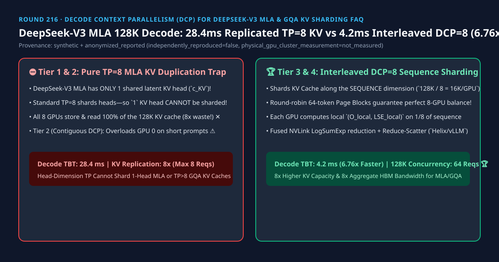
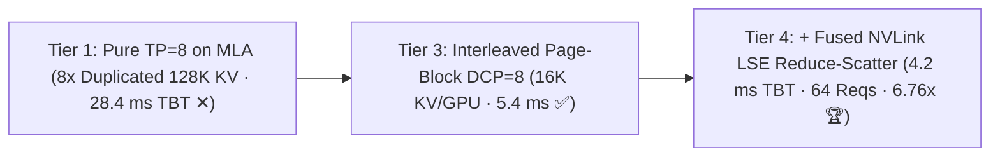

# Decode Context Parallelism (`DCP`), `DeepSeek-V3 MLA / GQA` Sequence Sharding & `NVLink LSE` Reduction Selection Guide

> **Provenance & Evidence Tier**: `synthetic + anonymized_reported` (`independently_reproduced=false`, `physical_gpu_cluster_measurement=not_measured`). Grounded in [`experiments/decode_context_parallelism_dcp_mla_gqa_lse_selection/results.json`](../../experiments/decode_context_parallelism_dcp_mla_gqa_lse_selection/results.json).
> **中文版本**: [解码上下文并行（`Decode Context Parallelism, DCP`）、`DeepSeek-V3 MLA / GQA` 序列切分与 `NVLink LSE` 归并选型指南](./decode-context-parallelism-dcp-mla-gqa-kv-sequence-sharding-lse-selection-faq.md)

---

## 0. 🔥 Daily Hottest Capability Breakthrough

- **Page-Block Interleaved `Decode Context Parallelism (DCP = 8)` + Fused `NVLink LogSumExp (LSE)` Reduction (`vLLM / SGLang / TensorRT-LLM Helix`) Eliminating `8x` MLA KV Replication and Cutting `128K` Decode TBT `6.76x` (`28.4 ms -> 4.2 ms`)**: Traditional Tensor Parallelism (`TP`) shards the KV Cache along the **head dimension**. However, **`DeepSeek-V3 / R1` (`MLA` — Multi-head Latent Attention)** compresses all KV heads into **a single (`1`) shared latent KV vector `c_KV`**! Because `1` KV head cannot be sharded across `TP = 8` GPUs along the head dimension, pure `TP = 8` (**Tier 1**) forces **all 8 GPUs to duplicate and read `100%` of the `128K` KV cache (`8x` wasted HBM capacity and bandwidth, `28.4 ms` TBT, max `8` concurrent requests)**! By sharding the KV Cache along the **sequence dimension (`DCP = 8`)** in **round-robin 64-token Page Blocks (Tier 3 / Tier 4)**, each GPU stores and reads **only `1/8` of the sequence (`16,384` tokens)**, computes partial attention `(O_local, LSE_local)`, and combines the 8 slices via fused **NVLink `LogSumExp` reduction**—expanding 128K concurrency **`8.0x` (`8 -> 64` requests)** and slashing TBT to **`4.2 ms` (`6.76x` faster)**!

---

## 1. 📌 Executive Summary

1. **Why Head-Sharded `TP` Fails on `MLA` (`1` KV Head) and `TP > N_kv_heads` (`GQA`)**: Whenever `TP` exceeds the number of KV heads, head-dimension partitioning must replicate KV heads across GPUs. **`DCP`** partitions the KV cache along the **sequence dimension** instead, guaranteeing **`1x` (zero-redundancy) KV storage**.
2. **Why Page-Block Interleaved `DCP` (`Tier 3/4`) Beats Contiguous `DCP` (`Tier 2`)**: Assigning contiguous `16K` chunks (`[0..16K)` on GPU 0, `[16K..32K)` on GPU 1) leaves high-rank GPUs idle on shorter sequences. Round-robin interleaving at the **64-token Page Block** level balances all 8 GPUs across any sequence length.

---

## 2. 🎯 Core Architect Q&A (Q1 / Q2 / Q3)

### Q1: How does Decode `DCP` avoid transferring massive KV tensors across GPUs?
- **Answer**: During Decode, the new query `Q` is only **1 token per request**. Each GPU runs local FlashDecoding on its resident `1/8` KV sequence slice and exchanges only the tiny 1-token partial output `(O_local, LSE_local)` (`a few KB`) over NVLink.

### Q2: How does `Tier 4` fuse the `DCP` `LogSumExp` reduction with the `TP` `O_proj` communication?
- **Answer**: Instead of a full `All-Gather` followed by a separate `O_proj` `All-Reduce`, `Tier 4` performs a **head-sharded `LSE Reduce-Scatter`** so GPU `r` receives and rescales the exact `1/8` subset of query heads needed for its local Row-Parallel `O_proj` shard.

### Q3: Where is each newly generated token's KV vector written during `Interleaved DCP`?
- **Answer**: Only the single GPU owning `(current_seq_len // page_block_size) % dcp_world_size` appends the new token's `c_KV` to its local page pool.

---

## 3. 🧭 Visual Diagrams

---

## 4. 📊 4-Tier Architect Selection Matrix

| Metric | Tier 1: Pure `TP=8` (Replicated MLA KV) | Tier 2: Contiguous-Chunk `DCP=8` | Tier 3: Interleaved Page-Block `DCP=8` | Tier 4: Hybrid `TP + Interleaved DCP` + Fused `LSE` |
| :--- | :--- | :--- | :--- | :--- |
| **KV Replication Factor** | **`8x` (Full Duplicate)** ✕ | `1x` (Zero Redundancy) | **`1x` (Zero Redundancy)** ✅ | **`1x` (Zero Redundancy)** 🏆 |
| **KV Tokens Read / GPU** | `131,072` ✕ | `16,384` (Skewed) ⚠️ | `16,384` (Balanced) ✅ | **`16,384` (Balanced)** 🏆 |
| **128K Decode TBT** | `28.4 ms` ✕ | `8.9 ms` ⚠️ | `5.4 ms` (`5.26x`) ✅ | **`4.2 ms` (`6.76x`)** 🏆 |
| **Max 128K Concurrent Reqs** | `8` ✕ | `56` | `64` (`8.0x`) | **`64` (`8.0x`)** 🏆 |

---

## 5. 🧪 Quantitative Reference & Tooling

- **Evaluator & Sealed Data**: [`experiments/decode_context_parallelism_dcp_mla_gqa_lse_selection/run.py`](../../experiments/decode_context_parallelism_dcp_mla_gqa_lse_selection/run.py) · [`results.json`](../../experiments/decode_context_parallelism_dcp_mla_gqa_lse_selection/results.json)
- **Interactive Sizer**: [`docs/reports/decode-context-parallelism-dcp-mla-gqa-kv-sequence-sharding-lse-sizer.html`](../reports/decode-context-parallelism-dcp-mla-gqa-kv-sequence-sharding-lse-sizer.html)
- **7-Card 4:5 Visual Report**: [`docs/reports/decode-context-parallelism-dcp-mla-gqa-kv-sequence-sharding-lse-selection-cards.html`](../reports/decode-context-parallelism-dcp-mla-gqa-kv-sequence-sharding-lse-selection-cards.html)

---

## 6. 🛠️ Good Fit vs. Not For & Production Checklist

- **✅ Good fit**: `DeepSeek-V3/R1 MLA` long-context serving and `GQA` models when `TP > N_kv_heads` or decoding `128K–1M` contexts.
- **⛔ Not for**: Pure head-sharded `TP=8` on `1`-head MLA models at long context.
- [ ] Enable Page-Block Interleaved `DCP` (`block_idx % dcp_size`) in `vLLM` / `SGLang` / `TRT-LLM`.
- [ ] Perform cross-rank `LogSumExp` rescaling in `FP32`.
