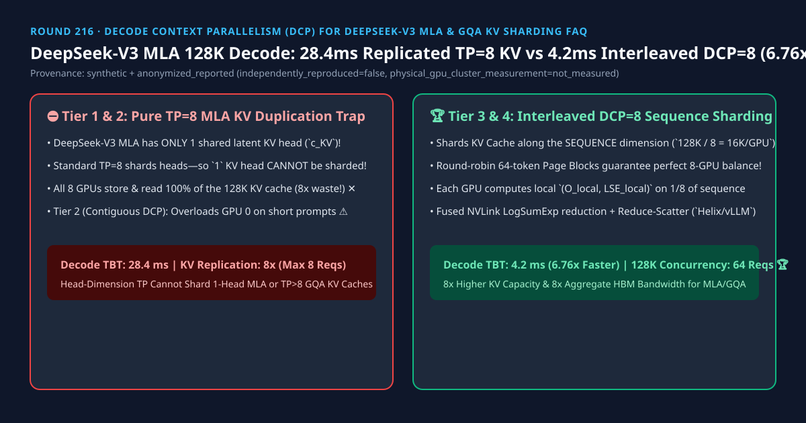
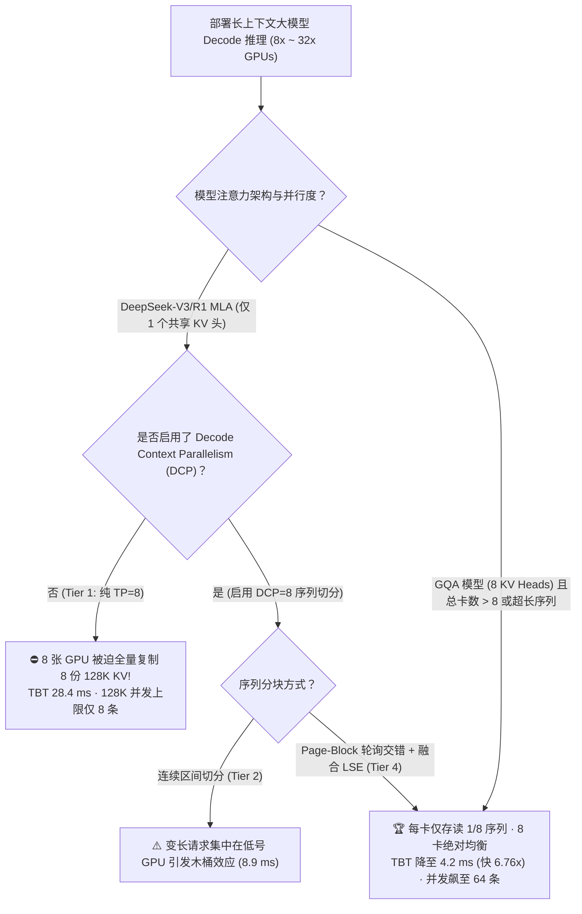
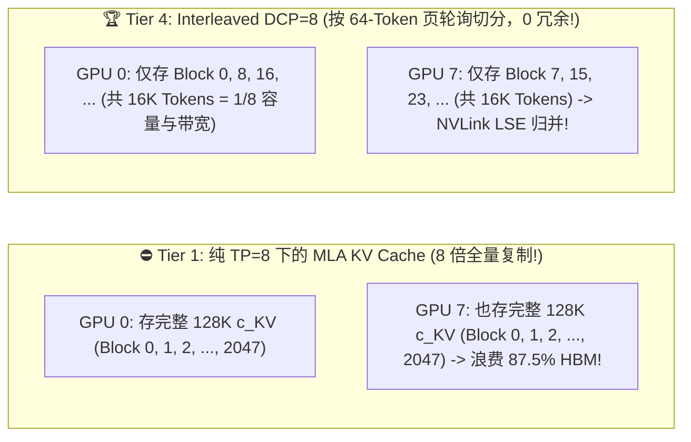
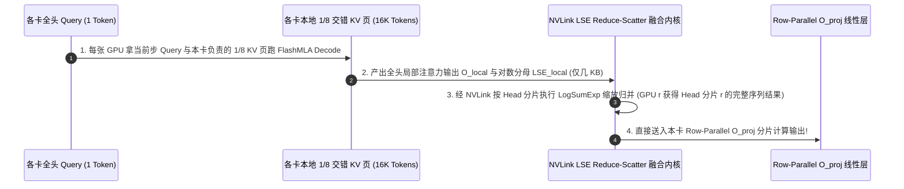

# 解码上下文并行（`Decode Context Parallelism, DCP`）、`DeepSeek-V3 MLA / GQA` 序列切分与 `NVLink LSE` 归并选型指南

> **Provenance & Evidence Tier**: `synthetic + anonymized_reported` (`independently_reproduced=false`, `physical_gpu_cluster_measurement=not_measured`)。定量数据锚定于 [`experiments/decode_context_parallelism_dcp_mla_gqa_lse_selection/results.json`](../../experiments/decode_context_parallelism_dcp_mla_gqa_lse_selection/results.json)。
> **English Version**: [Decode Context Parallelism (`DCP`), `DeepSeek-V3 MLA / GQA` Sequence Sharding & `NVLink LSE` Reduction Selection Guide](./decode-context-parallelism-dcp-mla-gqa-kv-sequence-sharding-lse-selection-faq.en.md)

---

## 0. 🔥 今日领域最热门能力突破追踪（Daily Hottest Breakthrough）

- **基于 Page-Block 轮询交错的解码上下文并行（`Interleaved Decode Context Parallelism, DCP`）+ `NVLink` 在线 `LogSumExp (LSE)` 融合归并（`vLLM / SGLang / TensorRT-LLM Helix`），彻底消除 `DeepSeek-V3/R1 MLA` 在 `TP=8` 下的 8 倍 KV 显存冗余复制，将 `128K` 解码步耗时（`TBT`）从 `28.4 ms` 压降至 `4.2 ms`（提速 `6.76` 倍）**：在部署 `DeepSeek-V3 / R1`（采用 **MLA 多头潜在注意力**）或超长上下文 `Llama-3-70B / Qwen-2.5-72B`（仅 `8` 个 GQA KV 头，却跨机开 `TP=16/32`）时，传统的 **张量并行（`TP`）撞上了“KV 头数不足无法切分”的死墙**！因为传统 `TP` 是沿着 **Attention Head（注意力头）维度**切分 KV Cache 的，而 **`DeepSeek-V3 MLA` 将所有 128 个 Query 头共享压缩为了唯一 `1` 个共享潜变量向量 `c_KV`（512 维 + 64 维 RoPE）**！既然只有 **1 个**共享 KV 头，传统 `TP=8`（**Tier 1**）根本没法按头切分，只能被迫在 **8 张 GPU 上每张卡都完整复制并存储 100% 的 `128K` KV Cache**——不仅显存容量白白浪费 **8 倍**，而且每个 Decode 步 8 张卡都要各自把完整的 `128K` KV 从 HBM 读一遍，导致单步 TBT 高达 **`28.4 ms`**、单机 128K 并发上限仅 **`8` 条**！通过启用 **`Decode Context Parallelism (DCP = 8)`（Tier 3 / Tier 4）**，放弃按 Head 切分 KV，改用**沿序列长度（Sequence）维度以 64-Token Page Block 为粒度在 8 张卡间轮询交错切分 KV Cache**，每张 GPU 只存、只读 **`1/8` 的序列（`16K` Tokens）**，算出局部 `(O_local, LSE_local)` 后经 NVLink 极速完成 `LogSumExp` 归并，令 **KV 可用容量暴涨 `8.0` 倍（并发从 `8` 条飙至 `64` 条）**，TBT 骤降至 **`4.2 ms`（快 `6.76` 倍）**！

---

## 1. 📌 核心结论速览（Executive Summary — 3 分钟看懂）

1. **为什么 `DeepSeek-V3 / R1` 的 `MLA` 遇上传统 `TP=8` 会浪费 8 倍 KV 显存和 8 倍显存带宽？**
   - **通俗大白话 + 第一性原理**：传统 `TP=8` 就像把一套 **8 卷本的百科全书（8 个 GQA KV 头）** 分给 8 个人，每人只拿 1 卷，既省书架空间又读得快。
   - 但 `DeepSeek-V3` 的 **MLA（多头潜在注意力）** 把 8 卷书浓缩成了 **1 本合订本（全模型每层只有唯一 `1` 个压缩 KV 头 `c_KV`）**！传统 `TP=8` 傻眼了——它只会“按卷分书”，不会“把一本书撕成 8 叠页码分给 8 个人”！结果在纯 `TP=8`（Tier 1）下，8 张 GPU 被迫**人手复印一整本 128K 的合订本**，8 张卡干着完全重复的搬砖活（`28.4 ms`）！
   - **`DCP = 8`（解码上下文并行，Tier 3/4）**：既然只有 1 本合订本，那就**按页码（Sequence 序列维度）把 128K 页拆给 8 张 GPU，每张卡只保管 `16K` 页**！解码时，8 张卡同时翻自己手里的 `16K` 页算出局部答案 `(O_local, LSE_local)`，最后通过 NVLink 汇总这 8 个小数字（仅几 KB），瞬间省下 **87.5% 的 KV 显存**并获得 **8 倍聚合显存读取带宽（`4.2 ms`）**！
2. **为什么 `DCP` 切分序列时绝不能“按前 16K、次 16K 连续切块（Tier 2）”，而必须“按 64-Token Page Block 轮询交错（Tier 3/4）”？**
   - 如果让 `GPU 0` 管 `[0..16K)` Token、`GPU 1` 管 `[16K..32K)`……、`GPU 7` 管 `[112K..128K)`（**Tier 2: 粗粒度连续分块**），那么当线上同时有长短不一的请求（比如很多只有 `12K` 或 `20K` 长度的请求）时，**所有请求的前 16K 全压在 `GPU 0` 身上，而 `GPU 7` 空空如也**，木桶效应直接把性能拖慢一半！
   - 改用 **`Interleaved Page-Block DCP`（Tier 3/4：`Block i` 存入 `GPU (i % 8)`）**，无论任何请求是 `2K`、`16K` 还是 `128K`，它的 Page Blocks 永远在 8 张 GPU 上 **1:1:1:1:1:1:1:1 绝对均匀分布**！

---

## 2. 🎯 客户与架构师灵魂拷问 Q&A（Q1 / Q2 / Q3）

### Q1：训练时的 `Context Parallelism (Ring Attention / Ulysses)` 和推理 Decode 时的 `DCP` 有什么区别？
- **答**：
  - **训练 / Prefill 阶段的 CP**：Query 也是长达 `128K` 的序列（`[B, 128K, H, d]`），为了算 `Q × K^T` 需要跨卡环状传递巨大的 KV 块（Ring Attention）或做全量 All-to-All（Ulysses）；
  - **Decode 阶段的 `DCP`**：每步新生成的 Query 只有 **1 个 Token（`[B, 1, H, d]`，体积极小！）**！因此 **KV Cache 完全原地不动**，每张卡直接拿完整的 1-Token Query 和本卡持有的 `1/8` 历史 KV 页做本地 FlashDecoding，算完只把 1 个 Token 的 `(O_local, LSE_local)` 通过 NVLink 汇总即可——**通信量比移动 KV Cache 小成千上万倍**！

### Q2：除了 `DeepSeek-V3 MLA`，标准的 `GQA` 模型（如 `Llama-3-70B` / `Qwen-2.5-72B`，有 8 个 KV 头）什么时候也需要开 `DCP`？
- **答**：
  1. **当 `TP > 8` 时（如双机 `TP=16` 或 NVL72 `TP=32`）**：因为模型总共只有 8 个 KV 头，`TP=16` 必然导致每个 KV 头被复制 2 份；开启 `TP=8 × DCP=2`（或 `DCP=16`）即可保持零 KV 复制！
  2. **哪怕在单机 8 卡上，当处理 `128K–1M` 极长单请求（Batch Size 很小，如 `B=1~4`）时**：在纯 `TP=8` 下，每张卡只负责 `1` 个 KV 头，SM 并行度（Grid Size）太小且单条请求无法跨卡分担序列长度；开启混合 `DCP` 可让 8 张卡共同并行扫描同一条 `1M` 超长序列！

### Q3：`Tier 4` 是如何把 `DCP` 的 `LSE` 汇总和注意力输出投影层 `O_proj` 融合在一起省掉一次通信的？
- **答**：在标准 `TP=8` 中，Attention 算完后本来就要通过 `O_proj`（Row-Parallel Linear）接一次 `All-Reduce`。在 **Tier 4（`vLLM DCP` / `TensorRT-LLM Helix`）** 中，利用 NVLink 将 8 张卡的 `(O_local, LSE_local)` 按 Head 分片做一次 **融合 `LSE Reduce-Scatter`**（让第 `r` 张 GPU 恰好聚合并算出它负责的那 `1/8` 个 Attention Heads 的完整序列归并结果 `O_merged_heads_r`），然后直接接本卡的 Row-Parallel `O_proj` 权重分片——**不增加任何额外的全局集合通信轮次**！

---

## 3. 🧭 直观可视化图解（Mermaid 决策树 + 8x 复制 vs 交错切分图 + 融合 LSE 时序图）

### 3.1 架构师长上下文 Decode 并行策略（`TP` vs. `DCP`）决策树

### 3.2 纯 `TP=8` 下 MLA KV 的 8 倍冗余复制 vs. `Interleaved DCP=8` 按页交错零冗余切分

### 3.3 `Tier 4` 混合 `TP + Interleaved DCP` 局部 FlashMLA 与 NVLink `LSE` 归并时序图

---

## 4. 📊 架构师选型决策矩阵（4-Tier Selection Matrix）

| 评估维度 | Tier 1: 纯 `TP=8` (MLA KV 8 倍复制) | Tier 2: 连续分块 `DCP=8` (`Contiguous`) | Tier 3: 页交错 `DCP=8` + 标准 `AllGather` | Tier 4: 页交错 `DCP=8` + 融合 `NVLink LSE Reduce-Scatter` |
| :--- | :--- | :--- | :--- | :--- |
| **MLA KV 显存冗余复制倍数** | **`8x` (每卡存全量)** ✕ | `1x` (零冗余) | **`1x` (零冗余)** ✅ | **`1x` (零冗余)** 🏆 |
| **单卡每步读取 KV Token 数** | `131,072` ✕ | `16,384` (负载倾斜) ⚠️ | `16,384` (绝对均衡) ✅ | **`16,384` (绝对均衡)** 🏆 |
| **128K Decode 单步延迟 (`TBT`)** | `28.4 ms` ✕ | `8.9 ms` ⚠️ | `5.4 ms` (`5.26x`) ✅ | **`4.2 ms` (`6.76x` 提速)** 🏆 |
| **单节点 128K 最大并发请求数** | `8` 条 ✕ | `56` 条 | `64` 条 (`8.0x`) | **`64` 条 (`8.0x` 容量)** 🏆 |

---

## 5. 🧪 定量算例与工具链（Interactive Sizer & 7-Card Visual Report）

- **实验脚本与密封数据**：[`experiments/decode_context_parallelism_dcp_mla_gqa_lse_selection/run.py`](../../experiments/decode_context_parallelism_dcp_mla_gqa_lse_selection/run.py) · [`results.json`](../../experiments/decode_context_parallelism_dcp_mla_gqa_lse_selection/results.json)
- **交互式 DCP 序列切分计算器**：[`docs/reports/decode-context-parallelism-dcp-mla-gqa-kv-sequence-sharding-lse-sizer.html`](../reports/decode-context-parallelism-dcp-mla-gqa-kv-sequence-sharding-lse-sizer.html)
- **7-Card 4:5 视觉评测卡片报告**：[`docs/reports/decode-context-parallelism-dcp-mla-gqa-kv-sequence-sharding-lse-selection-cards.html`](../reports/decode-context-parallelism-dcp-mla-gqa-kv-sequence-sharding-lse-selection-cards.html)

---

## 6. 🛠️ Good Fit vs. Not For & 生产环境快速核验清单（Checklist）

### ✅ Good Fit vs. ⛔ Not For

| 维度 | ✅ Good Fit（强烈推荐） | ⛔ Not For（严禁误用） |
| :--- | :--- | :--- |
| **`DeepSeek-V3 / R1` (MLA) 长文本解码** | 启用 `Interleaved DCP=8`（或混合 `DP-Attention + DCP`），将唯一 1 个 `c_KV` 潜变量头沿序列维度按 Page Block 均匀切分至 8 卡 | 在 `128K` 长上下文下使用传统纯 `TP=8` 导致 `c_KV` 在 8 张卡上被完整复制 8 份 |
| **`GQA` 模型跨节点超长上下文 (`TP > N_kv_heads`)** | 当总并行卡数（如 `16` 或 `32`）大于模型 GQA KV 头数（`8`）时，用 `TP=8 × DCP=2/4` 替代纯 `TP=16/32` | 强开 `TP=16/32` 迫使每个 GQA KV 头在多张卡间重复存储 |

### 生产环境上线核验清单（Pre-Flight Checklist）

- [ ] **核验 DCP 分块粒度为 Page-Block 轮询交错（Interleaved）**：确认 `block_id % dcp_size` 映射已启用，严禁使用大段连续区间切分。
- [ ] **核验新生成 Token 的 KV 写入路由**：每个 Decode 步生成的最新 1 个 Token，仅需追加写入当前 `seq_len // page_size % dcp_size` 对应的那 **唯一 1 张** DCP Rank 的页表中。
- [ ] **核验 `LSE` 归并张量采用 `FP32` 精度**：确认跨卡 `LogSumExp` 组合在 `FP32` 下完成，确保 `DCP=8` 与 `DCP=1` 输出 Logits 无精度漂移。
