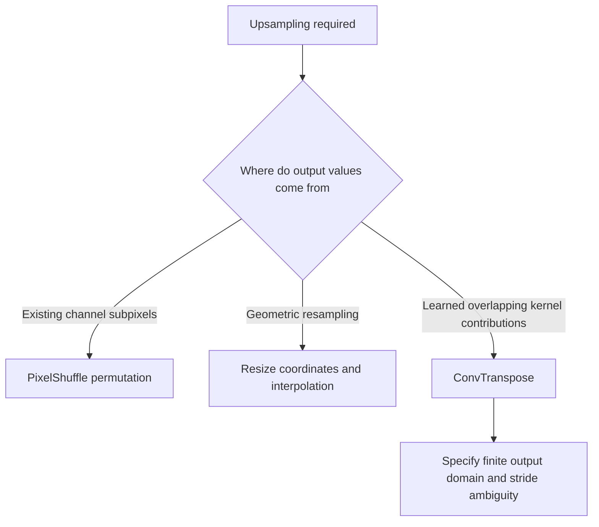
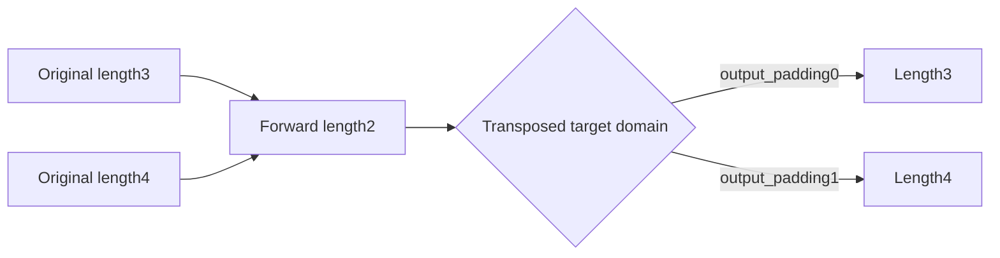
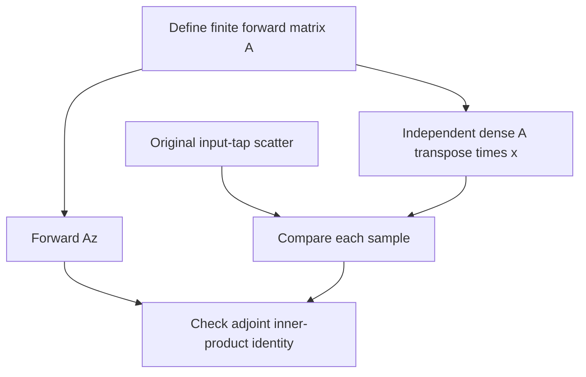

# AI Infra finite-convolution FAQ: ConvTranspose output_padding, shape ambiguity and adjoints

> **Language**: English | [中文](dense-transpose-output-padding-finite-adjoint-selection-faq.md)  
> **Round 139 · 2026-11-14 daytime**: finite dense upsampling boundaries and linear-matrix contracts—not streaming overlap or sparse coordinate maps.  
> **Related**: [PixelShuffle DCR/CRD](pixel-shuffle-depth-space-dcr-crd-layout-selection-faq.en.md) · [Resize coordinates](resize-integer-size-half-pixel-align-corners-selection-faq.en.md)

**Executive finding:** transposed convolution can represent the adjoint of a fixed finite cross-correlation matrix, **not its numerical inverse**. `output_padding` selects an ambiguous output length; it does **not append zeros**. With original input `[1,2]`, kernel `[1,2,3]`, stride2/padding1/dilation1, changing output_padding0→1 changes `[2,5,4]` to **`[2,5,4,6]`**. The newly included sample can be nonzero.

**Artifacts**: [workbench](../reports/dense-transpose-output-padding-finite-adjoint-sizer.html) · [seven cards](../reports/dense-transpose-output-padding-finite-adjoint-selection-cards.html) · [1600px SVG](../../assets/svg/dense-transpose-output-padding-finite-adjoint-selection-faq-summary.svg) · [sealed report](../../experiments/transpose_output_padding_selection/report.json)

## Q1: When should ConvTranspose be chosen over PixelShuffle or Resize?

Consider ConvTranspose when a network should project inputs through learned kernel contributions into a larger spatial domain. PixelShuffle rearranges channel/spatial positions without weighted overlap; Resize interpolates according to geometric coordinates. Equal resolution changes do not make those semantics interchangeable. Image/audio quality depends on the network and training, not this model's boundary correctness.



This study concerns dense finite output selection. Earlier streaming overlap-carry/bias and sparse cached-inverse-connectivity studies address different protocols. No measurements or claims are inherited from them.

## Q2: Why does the output-length formula include output_padding?

For these 1-D parameters, `Lout=(Lin−1)*stride−2*padding+dilation*(K−1)+output_padding+1`. A stride>1 forward cross-correlation can map several original lengths to the same output length. With K3/stride2/padding1, original lengths3 and4 both produce length2. That length alone cannot choose whether the transposed target should be3 or4.

The pinned PyTorch `_output_padding` requested-output-size branch computes a minimum M, accepts targets through `M+stride−1`, and takes their difference. Our model also checks the interval and positive target length rather than silently flooring or cropping invalid requests.



Our selected subset `0≤output_padding<stride` makes the matching finite forward-matrix row count unambiguous. It is narrower than some native dilation-related explicit configurations: the read native slow2D shape guard uses a smaller-than-stride **or** smaller-than-dilation check. Model rejection does not establish rejection by every PyTorch backend; backend support matrices are not reproduced.

## Q3: Why does “append one zero” fail, and how should padding be interpreted?

The original scatter visits input index i and kernel tap k, accumulating `x[i]*w[k]` at `position=i*stride−padding+k*dilation` only inside the selected finite domain. Enlarging that domain can admit real contributions previously outside it, rather than merely extending an output array.

| Original input `[1,2]`, kernel `[1,2,3]` | Output | Meaning |
| :--- | :--- | :--- |
| output_padding0 | `[2,5,4]` | Finite target length3 |
| output_padding1 | `[2,5,4,6]` | Position3 includes `2*3=6` |
| Wrong append-zero surrogate | `[2,5,4,0]` | Only3/4 positions match; a real contribution is lost |

Native `padding` documentation relates it to ordinary Conv1d's padding but does not mean directly padding the result again. This model states coordinates and finite clipping explicitly rather than guessing extra offsets.

## Q4: Why is transpose an adjoint, not an inverse?

The independent oracle constructs the dense forward cross-correlation matrix from row/column coordinates. For the length4 target, `A=[[2,3,0,0],[0,1,2,3]]`; `Aᵀ*[1,2]=[2,5,4,6]`, matching scatter individually. The oracle does not just repeatedly call the scatter.



For `z=[1,2,3,4]`, `Az=[8,20]`; its inner product with `x=[1,2]` is48, equal to `<z,Aᵀx>`. Yet `AᵀAz=[16,44,40,60]` does not recover z. Compression or nonorthogonal weights do not become invertible just because the layer is called transpose.

The adjoint statement needs the same linear kernel, matching finite boundary, stride/dilation and **no bias**. Independently learned transpose weights need not be the adjoint of an existing forward layer. An affine biased layer is not simply the same linear matrix.

## Q5: What boundaries must memory and throughput budgets preserve?

The independent grouped payload budget selects batch8, Cin64/Cout32/groups4, Lin128/K3, stride2/padding1/dilation1/output_padding1 and4B scalars, giving Lout256. Input/output payloads are262144B each, weights6144B; reading inputs/weights once and writing output once totals530432B of selected logical traffic. This is not actual total traffic, workspace or allocator peak; the scalar evaluator does not execute grouped convolution.

| Original transpose input length | Python tap scatter (ms) | Prebuilt dense matrix transpose apply (ms) |
| ---: | ---: | ---: |
| 16 | 0.015333 | 0.052067 |
| 32 | 0.028033 | 0.193400 |
| 64 | 0.053967 | 0.732000 |
| 128 | 0.112333 | 3.371733 |

Two warmups, seven alternating repeats, three operations per sample, median repeat means; dense matrix construction is excluded. The baseline is an educational mostly-zero Python matrix, not an actual cuDNN/BLAS/native convolution algorithm. Native selection, GPU, bias, grouped execution, streaming and quality are unmeasured; the ratios are not production speedups.

## Q6: How should the study be reproduced and production behavior accepted?

```powershell
python -m unittest discover -s tests -p test_transpose_output_padding_selection.py -q
python -m experiments.transpose_output_padding_selection.run --check
# --measure deliberately replaces original local CPU samples.
```

Eight tests cover nonzero extension, 36 input/stride/output-padding/dilation finite-matrix cases, adjoint-not-inverse, requested-length intervals, zero/linearity controls, grouped budgets/bad inputs, Node/Python parity and sealed timing. The H5 reports errors and limits displayed output to4096samples. Prior browser refusal remains respected; visual browser inspection was not performed.

Sources: [pinned PyTorch conv.py ConvTranspose1d and `_output_padding`](https://github.com/pytorch/pytorch/blob/7bbc31dd45f4e43a5e3899e7e328aedfd967f2ff/torch/nn/modules/conv.py) and [native slow-transpose shape guard](https://github.com/pytorch/pytorch/blob/7bbc31dd45f4e43a5e3899e7e328aedfd967f2ff/aten/src/ATen/native/NaiveConvolutionTranspose2d.cpp), with upstream BSD-style rights preserved. Tracked conv.py history last changed July20 comments/docstring typos; the Nov14 tree's regional AOTI work did not invent ConvTranspose. No daily trending rank is fabricated.

Scalar/matrix code, budgets, H5/art/report are original, not copied implementation. Production needs dimensionality, grouped channel-weight layout, output-size path, dtype/backend, determinism and quality regressions. Native parity/GPU/workspace/audio-image quality remain unknown/null. Provenance is `synthetic`, `independently_reproduced=false`; original CPU records are separately `measured`. This finite bias-free model does not certify every native configuration.
