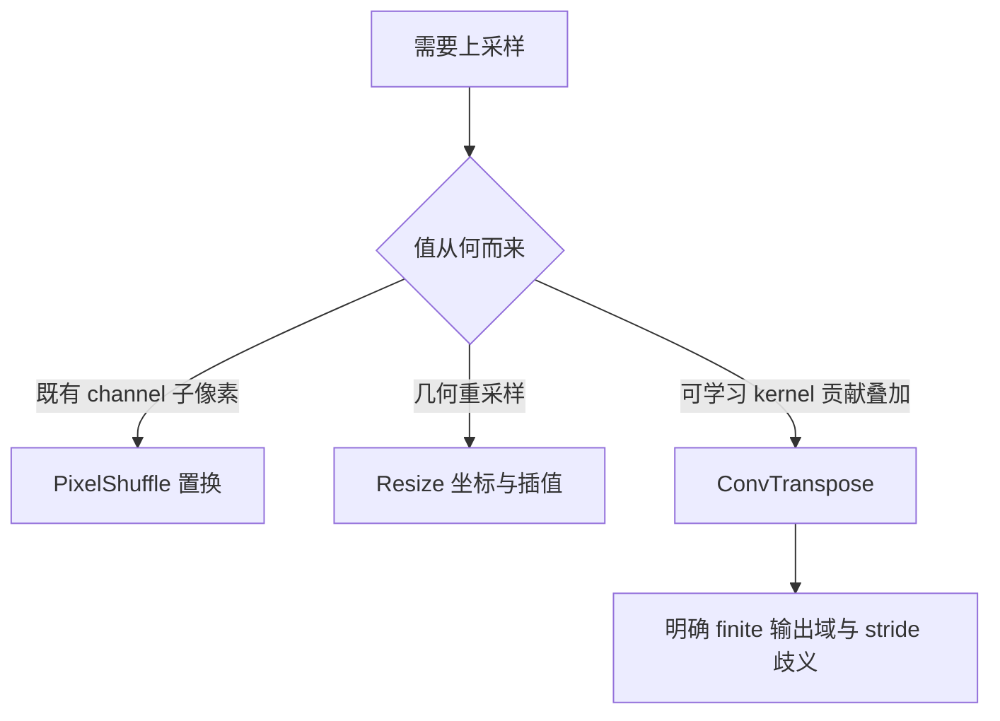
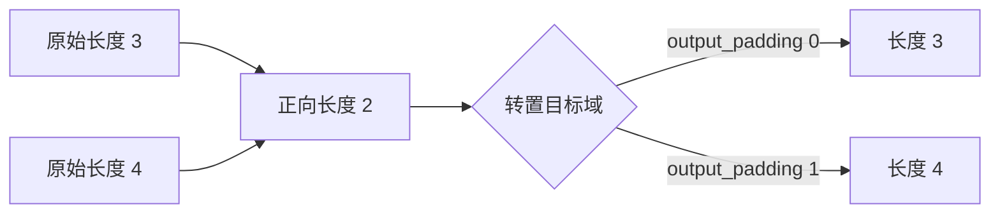
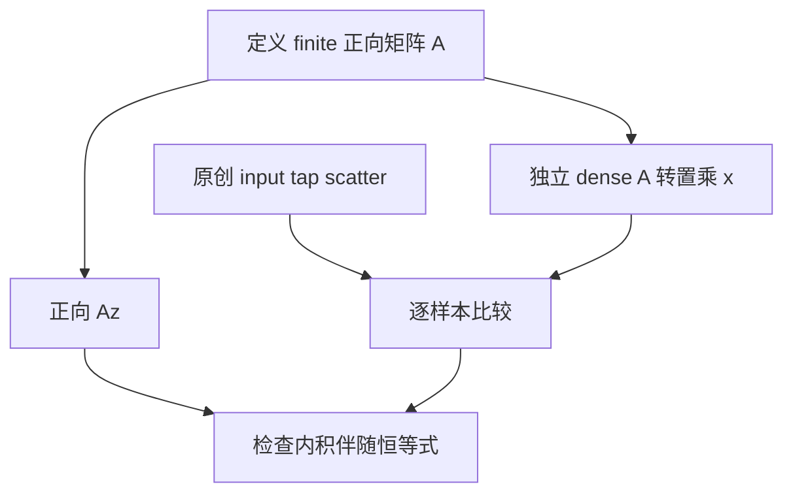

# AI Infra 有限域卷积选型 FAQ：ConvTranspose 的 output_padding、形状歧义与伴随

> **语言**：中文 | [English](dense-transpose-output-padding-finite-adjoint-selection-faq.en.md)  
> **Round 139 · 2026-11-14 白班**：dense 上采样层的输出边界与线性矩阵契约；不是 streaming overlap 或 sparse coordinate-map 研究。  
> **关联**：[PixelShuffle DCR / CRD](pixel-shuffle-depth-space-dcr-crd-layout-selection-faq.md) · [Resize 几何坐标](resize-integer-size-half-pixel-align-corners-selection-faq.md)

**结论速览**：转置卷积可表示固定 finite cross-correlation 矩阵的伴随，**不是数值逆**。`output_padding` 用于选择有歧义的输出长度，**不是在结果末尾补零**：原创输入 `[1,2]`、kernel `[1,2,3]`、stride2/padding1/dilation1，将 output_padding 从0改1，输出 `[2,5,4]` 变成 **`[2,5,4,6]`**，最后一个新位置可以非零。

**交付**：[交互工作台](../reports/dense-transpose-output-padding-finite-adjoint-sizer.html) · [7-Card](../reports/dense-transpose-output-padding-finite-adjoint-selection-cards.html) · [1600px SVG](../../assets/svg/dense-transpose-output-padding-finite-adjoint-selection-faq-summary.svg) · [封存数据](../../experiments/transpose_output_padding_selection/report.json)

## Q1：何时选择 ConvTranspose，和 PixelShuffle / Resize 有什么不同？

当网络需要按学习到的 kernel 将输入贡献投到更大的空间域，可以考虑 ConvTranspose。PixelShuffle 只置换 channel 与空间位置，不做 weighted overlap；Resize 按几何坐标做插值。三者改变分辨率的方式不同，不能仅按输出尺寸互换。图像/音频质量依赖训练与具体网络，不由本模型的边界正确性决定。



本专题只讨论 dense 有限域输出选择。此前 streaming 研究的 overlap carry/bias 与 sparse 研究的 cached inverse connectivity 是不同协议；不继承其数据、延迟或实现结果。

## Q2：输出长度公式为什么有 output_padding？

对于本例1-D参数，`Lout=(Lin−1)*stride−2*padding+dilation*(K−1)+output_padding+1`。普通 stride>1 cross-correlation 可以将多个原始长度映射为同一个输出长度。例如 K3/stride2/padding1 时，原始长度3和4都得到长度2；因此只知道长度2不足以判断转置目标应为3还是4。

固定 PyTorch `_output_padding` 的 requested `output_size` 分支计算最小长度 M，允许从 M 到 `M+stride−1` 的目标并解出差值；原型也检查目标范围和正输出长度，不用 floor 或静默裁剪修复非法请求。



原型明确选择 `0≤output_padding<stride` 子域，使匹配有限正向矩阵的行数确定。它比某些 native dilation 相关显式配置更窄；已读 native slow 2-D shape guard 接受“小于 stride 或 dilation”的边界，不能把本模型拒绝当所有 PyTorch backend 的拒绝证明。此处也不复现各 backend 支持矩阵。

## Q3：为什么“只补一个零”会错？padding 参数该怎样理解？

原创 scatter 遍历每个输入索引 i 与 kernel tap k，将 `x[i]*w[k]` 累加至 `position=i*stride−padding+k*dilation`，仅保留所选 finite 域内的位置。选更大的输出域会让原本被边界排除的真实贡献进入，而不只是改变数组末尾。

| 原创输入 `[1,2]`、kernel `[1,2,3]` | 输出 | 含义 |
| :--- | :--- | :--- |
| output_padding0 | `[2,5,4]` | 目标域长度3 |
| output_padding1 | `[2,5,4,6]` | 位置3包含 `2*3=6` |
| 错误 zero-append surrogate | `[2,5,4,0]` | 只有3/4位置匹配，丢掉真实贡献 |

native 文档对 `padding` 的解释与普通 Conv1d 输入左右补零参数有关联但不完全同一句操作。避免把它再当一次直接输出补零；本模型通过明确坐标和 finite 截取描述语义，不做任意 offset 猜测。

## Q4：为什么 transpose 是 adjoint，不是 inverse？

独立 oracle 先从正向 cross-correlation 的 row/column 坐标构建 dense 矩阵。本例输出目标长度4时，`A=[[2,3,0,0],[0,1,2,3]]`；`Aᵀ*[1,2]=[2,5,4,6]`，逐值等于 scatter。不是用同一个 scatter 反复调用伪造 oracle。



取 `z=[1,2,3,4]`，则 `Az=[8,20]`；与 `x=[1,2]` 的 inner product 为48，等于 `<z,Aᵀx>`。但 `AᵀAz=[16,44,40,60]`，并不恢复 z。卷积有信息压缩或非正交权重时，transpose 不能凭名字变成逆。

该 adjoint 论述需要相同 linear kernel、匹配 boundary、stride/dilation 与**无 bias**。独立学习的 transpose kernel 不一定等于某个已有 forward kernel 的伴随；带 bias 的 affine 层不能直接视为同一个线性矩阵。

## Q5：内存和吞吐预算需要保留什么边界？

独立 grouped payload budget 选择 batch8、Cin64/Cout32/groups4、Lin128/K3、stride2/padding1/dilation1/output_padding1、4B标量，得到 Lout256。输入与输出 payload 各262144B，weight payload6144B；假设 input/weights 各读一次、output写一次，总逻辑量530432B。这不是实际总访存、workspace 或 allocator 峰值；标量 evaluator 也没有执行 grouped convolution。

| 原创 transpose 输入长度 | Python tap scatter（ms） | 预构建 dense 矩阵转置乘（ms） |
| ---: | ---: | ---: |
| 16 | 0.015333 | 0.052067 |
| 32 | 0.028033 | 0.193400 |
| 64 | 0.053967 | 0.732000 |
| 128 | 0.112333 | 3.371733 |

两次 warmup、七轮交替 repeat，每样本三操作，报告 repeat 均值中位数；dense matrix 构建不计入 timing。baseline 是教学用含大量零的 Python matrix，不是 cuDNN/BLAS/native 卷积的真实算法。没有测 native algorithm selection、GPU、bias、groups execution、streaming 或质量；不能把比例冒充生产加速。

## Q6：如何复现、跟踪来源和验收生产行为？

```powershell
python -m unittest discover -s tests -p test_transpose_output_padding_selection.py -q
python -m experiments.transpose_output_padding_selection.run --check
# --measure 会主动替换本机原创 CPU samples
```

八项测试覆盖非零扩展反例、36组 input/stride/output_padding/dilation finite matrix 对照、adjoint非inverse、requested长度区间、零值与线性、分组预算/非法输入、Node/Python parity 和 sealed timing。H5显式报错，交互输出上限4096；此前浏览器拒绝仍受尊重，未执行视觉浏览器检查。

来源：[固定 PyTorch conv.py 的 ConvTranspose1d 与 `_output_padding`](https://github.com/pytorch/pytorch/blob/7bbc31dd45f4e43a5e3899e7e328aedfd967f2ff/torch/nn/modules/conv.py) 及 [native slow transpose shape guard](https://github.com/pytorch/pytorch/blob/7bbc31dd45f4e43a5e3899e7e328aedfd967f2ff/aten/src/ATen/native/NaiveConvolutionTranspose2d.cpp)，BSD-style 上游权利保留。conv.py 所追踪最近历史为7月20日 typo/comment 修订，11月14日 tree 的 regional AOTI 不构成新 ConvTranspose 发明；不虚构当日热榜排名。

原创 scalar/matrix、字节预算、H5/图/报告均未复制 upstream实现。生产应验证实际dimensionality、group/channel weight layout、output_size路径、dtype/backend、determinism要求与质量回归。native parity/GPU/workspace/音视频质量均未知/null；报告`synthetic`、`independently_reproduced=false`，原创CPU记录单独`measured`。不得由这个有限无bias模型证明所有native配置兼容。
