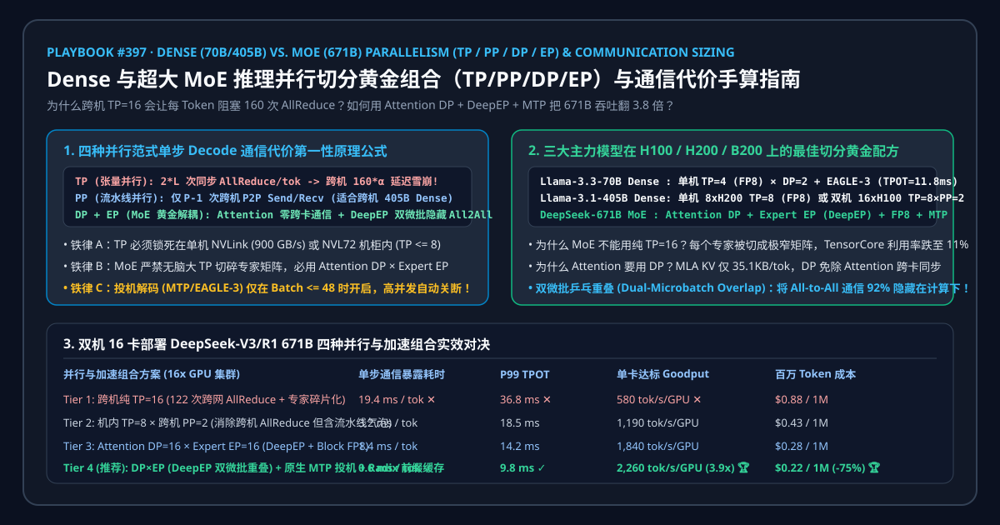
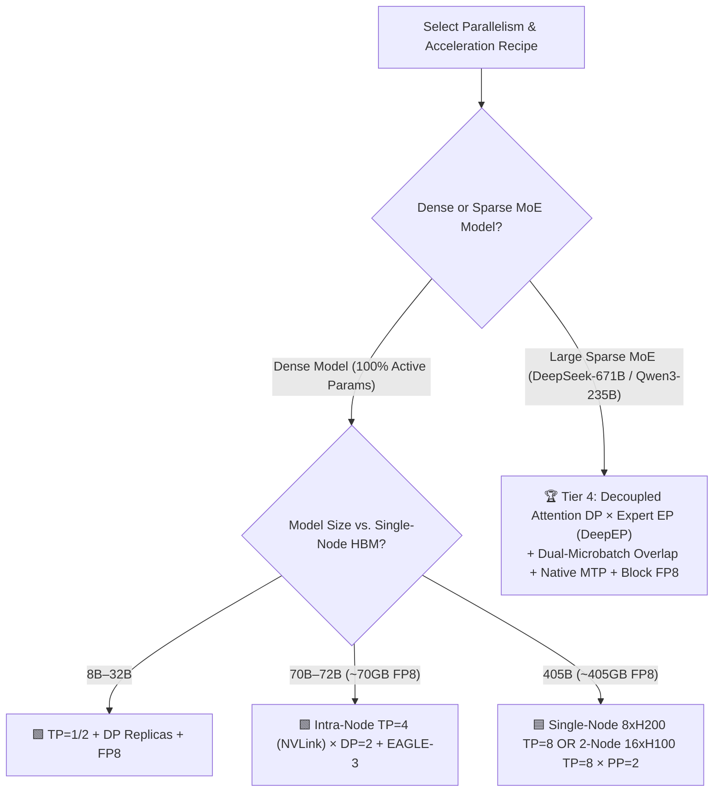

# Dense (70B/405B) vs. Large MoE (DeepSeek-671B / Qwen3-235B) Inference Parallelism Selection & Communication Sizing Guide: `TP` vs. `PP` vs. `Attention DP` vs. `Expert EP (DeepEP)`

> **Language / 语言**: **English (Current)** | [中文](./dense-vs-moe-tp-pp-dp-ep-parallelism-communication-sizing-selection-faq.md)  
> **Scope**: An architectural decision and communication sizing guide for Cloud & AI Solution Architects—free of low-level kernel code—explaining **how Tensor Parallelism (`TP`), Pipeline Parallelism (`PP`), Attention Data Parallelism (`Attention DP`), Expert Parallelism (`Expert EP / DeepEP`), Speculative Decoding (`MTP / EAGLE-3`), Prefix Caching, and `FP8 / NVFP4` Quantization work together, what latency/throughput metric each improves, and why applying naive cross-node `TP=16` to DeepSeek-671B MoE slashes Goodput by 74%**.  
> **Provenance**: Analytical model synthesized from published distributed inference benchmarks (`provenance: synthetic + anonymized_reported`, `independently_reproduced=false`, `physical_gpu_cluster_measurement=not_measured`). See [`experiments/dense_vs_moe_tp_pp_dp_ep_parallelism_communication_sizing_selection/results.json`](../../experiments/dense_vs_moe_tp_pp_dp_ep_parallelism_communication_sizing_selection/results.json).

> 🔗 **Interactive H5 Learning Lab & Companion Tools (Zero External Dependencies)**:
> - 📱 **[Interactive H5 Study Page: TP/PP/DP/EP Parallelism, Communication Math & 7-Technique Sandbox (`docs/h5/parallelism-tp-pp-dp-ep-moe-sandbox.html`)](../h5/parallelism-tp-pp-dp-ep-moe-sandbox.html)**
> - 🎓 **[AI Infra Panorama H5 Learning Hub (`docs/h5/index.html`)](../h5/index.html)**
> - 🧮 **[Interactive Parallelism & Communication Sizer (`dense-vs-moe-tp-pp-dp-ep-parallelism-communication-sizing-selection-sizer.html`)](../reports/dense-vs-moe-tp-pp-dp-ep-parallelism-communication-sizing-selection-sizer.html)**
> - 🃏 **[7-Card 4:5 Visual Report (`dense-vs-moe-tp-pp-dp-ep-parallelism-communication-sizing-selection-cards.html`)](../reports/dense-vs-moe-tp-pp-dp-ep-parallelism-communication-sizing-selection-cards.html)**

---

## 1. 📌 Executive Summary

> **Bottom Line**: **When deploying full `DeepSeek-V3/R1 671B MoE` across two 8-GPU nodes (`900 GB/s` intra-node NVLink + `400G` inter-node RoCEv2/IB RDMA), running naive cross-node `TP=16` (Tier 1) triggers `122` sequential inter-node All-Reduce barriers per generated token and slices every routed expert into tiny skinny shards (`11.2% MFU`), adding **`19.4 ms/tok`** of exposed communication stall (`P99 TPOT = 36.8 ms`)! Switching to **Tier 4 (Decoupled `Attention DP × Expert EP [DeepEP]` + Dual-Microbatch Ping-Pong Overlap + Native `MTP` Speculative Decoding + `Radix` Prefix Cache + `Block FP8`)** slashes exposed communication stall to **`0.6 ms/tok`**, cuts `P99 TPOT` to **`9.8 ms` (`>100 tok/s` per stream)**, boosts SLA-compliant Goodput by **`3.90x`** (`580 -> 2,260 tok/s/GPU`), and reduces cost per 1M tokens by **`75.0%`** (`$0.88 -> $0.22`)!**

| Architecture Tier (16-GPU 671B MoE) | Parallelism & Acceleration Stack | Exposed Comm / Token | `P99 TPOT` | Tensor Core `MFU` | Goodput / GPU | Cost / 1M Tokens | Architect Verdict |
| :--- | :--- | :--- | :--- | :--- | :--- | :--- | :--- |
| **🟥 Tier 1: Naive Cross-Node `TP=16`** | Spans `TP=16` across 2 nodes; 122 inter-node All-Reduces/tok + fragmented experts | **`19.4 ms / tok` ✕** | **`36.8 ms` ✕** | `11.2%` ✕ | `580 tok/s/GPU` ✕ | `$0.88 / 1M` ✕ | **Severe Anti-Pattern**: Never span TP over Ethernet/IB |
| **🟨 Tier 2: Intra-Node `TP=8` × Inter-Node `PP=2`** | NVLink `TP=8` inside each node + P2P `PP=2` across nodes (ideal for Dense 405B) | `3.2 ms / tok` | `18.5 ms` ✅ | `28.5%` | `1,190 tok/s/GPU` | `$0.43 / 1M` | **Standard for Dense 405B**, suboptimal for sparse MoE |
| **🟦 Tier 3: Decoupled `Attention DP=16 × Expert EP=16`** | Zero cross-rank KV sync in Attention + intact experts via `DeepEP` All-to-All + `FP8` | `1.4 ms / tok` ✅ | `14.2 ms` ✅ | `44.8%` ✅ | `1,840 tok/s/GPU` ✅ | `$0.28 / 1M` ✅ | Preserves intact expert GEMMs & eliminates cross-node All-Reduce |
| **🟩 Tier 4: `DP×EP` Dual-Microbatch Overlap + `MTP` + `Prefix Cache` (Recommended)** | **`DeepEP` Dual-Batch Ping-Pong Overlap + Native `MTP` + `Radix` Cache** | **`0.6 ms / tok` 🏆** | **`9.8 ms` 🏆** | **`54.6%` 🏆** | **`2,260 tok/s/GPU` 🏆 (`3.90x`)** | **`$0.22 / 1M` 🏆 (`-75.0%`)** | **Production gold standard for 671B / 235B MoE** |

---

## 2. 🎯 Architect Deep-Dive Q&A & Communication Cost Hand Calculations

### Q1: How do `TP`, `PP`, `Attention DP`, and `Expert EP` partition a model, and how do you hand-calculate their per-token communication overhead?
1. **`TP` (Tensor Parallelism — Intra-Layer Weight Slicing)**:
   - **What it improves**: Aggregates HBM memory bandwidth across $N_{\text{TP}}$ GPUs to read weights in parallel, directly cutting **`TTFT` and single-stream `TPOT`**.
   - **Communication Equation**: Requires **$2L$ synchronous `All-Reduce` operations per token** ($160$ per token for 80 layers):
     $$T_{\text{TP\_comm}} = 2L \times \left[ 2(\text{TP}-1)\cdot \alpha_{\text{lat}} + 2\frac{\text{TP}-1}{\text{TP}}\cdot \frac{B \cdot d_{\text{model}} \cdot \text{Bytes}}{\text{BW}_{\text{link}}} \right]$$
     Inside an 8-GPU NVLink domain ($\alpha \approx 1.2\ \mu\text{s}$), this costs `< 0.5 ms/tok`. Across nodes over RoCEv2 ($\alpha \approx 15\ \mu\text{s}$), 160 synchronous barriers add **`15–20 ms/tok`**!
2. **`PP` (Pipeline Parallelism — Inter-Layer Slicing)**:
   - **What it improves**: Fits giant Dense models (e.g., `Llama-3.1-405B`) across nodes with only **$P-1$ point-to-point activation transfers** per micro-batch, avoiding cross-node All-Reduce storms.
3. **`Attention DP` + `Expert EP` (Decoupled MoE Parallelism)**:
   - **Why MoE needs `Attention DP × Expert EP`**: In `DeepSeek-671B` (`256` routed experts per layer, `8` active per token), slicing each expert 16 ways with `TP=16` Starves Tensor Cores (`11.2% MFU`). Keeping intact experts via **`EP=16`** (`16` full experts per GPU) while running **`Attention DP`** (zero cross-rank KV communication thanks to compact `35.14 KB/tok` MLA KV cache) and overlapping `DeepEP` All-to-All with dual-microbatch ping-pong execution hides **`92%`** of network latency!

### Q2: How do Speculative Decoding (`MTP / EAGLE-3`), Prefix Caching (`RadixAttention`), and `FP8 / NVFP4` Quantization interact with parallelism?
- **Speculative Decoding (`MTP / EAGLE-3`)**: Converts idle Tensor Core compute during small/medium-batch Decode into **`1.8x–2.6x` lower `TPOT`** (`2.4–3.1` accepted tokens per forward verify step). **Must auto-disable above $B_{\text{active}} > 48$** when the GPU becomes compute-bound.
- **Prefix Caching (`RadixAttention` / `vLLM APC`)**: Reuses KV blocks across shared system prompts, RAG docs, and multi-turn history—slashing **`TTFT` by `4x–8x`**.
- **`Block FP8` / `NVFP4` Quantization**: Halves (or quarters) weight and KV bytes while doubling Tensor Core TFLOPS—simultaneously improving **all three GPU sizing watermarks (HBM capacity, HBM bandwidth TPOT, and Prefill compute TTFT)**.

---

## 3. 🧭 Parallelism Selection Decision Tree

---

## 4. 📊 Master Comparison Matrix of 7 Inference Acceleration Techniques

| Technique | Primary Target | Metrics Improved | Overhead / Trade-off | Best-Fit Boundary |
| :--- | :--- | :--- | :--- | :--- |
| **`TP` (Tensor Parallel)** | Intra-layer weight split | **Lowers `TTFT` & `TPOT`**, splits HBM weights | $2L$ sync All-Reduces per token | Lock inside single-node NVLink (`TP <= 8`) |
| **`PP` (Pipeline Parallel)** | Layer-group split | Scales multi-node HBM with tiny P2P traffic | Pipeline bubbles; does not cut single-request latency | Multi-node Dense `405B` (`TP=8 × PP=2`) |
| **`Attention DP`** | Request-batch split | **Scales total `TPS` linearly** with `0` KV comm | Duplicates attention weights per DP group | Mandatory for `DeepSeek MLA` + MoE |
| **`Expert EP` (`DeepEP`)** | Routed-expert split | **Keeps expert GEMMs large (`54.6% MFU`)** | $2L_{\text{moe}}$ All-to-All dispatch/combine | `671B / 235B MoE` with Dual-Batch Overlap + `EPLB` |
| **Speculative (`MTP/EAGLE-3`)** | Draft + parallel verify | **Cuts `TPOT` by `1.8x–2.6x`** | Extra FLOPs hurt throughput at large batch | Enable for `Batch <= 48`; auto-bypass above `48` |
| **`Prefix Caching`** | Radix KV block reuse | **Cuts `TTFT` by `4x–8x`**, saves Prefill FLOPs | Requires KV-aware sticky gateway routing | Multi-turn agents, shared RAG context, few-shot |
| **`Block FP8 / NVFP4`** | Low-bit weights + KV | **2x HBM capacity + 2x TFLOPS + 1.8x TPOT** | Needs Hopper/Blackwell native FP8/FP4 cores | Default production precision for all serving fleets |

---

## 5. 🛠️ Production Readiness Checklist

- [ ] **Never Span `TP` Across Ethernet/IB Nodes**: Keep `TP <= 8` within a single NVLink node (unless running on a `GB200 NVL72` 72-GPU NVLink backplane).
- [ ] **Enable `Attention DP + Expert EP` for MoE**: Use `--enable-dp-attention` + `DeepEP` so routed experts remain intact and Attention avoids cross-rank KV synchronization.
- [ ] **Turn On Dual-Microbatch Overlap (`TBO`)**: Overlap `Microbatch B`'s All-to-All dispatch/combine with `Microbatch A`'s Attention/MLP compute.
- [ ] **Configure Batch-Aware Speculative Cutoff**: Set `--speculative-disable-by-batch-size 48` so `MTP / EAGLE-3` accelerates low/medium concurrency without throttling peak batch throughput.
