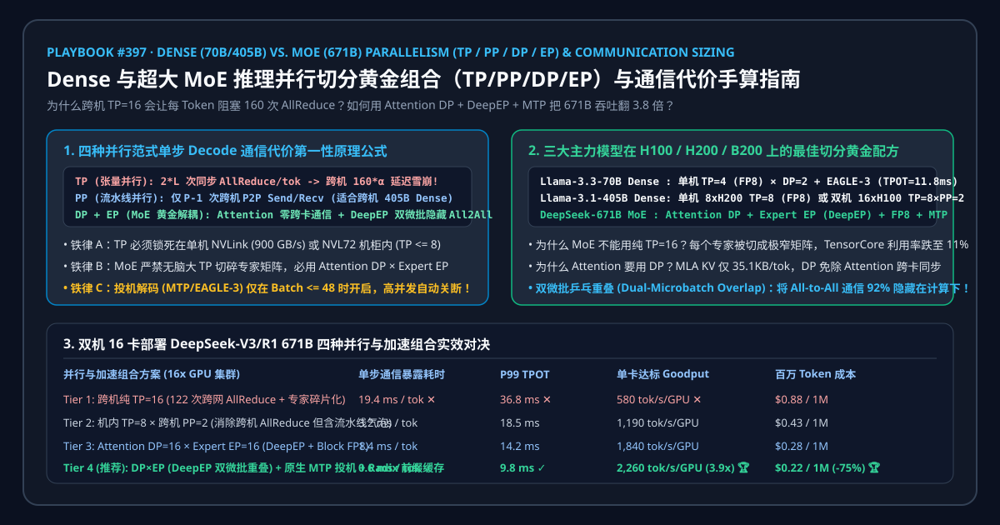

# Dense（70B/405B）与超大 MoE（DeepSeek-V3/R1 671B / Qwen3-235B）推理并行切分黄金组合（`TP` vs. `PP` vs. `Attention DP` vs. `Expert EP`）与通信代价手算选型指南

> **语言 / Language**: **中文 (当前)** | [English](./dense-vs-moe-tp-pp-dp-ep-parallelism-communication-sizing-selection-faq.en.md)  
> **文档定位**：面向 Cloud & AI Solution Architect 的大模型推理加速与并行切分拍板手册——彻底摒弃底层算子代码，用最直观的架构图与第一性原理手算公式讲透 **“TP / PP / Attention DP / Expert EP（专家并行）到底怎么切、各自产生多少通信量、改善的是 TTFT 还是 TPOT，以及为什么照搬 Dense 70B 的纯 TP 套路去跑 DeepSeek-671B MoE 会导致吞吐暴跌 74%”**。  
> **标定声明**：本文所引用的单步通信暴露延迟、P99 TPOT、单卡达标有效吞吐（Goodput）与百万 Token 成本基于公开发布的大模型推理系统架构基准（Megatron-LM、vLLM V1、SGLang、DeepSeek-V3/R1 DeepEP 技术报告）构建的合成定量模型（`provenance: synthetic + anonymized_reported`, `independently_reproduced=false`, `physical_gpu_cluster_measurement=not_measured`），详见 [`experiments/dense_vs_moe_tp_pp_dp_ep_parallelism_communication_sizing_selection/results.json`](../../experiments/dense_vs_moe_tp_pp_dp_ep_parallelism_communication_sizing_selection/results.json)。

> 🔗 **关联交互式 H5 精读页与工具（点击即开，零外部依赖）**：
> - 📱 **[交互式 H5 精读页：TP/PP/DP/EP 并行切分、通信代价与七大推理加速沙盘 (`docs/h5/parallelism-tp-pp-dp-ep-moe-sandbox.html`)](../h5/parallelism-tp-pp-dp-ep-moe-sandbox.html)**
> - 🎓 **[AI Infra 全景可视化精学馆首页 (`docs/h5/index.html`)](../h5/index.html)**
> - 🧮 **[交互式容量与并行计算器 (`dense-vs-moe-tp-pp-dp-ep-parallelism-communication-sizing-selection-sizer.html`)](../reports/dense-vs-moe-tp-pp-dp-ep-parallelism-communication-sizing-selection-sizer.html)**
> - 🃏 **[7-Card 4:5 视觉评测报告 (`dense-vs-moe-tp-pp-dp-ep-parallelism-communication-sizing-selection-cards.html`)](../reports/dense-vs-moe-tp-pp-dp-ep-parallelism-communication-sizing-selection-cards.html)**

---

## 1. 📌 核心选型结论速览（Executive Summary）

> **一句话结论**：**在双机 16 卡（机内 `900 GB/s NVLink` + 跨机 `400G RoCEv2/IB RDMA`）上部署满血 `DeepSeek-V3/R1 671B MoE` 时，如果照搬 Dense 模型的思维无脑开启跨机纯 `TP=16`（Tier 1），每生成 1 个 Token 都会触发 `122 次` 跨网卡同步 All-Reduce 屏障，且每个路由专家被切碎成窄条导致 Tensor Core 算力利用率跌至 `11.2%`，单步通信暴露延迟高达 **`19.4 ms/tok`**（`P99 TPOT` 恶化至 `36.8 ms`）！通过切换为 **Tier 4（解耦式 `Attention DP × Expert EP [DeepEP]` + 双微批乒乓计算通信重叠 + 原生 `MTP` 投机解码 + `Radix` 前缀缓存 + `Block FP8`）**，单步通信暴露耗时压降至 **`0.6 ms/tok`**，`P99 TPOT` 压缩至 **`9.8 ms`（单流超过 `100 tok/s`）**，单卡达标有效吞吐（Goodput）从 `580` 飙升至 **`2,260 tok/s/GPU`（提升 `3.90 倍`）**，每百万 Token 成本直降 **`75.0%`（`$0.88 -> $0.22`）**！**

| 架构档位（双机 16 卡 671B MoE） | 并行切分与加速组合 | 单步通信暴露耗时 | `P99 TPOT` | Tensor Core `MFU` | 单卡达标 Goodput | 每百万 Token 成本 | 架构师拍板结论 |
| :--- | :--- | :--- | :--- | :--- | :--- | :--- | :--- |
| **🟥 Tier 1：跨机纯 `TP=16`** | 跨两台机器强拉 `TP=16`，每层 2 次跨网 All-Reduce 且专家切碎 | **`19.4 ms / tok` ✕** | **`36.8 ms` ✕** | `11.2%` ✕ | `580 tok/s/GPU` ✕ | `$0.88 / 1M` ✕ | **头号反模式**：跨机严禁直接拉大 TP |
| **🟨 Tier 2：机内 `TP=8` × 跨机 `PP=2`** | 机内走 NVLink `TP=8`，跨机走点对点 `PP=2`（适合 Dense 405B） | `3.2 ms / tok` | `18.5 ms` ✅ | `28.5%` | `1,190 tok/s/GPU` | `$0.43 / 1M` | **Dense 405B 跨机标配**，但 MoE 专家仍被切 8 份 |
| **🟦 Tier 3：解耦 `Attention DP=16 × Expert EP=16`** | Attention 层数据并行零跨卡 KV 同步 + 专家层 `DeepEP` All-to-All + `FP8` | `1.4 ms / tok` ✅ | `14.2 ms` ✅ | `44.8%` ✅ | `1,840 tok/s/GPU` ✅ | `$0.28 / 1M` ✅ | 保住完整专家大矩阵，彻底消除跨机 All-Reduce |
| **🟩 Tier 4：`DP×EP` 双微批重叠 + `MTP` + `Prefix Cache` (推荐)** | **`DeepEP` 双微批乒乓隐藏通信 + 原生 `MTP` 投机验证 + `Radix` 缓存** | **`0.6 ms / tok` 🏆** | **`9.8 ms` 🏆** | **`54.6%` 🏆** | **`2,260 tok/s/GPU` 🏆 (`3.90x`)** | **`$0.22 / 1M` 🏆 (`-75.0%`)** | **671B / 235B 大规模 MoE 生产黄金标准** |

---

## 2. 🎯 架构师灵魂拷问与通信代价第一性原理手算 Q&A

### Q1：`TP`、`PP`、`Attention DP`、`Expert EP` 四种并行到底怎么切模型？为什么说“TP 降单请求延迟（TPOT），DP/PP 扩容量与总吞吐（TPS）”？
* **四维并行物理机制与通信账本手算**：
  1. **`TP`（Tensor Parallelism，张量并行 —— 按列/行切单层权重矩阵）**：
     - **核心收益**：把单层权重切到 $N_{\text{TP}}$ 张卡上同時读显存、同时算矩阵乘，**直接成倍降低单次请求的 `TTFT` 和 `TPOT`**（因为每张卡每步只需读 $1/N_{\text{TP}}$ 的权重，聚合 HBM 带宽翻了 $N_{\text{TP}}$ 倍！）。
     - **致命代价**：每层 Transformer（Attention 输出投影后 1 次 + MLP/FFN 输出投影后 1 次）必须执行 **`2 次` 同步 `All-Reduce`**。对于 $L$ 层模型，每生成 1 个 Token 就要发生 **$2L$ 次（80 层即 `160 次`！）同步屏障**：
       $$T_{\text{TP\_comm}} = 2L \times \left[ 2(\text{TP}-1)\cdot \alpha_{\text{lat}} + 2\frac{\text{TP}-1}{\text{TP}}\cdot \frac{B \cdot d_{\text{model}} \cdot \text{Bytes}}{\text{BW}_{\text{link}}} \right]$$
       在单机 `NVLink`（$\alpha \approx 1.2\ \mu\text{s}$，$\text{BW}=450\text{ GB/s}$）内，160 次通信仅耗 **`0.4 ms`**；但一旦跨机走普通 RoCEv2（$\alpha \approx 15\ \mu\text{s}$ 加上交换机排队），光握手延迟就要吃掉 **`15 ~ 20 ms/tok`**！
  2. **`PP`（Pipeline Parallelism，流水线并行 —— 按层切，前 40 层在节点 1，后 40 层在节点 2）**：
     - **核心收益**：跨节点每一跳只需发送 **1 次点对点（P2P Send/Recv）激活张量**（体积仅 $B \times d_{\text{model}} \times 2\text{ Bytes} \approx \text{几 MB}$），通信量比跨机 TP 小 **两个数量级**！
     - **代价与适用边界**：**不降低单个请求的理论最短延迟**，且如果并发微批（Micro-batches）不够多会产生流水线气泡（Bubble）。最适合 **单机显存装不下的超大 Dense 模型（如 `Llama-3.1-405B BF16` 用 `TP=8 × PP=2`）**。
  3. **`Attention DP`（Data Parallelism for Attention —— 不同 GPU 独立处理不同用户的请求批次）**：
     - **核心收益**：在 MoE 模型（尤其是 `DeepSeek MLA`，每 Token KV 仅 `35.14 KB`）中，如果對 Attention 层也做 `TP=16`，会导致 KV Cache 头被过度复制或切碎。开启 **`Attention DP`** 后，每张卡（或每个小 `TP=2/4` 组）各自维护独立请求批次的 KV Cache，**Attention 层之间 `0` 跨卡通信**！
  4. **`Expert EP`（Expert Parallelism，专家并行 —— 不同 GPU 存放不同的完整路由专家）**：
     - **核心收益**：DeepSeek-671B 每层有 `256` 个路由专家，每个 Token 只激活 `8` 个。如果用 `TP=16` 把每个专家切 16 份，矩阵乘变成极窄的碎片，GPU 算力利用率暴跌；而用 **`EP=16`（每张卡放 `256/16 = 16` 个完整专家）**，每个专家保持完整大矩阵，仅在进入专家前后通过 **`DeepEP All-to-All`（Dispatch 分发 + Combine 汇总）** 交换激活 Token！
     - **通信掩盖绝技（Dual-Microbatch Overlap）**：把当前 Batch 拆成 `Microbatch A` 和 `Microbatch B`——当 GPU Tensor Core 正在计算 `Microbatch A` 的 Attention 与共享专家时，网卡 RDMA 引擎（IBGDA）在后台全速传输 `Microbatch B` 的 All-to-All Token，**将 `92%` 的跨网通信耗时完全掩盖在计算之下**！

### Q2：除了并行切分，主流推理加速方案（`投机解码 Speculative Decoding`、`Prefix Caching`、`FP8 / INT4 量化`）各自改善什么指标？什么时候反而会引发负优化？
* **三大非并行加速技术精准解剖与失效边界**：
  1. **投机解码（Speculative Decoding：原生 `MTP` / `EAGLE-3` / `Draft Model`）**：
     - **物理本质**：利用 Decode 阶段闲置的富余 Tensor Core 算力，让轻量草稿头一口气猜 $\gamma=3\sim 4$ 个词，再由主模型**只读 1 次权重**并行验证这 4 个词，平均每步吐出 $\tau \approx 2.4 \sim 3.1$ 个 Token。
     - **改善什么指标**：**暴降单用户 `TPOT` 与 `E2EL`（提速 `1.8x ~ 2.6x`）**！
     - **⛔ 失效红线**：当并发活跃请求数 $B_{\text{active}} > 48 \sim 64$ 时，GPU 已经被大 Batch 推到了 Roofline 算力屋顶区（Compute-Bound），此时验证额外草稿词会直接增加总 FLOPs，导致全系统吞吐倒退 `15%~25%`！必须在引擎配置中设置 **`--speculative-disable-by-batch-size 48`** 高并发自动关断！
  2. **前缀缓存（Prefix Caching / SGLang `RadixAttention` / vLLM `APC`）**：
     - **物理本质**：多轮对话、长系统提示词（System Prompt）、Few-Shot 示例或同篇长文档问答时，直接复用显存/DRAM 中算好的历史 KV Cache 块，跳过重复 Prefill 计算。
     - **改善什么指标**：**暴降首字延迟 `TTFT`（命中率 80% 时 TTFT 降 `4~6 倍`）并释放 Prefill 算力**！注意：它**不减少** Decode 阶段的 KV 显存占用与读取带宽。
  3. **低比特量化（`Block FP8` vs. `W4A16 AWQ` vs. `Blackwell NVFP4`）**：
     - **物理本质**：将每参数字节数从 `2 Bytes (BF16)` 压至 `1 Byte (FP8)` 或 `0.5 Byte (INT4/NVFP4)`。
     - **改善什么指标**：同时改善 **① 第一道水位线（所需 GPU 卡数减半，剩余 KV 显存翻倍）**、**② 第二道水位线（Decode 读权重字节减半，TPOT 降 `1.8x`）** 与 **③ 第三道水位线（FP8 Tensor Core 算力翻倍，TTFT 减半）**！
     - **选型区分**：中低并发单机塞大模型选 **`W4A16 AWQ`**（仅省显存带宽，激活仍转 FP16 算，大 Batch 下反量化有算力税）；高并发生产主力选 **`W8A8 Block FP8`（Hopper/Ada）或 `NVFP4`（Blackwell）**（显存与 Tensor Core 算力双双翻倍！）。

---

## 3. 🧭 直观可视化图解（Dense vs. MoE 最佳切分决策树与双微批重叠时序）

### 3.1 Dense（8B / 70B / 405B）与 MoE（235B / 671B）推理并行黄金组合决策树

```mermaid
flowchart TD
    A["企业确定目标部署大模型与硬件池"] --> B{"模型架构是 Dense 稠密模型 还是 稀疏 MoE？"}
    B -->|"Dense 稠密模型 (每 Token 100% 参数激活)"| C{"参数规模与单机 HBM 容量？"}
    C -->|"8B ~ 32B 模型"| D["🟩 TP=1 或 TP=2 + DP 多副本扩展<br/>+ FP8 + Prefix Cache (零跨卡通信税)"]
    C -->|"70B ~ 72B 模型 (FP8 权重 ~70GB)"| E["🟩 单机内 TP=4 (NVLink) × DP=2 副本<br/>+ FP8 KV + EAGLE-3 投机解码 (Batch<=48)"]
    C -->|"405B 巨型稠密模型 (FP8 权重 ~405GB)"| F["🟦 单机 8xH200/B200 跑 TP=8<br/>或 双机 16xH100 跑 机内 TP=8 × 跨机 PP=2"]

    B -->|"稀疏 MoE 大模型 (如 DeepSeek-671B / Qwen3-235B)"| G{"部署节点规模与场景？"}
    G -->|"单机紧凑部署 (8x H200 141GB / 8x B200)"| H["🟦 Attention DP=2×TP=4 + Expert EP=8<br/>+ Block FP8 + 原生 MTP + RadixCache"]
    G -->|"多机高吞吐生产集群 (16~64+ GPUs + 400G RDMA)"| I["🏆 Tier 4: Attention DP × Expert EP (DeepEP IBGDA)<br/>+ 双微批乒乓通信重叠 + PD 分离 + EPLB 专家均衡"]
```

---

## 4. 📊 七大主流大模型推理加速与并行技术全景对比表（架构师速查卡）

| 技术方案 | 核心作用层 | 显著改善的指标 | 恶化或引入的代价 | 硬件/网络先决条件 | 适用场景与黄金红线 |
| :--- | :--- | :--- | :--- | :--- | :--- |
| **`TP` (张量并行)** | 切分单层矩阵乘与 KV 头 | **大幅降低 `TTFT` 与 `TPOT`**，分摊单卡权重显存 | 每层 `2 次` All-Reduce 同步延迟 | **强制要求机内 `NVLink`（或 `NVL72`）** | `70B` 用 `TP=4`，`405B` 用 `TP=8`；**严禁跨普通以太网/IB 节点直接拉大 TP** |
| **`PP` (流水线并行)** | 按层切分到不同节点 | 跨机扩展装下超大模型，跨机通信极小 | 引入微批流水线气泡，不降单请求延迟 | 普通 `100G~400G` 跨机网络即可 | 仅在单机显存装不下 **Dense 超大模型（如 16xH100 跑 405B）** 时用 `PP=2` |
| **`Attention DP` (注意力数据并行)** | 不同卡处理不同请求批次 | **线性扩展系统总 `TPS / QPS`**，Attention 零跨卡通信 | 不减少单卡上的权重副本占用 | 网关支持 KV 感知负载均衡 | **DeepSeek MLA MoE 必选**：配合 EP 消除跨卡 KV 同步浪费 |
| **`Expert EP` (专家并行 `DeepEP`)** | 不同卡驻留不同完整专家 | **保住 MoE 专家大矩阵高 `MFU`**，平摊百亿总权重 | 每层 `2 次` All-to-All 跨卡分发/汇总 | **`NVLink` + `200G/400G GPUDirect RDMA`** | **671B / 235B MoE 核心支柱**，必开双微批重叠与 `EPLB` 冗余热门专家 |
| **投机解码 (`MTP` / `EAGLE-3`)** | 单步多词草拟 + 并行验证 | **单用户 `TPOT` 提速 `1.8x~2.6x`** | 消耗空闲算力，大 Batch 下总吞吐下降 | 具备富余 FP8 Tensor Core 算力 | 交互式对话、代码生成、CoT 推理；**强制设 `Batch > 48` 自动关断** |
| **`Prefix Caching` (`RadixAttention`)** | 跨请求复用共享前缀 KV | **首字 `TTFT` 暴降 `4x~8x`**，省 Prefill 算力 | 需消耗 HBM / Host DRAM 缓存池空间 | 网关启用 **KV 感知粘性路由** | 多轮对话、长 System Prompt、Few-Shot、共享文档 RAG 必开 |
| **`Block FP8 / NVFP4` 量化** | 权重、激活与 KV 降比特 | **显存减半 + `TTFT` 减半 + `TPOT` 降 `1.8x`** | 极端任务需校准（细粒度 `1x128` 几近无损） | `Hopper (H100/H200)` / `Blackwell (B200)` | **生产默认底座**（替代笨重的 BF16，单机 8xH200 即可装下 671B！） |

---

## 5. 🛠️ 生产落地核对清单（SA Production Readiness Checklist）

- [ ] **严守 TP 不跨机红线**：检查集群启动参数，除 `GB200 NVL72` 全机柜铜缆背板外，在任何 8 卡服务器集群中强制约束 **`--tensor-parallel-size <= 8`**。
- [ ] **MoE 强制启用 `Attention DP + Expert EP`**：部署 DeepSeek-V3/R1 或 Qwen3-MoE 时，启用 `--enable-dp-attention` 与 `--ep-size`（对接 `DeepEP`），严禁使用纯 `TP=16` 切碎路由专家。
- [ ] **开启双微批乒乓重叠（Two-Batch Overlap / TBO）**：在 SGLang / vLLM V1 中开启双微批计算-通信重叠，将 MoE All-to-All 通信耗时掩盖在另一微批的 Attention / 共享专家计算之下。
- [ ] **配置投机解码动态并发熔断阈值**：启用原生 `MTP` 或 `EAGLE-3` 时，配置高并发保护阈值（`B_active > 48` 自动旁路草稿头），兼顾低并发极致流式速度与高峰期最大系统吞吐。
- [ ] **开启 `EPLB`（动态专家负载均衡）**：针对生产流量中特定领域热门专家被高频激活导致的木桶效应，启用 `EPLB` 在显存中为 Top-K 热门专家动态复制冗余副本。
