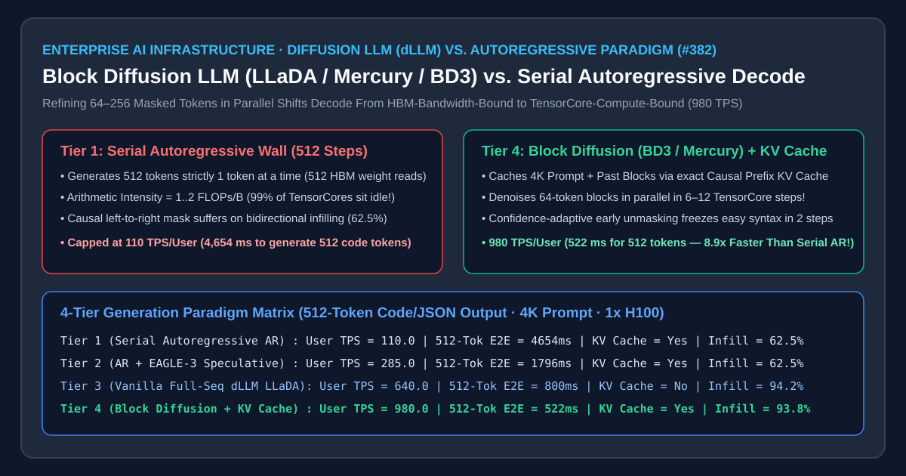

# Diffusion LLM (`LLaDA / Mercury Coder / Block Diffusion`) vs. Autoregressive LLM Architecture Guide: Breaking the Serial HBM Bandwidth Wall at `980 TPS`

> **Language**: [中文](./diffusion-llm-llada-mercury-block-diffusion-vs-autoregressive-selection-faq.md) | **English (Current)**  
> **Audience**: Cloud & AI Infrastructure Solution Architects and Next-Gen Inference Platform Engineers  
> **Provenance**: `synthetic + anonymized_reported` (`independently_reproduced=false`, `physical_gpu_cluster_measurement=not_measured`)

---

## 1. 📌 Executive Summary

> **Bottom Line**: **Standard Autoregressive (`AR`) LLMs (`Tier 1`) generate `512` tokens strictly 1 token at a time—reading the entire model weight matrix from HBM `512` times at an Arithmetic Intensity of `~1 FLOP/Byte` (`<0.5%` TensorCore utilization), capping single-user speed at `110 TPS` (`4,654 ms` for 512 tokens) or `285 TPS` with `EAGLE-3` speculative decoding (`Tier 2`). While first-generation full-sequence Masked Diffusion LLMs (`Vanilla LLaDA`, `Tier 3`) refine all output tokens in parallel (`640 TPS`), their full bidirectional mask prevents causal Prefix KV Caching on long prompts. Production next-gen code and structured-output engines adopt Semi-Autoregressive `Block Diffusion (BD3-LM / Mercury Coder style)` (`Tier 4`): locking the `4K+` prompt and completed blocks in an exact Causal Prefix KV Cache while denoising `64-token` blocks in parallel across `6–8` confidence-adaptive steps—shifting generation from HBM-bandwidth-bound to TensorCore-compute-bound to deliver `980 TPS/user` (`522 ms` for 512 tokens, `8.91x` faster than serial AR) and `93.8%` bidirectional code-infilling accuracy.**

- **Interactive Diffusion LLM vs. Autoregressive Sizer**: [Open Interactive Sizer (`diffusion-llm-llada-mercury-block-diffusion-vs-autoregressive-sizer.html`)](../reports/diffusion-llm-llada-mercury-block-diffusion-vs-autoregressive-sizer.html)
- **7-Card 4:5 Visual Report**: [Open 7-Card Report (`diffusion-llm-llada-mercury-block-diffusion-vs-autoregressive-selection-cards.html`)](../reports/diffusion-llm-llada-mercury-block-diffusion-vs-autoregressive-selection-cards.html)

---

## 2. 📊 4-Tier Generation Paradigm Matrix (`512-Token Code/JSON Output` · `4K Prompt` · `1x H100`)

| Metric | Tier 1: Serial Autoregressive (`1 Tok/Step`) | Tier 2: Autoregressive + `EAGLE-3 / MTP` Speculative | Tier 3: Vanilla Full-Sequence Diffusion (`LLaDA`, No KV Cache) | Tier 4 (Recommended): `Block Diffusion (BD3 / Mercury)` + `Prefix KV Cache` |
| :--- | :--- | :--- | :--- | :--- |
| **Per-User Output Throughput** | `110.0 TPS` ✕ (HBM-bound) | `285.0 TPS` | `640.0 TPS` | **`980.0 TPS` ✓ (`8.91x` vs Tier 1)** |
| **512-Token E2E Latency** | `4,654.0 ms` ✕ | `1,796.0 ms` | `800.0 ms` | **`522.0 ms` ✓ (Sub-second whole block)** |
| **Supports Causal Prefix KV Cache** | Yes ✓ | Yes ✓ | No ✕ (Recomputes prompt) | **Yes ✓ (Inter-block causal KV)** |
| **Bidirectional Infilling & Reversal** | `62.5%` ✕ (Left-to-right bias) | `62.5%` ✕ | **`94.2%` ✓** | **`93.8%` ✓ (Intra-block bidirectional)** |

---

## 3. 🛠️ Production Readiness Checklist

- [ ] **Deploy Block Diffusion (`BD3-LM` / `Mercury Coder` style) Rather Than Uncached Full-Sequence Diffusion** whenever enterprise prompts exceed `1,024` tokens so system prompts and RAG contexts remain cached in Paged KV HBM.
- [ ] **Enable Confidence-Adaptive Early Unmasking** to freeze high-certainty syntax/boilerplate tokens in `2–4` denoising steps rather than running a fixed `32-step` schedule.
