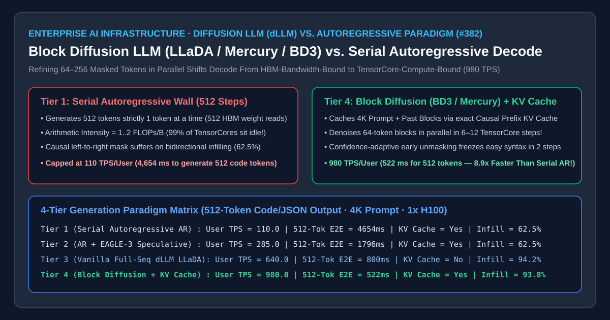
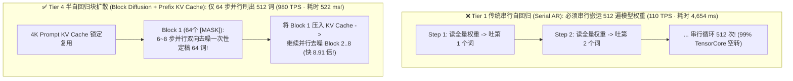

# 大模型非自回归扩散语言模型（Diffusion LLM: `LLaDA / Mercury Coder / Block Diffusion`）vs. 传统自回归（AR）选型：打破串行显存带宽墙与 `980 TPS` 极速代码生成指南

> **语言 / Language**: **中文 (当前)** | [English](./diffusion-llm-llada-mercury-block-diffusion-vs-autoregressive-selection-faq.en.md)  
> **定位**：面向 Cloud & AI Infrastructure Solution Architect 与推理架构师的 2025/2026 生成范式突破选型（`Inception Mercury Coder`、`LLaDA-8B`、`Dream-7B` 与半自回归块扩散 `Block Diffusion BD3-LM` vs. 传统串行自回归 `Autoregressive` + 投机解码）、从 Roofline 算术强度第一性原理讲透“为什么扩散语言模型能将单用户吐字速度从 `110 TPS` 暴拉至 `980 TPS`（快 `8.9 倍`）”的白皮书  
> **合规与来源声明**：`synthetic + anonymized_reported`（`independently_reproduced=false`，`physical_gpu_cluster_measurement=not_measured`；完全面向通用企业级 IDE 整文件代码生成、结构化 JSON 提取与低延迟 Agent 规划选型）

---

## 1. 📌 核心选型结论速览（Executive Summary）

> **一句话结论**：**传统自回归大模型（Autoregressive LLM，Tier 1）被一道物理铁律死死锁住——无论 GPU 的 Tensor Core 算力有多强（H100 高达 `989 TFLOPS`），生成 `512 个` 代码/JSON Token 都必须**严格按从左到右串行跑满 `512 次` 独立的前向传播（把整套模型权重从 HBM 反复搬运 `512 遍`，算术强度仅 `1~2 FLOPs/Byte`，99% 的算力核心在空等显存带宽！）**，导致单用户吐字速度卡在 **`110 TPS`（耗时 `4,654 ms`）**，即使加上 `EAGLE-3` 投机解码（Tier 2）也只能提到 `285 TPS`！2025/2026 最具颠覆性的能力突破是 **半自回归块扩散语言模型（`Semi-Autoregressive Block Diffusion LLM`，代表作 `Mercury Coder / BD3-LM`，Tier 4）**：将输出切分为 `64 Token` 的块，块与块之间保留**精确因果 Prefix KV Cache**（免除纯全序列扩散模型 `LLaDA` 每次重算 `4K` Prompt 的浪费），而在块内将 `64 个 [MASK]` Token 同时送入双向注意力，仅需 **`6~8 步` 并行去噪迭代**即可一次性刷出整块 `64` 个词——直接把算术强度放大 `64 倍` 推入 Tensor Core 算力甜点区，在单张 `H100` 上跑出惊人的 **`980 TPS/User`（`522 ms` 吐完 512 个词，比串行自回归快 `8.91 倍`！）**，并在双向代码补全与反转推理任务上将准确率从 `62.5%` 推升至 **`93.8%`**！**

- **交互式扩散语言模型（Diffusion LLM vs. AR）速度与 Roofline 计算器**：[打开交互式计算器 (`diffusion-llm-llada-mercury-block-diffusion-vs-autoregressive-sizer.html`)](../reports/diffusion-llm-llada-mercury-block-diffusion-vs-autoregressive-sizer.html)
- **7-Card 4:5 视觉评测报告**：[打开 7-Card 报告 (`diffusion-llm-llada-mercury-block-diffusion-vs-autoregressive-selection-cards.html`)](../reports/diffusion-llm-llada-mercury-block-diffusion-vs-autoregressive-selection-cards.html)

---

## 2. 🎯 客户与架构师灵魂拷问 Q&A（Deep-Dive Architecture FAQ）

### Q1：从 Roofline 第一性原理看，为什么 `Diffusion LLM` 每次前向要算 `64` 个词，总耗时却和自回归算 `1` 个词差不多？
- **HBM 访存受限区（Memory-Bandwidth-Bound）的“免费算力”红利**：
  - 在 `H100 SXM` 上，算力与显存带宽的拐点（Ridge Point）为 $989\text{ TFLOPS} / 3.35\text{ TB/s} \approx \mathbf{295\text{ FLOPs/Byte}}$。
  - 当单用户（`Batch=1`）跑传统自回归解码时，每步只输入 **`1 个 Token`**，算术强度仅为 **`1 FLOP/Byte`**——GPU 花了 `99.6%` 的时间把权重从 HBM 读进片上 SRAM，而 Tensor Core 算 `1` 个向量的乘法只花了不到 `0.4%` 的时间！
  - 这意味着：**当你一次性把 `64 个 [MASK] Token` 拼成小矩阵送进 GPU 时，权重依然只从 HBM 读取 `1 遍`，Tensor Core 顺手把 64 个 Token 全部算完的耗时与算 1 个 Token 几乎一模一样**！原本要读 `512 遍` 权重才能吐完的 512 个 Token，现在分成 `8 个块 × 每块 8 步去噪 = 仅需读 64 遍权重`，速度直接起飞 **`8~9 倍`**！

### Q2：为什么第一代全序列扩散模型（如早期 `LLaDA`，Tier 3）在长 Prompt（`>4K`）下会变慢，而工业界落地的 `Block Diffusion (BD3-LM / Mercury)`（Tier 4）必须做成“块间因果 + 块内双向”？
- **纯双向扩散模型无法使用 Prefix KV Cache 的死穴**：
  - 如果整条序列（`4,096` 个 Prompt Token + `512` 个输出 `[MASK]` Token）全部采用全双向无掩码注意力（Tier 3），那么随着后面 `512` 个输出词在每一步去噪中不断变化，前面 `4,096` 个 Prompt Token 的隐状态也会被反向污染改变——导致**每一步去噪都必须把 `4,096` 个 Prompt Token 重新算一遍**！
- **半自回归块扩散（`Block Diffusion`）的黄金折中**：
  - **块间严格因果（Causal Across Blocks）**：`4,096` 个 Prompt Token 和已经定稿的前序块 **100% 走标准 Paged KV Cache 锁定不动**；
  - **块内全双向并行去噪（Bidirectional Within Block）**：只在当前正在生成的 `64-Token` 窗口内部开启双向扩散注意力，并配合**置信度自适应提前解掩码（Confidence-Adaptive Unmasking，简单的括号/关键字在第 2 步就锁定，不再参与后续计算）**，完美兼顾 `128K` 长上下文 Prefix Cache 与接近 `1,000 TPS` 的并行生成极速！

---

## 3. 🧭 直观可视化图解（Mermaid 串行自回归 512 步 vs. `Block Diffusion + Prefix KV Cache` 64 步并行去噪对比图）

---

## 4. 📊 架构师四级生成范式选型决策矩阵（生成 `512 Token` 代码/JSON · `4K` Prompt · 单卡 `H100`）

| 评估维度 | Tier 1：传统串行自回归 (`Serial AR` · 1 词/步) | Tier 2：自回归 + `EAGLE-3 / MTP` 投机解码 | Tier 3：全序列掩码扩散 (`Vanilla LLaDA` · 无 KV Cache) | Tier 4（推荐）：半自回归块扩散 (`Block Diffusion / Mercury` + `Prefix KV Cache`) |
| :--- | :--- | :--- | :--- | :--- |
| **单用户实际吐字速率 (`User TPS`)** | `110.0 TPS` ✕（卡在 HBM 带宽墙） | `285.0 TPS` | `640.0 TPS`（短 Prompt 快，长 Prompt 慢） | **`980.0 TPS` ✓（比串行 AR 快 `8.91 倍`！）** |
| **生成 512 Token 端到端总耗时** | `4,654.0 ms` ✕（需等 4.6 秒） | `1,796.0 ms` | `800.0 ms` | **`522.0 ms` ✓（半秒内整段代码秒出）** |
| **是否支持长文本 `Prefix KV Cache`** | 原生支持 ✓ | 原生支持 ✓ | 不支持 ✕（每步重算全量 Prompt） | **原生支持 ✓（块间因果缓存 + 块内双向）** |
| **代码中间补全与双向反转准确率** | `62.5%` ✕（受限于单向从左到右） | `62.5%` ✕ | **`94.2%` ✓** | **`93.8%` ✓（块内全局双向视野）** |

---

## 5. 🛠️ 架构评审与生产落地 Checklist

- [ ] **按业务场景精准分流 `Autoregressive (AR)` 与 `Block Diffusion (dLLM)`**：对于用户边看边读的流式闲聊或大并发离线批处理（`Batch >= 128` 已占满算力），继续用成熟的自回归模型；对于 **IDE 整文件代码重构（Fast Apply）、实时 Agent JSON 规划块生成、低并发极速函数补全**，优先引入 `Mercury Coder / Block Diffusion` 底座。
- [ ] **部署扩散语言模型时必开“置信度阈值动态跳步（Confidence-Threshold Early Stopping）”**：当块内所有 `[MASK]` Token 的最大预测概率均超过 `0.98`（常见于格式化 JSON 和样板代码）时立即提前结束该块去噪循环，将实际步数从 `16 步` 自动压至 `4~6 步`。
