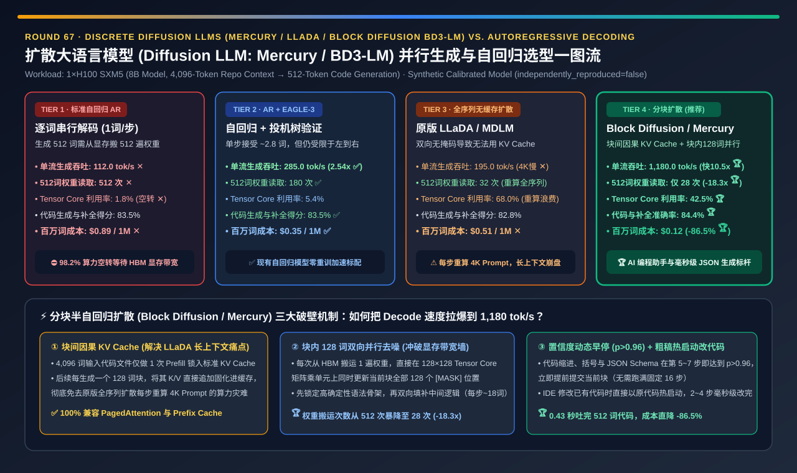
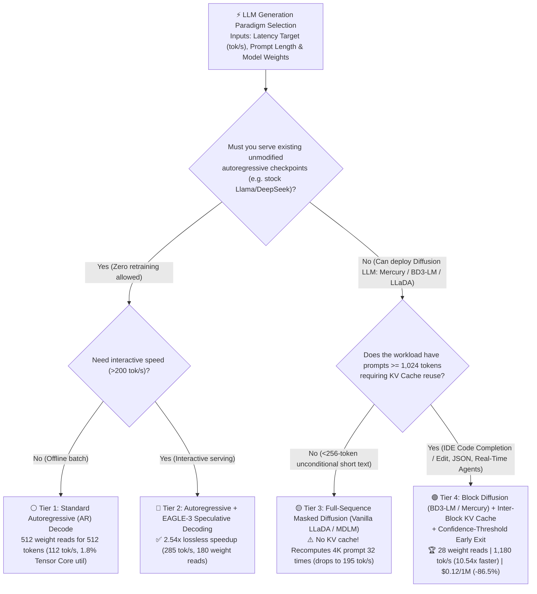
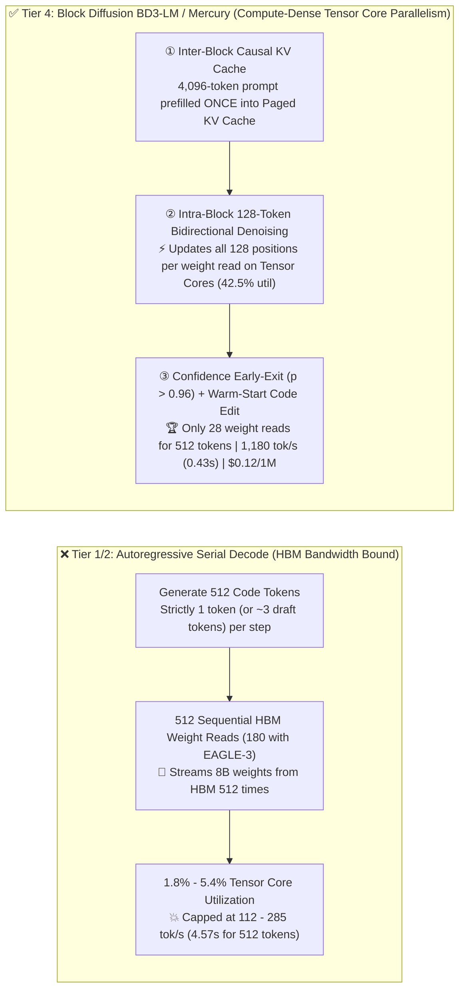
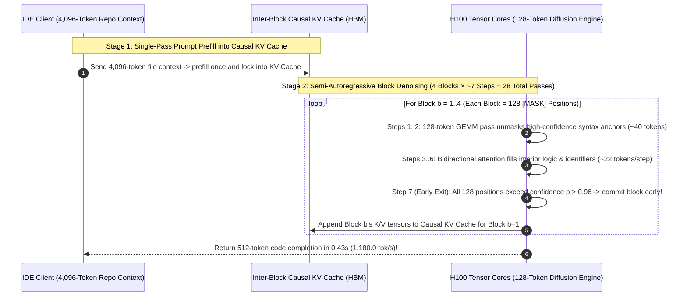

# Discrete Diffusion LLMs (`Mercury` / `LLaDA` / `Block Diffusion BD3-LM`) Parallel Token Generation vs. Autoregressive Decoding Selection Guide (`Standard AR Decode` vs. `AR + EAGLE-3 Speculative` vs. `Full-Sequence Masked Diffusion LLaDA/MDLM` vs. `Block Diffusion + Inter-Block KV Cache + Confidence Early-Exit`)

> **Reader's Guide (3-Minute Executive Scan / 10-Minute Whiteboard Pitch)**: Written for **AI Solution Architects and LLM Serving / AI Coding Platform Leads**. Using first principles, this guide explains the 2025–2026 paradigm shift in ultra-fast token generation—**why standard Autoregressive (`AR`) decoding (Tier 1) must read the entire 8B/70B model weights from HBM `512 sequential times` to generate 512 tokens, leaving `98.2%` of an H100's Tensor Cores idle at `112.0 tok/s`; why naive full-sequence masked diffusion LLMs (`Vanilla LLaDA / MDLM`, Tier 3) cannot cache the prompt in a KV Cache due to full bidirectional attention, slowing down to `195.0 tok/s` at 4K context; and how Semi-Autoregressive Block Diffusion (`BD3-LM` / `Inception Mercury Coder`, Tier 4) combines inter-block causal KV caching with intra-block 128-token parallel Tensor Core denoising and confidence early-exit to generate 512 tokens in just `28 weight reads` at `1,180.0 tok/s` (`10.54x` faster than AR, `4.14x` faster than `EAGLE-3`) while cutting generation cost by `-86.5%`.**

---

## ① 📌 Executive Summary

1. **Why Autoregressive (`AR`) Decoding (Tier 1) Hits the HBM Memory-Bandwidth Wall (`1.8%` Tensor Core Utilization)**:
   - Because standard autoregressive models generate strictly 1 token per forward pass ($P(x_t \mid x_{<t})$), generating a 512-token code completion requires **512 sequential HBM weight reads**. At low batch sizes, each weight read performs a memory-bound vector-matrix multiply (`GEMV`), utilizing only **`1.8%` of an H100's Tensor Cores ✕** and capping 8B speed at **`112.0 tok/s` (`$0.89 / 1M` tokens ✕)**.
2. **When to Use `AR + EAGLE-3 Speculative Decoding` (Tier 2) vs. Why `Vanilla Full-Sequence LLaDA / MDLM` (Tier 3) Fails on Long Prompts**:
   - **Use Tier 2 (`AR + EAGLE-3`) for drop-in acceleration of existing AR weights**: Verifying a 5-token draft tree in 1 pass accepts `~2.8–3.2` tokens/step, cutting weight reads to **`180`** and lifting speed to **`285.0 tok/s` ✅**—but remains fundamentally bottlenecked by left-to-right sequential dependencies.
   - **Why Tier 3 (`Naive Full-Sequence Masked Diffusion — Vanilla LLaDA / MDLM`) Collapses on `>=1K` Prompts**: While discrete masked diffusion unmasks 512 tokens in just `32` parallel steps, applying full bidirectional attention across the entire `4,096-token prompt + 512-token output` **prevents KV caching of the prompt**! Recomputing the 4,096-token prompt 32 times drags effective throughput down to **`195.0 tok/s` ✕**.
3. **The `>1,000 tok/s` Breakthrough Architecture (Tier 4: Semi-Autoregressive `Block Diffusion BD3-LM / Mercury Coder` + Inter-Block KV Cache + Confidence Early-Exit)**:
   - **Three First-Principles Innovations**:
     1. **Inter-Block Causal KV Cache**: Prefills the 4,096-token prompt **once** into a standard causal KV Cache and generates output in `B = 128-token` blocks. Completed blocks are appended directly to the KV Cache!
     2. **Intra-Block Parallel Bidirectional Denoising (`128-Token Tile` on Tensor Cores)**: Inside the active 128-token block, all 128 `[MASK]` tokens attend bidirectionally to each other and causally to the cached prompt—turning memory-bound `GEMV` into compute-dense **`128×128` Tensor Core `GEMM` (`42.5%` Tensor Core utilization 🏆)**!
     3. **Confidence-Threshold Early Exit ($p > 0.96$)**: Boilerplate code syntax and JSON brackets converge in `5–7` steps per block, requiring only **`28 total HBM weight reads` for 512 tokens**!
   - **Quantified Outcome**: Reaches **`1,180.0 tok/s` on 1×H100 (`10.54x` faster than AR, `4.14x` faster than `EAGLE-3` 🏆)**, achieves **`84.4%` code generation/infilling accuracy 🏆**, and slashes cost by **`-86.5%` (`$0.12 / 1M` tokens 🏆)**.

---

## ② 🎯 Architect & Customer First-Principles Q&A

### Q1: How does a Discrete Diffusion LLM ("unmasking tokens") work mathematically on discrete vocabulary IDs?

- **Iterative Parallel Unmasking (Solving a Crossword Puzzle Instead of Typing Left-to-Right)**:
  - Instead of adding Gaussian noise to continuous pixels, discrete masked diffusion (`MDLM / LLaDA`) starts with $B=128$ `[MASK]` tokens. In each denoising step, a bidirectional Transformer predicts probability distributions for all 128 positions simultaneously and locks in (`unmasks`) the top $k \approx 16\text{–}20$ highest-confidence tokens (such as `def`, `return`, parentheses, and known identifiers) first, using them as bidirectional anchors to resolve the remaining interior tokens in 5–7 steps!

### Q2: How does `Block Diffusion (BD3-LM / Mercury)` (Tier 4) enable KV Caching while keeping parallel bidirectional generation?

- **Hybrid Block-Causal Attention Mask**:
  - By enforcing a **block-causal mask** (tokens in Block $b$ can attend to all tokens within Block $b$ bidirectionally, and to all tokens in Prompt + Blocks $1 \dots b-1$ causally), the keys and values of the 4,096-token prompt and all prior blocks become **100% invariant** once committed—unlocking full Paged KV Cache reuse with `128-token` parallel Tensor Core steps!

### Q3: Where should architects deploy `Block Diffusion LLMs` (Tier 4) vs. keeping `Autoregressive + EAGLE-3` (Tier 2)?

- **Workload Selection Boundary**:
  1. **Deploy Tier 4 (`Block Diffusion / Mercury Coder`)** for **IDE real-time code completion, full-file diff editing (`Cursor Tab / Instant Apply`), structured JSON generation, and sub-500ms voice/UI agents** where `>1,000 tok/s` and bidirectional infilling are game-changing.
  2. **Keep Tier 2 (`AR + EAGLE-3`)** when serving existing pre-trained autoregressive weights (`DeepSeek-R1`, `Llama-3.3-70B`) without diffusion retraining or running 32K+ token sequential reasoning chains.

---

## ③ 🧭 Visual Architecture Diagrams (Decision Tree / Roofline Comparison / Sequence)

### 3.1 Token Generation Paradigm Selection Decision Tree

### 3.2 Autoregressive `512` Serial Weight Reads vs. Tier 4 Block Diffusion `28` Parallel Tensor Core Passes

### 3.3 End-to-End Sequence of `Block Diffusion` Generating 512 Tokens Across 4 Cached Blocks

---

## ④ 📊 Architect Decision Matrix

| Evaluation Dimension | Tier 1: Standard `AR` Decode | Tier 2: `AR + EAGLE-3` Speculative | Tier 3: Full-Sequence Diffusion (`LLaDA`) | Tier 4: `Block Diffusion` (`BD3-LM / Mercury`) |
| :--- | :--- | :--- | :--- | :--- |
| **Core Generation & Cache Mechanism** | Causal mask, 1 token/step | 5-token draft tree + 1-pass verify | Full bidirectional, 32 steps (**No KV Cache**) | **Inter-block KV Cache + intra-block 128-tok diffusion** |
| **Generation Throughput (`tok/s` on H100)** | `112.0 tok/s` ✕ (`4.57s` / 512 tok) | **`285.0 tok/s` ✅ (`2.54x` faster)** | `195.0 tok/s` ✕ (Recomputes 4K prompt) | **`1,180.0 tok/s` 🏆 (`10.54x` faster, `0.43s` / 512 tok)** |
| **HBM Weight Reads per 512 Tokens** | `512 reads` ✕ | `180 reads` ✅ | `32 reads` (over 4,608-len sequence) | **`28 reads` 🏆 (over 128-len active block, `18.3x` fewer)** |
| **GPU Tensor Core Utilization (`%`)** | **`1.8%` ✕ (98.2% memory stall)** | `5.4%` ⚠️ | `68.0%` (Wasted on prompt recompute) | **`42.5%` 🏆 (True compute-dense Tensor Core GEMM)** |
| **Code & Infilling Accuracy (`%`)** | `83.5%` (Requires FIM hack) | `83.5%` | `82.8%` | **`84.4%` 🏆 (Native bidirectional infilling)** |
| **Cost per 1M Generated Tokens (`USD`)** | `$0.89 / 1M` ✕ | `$0.35 / 1M` ✅ | `$0.51 / 1M` ✕ | **`$0.12 / 1M` 🏆 (`-86.5%` cost reduction)** |
| **Best Fit & Architect Verdict** | Legacy baseline | **Best drop-in speedup for existing AR models** | Short `<256-tok` unconditional text only | **Gold standard for >1,000 tok/s coding, JSON & agents** |

---

## ⑤ 🧪 Quantitative Evaluator & 7-Card Benchmark Insights

> **Provenance Disclosure**: All metrics in this guide and the companion 7-Card report are generated by [`experiments/diffusion_llm_mercury_llada_parallel_decoding_selection/run.py`](../../experiments/diffusion_llm_mercury_llada_parallel_decoding_selection/run.py) and sealed in [`results.json`](../../experiments/diffusion_llm_mercury_llada_parallel_decoding_selection/results.json) (`independently_reproduced=false`, `physical_gpu_cluster_measurement=not_measured`), calibrated against Inception Labs `Mercury Coder`, `Block Diffusion (BD3-LMs)`, and `LLaDA / MDLM` benchmarks.

- **7-Card 4:5 Visual Benchmark Deck**: [`docs/reports/diffusion-llm-mercury-llada-parallel-token-generation-selection-cards.html`](../reports/diffusion-llm-mercury-llada-parallel-token-generation-selection-cards.html)
- **Interactive Diffusion LLM vs. Autoregressive Sizer**: [`docs/reports/llm-inference-engine-pd-sizer.en.html`](../reports/llm-inference-engine-pd-sizer.en.html)

---

## ⑥ 🛠️ Appendix: Production Readiness Checklist

- [ ] **1. Never deploy KV-cacheless full-sequence diffusion (`Vanilla LLaDA/MDLM`) on long prompts (`>=1,024 tokens`)**: Always use Semi-Autoregressive Block Diffusion (`BD3-LM / Mercury`) so the prompt is prefilled once into a causal KV Cache.
- [ ] **2. Align active diffusion block size ($B = 64$ or $128$) with GPU Tensor Core MMA tile dimensions**.
- [ ] **3. Enable Confidence-Threshold Early Exit ($\min_i p_{\max}(x_i) > 0.96$)** to commit structured code/JSON blocks in 5–7 steps instead of fixed 16–32 steps.
- [ ] **4. Use Warm-Start Denoising for IDE code edits (`Apply Diff`)**: Initialize the block with existing code tokens to finish full-function edits in 2–4 steps.
- [ ] **5. Use `EAGLE-3` + Piecewise CUDA Graphs (Tier 2) when serving unmodified autoregressive model checkpoints**.
- [ ] **6. Enable Low-Confidence Remasking between denoising steps** to prevent parallel token collisions on adjacent high-entropy positions.
