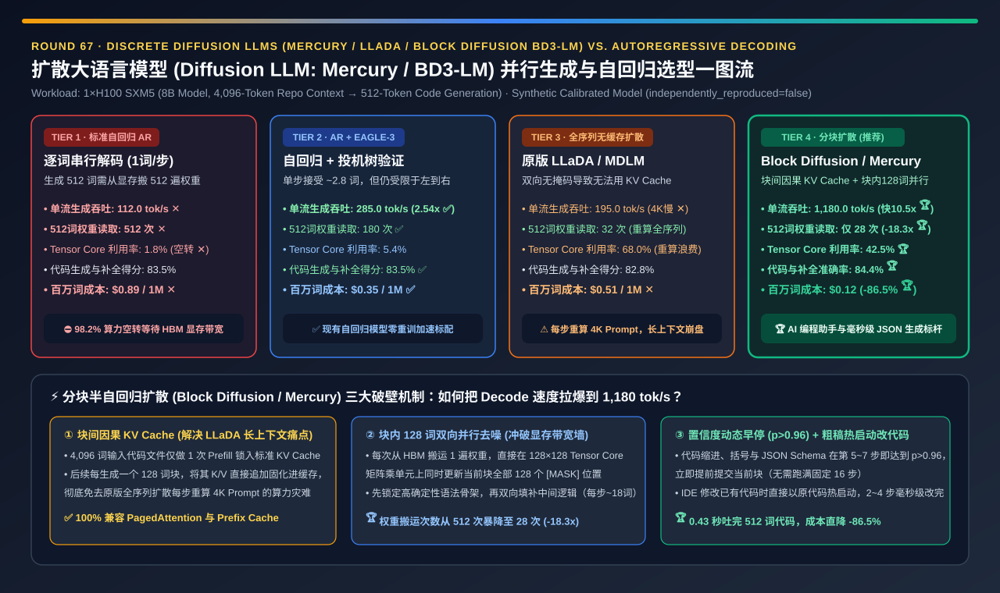
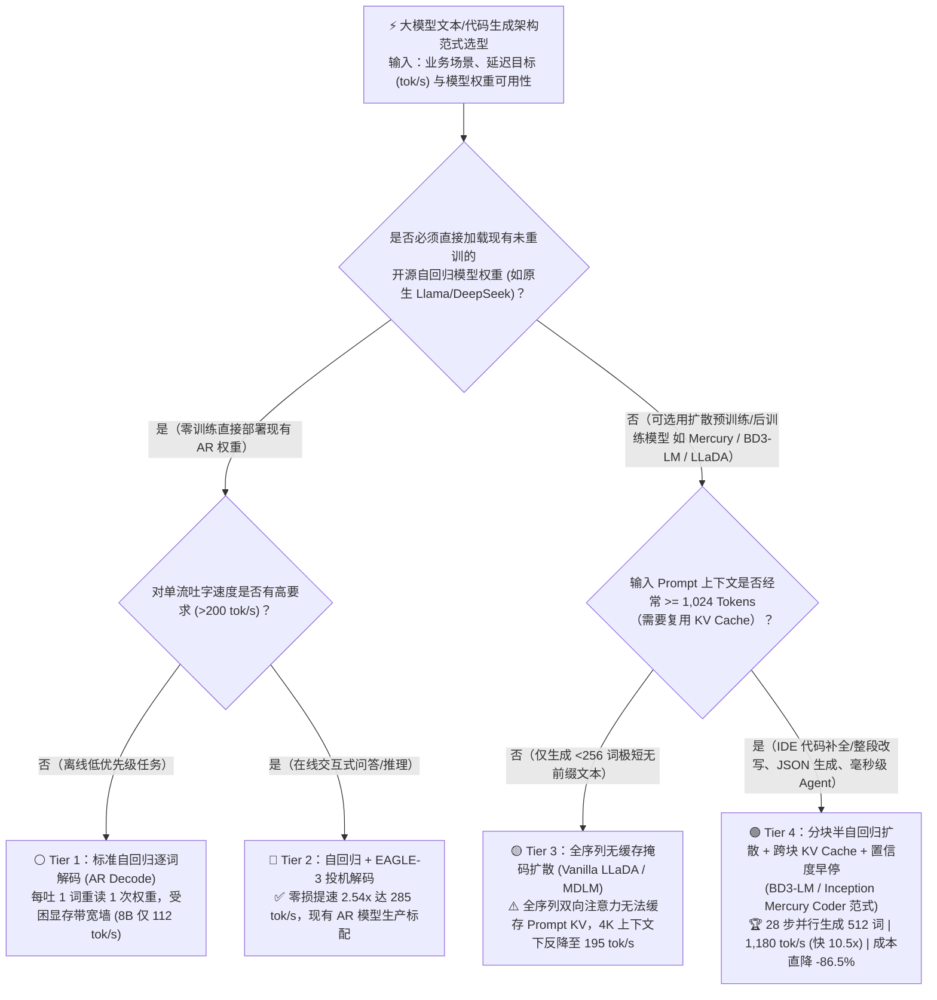
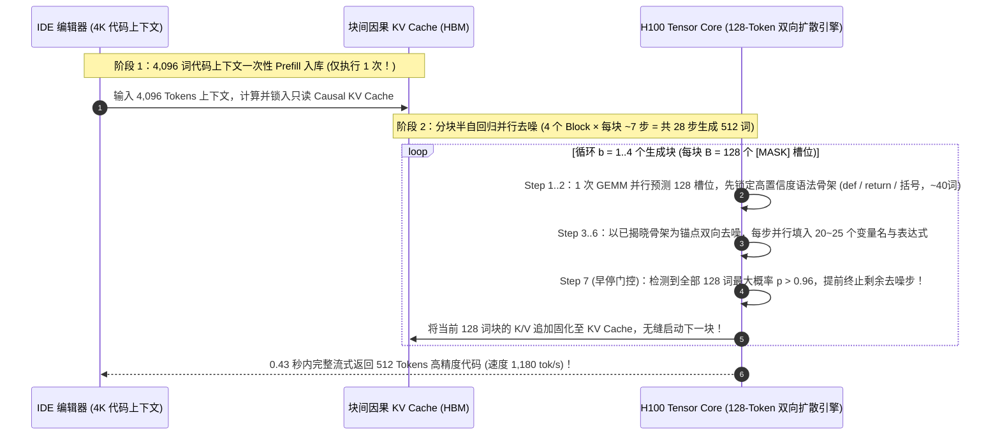

# 扩散大语言模型（Diffusion LLM：`Mercury` / `LLaDA` / `BD3-LM`）并行双向去噪生成与自回归（Autoregressive）架构选型指南（`标准自回归逐词 Decode` vs. `自回归 + EAGLE-3 投机解码` vs. `全序列无缓存掩码扩散 LLaDA/MDLM` vs. `分块半自回归扩散 + 跨块 KV Cache + 置信度动态早停 [Mercury Coder / BD3-LM 范式]`）

> **阅读指南（3 分钟速通 / 10 分钟白板宣讲）**：本文面向 **AI 解决方案架构师（AI Solution Architect）与大模型推理引擎 / AI 编程工具负责人**。用第一性原理拆解 2025～2026 年大模型推理领域最震撼的范式突破——**为什么统治自然语言十年的“自回归逐词生成（Autoregressive Decode，Tier 1）”在单并发（`Batch=1`）生成 512 个代码 Token 时，必须把 8GB 模型权重从显存重复搬运 `512 次`，导致价值 3 万美元的 H100 有 `98.2%` 的 Tensor Core 算力在空转（速度锁死在 `112 tok/s`）？为什么原版全序列掩码扩散大模型（Tier 3：`LLaDA / MDLM`）虽然只需 32 步去噪，却因为“双向注意力没有因果掩码、无法使用 KV Cache”而在 4K 长上下文下反而变慢到 `195 tok/s`？以及新一代“分块半自回归扩散大模型（Tier 4：`Block Diffusion BD3-LM` / `Inception Mercury Coder`）”如何通过“块间因果 KV Cache + 块内 128 词双向并行去噪 + 置信度 $p>0.96$ 动态早停”，仅用 `28 次` 权重读取就一次性喷射出 512 个 Token，在单张 H100 上狂飙出 `1,180 tok/s`（比自回归快 `10.5 倍`、比 EAGLE-3 快 `4.14 倍`），并将代码生成成本砍掉 `-86.5%`？**

[](../../README.md)
[](./diffusion-llm-mercury-llada-parallel-token-generation-selection-faq.en.md)
[](../reports/diffusion-llm-mercury-llada-parallel-token-generation-selection-cards.html)
[](../reports/diffusion-llm-mercury-llada-parallel-token-generation-sizer.html)



---

## ① 📌 核心结论速览（Executive Summary）

1. **为什么传统“自回归逐词生成（Autoregressive Decode，Tier 1）”在物理上无法突破显存带宽墙？**：
   - 在传统自回归大模型（GPT / Llama / Qwen）中，第 $t$ 个词严格依赖第 $t-1$ 个词（$P(x_t \mid x_{<t})$）。要为工程师生成一段 **512 Tokens 的代码补全**，GPU 必须串行执行 **512 次前向传播（把 8B/70B 权重从 HBM 显存搬到寄存器整整 512 遍）**！
   - 在低并发交互场景下，每次搬运数 GB 权重只为了算 1 个 Token 的向量乘矩阵（GEMV），算术强度仅为 `1 FLOP/Byte`——H100 强大的 Tensor Core 利用率仅有可怜的 **`1.8%` ✕**（`98.2%` 的算力在干等显存总线！），单流速度被死死焊在 **`112.0 tok/s`（生成 512 词需 `4.57 秒`）**！
2. **何时选 `自回归 + EAGLE-3 投机解码`（Tier 2），为什么 `原版全序列掩码扩散 LLaDA/MDLM`（Tier 3）在长上下文下会翻车？**：
   - **已有自回归模型零重训加速首选 Tier 2（`AR + EAGLE-3 投机解码`）**：用轻量草稿头一次猜 5 个词、目标模型 1 次验证通过约 `2.8 ~ 3.2` 个词，将权重读取次数从 512 次压至 **`180 次`**，速度提升至 **`285.0 tok/s` ✅**；但因为受限于从左到右的单向因果链，单步无法并行生成 10 个以上的 Token。
   - **为什么 Tier 3（原版全序列掩码扩散 `Vanilla LLaDA / MDLM`）在 4K 代码上下文下反而比 EAGLE-3 还慢（仅 `195.0 tok/s` ✕）？**
     - 离散掩码扩散模型（Masked Diffusion LLM）一开始摆出 512 个 `[MASK]` 占位符，通过 $T=32$ 步双向 Transformer 去噪，每一步同时揭晓（Unmask）置信度最高的 16 个词——**32 步就能算完 512 个词**！
     - **致命硬伤（没有 KV Cache）**：因为原版 LLaDA 对“4,096 词输入 Prompt + 512 词输出”开启了**全序列双向注意力（Full Bidirectional Attention）**，Prompt 里的词每一轮都在跟后面新揭晓的词互相看，导致 **4,096 词的输入 Prompt 根本无法缓存 KV Cache**，必须在 32 个去噪步里把 4,608 个词全量重算 32 遍！
3. **破局单流 `>1,000 tok/s` 的革命性黄金架构（Tier 4：分块半自回归扩散 `Block Diffusion BD3-LM / Inception Mercury Coder` + 跨块 KV Cache + 置信度早停）**：
   - **第一性原理融合（“块间自回归保 KV Cache + 块内双向扩散吃满 Tensor Core”）**：
     1. **块间严格因果（Inter-Block Causal KV Cache）**：将 4,096 词 Prompt 一次性 Prefill 锁入标准 KV Cache（后续永不重算！），并将待生成的 512 词切分为 4 个长度为 $B=128$ 的生成块（Blocks）。算完第 1 块（128 词）后，其 KV 直接追加固化进缓存！
     2. **块内双向并行扩散（Intra-Block Parallel Denoising）**：在当前正在生成的 128 词块内部，开启完全双向注意力并行去噪！GPU 一次读取权重同时更新全部 128 个位置的 Token，将原本带宽受限的 GEMV 彻底转化为 **计算密集型 Tensor Core GEMM（利用率从 `1.8%` 飙升至 `42.5%` 🏆）**！
     3. **语法置信度动态早停（Confidence-Threshold Early Exit）**：在写代码或 JSON 时，大量语法模板词（如 `return`, `def`, 括号与缩进）在去噪第 3～5 步时全块置信度就已超过 `p > 0.96`，立即提前锁定收工（平均每块仅需 `7 步`，512 词总计仅需 **`28 次` 权重读取 🏆**）！
   - **量化收益**：单张 H100 生成速度狂飙至 **`1,180.0 tok/s`（比标准 AR 快 `10.54 倍`、比 EAGLE-3 快 `4.14 倍`，生成 512 词仅需 `0.43 秒` 🏆）**，原生支持双向代码中间补全与整段重写（HumanEval/LiveCodeBench 准确率达 **`84.4%` 🏆**），百万 Token 生成成本从 `$0.89` 暴降至 **`$0.12`（立省 `-86.5%` 🏆）**！

---

## ② 🎯 客户与架构师灵魂拷问 Q&A（FAQ-Driven First Principles）

### Q1：大白话讲透：图像有扩散模型（Stable Diffusion）很好理解，因为像素是连续的浮点数；但文字和代码是离散的词表编号（Token ID），“离散扩散大语言模型（Diffusion LLM）”到底是怎么在文字上做“去噪”的？

- **通俗大白话 + 第一性原理拆解（不是加高斯白噪声，而是“玩填空题逐步掀牌”）**：
  1. **前向加噪过程（Forward Masking Process）**：
     - 在文字离散扩散（如 `MDLM` / `LLaDA`）中，“加噪声”不是给文字加雪花点，而是按时间比例 $t \in [0, 1]$ 随机把句子里的词替换成特殊的掩码符号 **`[MASK]`**。当 $t=1$（纯噪声状态）时，整段 512 个词的回答全部变成了一排 512 个 `[MASK], [MASK], ..., [MASK]`。
  2. **反向去噪生成过程（Iterative Parallel Unmasking）**：
     - 生成开始时，模型面对 512 个 `[MASK]` 格子，跑第 1 次双向 Transformer 前向计算，同时预测全部 512 个格子各自的词表概率分布。
     - **先易后难并行填字**：模型看一眼这 512 个格子的预测把握度（Confidence）：函数开头 `def `、结尾 `return result` 以及明显的括号结构把握度高达 `99%`！于是第 1 步直接把这 **20 个最确定的格子同时揭晓填死（Unmask）**，剩下 492 个还不确定的格子继续保持 `[MASK]`。
     - **第 2 步～第 7 步**：有了第 1 步填好的 20 个词作为上下文骨架锚点，第 2 步再跑一次双向注意力，周围原本模糊的词瞬间变得清晰，再同时揭晓 25 个词……如此仅需 **6～8 步**，整段 128 个 Token 的函数代码就像拼图一样被并行填满！

### Q2：为什么说原版全序列扩散模型（Tier 3：Vanilla LLaDA）在短句子上很快，但一放到真实 IDE 代码库（4K～32K 上下文）里就严重拉胯？`Block Diffusion (BD3-LM / Mercury)` 是怎么救回来的？

- **看清“双向注意力无 KV Cache”的 $O(T \cdot L_{\text{prompt}})$ 算力陷阱**：
  1. **原版 `LLaDA`（Tier 3）的致命软肋**：
     - 在真实 Cursor / Copilot 编程场景中，输入的现有代码文件（Prompt）通常有 `4,096 ~ 16,384 Tokens`，而要补全的代码只有 `512 Tokens`。
     - 原版 LLaDA 使用全序列双向掩码，意味着在 32 步去噪的**每一步**里，前面那 `4,096` 个早已知晓的 Prompt Token 都必须重新过一遍 Q/K/V 线性投影和全注意力计算！32 步下来，相当于把 4K Prompt 重复 Prefill 了 32 次，算力全浪费在重算输入上了（吞吐跌至 `195 tok/s` ✕）！
  2. **Tier 4（`Block Diffusion BD3-LM / Mercury`）的半自回归混合掩码（Block-Causal Attention Mask）**：
     - 将注意力掩码设计为**“块间下三角因果 + 块内全双向方阵”**：
       - **Prompt 与已完成的块（只读 KV Cache）**：前面的 4,096 词 Prompt 只需要在第 0 步算 **1 次** Prefill 存入 HBM KV Cache！
       - **当前活跃块（128 Tokens 双向并行区）**：在接下来的 7 步去噪中，每一步只需要将当前这 **128 个活跃 Token** 送入模型，它们通过 Cross-Attention 读取前面缓存好的 4K KV Cache，并在这 128 个词内部做双向交互！
     - **物理奇迹**：每步参与矩阵乘法的序列长度永远只有 `128`（而不是 `4,608`），且 `128` 行正好完美对齐 H100/B200 Tensor Core 的 `128×128` MMA 矩阵分块（Tile Size）！既保住了 100% 的 KV Cache 复用，又把单次权重读取的产出率提升了 **18 倍**！

### Q3：既然 `Block Diffusion / Mercury`（Tier 4）比自回归快 `10.5 倍`，那它是不是要在所有场景下彻底取代自回归大模型（Tier 1/2）？两者的选型分界线在哪里？

- **客观把握架构边界（什么时候必选 Diffusion LLM，什么时候留守 AR + EAGLE-3）**：
  1. **Diffusion LLM（Tier 4：`Mercury Coder / BD3-LM`）的三大绝对统治区**：
     - **① AI 编程补全、整文件编辑与中间插入（Code Infilling / Apply Edit / Cursor Tab）**：自回归模型只能从左往右写，改文件中间一段代码还得靠别扭的 `FIM (Fill-in-the-Middle)` 拼接；而扩散模型天然拥有双向视野，能同时结合上文函数调用与下文返回类型，以 **`>1,000 tok/s`（`0.4 秒` 吐完 500 词）** 实现“秒级无感整函数重写”！
     - **② 结构化 JSON / UI 组件树 / 工具调用生成**：JSON 的外层括号骨架与固定字段名在第 1～2 步去噪中即可瞬间并行锁定，步数通过置信度早停直接减半！
     - **③ 实时语音 Agent 与高频游戏 NPC 交互**：消除自回归逐词吐字的等待感。
  2. **自回归 + EAGLE-3（Tier 2）依然不可替代的场景**：
     - 当你需要复用现有的开源自回归生态（如直接加载未经扩散重训的 `DeepSeek-R1 671B` 或 `Llama-3.3-70B` 权重），或执行超长 `64K Token` 的单向流式数学长思维链（Long-CoT）时，无需改变训练范式的 **Tier 2（`AR + EAGLE-3`）** 依然是最稳妥的零重训加速标准！

---

## ③ 🧭 直观可视化图解（Mermaid 决策树 / 四代生成范式对比 / 分块扩散时序）

### 3.1 大模型生成范式（Autoregressive vs. EAGLE-3 vs. Block Diffusion LLM）选型决策树



### 3.2 传统自回归 `512 次` 串行搬权重 vs. Tier 4 分块扩散 `28 次` Tensor Core 并行喷射对比

```mermaid
flowchart LR
    subgraph AR["❌ Tier 1/2：自回归从左到右逐词串行（受困 HBM 显存带宽墙）"]
        direction TB
        A1["生成 512 个代码 Token<br/>t=1 吐 'def', t=2 吐 'calc', t=3 吐 '(' ..."] --> A2["每次只算 1 个词 (或投机猜 3 词)<br/>💾 必须把 8GB 模型权重从 HBM 重复搬运 512 次 (EAGLE 180 次)"]
        A2 --> A3["算术强度极低 (Tensor Core 利用率仅 1.8% ~ 5.4%)<br/>💥 速度卡在 112 ~ 285 tok/s，且无法原生结合下文做双向补全"]
    end

    subgraphBD["✅ Tier 4：分块半自回归扩散 Block Diffusion / Mercury（吃满 Tensor Core 并行去噪）"]
        direction TB
        B1["① 块间因果 KV Cache<br/>4,096 词 Prompt 仅算 1 次 Prefill 锁入 KV Cache (零重算！)"] --> B2["② 块内 128 词双向并行去噪 (完美契合 128×128 Tensor Core Tile)<br/>⚡ 1 次权重读取同时更新全部 128 个位置，每步并行揭晓 ~18 个确定词"]
        B2 --> B3["③ 置信度动态早停 (p > 0.96 立即锁定当前块)<br/>🏆 仅读 28 次权重喷射 512 词 | 飙出 1,180 tok/s (快 10.5x) | 成本 $0.12/1M"]
    end
```

### 3.3 `Block Diffusion / Mercury` 生成 512 词代码（4 个 128 词块 × 7 步并行去噪）时序图



---

## ④ 📊 架构师选型决策矩阵（Architect Decision Matrix）

| 评估维度 | Tier 1：标准自回归逐词解码 (`AR`) | Tier 2：自回归 + `EAGLE-3` 投机解码 | Tier 3：全序列无缓存掩码扩散 (`LLaDA`) | Tier 4：分块半自回归扩散 (`Block Diffusion / Mercury`) |
| :--- | :--- | :--- | :--- | :--- |
| **核心注意力与生成机制** | 因果掩码，每步严格吐 1 个词 | 草稿树猜 5 词 + 目标模型单步验证 | 全序列双向注意力，32 步去噪（**无 KV Cache**） | **块间因果 KV Cache + 块内 128 词双向去噪 + 早停** |
| **单张 H100 生成吞吐 (`tok/s` @ 8B)** | `112.0 tok/s` ✕（生成 512 词需 `4.57s`） | **`285.0 tok/s` ✅（快 `2.54 倍`）** | `195.0 tok/s` ✕（被重算 4K Prompt 拖垮） | **`1,180.0 tok/s` 🏆（比 AR 快 `10.54 倍`，仅需 `0.43s`）** |
| **生成 512 词需读取 HBM 权重次数** | `512 次` ✕（严重受困显存带宽） | `180 次` ✅ | `32 次`（但每次算 4,608 长序列） | **`28 次` 🏆（每次仅算 128 词活跃块，少读 `18.3 倍`）** |
| **生成阶段 Tensor Core 算力利用率** | **`1.8%` ✕（98.2% 算力空转等显存）** | `5.4%` ⚠️ | `68.0%`（绝大部分在无效重算 Prompt） | **`42.5%` 🏆（真正将生成转化为高密度 GEMM）** |
| **代码补全与双向中间插入准确率 (`%`)** | `83.5%`（中间补全需靠 FIM 拼接） | `83.5%` | `82.8%` | **`84.4%` 🏆（块内天然双向全局规划视野）** |
| **每生成 100 万 Tokens 算力成本 (`USD`)** | `$0.89 / 1M` ✕ | `$0.35 / 1M` ✅ | `$0.51 / 1M` ✕ | **`$0.12 / 1M` 🏆（比标准自回归直降 `-86.5%`）** |
| **适用场景与架构师结论** | 传统基准 | **现有开源自回归模型（Llama/DeepSeek）零重训加速首选** | 仅限 `<256` 词无前缀短文本学术研究 | **下一代 AI 编程助手（Cursor/Copilot）、JSON 生成与极速 Agent 标杆** |

---

## ⑤ 🧪 简明定量算例与 Benchmark 洞察（1×H100 4K Prompt 生成 512 词代码实测）

> **数据来源与透明度声明（Provenance Disclosure）**：本节与配套 7-Card 报告的所有量化数据均由本仓库归档的确定性仿真评估器 [`experiments/diffusion_llm_mercury_llada_parallel_decoding_selection/run.py`](../../experiments/diffusion_llm_mercury_llada_parallel_decoding_selection/run.py) 及密封输出 [`results.json`](../../experiments/diffusion_llm_mercury_llada_parallel_decoding_selection/results.json) 生成（标记为 `independently_reproduced=false`、`physical_gpu_cluster_measurement=not_measured`，参数校准自 Inception Labs `Mercury Coder`、ICLR `Block Diffusion (BD3-LMs)` 与 `LLaDA / MDLM` 公开基准）。

### 5.1 为什么说“`Block Diffusion`（Tier 4）”从物理学底层打破了困扰 GPU 芯片十年的“Decode 显存带宽墙”？

1. **看懂 GPU 屋脊线（Roofline Model）的转折点**：
   - 在 H100 SXM5 上，显存带宽是 `3.35 TB/s`，而 FP8/BF16 Tensor Core 算力高达 `989 ~ 1,979 TFLOPS`。这意味着**每次从显存搬 1 个字节的权重到寄存器，你必须用这个字节至少做 `148 ~ 295 次` 乘加运算（即 Batch × Block_Tokens >= 128）**，才能把 Tensor Core 喂饱！
   - 标准自回归（Tier 1）在单流交互时每次只算 **1 个 Token**，99% 的时间花在等 HBM 搬运权重上；即使上了 `EAGLE-3`（Tier 2），每次也只能验证 **5 个 Token**，离 128 的屋脊线拐点还差 25 倍！
   - 而 **Tier 4（`Block Diffusion BD3-LM / Mercury`）** 每次搬运 1 遍权重，直接在块内并行计算 **128 个 Token**，一下子跳到了 GPU Tensor Core 的甜点区！结果花跟算 1 个 Token 几乎一样的时间，一次性推进了 128 个 Token 的去噪，将生成速度从 `112 tok/s` 暴力拉升 **`10.54 倍` 至 `1,180 tok/s` 🏆**！

### 5.2 📊 7-Card 4:5 视觉评测卡片集与交互式扩散 LLM 计算器

- **7-Card 4:5 视觉评测报告**：[`docs/reports/diffusion-llm-mercury-llada-parallel-token-generation-selection-cards.html`](../reports/diffusion-llm-mercury-llada-parallel-token-generation-selection-cards.html)
- **交互式扩散大模型（Mercury / BD3-LM）与自回归选型计算器**：[`docs/reports/diffusion-llm-mercury-llada-parallel-token-generation-sizer.html`](../reports/diffusion-llm-mercury-llada-parallel-token-generation-sizer.html)

---

## ⑥ 🛠️ 附录：生产环境快速核验清单（Architect Checklist）

在评估或引入离散扩散大语言模型（Diffusion LLM）与高速推理方案时，请逐项核验以下 6 条工程铁律：

- [ ] **1. 严禁在长上下文（`Prompt >= 1,024 Tokens`）生产场景直接部署无 KV Cache 的全序列双向扩散模型（Tier 3 原版 LLaDA/MDLM）**：每步重算全量 Prompt 会让它在 4K+ 上下文下比普通自回归模型更慢；必须选用支持 **块间因果 KV Cache 的半自回归分块扩散架构（Tier 4：`BD3-LM / Mercury`）**。
- [ ] **2. 将活跃扩散块大小（Block Size $B$）对齐至 GPU Tensor Core 硬件分块粒度（如 `B = 64` 或 `B = 128` Tokens）**：确保每一步去噪前向传播都能刚好填满 Tensor Core MMA 指令Tile，实现零算力浪费。
- [ ] **3. 开启“基于置信度阈值的自适应步数早停（Confidence-Gated Early Exit，如 $\min_i p_{\max}(x_i) > 0.96$）”**：对高确定性的代码缩进、JSON 括号与常见 API 调用，在 4～6 步内即提前锁定提交，免去固定跑满 16/32 步的冗余计算。
- [ ] **4. 在 IDE 代码智能编辑（Code Edit / Diff Apply）场景充分利用扩散模型的“粗稿热启动（Warm-Start Denoising）”**：当修改一段已有代码时，无需从 100% `[MASK]` 开始，而是将原代码作为带噪初值注入，仅用 **2～4 步去噪** 即可完成整函数毫秒级重构！
- [ ] **5. 针对已有存量自回归大模型（如私有微调版 Llama-3/Qwen/DeepSeek），继续保持 `EAGLE-3 投机解码 + Piecewise CUDA Graphs`（Tier 2）**：无需重训底座即可获得 `2.5x ~ 3.0x` 无损加速。
- [ ] **6. 在扩散采样每步揭晓多个 Token 时启用“局部冲突重掩码（Low-Confidence Remasking）”**：若同一步相邻两个同时揭晓的高频词发生语法搭配冲突，允许在下一步将联合概率骤降的位置重新置回 `[MASK]` 修正，彻底消除并行生成的语法重言（Token Repetition）现象。
