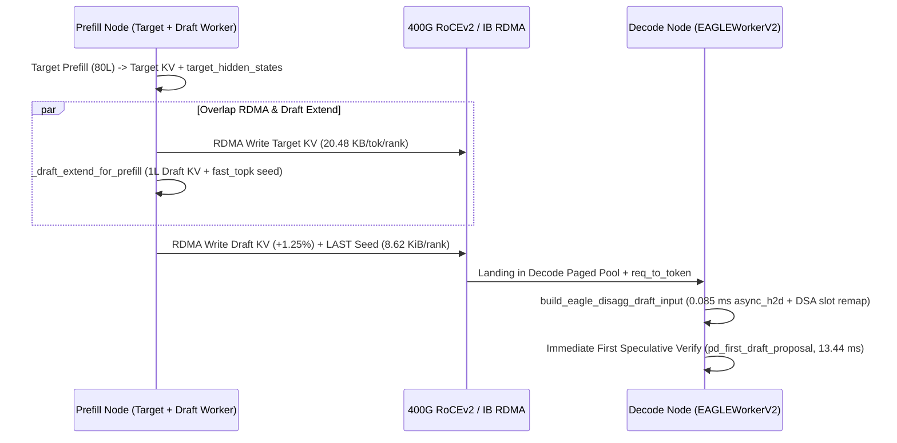

# Prefill-Decode 解耦架构下的 EAGLE-3 / MTP 投机解码零气泡交接 (`eagle_disaggregation.py`)

## 1. 核心架构问题：PD 分离与投机解码的“首步草稿预热死锁”

在 [PD 分离与分层 KV 路由](disaggregated-kv-routing.md) 与 [EAGLE-3 / MTP 树状投机验证](eagle3-speculative-tree-verification.md) 各自独立工作时，系统边界清晰；但当生产集群同时开启 **Prefill-Decode (PD) Disaggregation** 与 **EAGLE-3 / DeepSeek-V3 MTP 投机解码** 时，出现了一个严峻的跨节点状态断裂问题：
1. **EAGLE-3 / MTP 的自回归特征依赖**：不同于完全独立的小词表草稿模型，EAGLE-3 与 DeepSeek-V3 MTP 的草稿头（Draft Worker）需要将主模型（Target Model）倒数最后一层（或多层拼接投影后）的隐藏状态 $h_{t-1}^{\text{target}}$ 与采样出的草稿/奖励词元嵌入 $e(y_t)$ 拼接，并在 **Draft 自身的轻量级 KV Cache** 上执行注意力前向，才能生成下一步草稿树提案。
2. **朴素 PD 交接的两种退化路径**：
   - **方案 A（仅传输主模型 KV Cache + Decode 节点重跑 Draft Prefill）**：若 Prefill 节点仅通过 RDMA 发送主模型 `80` 层 KV Cache 与首个 `bonus_token`，Decode 节点收到请求后其本地 `EagleDraftWorker` 的 Draft KV Cache 为空，必须在 Decode 节点上对全部 $L$ 个提示 Token 重新运行一遍 Draft Prefill（或退化为非投机自回归），在 `32K–128K` 上下文下产生 **`58.74 ms–232.00 ms` 的首步草稿预热停顿（Draft Warmup Stall）**，直接打断同卡正在运行的并发 Decode 批次。
   - **方案 B（传输主模型 KV + 全序列 `BF16 hidden_states`）**：若将全部 $L$ 个位置的 3 层融合 `BF16` 隐藏状态（`3 × 8192 × 2B / 8 = 6,144 B/tok/rank`）随主模型 FP8 KV（`20,480 B/tok/rank`）一起经 RDMA 发送到 Decode 节点，不仅使跨节点 RDMA 负载膨胀 **`+30.0%`**，且 Decode 节点仍需执行全序列 `_draft_extend` 前向。

---

## 2. 一手源码核验：`sgl-project/sglang` 零停顿种子交接机制 (`implementation`)

我们对 `sgl-project/sglang` 仓库（固定提交 `da414adda71957676dcbb434a60326bd3a14600a`）中 PD 解耦投机解码的核心实现进行了源码级核验：

1. **Prefill 端异步重叠 `_draft_extend_for_prefill` 与末位置隐藏状态捕获（`python/sglang/srt/speculative/eagle_worker_v2.py`, blob `a91fca46910288c6d7eab5625e7d645e42514600a` -> `a91fca46`）**：
   - 在 `EagleDraftWorker._draft_extend_for_prefill`（行 `977-1040`）中，Prefill 节点在完成主模型前向后，立即在本地利用主模型特征运行 `1` 层 Draft 扩展前向以填充 **Draft KV Cache**，并直接通过 `fast_topk(probs, self.topk, dim=-1)` 或 `fast_sample` 采样出首步草稿树状态 `topk_p`、`topk_index` 及末尾位置的 `logits_output.hidden_states`（`num_tokens_per_req = 1`）。
   - 该阶段与主模型前 `80` 层 KV Cache 的后台 RDMA 发送高度重叠；跨节点仅需额外追加 `1` 层 Draft KV Cache（仅占主模型 80 层 KV 的 **`1.25%`**）以及极小的末尾位置种子状态包。
2. **Decode 端 `build_eagle_disagg_draft_input` 与 `pd_first_draft_proposal`（`python/sglang/srt/speculative/eagle_disaggregation.py`, blob `f8b5a23bb69b9533ffdc2676c7f9a09062968d2a`）**：
   - 在 `build_eagle_disagg_draft_input`（行 `55-138`）中，Decode 节点通过 `async_h2d_stack` 将每个请求从 Prefill 接收到的 `output_topk_p[:num_states]`（`float32`）、`output_topk_index[:num_states]`（`int64`）与末尾位置 `hidden_states_tensor`（`CaptureHiddenMode.LAST`）一次性异步压入 GPU，每个请求每 Rank 的种子状态包仅 **`8.62 KiB`**（`8,832 B`）。
   - **免完整分布传输的精确拒绝采样 `pd_first_draft_proposal`（行 `25-49`）**：为了避免通过 RDMA 传输庞大的全词表草稿概率分布 $q(x) \in \mathbb{R}^{128256}$，`pd_first_draft_proposal` 将接收到的 `topk_index` 构造为概率为 `1.0` 的 one-hot 提案分布（`probs.scatter_(-1, topk_index.unsqueeze(-1), 1.0)`）。源码注释严格证明：在首步 Verify 中，目标模型以概率 $p(X)$ 接受草稿词元 $X$，拒绝时从剔除 $X$ 后的残差分布重采样，最终提交词元的边缘分布依然严格等于目标分布 $p$（无损精确性）。
   - **DSA 稀疏注意力物理槽位重映射（行 `79-108`）**：当启用 DeepSeek Sparse Attention (`DSA`) 时，Prefill 发送的是请求相对位置 `output_dsa_topk_indices`；Decode 节点在进入 CUDA Graph 前通过 `local_slots = req_to_token[batch.req_pool_indices[:, None], gather_positions]` 将相对索引一次性重映射为 Decode 节点本地 Paged KV 池的物理槽位（并屏蔽保留给 padding sink 的 Slot `0`）。

---

## 3. 定量实验：三种 PD 投机交接方案的 RDMA 带宽与首步延迟对比 (`own-offline`)

在 `experiments/disaggregated_speculative_pd/run.py` 中，我们对 `8x H100 TP=8`（`Llama-3-70B-FP8` `80` 层主模型 + `1` 层 EAGLE-3/MTP 草稿头，单卡 `400 Gbps` RoCEv2 有效带宽 `45 GB/s`，草稿步数 `4`，期望接受长度 $\mathbb{E}[\tau]=3.45$，纯自回归等效耗时 `43.125 ms`）在 `4K–128K` 上下文下进行了确定性对比：

| 上下文长度 $L$ | 主模型 KV / Rank (`MiB`) | 方案 A：仅传主 KV + Decode 重跑 Draft (`Warmup Stall` / 首步总耗时) | 方案 B：传全序列 `BF16` 隐藏状态 (RDMA 膨胀 / 首步总耗时) | 方案 C (`SGLang` 零停顿种子交接)：RDMA 增量 / Decode 停顿 / 首步总耗时 / 较方案 A 提速 |
|---|---|---|---|---|
| `4,096` | `80.00 MiB` | `8.16 ms` / `24.060 ms` (`1.79x` vs AR) | `+30.0%` (`104.0 MiB`) / `22.512 ms` | **`+1.26%` (`81.01 MiB`)** / **`0.085 ms`** / **`13.435 ms` (`3.21x` vs AR, `1.79x` vs A)** |
| `16,384` | `320.00 MiB` | `30.25 ms` / `46.150 ms` (`0.93x` 负加速) | `+30.0%` (`416.0 MiB`) / `40.916 ms` | **`+1.25%` (`324.01 MiB`)** / **`0.085 ms`** / **`13.435 ms` (`3.21x` vs AR, `3.44x` vs A)** |
| `32,768` | `640.00 MiB` | `58.74 ms` / `74.641 ms` (`0.58x` 严重劣化) | `+30.0%` (`832.0 MiB`) / `64.669 ms` | **`+1.25%` (`648.01 MiB`)** / **`0.085 ms`** / **`13.435 ms` (`3.21x` vs AR, `5.56x` vs A)** |
| `65,536` | `1,280.00 MiB` | `115.72 ms` / `131.621 ms` (`0.33x` 崩塌) | `+30.0%` (`1,664.0 MiB`) / `112.177 ms` | **`+1.25%` (`1,296.01 MiB`)** / **`0.085 ms`** / **`13.435 ms` (`3.21x` vs AR, `9.80x` vs A)** |
| `131,072` | `2,560.00 MiB` | `232.00 ms` / `247.901 ms` (`0.17x` 崩塌) | `+30.0%` (`3,328.0 MiB`) / `209.109 ms` | **`+1.25%` (`2,592.01 MiB`)** / **`0.085 ms`** / **`13.435 ms` (`3.21x` vs AR, `18.45x` vs A)** |

### 关键架构结论
1. **避免长上下文下首步投机变成“负优化”**：在 $L \ge 16,384$ 时，方案 A 因 Decode 节点重跑 Draft Prefill 遭遇活跃 Decode 批次的 L2/尾波干扰（`30.25 ms–232.00 ms`），其首步耗时甚至超过纯自回归（`0.93x -> 0.17x`）。
2. **`+1.25%` RDMA 增量换取恒定 `13.435 ms` 零停顿首步验证**：方案 C 将 `_draft_extend_for_prefill` 留在算力充裕的 Prefill 节点并与主模型 KV DMA 重叠，仅以 **`+1.25%` Draft KV + `8.62 KiB` `CaptureHiddenMode.LAST` 种子包** 的极低代价，把 Decode 节点首步准备开销锁死在 **`0.085 ms`**，在 `32K` 与 `128K` 下分别实现较方案 A **`5.56x`** 与 **`18.45x`** 的首步提速（维持 **`3.21x`** 净投机加速比）。
