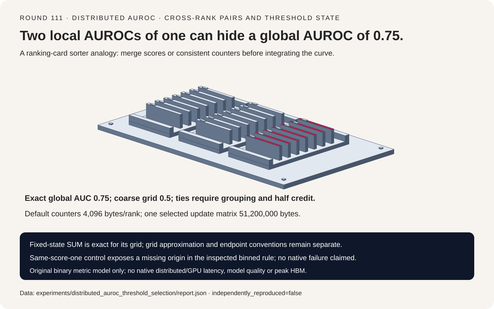
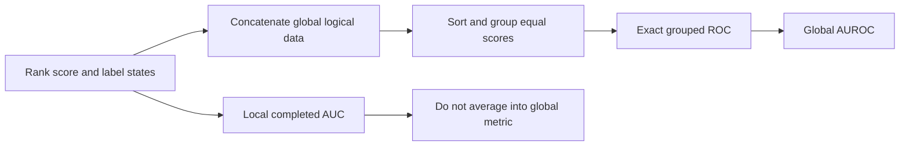
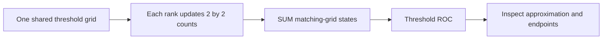
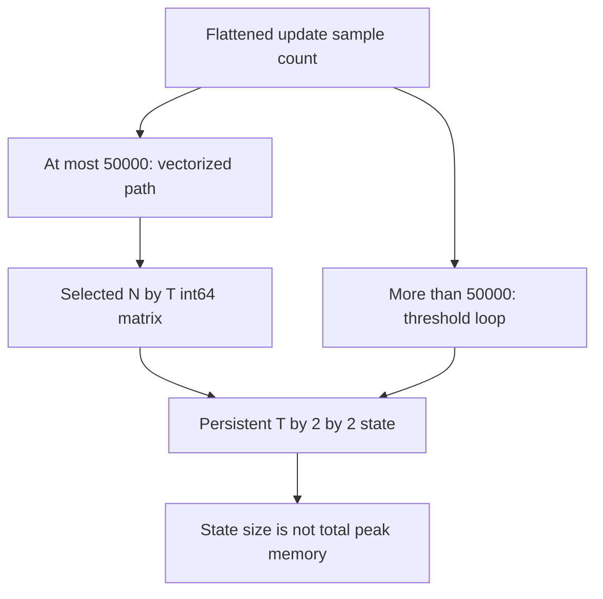

# Distributed AUROC FAQ: cross-rank pairs, score ties and threshold-state budgets

> **Language**: [中文](distributed-auroc-ties-threshold-state-selection-faq.md) | English
>
> **Round 111 · 2026-11-14 (twentieth round of the November 13 night)** · [SVG](../../assets/svg/distributed-auroc-ties-threshold-state-selection-faq-summary.svg) · [7-card report](../reports/distributed-auroc-ties-threshold-state-selection-cards.html) · [H5](../reports/distributed-auroc-ties-threshold-state-sizer.html) · [Sealed report](../../experiments/distributed_auroc_threshold_selection/report.json)
>
> **Synthetic, `independently_reproduced=false`.** Only original rational ROC and pairwise scalar algorithms were timed. No TorchMetrics execution, distributed synchronization, real-model discrimination/quality or peak-HBM measurement.



## 1. Executive summary: merge metric states, not finished AUROCs

The pinned September 8, 2026 TorchMetrics change removes obsolete
Torch compatibility paths. Exact versus binned metric states are
longstanding mechanisms, not newly invented ROC algorithms or a
daily-popularity claim.

Two ranks each have local AUROC **1.0**, but their combined data has
global AUROC **0.75**. Cross-rank positive-negative pairs change the
population. The source therefore concatenates raw scores/targets for
exact mode or SUM-reduces matching-grid confusion counters for binned
mode—not local finished AUROC values.

| Contract | Preserve | Do not infer |
| :--- | :--- | :--- |
| Global ranking | Every positive-negative pair | Average of local AUCs is global AUC |
| Ties | Grouped threshold step / half credit | Arbitrary ordering of tied labels is harmless |
| Fixed grid | Exact merging of its counters | Exact state merge makes approximation exact |
| Memory | Persistent state and update workspace | O(thresholds) state means bounded total peak |

This study uses unweighted binary finite probability scores only.
Synthetic AUROC is an algorithm-control result, not a real model's
quality or calibrated confidence.

## 2. Architect Q&A: which semantics survive distribution and streaming?

### Q1: Why does averaging two perfect local AUROCs fail?

Rank zero has `(0.1,negative),(0.2,positive)` and rank one has
`(0.8,negative),(0.9,positive)`. Each local positive outranks its
local negative, giving 1.0.

Globally there are two positives × two negatives = four pairs.
Positive 0.2 loses to negative 0.8; three pairs win, so exact AUROC
is 3/4. Even equal local sample counts do not fix the missing
cross-rank comparisons. A weighted mean of local completed AUROCs
still cannot reconstruct the global ranking.

Exact mode needs the score/label state or another sufficient global
ranking representation. Fixed-threshold mode can merge counters,
provided the same thresholds and comparison semantics are used on
every rank.

### Q2: How should ties and equality to a threshold be handled?

The original exact implementation sorts scores descending, groups all
equal scores into a single ROC step and integrates using rational
coordinates. An independent pairwise oracle gives one credit for a
strict positive win and half credit for a tie.

For `(0.1,N),(0.2,P),(0.2,N),(0.9,P)`, both implementations return
**0.875** regardless of input order. Splitting a tie group according to
arbitrary label order would change the curve.

The inspected fixed-grid predicate is **score >= threshold**, not
strict greater-than. At threshold 0.5, score 0.5 is predicted positive.
The original state records `TN,FP,FN,TP` per threshold and rejects
merging different grids even if they have the same number of entries.

### Q3: What does “binned but mergeable” lose?

For the four-point cross-rank fixture, thresholds `[0,0.5,1]`
produce AUROC **0.5**, while the exact result is 0.75.
An eleven-point grid `[0,0.1,...,1]` recovers 0.75 for this fixture.
State merging is exact for each declared grid; ranking information
inside its intervals has still been lost.

The number of thresholds alone is not a universal error guarantee.
Score distribution, placement of thresholds, ties and endpoints matter.
More thresholds in an unrelated grid need not improve every example.
The original model limits grids to strictly increasing finite values
from zero to one; it does not reproduce every source custom-grid
validation rule.

### Q4: Why test score-one endpoints and missing classes separately?

The inspected exact ROC path inserts an origin; its binned path
reverses threshold counters without automatically inserting one.
For one positive and one negative both scored exactly 1.0 with
thresholds `[0,1]`, the source-derived binned points in our arithmetic
are `[(1,1),(1,1)]`. Their integral is zero, while pairwise exact
AUROC is 0.5.

The separately labeled **original explicit-origin completion variant**
returns 0.5. It changes the integration convention; it is not silently
substituted into the inspected rule. No native TorchMetrics failure
or fix is reproduced here. A missing origin does not always change
area—for example, a missing purely vertical segment has zero area.

AUROC also requires both global classes. The original model raises
`UndefinedMetric` when either is missing. The inspected source exact
ROC path instead warns and supplies zero rate tensors for the absent
class. We deliberately do not claim native warning/return parity or
turn mathematical undefinedness into a valid zero-quality score.

### Q5: Does fixed threshold state bound update memory?

No. The pinned source stores a `T×2×2` int64 confusion state:
128 thresholds require **4096 bytes/rank**, plus a selected four-byte
threshold vector of 512 bytes.

Default four ranks with 250,000 records each, four-byte score and
eight-byte target, have **12,000,000 logical raw payload bytes/rank**
after global gathering. This excludes internal variable-size padding,
list/tensor overhead, sorting and transport buffers.

The source chooses a vectorized update for at most 50,000 flattened
score elements, otherwise a threshold loop. At a 50,000×128 update,
**one selected int64 matrix is 51,200,000 bytes**—despite the tiny
persistent counter state. Other mappings and temporaries also exist;
this is not a total allocation or measured peak.

The H5 reports that selected matrix only for the inspected vectorized
branch. For larger updates it leaves that field null rather than
pretending the loop needs the same matrix or zero workspace. Wire
traffic, native latency and peak HBM remain unknown.

## 3. Visual architecture: global ranking, mergeable counters and workspace







## 4. Selection matrix: choose state semantics before memory claims

| Choice | Good fit | Gate before adoption |
| :--- | :--- | :--- |
| Exact global ROC | Ranking fidelity when raw state fits | Global data, ties and native sorting workspace |
| Fixed-grid counters | Streaming/distributed bounded persistent state | Shared grid, approximation and endpoint checks |
| Local AUROC | Intentionally local diagnostic | Never relabel its mean as a global metric |
| Pairwise oracle | Small independent correctness checks | Quadratic pairs; not production recommendation |
| Missing-class gate | Explicit undefinedness in reports | Distinguish application policy from library warnings |

## 5. Hands-on evidence: exact rational ROC versus a scalar oracle

```powershell
python -m experiments.distributed_auroc_threshold_selection.run
python -m unittest discover -s tests -p test_distributed_auroc_threshold_selection.py -q
python -m experiments.distributed_auroc_threshold_selection.run --check
```

Recorded ARM64/Python 3.12.10 timings:

| Samples / positive-negative pairs | Rational grouped ROC, ms | Pairwise oracle, ms |
| :--- | ---: | ---: |
| 16 / 64 | 0.080333 | 0.013700 |
| 64 / 1024 | 0.313533 | 0.115367 |
| 256 / 16,384 | 1.275367 | 1.454333 |
| 1024 / 262,144 | 5.227833 | 21.505967 |

Two warmups, seven alternating repeats, three operations per sample;
table is median repeat means. Both validate inputs; exact agreement
is checked outside timing. Fraction arithmetic makes grouped ROC
slower at the two smallest tiers. This is not a native tensor-kernel,
streaming-update or distributed metric benchmark.

Eight focused tests cover cross-rank pairs, all tie permutations,
independent label patterns, same-grid state merging/repartition,
empty state identities, threshold equality, endpoint conventions,
explicit undefined/invalid input, Python/Node payload parity, sealed
artifacts, CSP and SVG bounds. Browser inspection was not performed;
the prior browser operation refusal remains respected.

## 6. Sources, provenance and limits

TorchMetrics pin: `e843b84bb9e957514deb8971340ec6c6e3f0887c`.

1. [September 8, 2026 compatibility-path cleanup](https://github.com/Lightning-AI/torchmetrics/commit/e843b84bb9e957514deb8971340ec6c6e3f0887c).
2. [Metric state registration: exact cat versus fixed confusion-state SUM](https://github.com/Lightning-AI/torchmetrics/blob/e843b84bb9e957514deb8971340ec6c6e3f0887c/src/torchmetrics/classification/precision_recall_curve.py).
3. [Tied score grouping and vectorized/loop threshold updates](https://github.com/Lightning-AI/torchmetrics/blob/e843b84bb9e957514deb8971340ec6c6e3f0887c/src/torchmetrics/functional/classification/precision_recall_curve.py).
4. [ROC endpoints and missing-class warning behavior](https://github.com/Lightning-AI/torchmetrics/blob/e843b84bb9e957514deb8971340ec6c6e3f0887c/src/torchmetrics/functional/classification/roc.py).
5. [AUROC integration](https://github.com/Lightning-AI/torchmetrics/blob/e843b84bb9e957514deb8971340ec6c6e3f0887c/src/torchmetrics/functional/classification/auroc.py).
6. [Apache-2.0 LICENSE](https://github.com/Lightning-AI/torchmetrics/blob/e843b84bb9e957514deb8971340ec6c6e3f0887c/LICENSE).

Original arithmetic, pairwise oracle and art copy no library
implementation, model weights or datasets. Upstream rights remain with
their holders. No logits normalization, sample weights, multiclass,
multilabel, partial AUROC, ignored-label behavior, native regression,
calibration, real-model quality or GPU result is claimed. Seven static
4:5 cards have strict self-contained CSP and bars from sealed data.
