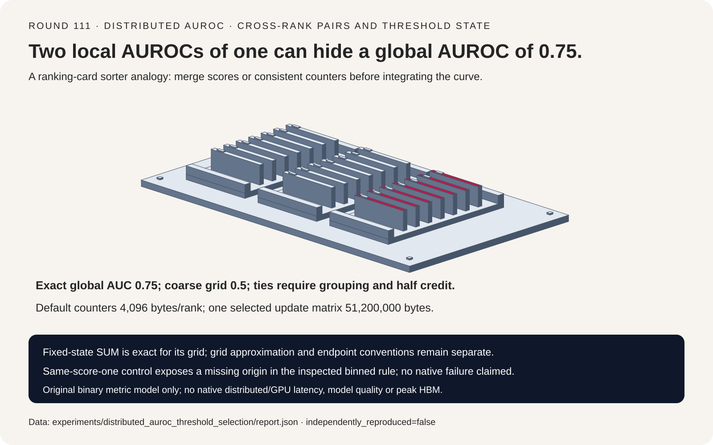
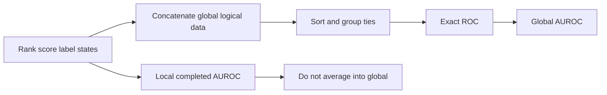
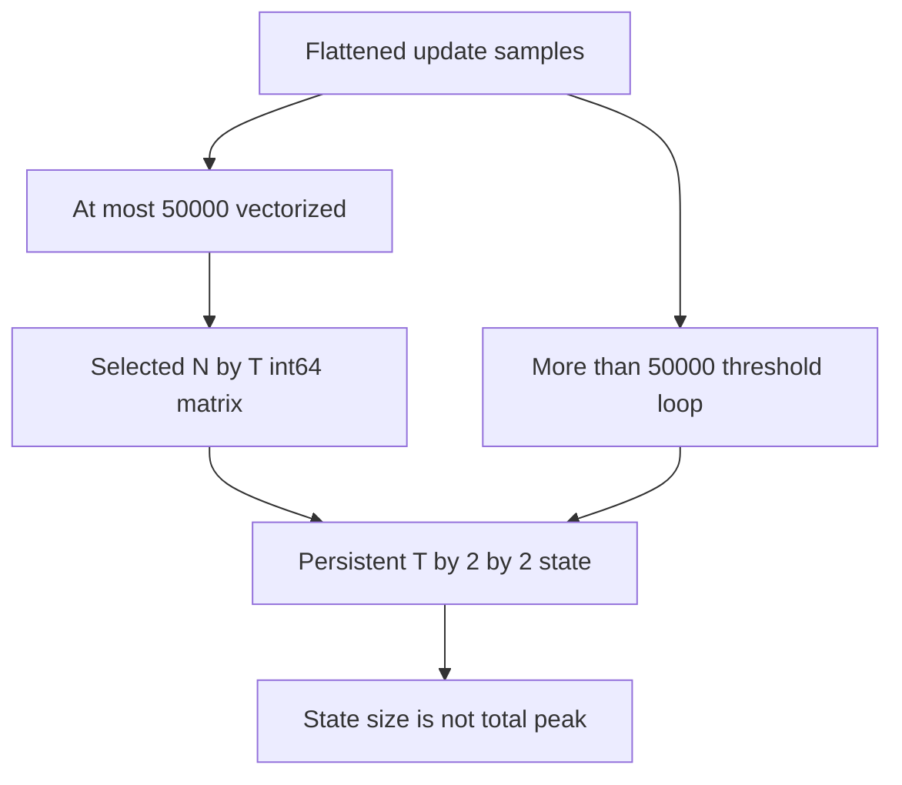

# 分布式 AUROC 选型 FAQ：跨 Rank 配对、同分值与固定阈值状态

> **语言**：中文 | [English](distributed-auroc-ties-threshold-state-selection-faq.en.md)
>
> **Round 111 · 2026-11-14（11 月 13 日夜班第二十轮）** · [SVG](../../assets/svg/distributed-auroc-ties-threshold-state-selection-faq-summary.svg) · [七卡](../reports/distributed-auroc-ties-threshold-state-selection-cards.html) · [H5](../reports/distributed-auroc-ties-threshold-state-sizer.html) · [封存数据](../../experiments/distributed_auroc_threshold_selection/report.json)
>
> **Synthetic，`independently_reproduced=false`。** 仅原创 rational ROC 与 scalar pairwise 算法单独实测；未运行 TorchMetrics、distributed synchronization、真实模型评估或测量 peak HBM。



## 1. 先给结论：合并 Metric State，不平均完成后的 AUROC

固定 TorchMetrics 2026-09-08 变更移除旧 Torch compatibility paths。
Exact/binned state 是长期机制，不宣称新发明 ROC 或“今日热度第一”。

两个 rank 的 local AUROC 都是 **1.0**，合并后的 global AUROC 却为
**0.75**。跨 rank 的 positive-negative pairs 改变了评价总体。
源码 exact mode 拼接原始 score/target；binned mode 对同 grid 的
confusion counters 做 SUM，而不是平均完成后的 local AUC。

| 契约 | 必须保留 | 不能推导 |
| :--- | :--- | :--- |
| Global ranking | 全部 positive-negative pairs | Local AUC 均值就是 global |
| Ties | 同分组整体推进、平局半分 | 任意打散同分 label 不影响结果 |
| Fixed grid | Counter merge 对其 grid 精确 | 状态合并精确就没有近似误差 |
| Memory | Persistent state 与 update workspace 分开 | O(thresholds) 等于 peak memory 固定 |

本模型仅处理 unweighted、binary、有限的 `[0,1]` scores。
Synthetic AUROC 是算法控制结果，不是真实模型质量或 calibrated confidence。

## 2. 架构师 Q&A：哪些语义必须跨分布式与 Streaming 保留？

### Q1：两个完美的 Local AUROC，平均后为什么还会错？

Rank 0 为 `(0.1,N),(0.2,P)`，rank 1 为 `(0.8,N),(0.9,P)`，
各自 positive 都高于自己的 negative，local AUC=1。
全局有两 positive × 两 negative = 四个 pairs，0.2 positive
输给 0.8 negative，因此只有三个胜出，AUC=3/4。

即使 local sample counts 相等也补不上跨 rank 配对；
对已完成 AUC 再按 count 加权也不保留全局排序。
Exact mode 需要 score/label 状态或其他足够的全局排序表示；
fixed-threshold mode 可合并 counters，但各 rank 的 grid 和比较规则必须一致。

### Q2：同分值与恰好等于 Threshold 应该怎么处理？

原创 exact path 降序排序，将全部同分 score 作为一组推进 ROC，
用 rational coordinates 积分。独立 pairwise oracle：
positive 严格胜出记一分，tie 记半分。

`(0.1,N),(0.2,P),(0.2,N),(0.9,P)` 不论输入排列，
两种方法都是 **0.875**。按任意 label 顺序打散同分组会改变曲线。

固定源码阈值谓词为 **score >= threshold**，不是严格大于。
Score=0.5 在 threshold=0.5 被判 positive。
原创 state 每阈值记录 `TN,FP,FN,TP`，不同 grid 即使长度相同也拒绝合并。

### Q3：“Binned 但可精确合并”到底损失了什么？

四点跨 rank 算例在 thresholds=`[0,0.5,1]` 时 AUC=**0.5**，
而 exact=0.75；十一点 `[0,0.1,...,1]` grid 在本算例恢复 0.75。
Counter merge 对每个声明的 grid 精确，但 interval 内的排序信息已经丢失。

Threshold 数量不是通用误差保证。分布、阈值位置、ties、endpoint 都影响
结果；换成更多但不相关的 grid，也不能保证每个样本更准确。
原创模型只接受从零到一、严格递增的 finite grid，不复现源码所有
custom-grid validation 规则。

### Q4：为什么 Score=1 的 Endpoint 与 Missing Class 要单独测试？

固定 exact ROC 插入 origin；binned path 仅翻转阈值 counters，
不会自动插入 origin。对一个 positive、一个 negative 都为 score=1，
thresholds=`[0,1]`，按 inspected rule 做原创算术，points 为
`[(1,1),(1,1)]`，积分为零，而 exact pairwise AUC=0.5。

单独标明的 **original explicit-origin completion variant** 得到 0.5。
它改变 integration convention，不会被偷偷替换成 inspected rule。
这里没有复现 native TorchMetrics failure，也没有声称已修复 native library。
缺 origin 也未必改变面积：缺少纯垂直段时面积可以不变。

AUROC 还要求两类都在 global population 中存在。原创模型缺任一类就
抛出 `UndefinedMetric`；固定源码的 exact ROC 则 warning 并给缺失类
zero-rate tensor。两者不冒充 native warning/return parity，
也不把数学上 undefined 当成有效的零分质量结论。

### Q5：Fixed Threshold State 能限制 Update Memory 吗？

不能。固定源码 persistent confusion state 为 `T×2×2` int64；
128 thresholds 共 **4096 bytes/rank**，另有选定四字节 threshold vector
512 bytes。

默认四个 ranks 各 250,000 records、four-byte score、eight-byte target，
全局 logical raw payload 为 **12,000,000 bytes/rank**。
未计内部 variable-size padding、list/tensor overhead、sorting 与 transport。

固定源码对 ≤50,000 个 flattened score elements 走 vectorized update，
更大则 threshold loop。50,000×128 时，**仅一份选定 int64 matrix 就有
51,200,000 bytes**，远大于 persistent counters。
还有其他 mapping/temporaries；这里不求和冒充 total allocation 或 peak。

H5 只在 inspected vectorized branch 给该 matrix 字节；
更大 update 保持该字段 null，不假装 loop 分配同样矩阵或完全没有 workspace。
Wire bytes、native latency、peak HBM 均 unknown。

## 3. 可视化架构：全局排序、可合并 Counters 与 Workspace






## 4. 选型矩阵：先选状态语义，再谈内存

| 路径 | 适合 | 上线门槛 |
| :--- | :--- | :--- |
| Exact global ROC | Raw state 可容纳且要求排名保真 | Global data、ties、native sort workspace |
| Fixed-grid counters | Streaming/distributed 有界 persistent state | Shared grid、近似与 endpoint 检查 |
| Local AUROC | 有意保留 local diagnostic | 不把均值改名 global metric |
| Pairwise oracle | 小数据独立正确性验证 | 平方配对数，不是 production 建议 |
| Missing-class gate | 明确报告 undefined | 区分应用策略与库 warning 行为 |

## 5. 动手验证：Rational ROC 与独立 Scalar Oracle

```powershell
python -m experiments.distributed_auroc_threshold_selection.run
python -m unittest discover -s tests -p test_distributed_auroc_threshold_selection.py -q
python -m experiments.distributed_auroc_threshold_selection.run --check
```

ARM64、Python 3.12.10：

| Samples / positive-negative pairs | Rational grouped ROC，ms | Pairwise oracle，ms |
| :--- | ---: | ---: |
| 16 / 64 | 0.080333 | 0.013700 |
| 64 / 1024 | 0.313533 | 0.115367 |
| 256 / 16,384 | 1.275367 | 1.454333 |
| 1024 / 262,144 | 5.227833 | 21.505967 |

两次 warmup、七次交替 repeats、每 sample 三次操作取均值，
表格取 repeat means 的 median。两条路径都检查输入，计时外核对精确结果；
Fraction 成本使 grouped ROC 在两个最小 tier 反而更慢。
不称为 native tensor、streaming-update 或 distributed benchmark。

八项 focused tests 覆盖跨 rank 配对、全部 tie permutations、
独立 label patterns、state merge/repartition、empty identity、
threshold equality、endpoint、undefined/invalid、Python/Node payload、
封存数据/CSP/SVG。此前 browser refusal 受尊重，未做浏览器视觉检查。

## 6. 来源、归因与研究边界

TorchMetrics pin：`e843b84bb9e957514deb8971340ec6c6e3f0887c`。

1. [2026-09-08 compatibility cleanup](https://github.com/Lightning-AI/torchmetrics/commit/e843b84bb9e957514deb8971340ec6c6e3f0887c)。
2. [Exact cat / fixed confusion-state SUM 注册](https://github.com/Lightning-AI/torchmetrics/blob/e843b84bb9e957514deb8971340ec6c6e3f0887c/src/torchmetrics/classification/precision_recall_curve.py)。
3. [Tied scores、vectorized/loop threshold updates](https://github.com/Lightning-AI/torchmetrics/blob/e843b84bb9e957514deb8971340ec6c6e3f0887c/src/torchmetrics/functional/classification/precision_recall_curve.py)。
4. [ROC endpoint 与 missing-class warning](https://github.com/Lightning-AI/torchmetrics/blob/e843b84bb9e957514deb8971340ec6c6e3f0887c/src/torchmetrics/functional/classification/roc.py)。
5. [AUROC integration](https://github.com/Lightning-AI/torchmetrics/blob/e843b84bb9e957514deb8971340ec6c6e3f0887c/src/torchmetrics/functional/classification/auroc.py)。
6. [Apache-2.0 LICENSE](https://github.com/Lightning-AI/torchmetrics/blob/e843b84bb9e957514deb8971340ec6c6e3f0887c/LICENSE)。

原创算术、pairwise oracle、图形未复制库实现、权重或数据集，
上游权利保留。不声称 logits normalization、sample weights、
multiclass/multilabel、partial AUROC、ignore labels、native regression、
calibration、真实模型质量或 GPU 结果。七张静态 4:5 卡严格自包含 CSP，
全部数值条来自 sealed data。
