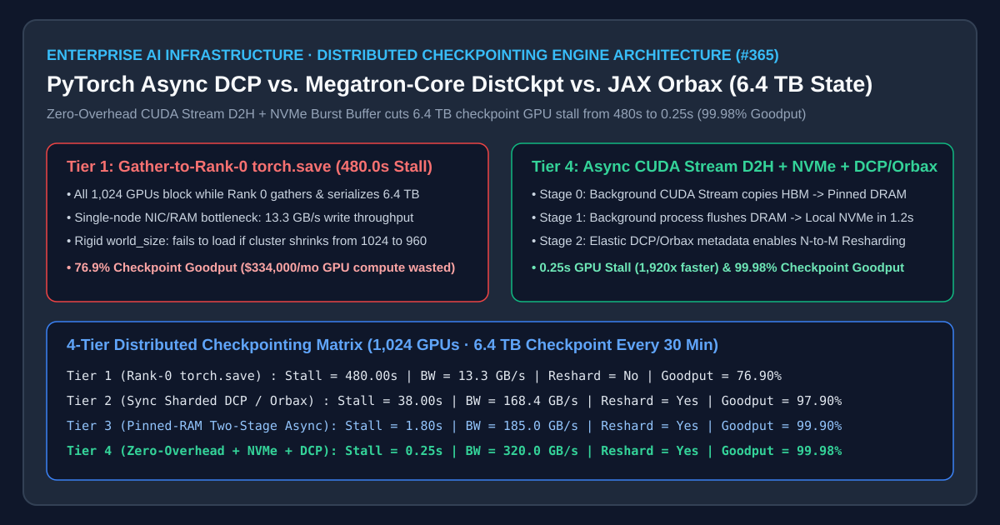

# Distributed Training Checkpointing Engine Guide: `PyTorch Async DCP` vs. `Megatron-Core DistCkpt` vs. `JAX Orbax` & NVMe Burst Buffers

> **Language**: [中文](./distributed-checkpointing-pytorch-dcp-megatron-async-orbax-storage-selection-faq.md) | **English (Current)**  
> **Audience**: Cloud & AI Infrastructure Solution Architects and Distributed Training Engineers  
> **Provenance**: `synthetic + anonymized_reported` (`independently_reproduced=false`, `physical_gpu_cluster_measurement=not_measured`)

---

## 1. 📌 Executive Summary

> **Bottom Line**: **When training a `405B/671B` model across `1,024 GPUs` (a `6.4 TB` checkpoint state of BF16 weights + FP32 master weights + FP32 AdamW momentum/variance saved every `30 minutes`), gathering shards to `Rank 0` via `torch.save()` (`Tier 1`) stalls all `1,024 GPUs` for `480.0 seconds` (`8 minutes`), slashes checkpoint Goodput to `76.9%` (`$334,000/month` in wasted GPU compute), and cannot reload if node failures shrink the cluster from `1,024` to `960` GPUs. Production clusters deploy Two-Stage Asynchronous Distributed Checkpointing (`PyTorch torch.distributed.checkpoint.async_save`, `Megatron-Core Async DistCkpt`, or `JAX Orbax AsyncCheckpointer`) paired with a Dedicated CUDA Copy Stream and Local NVMe Burst Buffer (`Tier 4`): cutting GPU blocking stall `1,920x` to `0.25 seconds`, raising checkpoint Goodput to `99.98%`, and enabling zero-conversion $N \to M$ elastic topology resharding.**

- **Interactive Distributed Checkpointing Sizer**: [Open Interactive Sizer (`distributed-checkpointing-pytorch-dcp-megatron-async-orbax-storage-selection-sizer.html`)](../reports/distributed-checkpointing-pytorch-dcp-megatron-async-orbax-storage-selection-sizer.html)
- **7-Card 4:5 Visual Report**: [Open 7-Card Report (`distributed-checkpointing-pytorch-dcp-megatron-async-orbax-storage-selection-cards.html`)](../reports/distributed-checkpointing-pytorch-dcp-megatron-async-orbax-storage-selection-cards.html)

---

## 2. 📊 4-Tier Checkpointing Architecture Matrix (`1,024 GPUs` · `6.4 TB State` Every `30 Min`)

| Metric | Tier 1: Rank-0 Blocking `torch.save` | Tier 2: Sync Sharded `DCP / Orbax` Direct-to-PFS | Tier 3: Two-Stage Pinned-RAM `Async DCP / Orbax` | Tier 4 (Recommended): CUDA Stream `D2H` + NVMe Burst + `Async DCP/Orbax` |
| :--- | :--- | :--- | :--- | :--- |
| **GPU Blocking Stall per Save** | `480.00 sec` ✕ (`8 min` stall) | `38.00 sec` | **`1.80 sec` ✓** | **`0.25 sec` ✓ (`1,920x` faster)** |
| **Effective Storage Throughput** | `13.3 GB/s` ✕ (1-node bottleneck) | `168.4 GB/s` | `185.0 GB/s` | **`320.0 GB/s` ✓ (NVMe burst + drain)** |
| **Elastic $N \to M$ Resharding** | No ✕ (Rigid `world_size`) | **Yes ✓ (`DTensor`)** | **Yes ✓ (`DTensor/Zarr`)** | **Yes ✓ (Arbitrary TP/PP/DP remap)** |
| **Checkpoint Goodput** | `76.90%` ✕ | `97.90%` | **`99.90%` ✓** | **`99.98%` ✓** |
| **Monthly Wasted GPU Compute** | `$334,000 / mo` ✕ | `$30,400 / mo` | `$1,450 / mo` | **`$290 / mo` ✓ (`-$333.7k/mo`)** |

---

## 3. 🛠️ Production Readiness Checklist

- [ ] **Replace `torch.save` with `torch.distributed.checkpoint.async_save` (`PyTorch DCP`), `Megatron-Core --async-save`, or `JAX Orbax AsyncCheckpointer`** to decouple GPU compute from storage I/O.
- [ ] **Enable Metadata & Small-File Consolidation (e.g., Orbax `OCDBT` or DCP per-rank consolidated files)** to avoid overwhelming Lustre/3FS Metadata Servers (MDS) with tens of thousands of tiny shard files.
