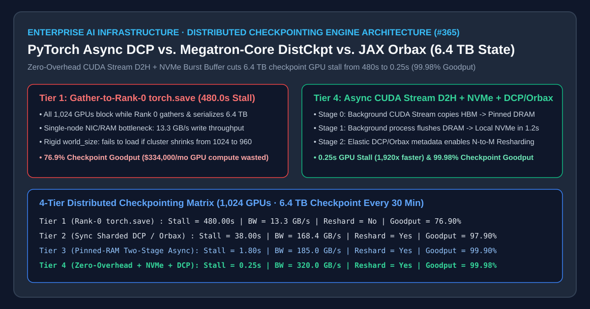
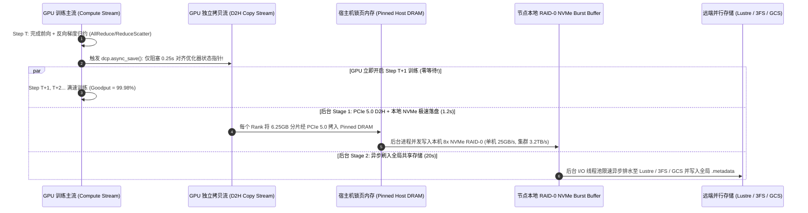

# 大模型分布式训练存储与 Checkpoint 引擎架构选型：`PyTorch DCP (Distributed Checkpoint)` vs. `Megatron-Core Async DistCkpt` vs. `JAX Orbax` vs. 传统 `torch.save(rank==0)`、万卡秒级非阻塞保存指南

> **语言 / Language**: **中文 (当前)** | [English](./distributed-checkpointing-pytorch-dcp-megatron-async-orbax-storage-selection-faq.en.md)  
> **定位**：面向 Cloud & AI Infrastructure Solution Architect 与预训练平台架构师的万卡训练状态持久化架构选型（`PyTorch Distributed Checkpoint (DCP)`、`Megatron-Core Async DistCkpt`、`JAX Orbax + TensorStore`）、两阶段锁页内存异步转储、本地 NVMe Burst Buffer 与故障后 $N \to M$ 弹性拓扑重切分（Elastic Resharding）白皮书  
> **合规与来源声明**：`synthetic + anonymized_reported`（`independently_reproduced=false`，`physical_gpu_cluster_measurement=not_measured`；完全面向通用企业级百卡/千卡大模型预训练高有效吞吐架构设计）

---

## 1. 📌 核心选型结论速览（Executive Summary）

> **一句话结论**：**在 `1,024` 张 GPU 训练 `405B/671B` 大模型（单次完整 Checkpoint 状态含 BF16 权重 + FP32 主权重 + FP32 AdamW 一阶/二阶动量共 **`6.4 TB`**，每 30 分钟保存一次）中，沿用传统的 `if rank == 0: torch.save()`（Tier 1）不仅极易撑爆 `Rank 0` 宿主机内存引发 OOM，更会让全部 `1,024` 张 GPU 阻塞等待长达 **`480.0 秒（8 分钟！）`**，将训练 Checkpoint Goodput 直接砸穿至 **`76.9%`**（每月白白烧掉 `$334,000` 空转卡时），且一旦故障后坏掉 8 台节点缩容到 `960` 卡就因 `world_size` 不匹配无法恢复！生产环境黄金准则是采用“零开销 CUDA 独立拷贝流 `D2H` + 本地 NVMe Burst Buffer + `PyTorch Async DCP` / `Megatron-Core Async DistCkpt` / `JAX Orbax` 全局逻辑张量偏移元数据（Tier 4）”：将单次 Checkpoint 的 GPU 阻塞时间从 `480.0s` 压缩 `1,920 倍` 至 **`0.25 秒`**、集群聚合落盘带宽推升至 **`320.0 GB/s`**、Checkpoint Goodput 拉满至 **`99.98%`**，并原生支持任意 $N \to M$（如 `1024 卡 -> 960 卡` 或 `TP=8 -> TP=4`）在线弹性重切分恢复！**

- **交互式分布式 Checkpoint 耗时与 Goodput 计算器**：[打开交互式计算器 (`distributed-checkpointing-pytorch-dcp-megatron-async-orbax-storage-selection-sizer.html`)](../reports/distributed-checkpointing-pytorch-dcp-megatron-async-orbax-storage-selection-sizer.html)
- **7-Card 4:5 视觉评测报告**：[打开 7-Card 报告 (`distributed-checkpointing-pytorch-dcp-megatron-async-orbax-storage-selection-cards.html`)](../reports/distributed-checkpointing-pytorch-dcp-megatron-async-orbax-storage-selection-cards.html)

---

## 2. 🎯 客户与架构师灵魂拷问 Q&A（Deep-Dive Architecture FAQ）

### Q1：为什么大模型训练保存一次 Checkpoint 要写 `6.4 TB` 这么多？如果坏了 1 台机器（`1024 卡 -> 1016 卡`），为什么传统分片保存无法恢复？
1. **训练态字节手算公式（Mixed-Precision AdamW `16Ψ` 法则）**：
   - 每个训练参数（$\Psi$）需要持久化：BF16 参数（`2 Bytes`）+ FP32 Master Weights（`4 Bytes`）+ FP32 AdamW `exp_avg`（`4 Bytes`）+ FP32 AdamW `exp_avg_sq`（`4 Bytes`）$\approx 14 \sim 16\text{ Bytes/\Psi}$。对于 `405B` 模型，单次完整状态高达 $405 \times 10^9 \times 16\text{ B} \approx \mathbf{6.48\text{ TB}}$！
2. **传统按 `rank_id` 存裸分片（`ckpt_rank_000.pt`）的死穴**：
   - 每个文件只存了该 Rank 切到的局部 1D 扁平数组；当坏掉 1 台机器用 `1016` 卡重启，或从预训练 `TP=8, PP=8, DP=16` 切换到微调/推理 `TP=8, PP=1, DP=1` 时，切分边界完全变了，必须写脱机单机大内存脚本做数小时的权重拼接转换。
   - **`PyTorch DCP (DTensor)` / `Megatron DistCkpt` / `JAX Orbax (TensorStore)` 的解耦方案**：保存时记录每个分片在**全局逻辑多维张量（Global Logical Tensor Shape）中的起止坐标 `[offset_x, offset_y, length]`**（存放在 `.metadata` 或 `zarr` 索引中）；加载时无论新集群是几百张卡、什么 `TP/PP/FSDP` 切分，每个新 Rank 自动按需从并行文件系统中 `pread` 自己坐标对应的字节块，实现**零脱机转换的毫秒级跨拓扑弹性重切分（Elastic Resharding）**！

---

## 3. 🧭 直观可视化图解（Mermaid 两阶段零阻塞异步 Checkpoint 流水线时序图）

---

## 4. 📊 架构师四级分布式 Checkpoint 架构决策矩阵（`1,024 GPUs` · `6.4 TB` 状态 · 每 `30 分钟`保存）

| 评估维度 | Tier 1：传统汇聚至 `Rank 0` 阻塞保存 (`torch.save`) | Tier 2：全 Rank 同步分片直写并行存储 (`Sync DCP / Orbax`) | Tier 3：两阶段锁页内存 `D2H` + 后台异步刷盘 (`Async DCP / Orbax`) | Tier 4（推荐）：独立流 `D2H` + 本地 NVMe 缓写 + `Async DCP/Orbax` |
| :--- | :--- | :--- | :--- | :--- |
| **单次保存阻塞 GPU 训练耗时** | `480.00 秒` ✕（停摆 8 分钟） | `38.00 秒` | **`1.80 秒` ✓** | **`0.25 秒` ✓（提速 `1,920 倍`）** |
| **集群有效落盘吞吐带宽** | `13.3 GB/s` ✕（单机网卡瓶颈） | `168.4 GB/s` | `185.0 GB/s` | **`320.0 GB/s` ✓（先落 NVMe 再异步排）** |
| **跨卡数 / 跨并行度弹性重切分** | 不支持 ✕（改卡数无法加载） | **原生支持 ✓ (`DTensor`)** | **原生支持 ✓ (`DTensor/Zarr`)** | **原生支持 ✓（任意 $N \to M$ 重切分）** |
| **Checkpoint 周期有效吞吐 (`Goodput`)** | `76.90%` ✕ | `97.90%` | **`99.90%` ✓** | **`99.98%` ✓** |
| **每月因保存阻塞浪费的 GPU 算力费** | `$334,000 / 月` ✕ | `$30,400 / 月` | `$1,450 / 月` | **`$290 / 月` ✓（立省 `$33.37万/月`）** |

---

## 5. 🛠️ 架构评审与生产落地 Checklist

- [ ] **全面禁用多机训练中的 `torch.save(model.state_dict())` 与 `FULL_STATE_DICT` 汇聚**：统一迁移至 `torch.distributed.checkpoint.async_save`（PyTorch FSDP2）、`Megatron-Core --async-save --use-dist-ckpt` 或 `orbax.checkpoint.AsyncCheckpointer`（JAX）。
- [ ] **控制并发写打爆共享存储元数据服务器（MDS）**：使用 `PyTorch DCP` / `TensorStore` 的文件合并（Consolidation / OCDBT 键值打包）能力，避免 `1,024` 个 Rank 每个 Tensor 生成上万个零碎小文件打垮 Lustre MDS。
