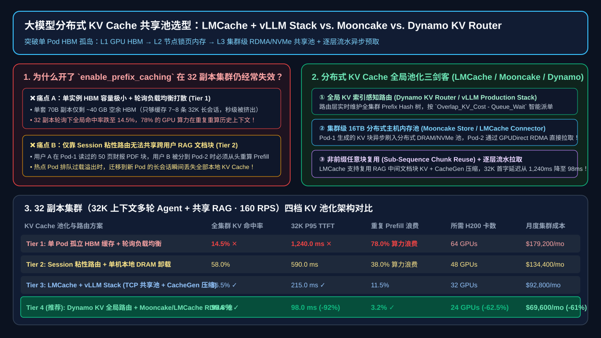

# Distributed KV Cache Pool & Cross-Replica Routing Guide: `LMCache + vLLM Production Stack` vs. `Mooncake Transfer Engine` vs. `NVIDIA Dynamo KV Router`

> **Language**: [中文](./distributed-kv-cache-pool-lmcache-mooncake-vllm-production-stack-selection-faq.md) | **English (Current)**  
> **Audience**: Cloud & AI Infrastructure Solution Architects and Distributed Inference Engineers  
> **Provenance**: `synthetic + anonymized_reported` (`independently_reproduced=false`, `physical_gpu_cluster_measurement=not_measured`)

---

## 1. 📌 Executive Summary

> **Bottom Line**: **In a multi-replica Kubernetes inference cluster (`32` `vLLM / SGLang` pods serving `32K`-context multi-turn agents and shared RAG documents), enabling local `--enable-prefix-caching` behind a standard Round-Robin load balancer (`Tier 1`) yields a dismal `14.5%` cluster-wide KV Cache hit rate—wasting `78.0%` of GPU Prefill FLOPs on redundant recomputation (`1,240 ms` P95 `TTFT` and `64 H200 GPUs`). Deploying a Global KV-Index-Aware Router (`Dynamo KV Router / vLLM Production Stack`) paired with a Distributed RDMA/DRAM KV Cache Pool (`Mooncake Store / LMCache`, `Tier 4`) lifts cluster KV hit rate to `95.8%`, slashes `32K` P95 `TTFT` by `92.1%` (`98.0 ms`), and cuts required `H200` GPUs from `64` to `24` (`-62.5%` GPUs, `-61.2%` monthly TCO).**

- **Interactive Distributed KV Cache Pool Sizer**: [Open Interactive Sizer (`distributed-kv-cache-pool-lmcache-mooncake-vllm-production-stack-sizer.html`)](../reports/distributed-kv-cache-pool-lmcache-mooncake-vllm-production-stack-sizer.html)
- **7-Card 4:5 Visual Report**: [Open 7-Card Report (`distributed-kv-cache-pool-lmcache-mooncake-vllm-production-stack-selection-cards.html`)](../reports/distributed-kv-cache-pool-lmcache-mooncake-vllm-production-stack-selection-cards.html)

---

## 2. 📊 4-Tier Distributed KV Pooling Matrix (`32 Replicas` · `32K Context` · `160 RPS`)

| Metric | Tier 1: Isolated Pod HBM + Round-Robin | Tier 2: Session Sticky + Local Host DRAM | Tier 3: `LMCache + vLLM Stack` (`TCP + CacheGen`) | Tier 4 (Recommended): `Dynamo KV Router` + `Mooncake/LMCache RDMA` Pool |
| :--- | :--- | :--- | :--- | :--- |
| **Cluster-Wide KV Hit Rate** | `14.5%` ✕ | `58.0%` | `86.5%` ✓ | **`95.8%` ✓** |
| **Multi-Turn 32K P95 `TTFT`** | `1,240.0 ms` ✕ | `590.0 ms` | `215.0 ms` ✓ | **`98.0 ms` ✓ (`-92.1%`)** |
| **Wasted Prefill Recompute** | `78.0%` ✕ | `38.0%` | `11.5%` | **`3.2%` ✓** |
| **Required `H200` GPUs** | `64 GPUs` ✕ | `48 GPUs` | `32 GPUs` | **`24 GPUs` ✓ (`-62.5%`)** |
| **Monthly Cluster TCO** | `$179,200 / mo` ✕ | `$134,400 / mo` | `$92,800 / mo` | **`$69,600 / mo` ✓ (`-61.2%`)** |

---

## 3. 🛠️ Production Readiness Checklist

- [ ] **Replace Stateless Round-Robin L7 Load Balancers with a KV-Index-Aware Router** (`vLLM Production Stack Router`, `NVIDIA Dynamo KV Router`, or `SGLang Router`).
- [ ] **Pool Host DDR5 RAM Across All Inference Nodes via `Mooncake Store` (RDMA) or `LMCache` (`CacheGen` on TCP)** so evicted HBM KV blocks and shared RAG document KV chunks are never recomputed from scratch.
