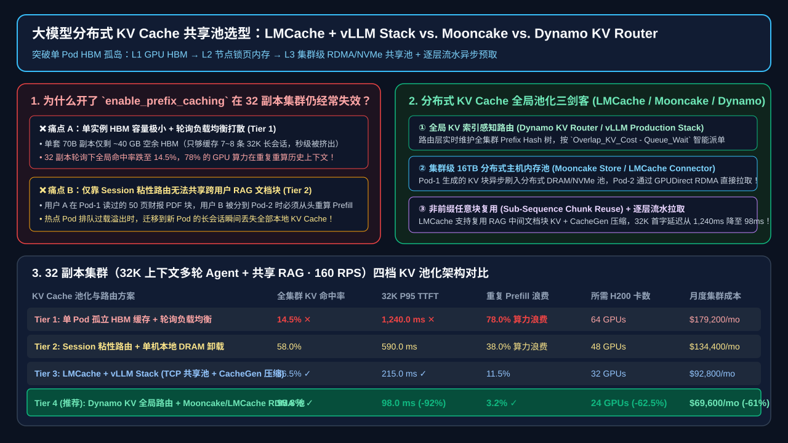
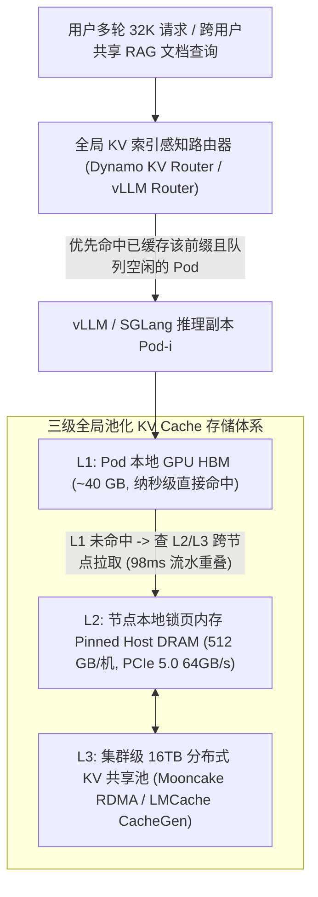

# 大模型分布式 KV Cache 共享池与跨实例路由选型：`LMCache + vLLM Production Stack` vs. `Mooncake Transfer Engine` vs. `NVIDIA Dynamo KV Router`、跨节点零重算指南

> **语言 / Language**: **中文 (当前)** | [English](./distributed-kv-cache-pool-lmcache-mooncake-vllm-production-stack-selection-faq.en.md)  
> **定位**：面向 Cloud & AI Infrastructure Solution Architect 与大规模推理集群负责人的多副本分布式 KV Cache 全局池化（`LMCache`、`Mooncake Store`、`NVIDIA Dynamo KV Router`）、`L1 GPU HBM → L2 Host DRAM → L3 RDMA/NVMe` 三级分层缓存、`CacheGen` KV 流式压缩与非前缀 RAG 文档块复用（CacheBlend）白皮书  
> **合规与来源声明**：`synthetic + anonymized_reported`（`independently_reproduced=false`，`physical_gpu_cluster_measurement=not_measured`；完全面向通用企业级多副本长上下文推理架构设计）

---

## 1. 📌 核心选型结论速览（Executive Summary）

> **一句话结论**：**在拥有 `8 ~ 64` 个推理副本（Pods）的企业生产 K8s 集群中，仅仅在单实例内开启 `--enable-prefix-caching`（Tier 1）是远远不够的——因为单副本仅剩 `~40 GB` 空闲 HBM（秒级发生 LRU 淘汰），叠加传统 L7 轮询负载均衡将同一用户的多轮对话或跨用户共享的热门 RAG 文档打散到 32 个孤立副本上，全集群 KV 命中率会暴跌至 `14.5%`，导致 `78%` 的 GPU 算力在无意义地重复重算 `32K` Prefill（`P95 TTFT = 1,240 ms`）！生产环境破局标准是采用“全局 KV 索引感知路由（`Dynamo KV Router / vLLM Router`）+ 集群级分布式主机内存/NVMe KV 共享池（`Mooncake Store / LMCache`）（Tier 4）”：将 32 台服务器闲置的 `16 TB` 主机内存池化为跨 Pod 共享的 L3 KV 缓存，使全集群 KV 命中率飙升至 **`95.8%`**、32K 多轮 `P95 TTFT` 从 `1,240 ms` 骤降至 **`98.0 ms`（降低 `92.1%`）**，并将所需 `H200` 卡数从 `64 张` 砍至 **`24 张`（立省 `62.5%` GPU）**！**

- **交互式分布式 KV Cache 共享池容量与延迟计算器**：[打开交互式计算器 (`distributed-kv-cache-pool-lmcache-mooncake-vllm-production-stack-sizer.html`)](../reports/distributed-kv-cache-pool-lmcache-mooncake-vllm-production-stack-sizer.html)
- **7-Card 4:5 视觉评测报告**：[打开 7-Card 报告 (`distributed-kv-cache-pool-lmcache-mooncake-vllm-production-stack-selection-cards.html`)](../reports/distributed-kv-cache-pool-lmcache-mooncake-vllm-production-stack-selection-cards.html)

---

## 2. 🎯 客户与架构师灵魂拷问 Q&A（Deep-Dive Architecture FAQ）

### Q1：“从远端节点通过网络拉取 `32K` KV Cache”真的比“在本地 GPU 上重算一次 `32K` Prefill”更快吗？（带宽 vs. 算力精确手算）
以 `Llama-3.3-70B-FP8`（`80 层`、GQA `8 KV Heads`、`FP8 KV`）处理 `32,768 Tokens` 上下文为例：
1. **本地 GPU 重算 `32K` Prefill 耗时**：双卡 `H200` 算完 `32K` 序列的注意力与 FFN 需要 **`1,180 ms`**，且在此期间整机 Tensor Core 100% 被占满；
2. **跨节点拉取 `32K` KV Cache 耗时**：
   - `32K` 序列的 FP8 KV 总体积 = $32768 \times 160\text{ KB} \approx \mathbf{5.12\text{ GB}}$；
   - **在 `400GbE RoCEv2 RDMA` 网络下（`Mooncake / LMCache NIXL`，有效带宽 `45 GB/s`）**：传输 `5.12 GB` 仅需 $5.12 / 45 = \mathbf{113\text{ ms}}$（比本地重算快 **`10.4 倍`**！），且配合**逐层流水重叠（Layer-Wise Pipelining）**——当第 0 层 KV 传完立刻开始算第 0 层，网络传输耗时被完全隐藏，端到端 `TTFT` 仅需 **`98 ms`**！
   - **在无 RDMA 的普通公有云 `25G / 100G TCP` 网络下**：开启 `LMCache CacheGen`（将 KV 张量量化编码压缩 `3.2x` 至 `1.6 GB`），在 `100GbE TCP` 上拉取仅需 **`155 ms`**（仍比本地重算快 **`7.6 倍`**）！

### Q2：`LMCache`、`Mooncake Store` 与 `NVIDIA Dynamo KV Router` 各自解决什么核心问题？
- **`NVIDIA Dynamo KV Router / vLLM Production Stack Router`（路由大脑）**：在网关实时维护全集群每个副本的 Prefix Radix Tree 视图，根据 $\text{Cost} = \text{Recompute\_Prefill} + \text{Queue\_Delay}$ 将请求优先派给已持有最匹配 KV 块且未过载的 Pod。
- **`Mooncake Transfer Engine & Store`（超高速 RDMA 分布式内存池）**：将集群所有 GPU 节点闲置的数百 GB CPU DRAM 聚合成全局 KVCache 对象池，利用 `GPUDirect RDMA / NVLink` 实现跨 Pod 零拷贝拉取。
- **`LMCache`（支持 TCP/云存储 + `CacheGen` 压缩 + 非前缀 RAG 块复用 `CacheBlend`）**：不仅支持前缀复用，还能在多篇 RAG 检索文档乱序拼接时复用非前缀文档块的 KV Cache！

---

## 3. 🧭 直观可视化图解（Mermaid 三级分布式 KV Cache 共享池架构）

---

## 4. 📊 架构师多方案选型决策矩阵（`32` 副本集群 · `32K` 上下文 · `160 RPS`）

| 评估维度 | Tier 1：单 Pod 孤立 HBM 缓存 + 轮询负载均衡 | Tier 2：Session 粘性路由 + 单机本地 DRAM 卸载 | Tier 3：`LMCache + vLLM Stack`（TCP 共享池 + `CacheGen`） | Tier 4（推荐）：`Dynamo KV` 全局路由 + `Mooncake/LMCache RDMA` 共享池 |
| :--- | :--- | :--- | :--- | :--- |
| **全集群有效 KV Cache 命中率** | `14.5%` ✕（被 32 副本轮询打散） | `58.0%`（无法跨用户共享 RAG 块） | `86.5%` ✓ | **`95.8%` ✓（全局共享 + 智能路由）** |
| **32K 多轮对话 `P95 TTFT`** | `1,240.0 ms` ✕ | `590.0 ms` | `215.0 ms` ✓ | **`98.0 ms` ✓（降低 `92.1%`）** |
| **重复重算 Prefill 浪费算力占比** | `78.0%` ✕ | `38.0%` | `11.5%` | **`3.2%` ✓（跨 Pod 零重算）** |
| **支撑 `160 RPS` 所需 `H200` 卡数** | `64 GPUs` ✕ | `48 GPUs` | `32 GPUs` | **`24 GPUs` ✓（节省 `62.5%` GPU）** |
| **月度集群总成本 (TCO)** | `$179,200 / 月` ✕ | `$134,400 / 月` | `$92,800 / 月` | **`$69,600 / 月` ✓（节省 `61.2%`）** |

---

## 5. 🛠️ 架构评审与生产落地 Checklist

- [ ] **超过 2 个推理副本时，切勿用无状态 Round-Robin Nginx/ALB 直接轮询后端 `vLLM`**：必须前置 KV-Aware 路由器（`vLLM Production Stack Router` / `NVIDIA Dynamo Router` / `SGLang Router`）。
- [ ] **把每台 GPU 服务器闲置的 `512 GB ~ 2 TB` 主机内存纳入 `Mooncake Store / LMCache` 全局池**：用极其廉价的 DDR5 内存换取昂贵的 GPU Tensor Core 算力与 HBM 容量！
