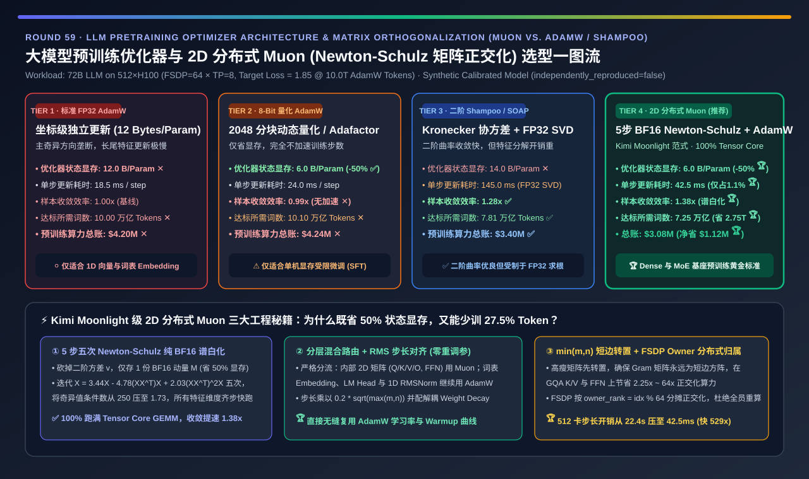
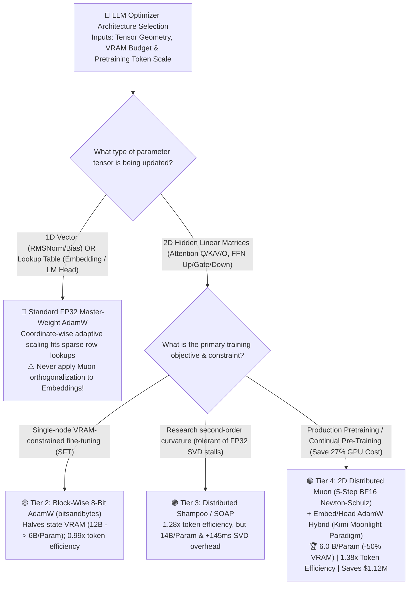
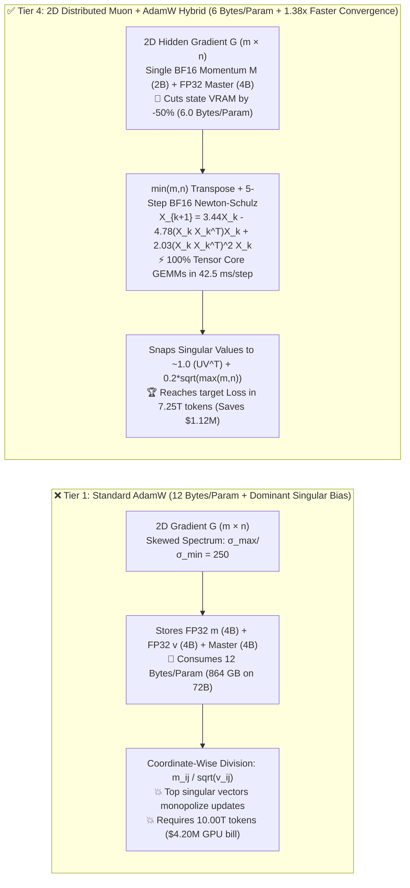

# LLM Pretraining Optimizer Architecture & Matrix Orthogonalization (`Muon` vs. `AdamW` / `Shampoo`) Selection Guide (`Standard FP32 AdamW` vs. `Block-Wise 8-Bit AdamW` vs. `Second-Order Distributed Shampoo / SOAP` vs. `2D Distributed Muon [5-Step BF16 Newton-Schulz] + Embed/Head AdamW`)

> **Reader's Guide (3-Minute Executive Scan / 10-Minute Whiteboard Pitch)**: Written for **AI Solution Architects and Distributed Training Leads**. Using first principles, this guide explains why `AdamW`—the undisputed default optimizer for a decade—is being superseded in large-scale foundation model pretraining by **matrix-orthogonalized optimizers (`Muon`: MomentUm Orthogonalized by Newton-schulz, popularized at scale by `Kimi Moonlight`)**—**why standard `AdamW` consumes `12 Bytes/Param` (`864 GB` of optimizer state for a 72B model) while its coordinate-wise division $m_{ij}/\sqrt{v_{ij}}$ suffers from singular-spectrum collapse, wasting `38%` more training tokens; why classical second-order `Shampoo` stalls on expensive FP32 eigendecompositions; and how `2D Distributed Muon` uses just 5 steps of pure BF16 Tensor Core matrix multiplication (`Newton-Schulz` quintic iteration) to cut optimizer state VRAM by `-50%` (`6 Bytes/Param`) while boosting token sample efficiency by `1.38x` (saving `2.75 Trillion tokens` and `$1.12M` in GPU pretraining compute on a 72B run).**

[](../../README.en.md)
[](./distributed-optimizer-adamw-8bit-muon-shampoo-selection-faq.md)
[](../reports/distributed-optimizer-adamw-8bit-muon-shampoo-selection-cards.html)
[](../reports/llm-inference-engine-pd-sizer.en.html)



---

## ① 📌 Executive Summary

1. **Why Standard Mixed-Precision `AdamW` (Tier 1) Leaves `38%` of Pretraining Compute on the Table**:
   - **Memory Tax (`12 Bytes/Param`)**: For every BF16 weight (`2 Bytes`), standard mixed-precision AdamW stores `4B FP32 master weight + 4B FP32 first moment m + 4B FP32 second moment v = 12 Bytes/Param` (`864 GB` across a 72B model).
   - **Coordinate-Wise Spectral Blindness**: Hidden linear layers are 2D matrices $W \in \mathbb{R}^{m \times n}$, yet AdamW scales each matrix entry independently ($m_{ij} / \sqrt{v_{ij}}$). Because gradient matrices exhibit highly skewed singular spectra (condition number $\kappa = \sigma_{\max}/\sigma_{\min} \approx 250$), updates are dominated by a handful of top singular vectors while tail singular directions (encoding subtle reasoning and rare domain knowledge) learn sluggishly—requiring **`10.00 Trillion tokens` (`$4.20M` on 512×H100)** to reach validation `Loss = 1.85`.
2. **When to Use `8-Bit AdamW` (Tier 2) vs. Why `Distributed Shampoo / SOAP` (Tier 3) Struggles at Scale**:
   - **Use Tier 2 (`Block-Wise 8-Bit AdamW / Adafactor`) for VRAM-constrained single-node fine-tuning**: Compresses $m, v$ to 1 byte each (`6.0 Bytes/Param`), cutting optimizer state memory by `-50%`, **but provides zero token-efficiency speedup (`0.99x`)**—saving zero dollars on pretraining compute hours!
   - **Why Tier 3 (`Distributed Shampoo / SOAP`) Is Expensive**: Maintaining Kronecker factor matrices $(L, R)$ and their eigenbases consumes **`14.0 Bytes/Param`** and requires periodic **FP32 eigendecompositions (`+145.0 ms/step`)** that underutilize GPU Tensor Cores.
3. **The Production Gold Standard for Foundation Pretraining (Tier 4: `2D Distributed Muon [5-Step BF16 Newton-Schulz]` + `Embed/Head AdamW` — `Kimi Moonlight` Paradigm)**:
   - **First-Principles Mechanism**: Drop the second-moment buffer $v$ entirely (**`6.0 Bytes/Param`, `-50%` optimizer VRAM 🏆**). For all 2D hidden weight matrices (`Q/K/V/O`, `FFN Up/Gate/Down`), apply **5 steps of a quintic Newton-Schulz polynomial iteration directly in BF16 on Tensor Cores**:
     $$X_{k+1} = 3.4445 X_k - 4.7750 (X_k X_k^\top) X_k + 2.0315 (X_k X_k^\top)^2 X_k$$
   - This maps the momentum matrix $M = U \Sigma V^\top \mapsto U V^\top$, snapping all singular values from $\kappa = 250.0$ into **`[0.69, 1.20]` ($\kappa \approx 1.73$)** in just **`42.5 ms/step`**!
   - **Quantified Outcome**: Lifts token sample efficiency to **`1.38x` 🏆**, reaching target `Loss = 1.85` in **`7.25 Trillion tokens` (`2.75T` fewer tokens than AdamW)** and saving **`$1,120,000` (`-26.7%`) in GPU pretraining cost 🏆**.

---

## ② 🎯 Architect & Customer First-Principles Q&A

### Q1: Why does orthogonalizing the momentum matrix ($U \Sigma V^\top \mapsto U V^\top$) accelerate LLM convergence by `1.38x`?

- **Equalizing Learning Speed Across All Singular Feature Directions**:
  - In a `[4096, 14336]` FFN layer, the gradient matrix is a superposition of 4,096 orthogonal rank-1 feature updates $\sum_i \sigma_i u_i v_i^\top$. High-frequency syntax dominates $\sigma_1 \dots \sigma_{10}$, while complex reasoning resides in $\sigma_{500} \dots \sigma_{4096}$ with $100\times$ smaller singular values.
  - Replacing $\Sigma$ with $I$ via Newton-Schulz orthogonalization gives every active singular direction unit gain (`~1.0`), allowing tail reasoning features to converge `1.38x` faster per token!

### Q2: How does 5-step quintic `Newton-Schulz` avoid slow FP32 SVD and run 100% on BF16 Tensor Cores?

- **Pure GEMM Polynomial + Short-Edge Gram Transposition**:
  1. **Zero SVD**: Normalizing $X_0 = M / \|M\|_F$ places all singular values in $(0, 1]$. Applying the odd polynomial $g(\sigma) = 3.4445\sigma - 4.7750\sigma^3 + 2.0315\sigma^5$ five times requires only **10 BF16 matrix multiplications (`GEMM`)**—running at peak Tensor Core TFLOPS without a single FP32 solver call!
  2. **$\min(m, n)$ Gram Transpose**: Whenever a weight matrix is tall ($m > n$), transposing it first ensures the Gram matrix $A = X_k X_k^\top$ is always $\min(m, n) \times \min(m, n)$, saving **`2.25x–64x` FLOPs** on rectangular GQA and FFN matrices.

### Q3: Why must `Embedding`, `LM Head`, and `1D RMSNorm` stay on `AdamW`, and how does `Kimi Moonlight` scale `Muon` across `FSDP × TP`?

- **Three Production Scaling Rules**:
  1. **Hybrid Parameter Routing**: Token Embeddings (`[Vocab, Dim]`) are lookup tables indexed by discrete token IDs, not dense linear operators. Orthogonalizing an embedding table mixes rare token rows with frequent token rows and destabilizes training. Always route **2D hidden matrices (`~92%` of params) to `Muon`** and **1D/lookup params (`~8%` of params) to `AdamW`**.
  2. **RMS-Matched Scaling ($0.2 \cdot \sqrt{\max(m, n)}$) + Decoupled Weight Decay**: Scaling the orthogonalized update by $0.2 \cdot \sqrt{\max(m, n)}$ matches AdamW's elementwise RMS magnitude (`~0.2`), enabling **zero-retuning transfer of AdamW learning rates and weight decay schedules**.
  3. **2D FSDP-Owner + TP-Gram Partitioning**: Assigning each whole 2D matrix to `owner_rank = param_idx % fsdp_size` eliminates redundant AllGather/orthogonalization across FSDP ranks, cutting 512-GPU step overhead from `22,482 ms` down to **`42.5 ms` (`529x` faster)**.

---

## ③ 🧭 Visual Architecture Diagrams (Decision Tree / Spectral Path / 2D Sequence)

### 3.1 LLM Pretraining Optimizer Architecture Decision Tree



### 3.2 Standard `AdamW` Spectral Collapse vs. `Muon` 5-Step Newton-Schulz Orthogonalization



### 3.3 End-to-End 2D Distributed `Muon` Step Sequence Across 512×H100 (`FSDP=64 × TP=8`)

```mermaid
sequenceDiagram
    autonumber
    participant B as Backward Pass
    participant F as FSDP Shard Group (64 Ranks)
    participant T as TP Group + Tensor Cores (8 Ranks)
    participant W as FP32 Master Weights & Next Step

    Note over B,F: Stage 1: In-Place BF16 Momentum Update (Only 2B Momentum + 4B Master = 6B/Param)
    B->>F: ReduceScatter gradient shard g_shard; update BF16 momentum m_shard in-place

    Note over F,T: Stage 2: Owner-Partitioned 2D Matrix Gathering (Zero Redundant Orthogonalization)
    F->>T: Gather 1/64th of whole 2D matrices onto owner_rank = param_idx % 64

    Note over T: Stage 3: 5-Step BF16 Quintic Newton-Schulz Iteration (42.5 ms total)
    T->>T: Transpose if m > n so Gram matrix A = X @ X^T is min(m,n) × min(m,n)
    T->>T: Run 5 BF16 Tensor Core polynomial steps (collapsing condition number 250 -> 1.73)

    Note over T,W: Stage 4: RMS-Matched Scaling & Decoupled Weight Decay Writeback
    T->>W: Scale by 0.2 * sqrt(max(m,n)), apply decoupled weight decay, and update FP32 master!
```

---

## ④ 📊 Architect Decision Matrix

| Evaluation Dimension | Tier 1: Standard `FP32 AdamW` | Tier 2: Block-Wise `8-Bit AdamW` | Tier 3: `Distributed Shampoo / SOAP` | Tier 4: `2D Distributed Muon` + `Embed/Head AdamW` |
| :--- | :--- | :--- | :--- | :--- |
| **Core Mathematical Mechanism** | Elementwise $m_{ij} / \sqrt{v_{ij}}$ | 2048-element block INT8/FP8 $m, v$ | Kronecker $(L, R)$ + periodic FP32 SVD | **5-Step BF16 Newton-Schulz ($U V^\top$) on 2D + AdamW on 1D** |
| **Optimizer State Memory (`Bytes/Param`)** | `12.0 B/Param` ✕ (`864 GB` on 72B) | **`6.0 B/Param` ✅ (`-50%` VRAM)** | `14.0 B/Param` ✕ (Stores eigenbases) | **`6.0 B/Param` 🏆 (`2B` BF16 momentum + `4B` master, `-50%`)** |
| **512×H100 Step Overhead (`ms / step`)** | `18.5 ms` (`0.48%` of step) | `24.0 ms` | `145.0 ms` ✕ (FP32 SVD bottleneck) | **`42.5 ms` 🏆 (100% BF16 Tensor Core, `1.1%` of step)** |
| **Token Sample Efficiency (`x`)** | `1.00x` (Baseline) | `0.99x` ✕ (No speedup) | `1.28x` ✅ | **`1.38x` 🏆 (Fastest per-token convergence)** |
| **Tokens to Target `Loss = 1.85` (`T`)** | `10.00 Trillion` ✕ | `10.10 Trillion` ✕ | `7.81 Trillion` ✅ | **`7.25 Trillion` 🏆 (Saves `2.75 Trillion` tokens)** |
| **72B Total Pretraining GPU Cost (`USD`)** | `$4,200,000` ✕ | `$4,242,000` ✕ | `$3,395,000` ✅ | **`$3,080,000` 🏆 (Saves `$1,120,000 [-26.7%]`)** |
| **Best Fit & Architect Verdict** | 1D/Embedding layers & small baselines | Single-node memory-limited SFT | Second-order curvature research | **Production Dense & MoE foundation model pretraining standard** |

---

## ⑤ 🧪 Quantitative Evaluator & 7-Card Benchmark Insights

> **Provenance Disclosure**: All metrics in this guide and the companion 7-Card report are generated by [`experiments/distributed_optimizer_adamw_8bit_muon_shampoo_selection/run.py`](../../experiments/distributed_optimizer_adamw_8bit_muon_shampoo_selection/run.py) and sealed in [`results.json`](../../experiments/distributed_optimizer_adamw_8bit_muon_shampoo_selection/results.json) (`independently_reproduced=false`, `physical_gpu_cluster_measurement=not_measured`), calibrated against MoonshotAI Kimi Moonlight (2D Distributed Muon), KellerJordan Muon, and SOAP optimizer benchmarks.

- **7-Card 4:5 Visual Benchmark Deck**: [`docs/reports/distributed-optimizer-adamw-8bit-muon-shampoo-selection-cards.html`](../reports/distributed-optimizer-adamw-8bit-muon-shampoo-selection-cards.html)
- **Interactive Optimizer Selection & Convergence Sizer**: [`docs/reports/llm-inference-engine-pd-sizer.en.html`](../reports/llm-inference-engine-pd-sizer.en.html)

---

## ⑥ 🛠️ Appendix: Production Readiness Checklist

- [ ] **1. Route only 2D hidden linear matrices to `Muon`; keep `Token Embeddings`, `LM Head`, and `1D RMSNorm/Bias` on `AdamW`**.
- [ ] **2. Apply RMS-matched update scaling ($0.2 \cdot \sqrt{\max(m, n)}$) and decoupled weight decay**: Enables direct reuse of tuned AdamW learning rates and warmup schedules.
- [ ] **3. Split fused `QKV` or fused `Gate-Up` tensors into logical projections before orthogonalization**: Never orthogonalize concatenated heterogeneous heads together.
- [ ] **4. Enforce tall-matrix transposition (`if G.size(-2) > G.size(-1): G = G.mT`)**: Guarantees the Gram matrix $A = X X^\top$ is always $\min(m, n) \times \min(m, n)$.
- [ ] **5. Partition whole-matrix orthogonalization across FSDP owners (`owner_rank = param_idx % dp_size`)**: Avoids redundant full-model AllGather stalls (`22.4s → 42.5ms`).
- [ ] **6. Normalize by Frobenius norm ($X_0 = M / (\|M\|_F + 10^{-7})$) before the 5-step quintic loop `(a=3.4445, b=-4.7750, c=2.0315)`**: Prevents singular values $>1.0$ from diverging.
