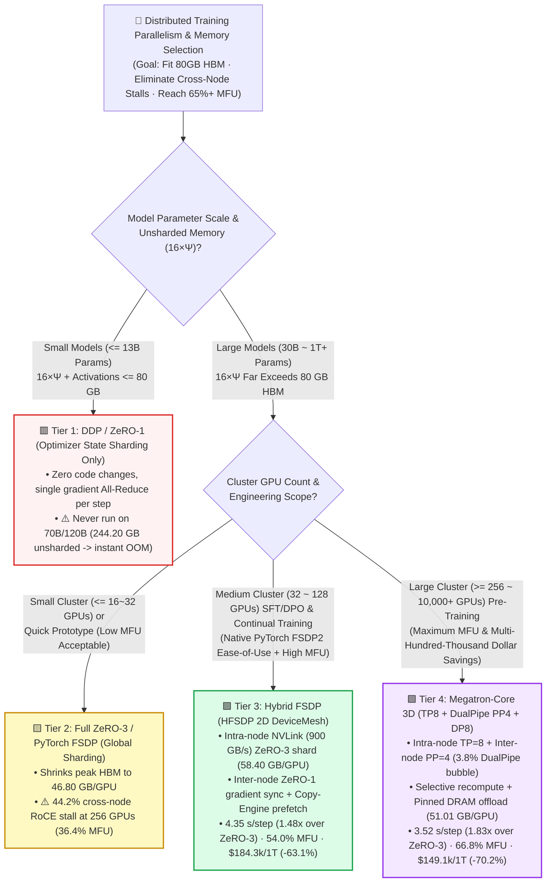
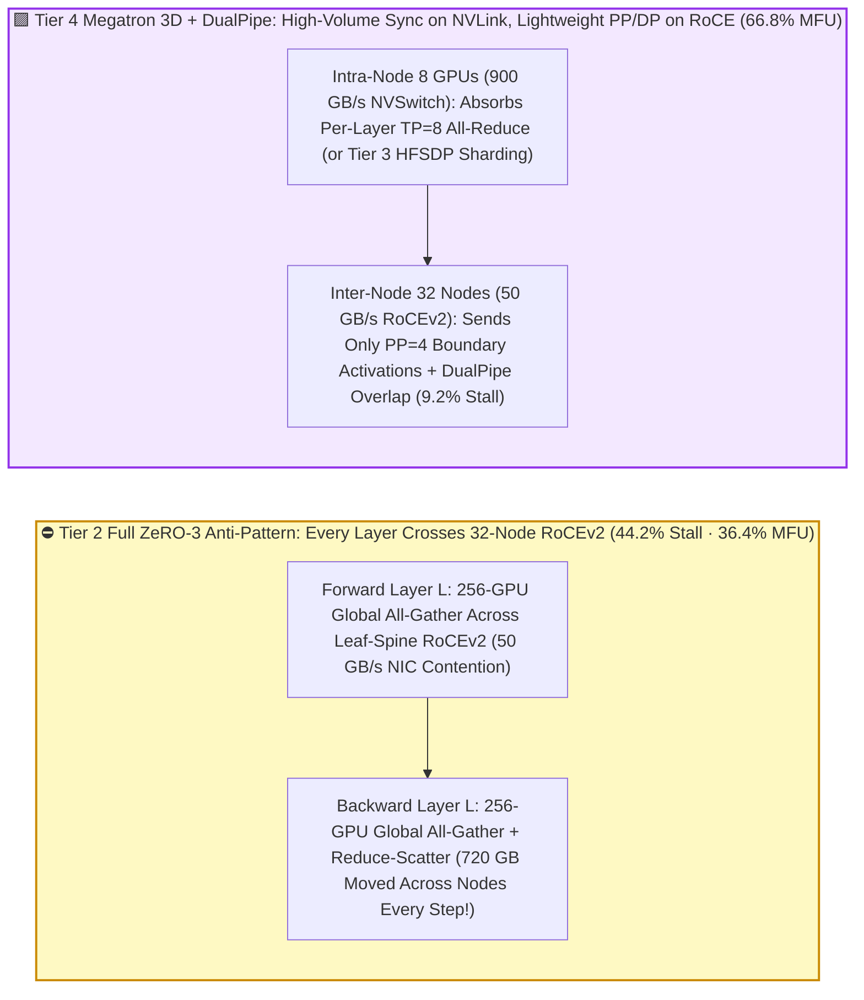
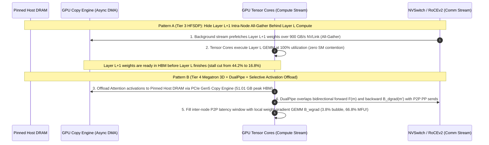

# Large-Scale Distributed Training Parallelism & Memory Optimization Selection FAQ (`DDP / ZeRO-1` vs. `Full ZeRO-3 / FSDP` vs. `Hybrid FSDP (HFSDP)` vs. `Megatron 3D (TP + DualPipe PP + DP) + Selective Activation Offload`)

> 🌐 **Language**: **[中文 (Chinese)](./distributed-training-memory-parallelism-selection-faq.md)** | **English Version** · **[📖 Back to Repository README](../../README.en.md)** · **[📊 2026-11-09 Daily Progress Report](../daily/2026-11-09.md)** · **[🃏 7-Card 4:5 Visual Benchmark Report](../reports/distributed-training-memory-parallelism-selection-cards.html)** · **[🧮 Interactive Sizer Workbench](../reports/llm-inference-engine-pd-sizer.en.html#training-parallelism-sizer)**
>
> **Overview**: A first-principles selection guide for AI Solution Architects. When scaling 70B–120B+ LLM training or fine-tuning across 64 to 1,024 H100/H200/B200 GPUs, engineering teams routinely hit two devastating traps: **(1) running standard `DDP / ZeRO-1`, which immediately triggers `CUDA OOM` on 80GB GPUs due to the `16×Ψ` mixed-precision state rule (`244.20 GB/GPU` unsharded peak for a 120B model); and (2) blindly turning on global 256-GPU `Full ZeRO-3 / FSDP`, which cuts peak HBM to `46.80 GB` but forces every forward and backward layer to execute a 32-node `All-Gather / Reduce-Scatter` over 400G RoCEv2—stalling GPUs for 44.2% of every step and collapsing MFU to `36.4%`**. Grounded in `experiments/distributed_training_parallelism_selection/` (`synthetic` + `anonymized_reported`, `independently_reproduced=false`), this guide establishes the exact decision boundaries across **DDP/ZeRO-1, Full ZeRO-3/FSDP, Hybrid FSDP (HFSDP), and Megatron-Core 3D Parallelism (`TP + DualPipe PP + DP`) + Selective Activation Offload**.


---

## ① 📌 Executive Summary

1. **Four-Tier Selection by Model Size and Cluster Scale (`32 ~ 1,024+ GPUs`)**:
   - On a `256 × NVIDIA H100 80GB` cluster (`32` nodes × `8` GPUs/node, `900 GB/s` intra-node NVLink-4, `400 Gbps` inter-node RoCEv2, `$640.00/hr` cluster cost) training a **`120B` foundation model for `1.0T` tokens (`4M tokens/step` global batch = `238,419` steps)**:
   - 🟥 **Tier 1 (`DDP / ZeRO-1` + PCIe CPU Offload Fallback)**: **Viable only for `<= 13B` models; never run unsharded on 70B/120B**. Unsharded weights and gradients demand **`244.20 GB/GPU` (instant `CUDA OOM` on 80GB HBM)**; falling back to PCIe CPU parameter offload stalls GPUs for **`58.6%`** of every step (`11.80 s/step`, **`28.5%` MFU**, **`$499,885.17` per 1T tokens**).
   - 🟨 **Tier 2 (`Full ZeRO-3 / PyTorch FSDP` Global 256-GPU Sharding)**: **Fit only for `<= 16 ~ 32 GPUs` or extreme context-length fine-tuning; avoid global sharding across 64+ GPUs**. While peak HBM drops to **`46.80 GB/GPU`**, every layer's forward and backward pass executes a 32-node `All-Gather` and `Reduce-Scatter` over `50 GB/s` RoCEv2—leaving **`44.2%`** of step time stalled on the network (`6.45 s/step`, **`36.4%` MFU**, **`$273,254.45` per 1T tokens**).
   - 🟩 **Tier 3 (`Hybrid FSDP (HFSDP)`: Intra-Node NVLink Sharding + Inter-Node Replication + Copy-Engine Prefetch)**: **The sweet spot for `32 ~ 128 GPU` SFT/DPO fine-tuning and continual pre-training**. Confines high-frequency `ZeRO-3` weight `All-Gather` inside the `900 GB/s` NVLink domain (`8–16 GPUs`) and synchronizes gradients across nodes only once per step; holds peak HBM at **`58.40 GB/GPU`**, cuts communication stall to **`16.8%`**, reduces step time to **`4.35 s` (`1.48x` faster than Full ZeRO-3)**, lifts MFU to **`54.0%`**, and cuts 1T-token cost to **`$184,284.55` (`-32.6%` vs ZeRO-3, `-63.1%` vs Tier 1)**.
   - 🟪 **Tier 4 (`Megatron-Core 3D Parallelism (TP=8 Intra-Node + DualPipe PP=4 + ZeRO-1 DP=8)` + Selective Activation Recompute & Pinned Offload)**: **The mandatory standard for `>= 256 ~ 10,000+ GPU` pre-training**. Confines `TP=8` inside NVSwitch, sends only lightweight layer boundary activations across nodes (`PP=4`) with **bidirectional `DualPipe` scheduling (compressing pipeline bubble from `21.4%` to `3.8%`)**, and offloads Attention activations via PCIe Gen5 Copy Engine; achieves **`51.01 GB/GPU`** peak HBM, **`9.2%`** total stall, **`3.52 s` step time (`1.83x` faster than Full ZeRO-3)**, **`66.8%` MFU**, **`1,191,563.6 tok/s`** throughput, and **`$149,120.73` per 1T tokens (saving `$124,133.72 / -45.4%` vs ZeRO-3 and `$350,764.44 / -70.2%` vs Tier 1)**!
2. **First-Principles Law (The `16×Ψ` Memory Ledger & Hierarchy Matching Rule)**:
   - Mixed-precision training (`BF16` compute + `FP32` AdamW master states) requires exactly **$16\Psi$ bytes of static model state** ($2\Psi$ BF16 params + $2\Psi$ BF16 grads + $4\Psi$ FP32 master weights + $8\Psi$ FP32 Adam $m, v$).
   - **Golden Rule of Parallelism Mapping**: Map per-layer high-volume collectives (`TP` or `FSDP All-Gather`) onto `900 ~ 1,800 GB/s` intra-node NVLink, and map point-to-point activation handoffs (`PP`) or once-per-step gradient reductions (`DP`) onto `50 ~ 100 GB/s` inter-node RoCEv2/IB.
3. **Provenance & Transparency Disclosure**:
   - All memory footprints, step times, MFU percentages, and 1T-token costs are bound 1:1 to `experiments/distributed_training_parallelism_selection/results.json` (`provenance_type: "synthetic"`, calibrated to published PyTorch FSDP2/TorchTitan HFSDP, Megatron-Core DualPipe, and DeepSpeed ZeRO specifications; `independently_reproduced: false`, `physical_gpu_cluster_measurement: "not_measured"`, `local_cpu_harness_measurement: "measured"`).

---

## ② 🎯 Architect & Customer Deep-Dive Q&A (FAQ-Driven)

### Q1: "A 70B/120B model takes only 2 bytes per parameter in inference. Why does training immediately blow past 80GB HBM (`244.20 GB/GPU` on 120B) when running standard DDP or ZeRO-1?"

- **Plain-English Answer**: **Inference stores only `2 bytes/param` of read-only weights, whereas mixed-precision training stores `16 bytes/param` of static model states (an 8x multiplier!) plus tens of gigabytes of forward activations**. For a 120B model, static states alone consume **`1,920 GB`**!
- **First-Principles Breakdown (The Four Components of Training Memory)**:
  1. **BF16 Parameters ($2\Psi$)**: `240 GB` for 120B.
  2. **BF16 Gradients ($2\Psi$)**: `240 GB` for 120B.
  3. **FP32 Optimizer States ($12\Psi$, the 75% Memory Hog)**: To prevent small weight updates from underflowing to zero in BF16, AdamW maintains **FP32 Master Weights ($4\Psi$)**, **FP32 First Moment $m$ ($4\Psi$)**, and **FP32 Second Moment $v$ ($4\Psi$)**—totaling `1,440 GB` for 120B.
  4. **Forward Activations**: Intermediate tensors retained between the forward and backward passes. Even after sharding optimizer states (`ZeRO-1`), unsharded weights + gradients + activations reach **`244.20 GB/GPU`**, guaranteeing an instant `CUDA OOM` on 80GB H100 GPUs.

### Q2: If `Full ZeRO-3 / FSDP` shards everything across 256 GPUs (`46.80 GB/GPU`), why is it **1.48x slower** than `Hybrid FSDP (HFSDP)` and **1.83x slower** than `Megatron 3D`?

- **Plain-English Answer**: **`Full ZeRO-3` trades network bandwidth for HBM capacity. Across 32 nodes (256 GPUs), every single Transformer layer must reconstruct its full weights over `50 GB/s` cross-node RoCEv2 twice per step (forward + backward) and scatter gradients once—leaving GPUs stalled on the network for 44.2% of every step!**
- **First-Principles Breakdown (Global `ZeRO-3` Network Storm vs. `HFSDP` Hierarchical Sharding)**:
  1. **$3\times$ Model Weight Movement Every Step**: Global `ZeRO-3` executes a 256-GPU `All-Gather` before every forward layer, another 256-GPU `All-Gather` before every backward layer, and a 256-GPU `Reduce-Scatter` for gradients—moving $6\Psi$ (`720 GB` for 120B) across the inter-node fabric every single step.
  2. **How `Hybrid FSDP (HFSDP, Tier 3)` Solves This**: Using PyTorch FSDP2's 2D `DeviceMesh (dp_replicate, dp_shard)`, `HFSDP` restricts `ZeRO-3` weight sharding to the intra-node `900 GB/s` NVLink domain (`8–16 GPUs`, keeping peak HBM at **`58.40 GB/GPU`**) and performs only once-per-step gradient reduction across nodes. Paired with Copy-Engine async prefetch, stall drops from `44.2%` to **`16.8%`** and MFU jumps from `36.4%` to **`54.0%`**.

### Q3: When must we move from `HFSDP` to `Megatron-Core 3D Parallelism (TP + DualPipe PP + DP)`, and how do `DualPipe` and Selective Activation Offload achieve **66.8% MFU**?

- **Plain-English Answer**: **For foundation pre-training on `>= 256 GPUs` with `>= 70B` models, `Megatron 3D Parallelism (Tier 4)` is mandatory because Pipeline Parallelism (`PP`) sends only megabytes of boundary activations across nodes instead of hundreds of gigabytes of weights, while `DualPipe` shrinks pipeline bubbles to `3.8%`**.
- **First-Principles Breakdown**:
  1. **Intra-Node `TP=8` + Inter-Node `PP=4` + `DP=8`**: Keeps all heavy tensor slicing inside the `900 GB/s` NVSwitch box while passing tiny activation tensors point-to-point between pipeline stages.
  2. **`DualPipe` Bidirectional Pipeline Overlap**: Standard 1F1B pipelines suffer a `15%~25%` startup/drain bubble. `DualPipe` feeds micro-batches from both ends of the pipeline simultaneously and splits backward activation gradients (`dgrad`) from weight gradients (`wgrad`), using local `wgrad` GEMMs to hide inter-node P2P communication—cutting the pipeline bubble to **`3.8%`** and total stall to **`9.2%`**.
  3. **Selective Activation Recompute + Pinned Host Offload**: Recomputes only memory-heavy, FLOP-light operations (`Softmax / Dropout / SiLU`) while streaming `Attention` activations to Pinned Host DRAM over the idle PCIe Gen5 Copy Engine—holding peak HBM at **`51.01 GB/GPU`** and reaching **`66.8%` MFU (`3.52 s/step`, `$149,120.73` per 1T tokens)**.

---

## ③ 🧭 Visual Architecture Diagrams (Decision Tree, Fabric Alignment & Overlap Sequence)

### 3.1 Distributed Training Parallelism & Memory Optimization Decision Tree



### 3.2 Full `ZeRO-3` Cross-Node Storm vs. `Tier 3 HFSDP` / `Tier 4 Megatron 3D` Bandwidth Alignment



### 3.3 End-to-End Overlap Sequence: `HFSDP Copy-Engine Prefetch` & `Megatron DualPipe` (`sequenceDiagram`)



---

## ④ 📊 Architect Decision Matrix

*All metrics are bound 1:1 to `experiments/distributed_training_parallelism_selection/results.json` (256×H100 80GB cluster at `$640.00/hr`, training a `120B` model for `1.0T` tokens at `4M tokens/step`):*

| Dimension | 🟥 Tier 1: `DDP / ZeRO-1` + CPU Offload | 🟨 Tier 2: `Full ZeRO-3 / FSDP` (256-GPU Global) | 🟩 Tier 3: `Hybrid FSDP (HFSDP)` (Intra-Node Shard) | 🟪 Tier 4: `Megatron 3D` (`TP8+DualPipe PP4+DP8`) |
| :--- | :--- | :--- | :--- | :--- |
| **Primary Workload Fit** | `<= 13B` small models (`244.20 GB` OOM on 120B) | `<= 16~32 GPUs` or extreme-memory prototyping | **`32 ~ 128 GPUs` SFT/DPO & continual pre-training** | **`>= 256 ~ 10,000+ GPUs` foundation pre-training** |
| **Peak HBM per GPU** | **`244.20 GB`** unsharded (OOM ✕; `76.50 GB` w/ CPU offload) | **`46.80 GB`** (✅ Lowest HBM footprint) | **`58.40 GB`** (✅ Fits 80GB HBM comfortably) | **`51.01 GB`** (✅ Selective recompute + offload) |
| **Inter-Node Traffic Pattern** | PCIe CPU thrashing + gradient All-Reduce | **Per-layer 32-node RoCE `All-Gather` & `Reduce-Scatter`** | Intra-node NVLink `All-Gather`; 1 gradient sync/step | **Lightweight `PP=4` boundary activations + `DualPipe`** |
| **Comm & Bubble Stall Share** | **`58.6%`** (stalled on PCIe & recompute) | **`44.2%`** (stalled on cross-node RoCE NICs) | **`16.8%`** (hidden by Copy-Engine prefetch) | **`9.2%`** (`3.8%` DualPipe bubble) |
| **Step Time / Cluster Throughput** | `11.80 s` · `355,449.5 tok/s` (`1.00x`) | `6.45 s` · `650,279.7 tok/s` (`1.83x`) | `4.35 s` · **`964,207.8 tok/s` (`2.71x`)** | **`3.52 s`** · **`1,191,563.6 tok/s` (`3.35x`)** |
| **Effective `MFU` / Cost per 1T Tokens** | `28.5%` · **`$499,885.17`** | `36.4%` · `$273,254.45` (`-45.3%`) | **`54.0%`** · **`$184,284.55` (`-63.1%`)** | **`66.8%`** · **`$149,120.73` (`-70.2%` / `-45.4%` vs ZeRO-3)** |

---

## ⑤ 🧪 Quantitative Case Study & Benchmark Insights

### 5.1 Cluster Scaling Sensitivity (`32 -> 1,024 GPUs`) & The Full ZeRO-3 MFU Collapse

As the training cluster scales from 32 GPUs (4 nodes) to 1,024 GPUs (128 nodes), effective MFU evolves as follows (from `results.json` `cluster_scale_sensitivity`):

| Cluster Scale (`Cluster GPUs`) | Tier 1 `DDP+CPU Offload` MFU | Tier 2 `Full ZeRO-3` MFU | Tier 3 `Hybrid FSDP (HFSDP)` MFU | Tier 4 `Megatron 3D DualPipe` MFU | Architect Crossover & Takeaway |
| :--- | :--- | :--- | :--- | :--- | :--- |
| **`32 GPUs`** (4 Nodes) | `42.0%` | `51.5%` | **`58.2%`** | **`64.0%`** | `HFSDP` delivers `58.2%` MFU with native PyTorch FSDP2 simplicity |
| **`64 GPUs`** (8 Nodes) | `35.0%` | `46.8%` | **`56.8%`** | **`65.5%`** | `Full ZeRO-3` drops below 47% as cross-node RoCE contention grows |
| **`256 GPUs`** (**32-Node Baseline**) | `28.5%` | `36.4%` | **`54.0%`** | **`66.8%`** | **`Megatron 3D` beats `Full ZeRO-3` by `1.83x` (`66.8%` vs `36.4%` MFU)** |
| **`1,024 GPUs`** (128 Nodes) | `19.0%` | `24.5%` | `47.2%` | **`64.2%`** | `Full ZeRO-3` collapses to `24.5%`; `Megatron 3D` holds **`64.2%` MFU** |

### 5.2 Reproducibility & Local Harness Verification

```bash
# Verify results.json matches the deterministic distributed training parallelism model 100%
python experiments/distributed_training_parallelism_selection/run.py --check

# Run Round 16 unit tests
python -m unittest tests/test_distributed_training_parallelism_selection.py
```

---

## ⑥ 🛠️ Production Verification Checklist (Architect Checklist)

1. - [ ] **Budget Peak HBM Below `80%~85%` (`<= 66 GB` on 80GB H100)**: Compute static memory via $16\Psi / N_{\text{shard}}$ plus activation footprint before launch to prevent `cudaMallocAsync` allocator defragmentation stalls.
2. - [ ] **Replace Global `FULL_SHARD` with `HYBRID_SHARD` on `>= 64 GPUs`**: Configure a 2D `DeviceMesh (dp_replicate, dp_shard)` in PyTorch FSDP2 / TorchTitan so `ZeRO-3` weight `All-Gather` stays strictly within the `8–16 GPU` NVLink domain.
3. - [ ] **Enable Copy-Engine Prefetch & Communication Overlap**: Enable `backward_prefetch=BACKWARD_PRE` and `limit_all_gathers=True` in FSDP2, or `--overlap-grad-reduce` and `--overlap-param-gather` in Megatron-Core.
4. - [ ] **Use Selective Activation Recomputation Instead of Full Recomputation**: Recompute only high-memory, low-FLOP ops (`Softmax / Dropout / SiLU`) and offload Attention activations to Pinned Host DRAM rather than paying a `+33%` full-layer recompute tax.
5. - [ ] **Enable `DualPipe / Interleaved 1F1B` with Split `dgrad / wgrad` on `PP >= 4`**: Overlap inter-node pipeline P2P transfers with local weight-gradient (`wgrad`) GEMMs to keep pipeline bubbles below `5%`.
