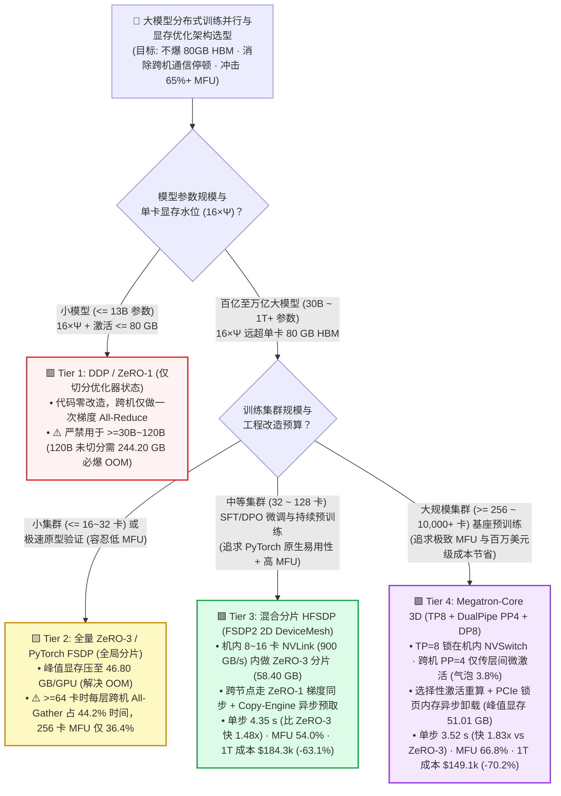
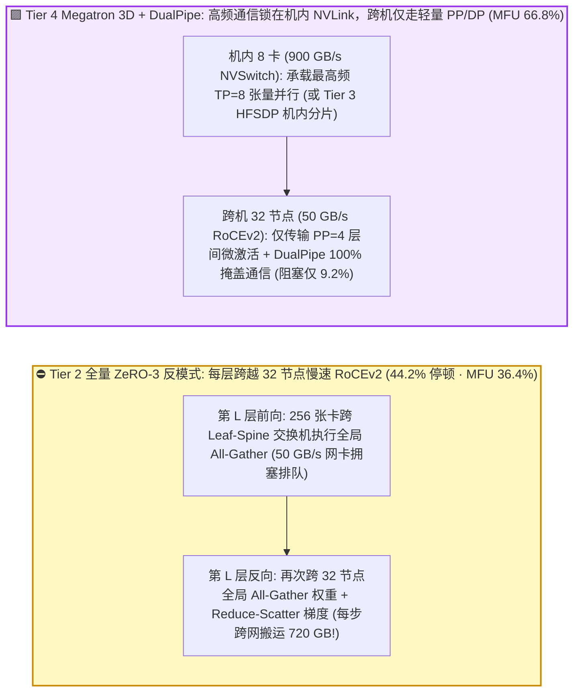
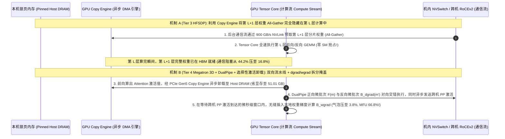

# 百亿至万亿参数大模型分布式训练并行与显存优化架构选型指南（`DDP / ZeRO-1` vs. `全量 ZeRO-3 / FSDP` vs. `混合分片 HFSDP` vs. `Megatron 3D (TP + DualPipe PP + DP) + 选择性激活卸载`）

> 🌐 **Language**: **中文 (Chinese)** | **[English Version](./distributed-training-memory-parallelism-selection-faq.en.md)** · **[📖 返回仓库根目录 README](../../README.md)** · **[📊 2026-11-09 每日进展日报](../daily/2026-11-09.md)** · **[🃏 7-Card 4:5 视觉评测报告](../reports/distributed-training-memory-parallelism-selection-cards.html)** · **[🧮 交互式定容工作台](../reports/llm-inference-engine-pd-sizer.html#training-parallelism-sizer)**
>
> **导读**：面向 AI Solution Architect 的第一性原理实战选型指南。当企业使用 64 至 1,024 张 H100/H200/B200 GPU 训练或微调 70B～120B+ 大模型时，研发团队最常踩中的两个深坑是：**① 直接套用单机时代的 `DDP / ZeRO-1`，结果因为 `16×Ψ` 混合精度显存定律（120B 模型未切分时单卡峰值需 `244.20 GB`）瞬间触发 `CUDA OOM`；② 为了解决 OOM 一键开启跨全集群 256 卡的 `Full ZeRO-3 / FSDP`，结果显存虽然降到了 `46.80 GB`，但每一层前向和反向都被迫在跨机 400G RoCE 网络上执行全局 `All-Gather / Reduce-Scatter`，导致 44.2% 的时间卡死在网卡上，集群有效算力利用率（MFU）暴跌至 `36.4%`**。本文基于 `experiments/distributed_training_parallelism_selection/` 封存的确定性模型（`synthetic` + `anonymized_reported`，`independently_reproduced=false`），系统拆解从 **DDP/ZeRO-1、全量 ZeRO-3/FSDP、混合分片 HFSDP** 到 **Megatron-Core 3D 并行（`TP + DualPipe PP + DP`）+ 选择性激活重算卸载** 的四档架构选型边界。


---

## ① 📌 核心结论速览（Executive Summary）

1. **按模型参数规模与集群卡数（`32 ~ 1,024+ GPUs`）四档精准选型**：
   - 在 `256 × NVIDIA H100 80GB` 集群（`32` 节点 × `8` 卡/节点，机内 `900 GB/s` NVLink-4，机间 `400 Gbps` RoCEv2，集群成本 `$640.00/hr`）训练 **`120B` 大模型 `1.0T (1 万亿)` Tokens（全局 Batch `4M tokens/step`，共 `238,419` 步）** 基准下：
   - 🟥 **Tier 1（`DDP / ZeRO-1` + PCIe CPU 卸载兜底）**：**仅适用于 `<= 13B` 小模型；在 70B/120B 模型上严禁裸跑**。未切分权重与梯度时单卡峰值显存高达 **`244.20 GB`（直接撑爆 `80 GB` HBM 触发 OOM）**；若强行开启 PCIe CPU 参数卸载兜底，通信与阻塞占比高达 **`58.6%`**，单步耗时 **`11.80 s`**，MFU 跌至 **`28.5%`**，训练 1T Tokens 成本高达 **`$499,885.17`**。
   - 🟨 **Tier 2（全量 `ZeRO-3 / PyTorch FSDP` 全局 256 卡跨节点分片）**：**仅适合单机/双机（`<= 16 ~ 32 卡`）或显存极度受限的超长序列微调，严禁在百卡以上集群无脑全网开启**。虽然将单卡峰值显存压至 **`46.80 GB`**，但因每层前向/反向都需跨 32 台服务器执行 256 卡 `All-Gather` 与 `Reduce-Scatter`，**`44.2%` 的时间卡在跨机 RoCE 网卡上**，单步耗时 **`6.45 s`**，MFU 仅 **`36.4%`**，1T Tokens 成本 **`$273,254.45`**。
   - 🟩 **Tier 3（`Hybrid FSDP (HFSDP)` 节点内 NVLink 分片 + 跨节点副本 + Copy-Engine 异步预取）**：**`<= 64 ~ 128 卡` 中大规模微调（SFT/DPO）与持续预训练的性价比首选**。将高频权重分片与 `All-Gather` 严格限制在机内/相邻双机的 `900 GB/s` NVLink 高速域内，跨节点仅在每个 Step 结束时同步一次梯度；单卡峰值显存 **`58.40 GB`（安全装入 80GB）**，通信阻塞骤降至 **`16.8%`**，单步压缩至 **`4.35 s`（比全量 ZeRO-3 快 `1.48x`）**，MFU 跃升至 **`54.0%`**，1T Tokens 成本降至 **`$184,284.55`（比 ZeRO-3 省 `32.6%`，比 Tier 1 省 `63.1%`）**。
   - 🟪 **Tier 4（`Megatron-Core 3D 并行 (TP=8 机内 + DualPipe PP=4 跨机 + ZeRO-1 DP=8)` + 选择性激活重算与锁页内存卸载）**：**`>= 256 ~ 10,000+ 卡` 百亿至万亿参数预训练的唯一黄金标准**。让最重度的 `TP=8` 跑在机内 NVSwitch，跨节点仅传输极小尺寸的流水线层间激活张量（`PP=4`），并通过 **`DualPipe` 双向微批次流水线将 PP 气泡从 `21.4%` 压至 `3.8%`**；峰值显存 **`51.01 GB`**，总通信与气泡阻塞仅 **`9.2%`**，单步仅需 **`3.52 s`（比全量 ZeRO-3 快 `1.83x`）**，MFU 高达 **`66.8%`**，集群吞吐达 **`1,191,563.6 tok/s`**，1T Tokens 成本降至 **`$149,120.73`（立省 `$124,133.72 / -45.4%` vs ZeRO-3，立省 `$350,764.44 / -70.2%` vs Tier 1）**！
2. **第一性原理定性（混合精度训练的 `16×Ψ` 显存账本与通信层级匹配铁律）**：
   - 任何参数量为 $\Psi$ 的大模型在混合精度（BF16 + FP32 AdamW）训练时，静态显存底盘固定为 **$16\Psi$ 字节**（BF16 参数 $2\Psi$ + BF16 梯度 $2\Psi$ + FP32 主权重 $4\Psi$ + FP32 一阶/二阶动量 $m, v$ 各 $4\Psi$）。
   - **分布式并行设计的唯一铁律**：把“每层触发的高频大流量同步（`TP` 或 `FSDP All-Gather`）”锁死在 `900 ~ 1,800 GB/s` 的机内 NVLink，把“点对点微张量传输（`PP`）或每步一次的梯度归约（`DP`）”放在 `50 ~ 100 GB/s` 的跨机 RoCE/IB 网络！
3. **证据口径与透明性声明**：
   - 本指南所有显存账本、单步耗时、MFU 与 1T Token 成本均绑定 `experiments/distributed_training_parallelism_selection/results.json`（`provenance_type: "synthetic"`，基于 PyTorch FSDP2/TorchTitan HFSDP、Megatron-Core DualPipe 及 DeepSpeed ZeRO 公开规范校准的确定性算例，`independently_reproduced: false`，未在物理 256×H100 集群执行完整 1T Token 实机训练 `physical_gpu_cluster_measurement: "not_measured"`；本机 Python 单测与校验为 `local_cpu_harness_measurement: "measured"`）。

---

## ② 🎯 客户与架构师灵魂拷问 Q&A（FAQ-Driven）

### Q1：客户问：“70B 模型做推理明明只需要 140 GB 显存（2 张 80GB H100 就够了），为什么一做训练/微调，连 8 张 H100（640 GB 显存）跑 DDP 都会直接报 `CUDA Out of Memory`？”

- **直白结论**：**因为推理只需要存 `2 字节/参数` 的权重，而混合精度训练每个参数必须存储 `16 字节` 的静态模型状态（膨胀 8 倍！）再加上数十 GB 的前向激活值（Activations）**。以 `120B` 模型为例，光静态模型状态就高达 **`1,920 GB`**，不切分权重与梯度根本不可能塞进单张 80GB 显存！
- **第一性原理拆解（训练显存四大金刚：$16\Psi$ 静态账本 + 动态激活值）**：
  1. **BF16 模型权重（Parameters，$2\Psi$）**：用于前向和反向矩阵乘法计算，120B 模型占 `240 GB`。
  2. **BF16 梯度（Gradients，$2\Psi$）**：反向传播求导产生，占 `240 GB`。
  3. **FP32 优化器状态（Optimizer States，$12\Psi$，显存头号吞金兽！）**：为了防止微小梯度在 BF16 下发生下溢归零（Underflow），AdamW 优化器必须在显存中维护一份 **FP32 主权重副本（Master Weights，$4\Psi$）**、一份 **FP32 一阶动量（Momentum $m$，$4\Psi$）** 和一份 **FP32 二阶方差（Variance $v$，$4\Psi$）**——合计 $12\Psi$，在 120B 模型上高达 **`1,440 GB`（占静态显存的 75%）**！
  4. **前向激活值（Activations）**：前向传播算出的中间张量必须保留在显存中等待反向传播求导。即使开启重算与切分，120B 在 `Tier 1 (ZeRO-1)` 下单卡仍需承载完整权重 + 梯度 + 分片优化器 + 激活共计 **`244.20 GB/GPU`**，在 80GB H100 上必爆 OOM！

### Q2：既然 `ZeRO-3 / PyTorch FSDP` 能把权重、梯度、优化器全部除以 256 张卡（单卡仅需 `46.80 GB`），为什么在 256 卡集群上直接用全量 `ZeRO-3` 会比 `HFSDP` 慢 **1.48 倍**、比 `Megatron 3D` 慢 **1.83 倍**？

- **直白结论**：**全量 `ZeRO-3 / FSDP` 是典型的“用跨节点网络带宽换显存”——当卡数从 8 卡扩到 256 卡甚至 1,024 卡时，每一层前向和反向都要在慢速跨机网络上临时拼装完整权重，导致 GPU 一半以上的时间在等网卡！**
- **第一性原理拆解（Full ZeRO-3 的跨节点通信风暴 vs. `HFSDP` 的分层解法）**：
  1. **全量 `ZeRO-3` 每步要搬运 $3\times$ 整个模型权重**：在 `ZeRO-3 / FSDP` 中，每张卡平时只保留 $1/256$ 的权重碎片。当算到第 $L$ 层前向时，必须向全网 256 张卡发起 **`All-Gather`** 拼出完整第 $L$ 层权重，算完立刻丢弃；反向传播算到第 $L$ 层时，又要再发起一次 **`All-Gather`** 拼出权重，算完梯度后再发起一次 **`Reduce-Scatter`** 聚合梯度——整步通信量高达 $3 \times 2\Psi = 6\Psi$（120B 模型每步需跨网搬运 `720 GB`）！
  2. **跨节点 RoCE 网卡掩盖不住计算**：在单机 8 卡内，`900 GB/s` 的 NVLink 可以用后台流轻松把第 $L+1$ 层的 `All-Gather` 隐藏在第 $L$ 层的矩阵计算背后；但一旦跨出机箱走到 `50 GB/s`（400 Gbps）的 RoCEv2 网卡，通信耗时暴涨，在 256 卡下 **`44.2%` 的训练时间裸露为通信停顿**（1,024 卡下 MFU 更跌至 **`24.5%`**）。
  3. **`Hybrid FSDP (HFSDP，Tier 3)` 如何兼得易用性与高 MFU？** `PyTorch FSDP2` 原生支持二维 DeviceMesh `(Replicate_Inter_Node, Shard_Intra_Node)`：只在 `8~16` 卡高速 NVLink 域内执行 `ZeRO-3` 全分片（将 244.2 GB 压至 **`58.40 GB/GPU`**），而在跨节点维度退化为 `ZeRO-1 / DDP`，结合 **CUDA Copy Engine 异步预取（Async Prefetch）**，将通信停顿从 `44.2%` 砍至 **`16.8%`**，无需复杂的模型层改造即可将 MFU 从 `36.4%` 拉升至 **`54.0%`**！

### Q3：什么时候必须放弃纯 FSDP，升级到 `Megatron-Core 3D 并行（TP + PP + DP）`？什么是流水线气泡（Pipeline Bubble），`DualPipe` 与“选择性激活重算”是如何把 MFU 推上 **66.8%** 的？

- **直白结论**：**当模型规模 `>= 70B` 且集群规模 `>= 256 GPUs` 开展长周期预训练时，必须采用 `Megatron-Core 3D 并行（Tier 4）`——因为它跨节点只传几 MB 的层间激活值（而非几百 GB 的模型权重），且通过 `DualPipe` 与选择性激活卸载将通信与气泡损耗压到了极致（`9.2%`）！**
- **第一性原理拆解（`3D 并行 + DualPipe + 选择性激活重算` 三大杀手锏）**：
  1. **跨节点流水线并行（`PP=4`）通信量比 `ZeRO-3` 小两个数量级**：将 80 层模型按层切分为 4 个 Stage（每个节点负责 20 层），节点与节点之间只需点对点发送上一层输出的激活张量（几 MB），完全不需要跨机广播百 GB 权重！
  2. **从传统 `1F1B` 到 `DualPipe` 双向流水线（消灭 `21.4% -> 3.8%` 气泡）**：传统流水线并行在启动和收尾阶段存在大量空闲等待（Pipeline Bubble $\approx (P-1)/M$，高达 `15%~25%`）。现代 Megatron-Core 1F1B Interleaved 与 DeepSeek **`DualPipe`** 从流水线两端同时双向注入微批次（Micro-batches），并将细粒度前向与反向权重梯度计算（`wgrad`）拆开与跨机通信 100% 重叠，将流水线空泡压至 **`3.8%`**。
  3. **选择性激活重算（Selective Activation Recomputation）+ 锁页内存卸载**：不再粗暴地把整层 Transformer 丢弃重算（会白白增加 `+33%` 计算量），而是**只重算“显存极大但计算极快”的 `Softmax / Dropout / SiLU` 激活**，并利用空闲的 PCIe Gen5 Copy Engine 将 `QKV / Attention` 激活异步卸载至本机锁页内存，使单卡显存稳锁在 **`51.01 GB`**，MFU 达到惊人的 **`66.8%`（单步 `3.52 s`，1T Token 净省 `$124,134` vs ZeRO-3）**！

---

## ③ 🧭 直观可视化图解（选型决策树 + 通信域映射对比 + 3D DualPipe 重叠时序图）

### 3.1 大模型分布式训练并行与显存优化架构选型决策树



### 3.2 全量 `ZeRO-3` 跨节点通信风暴 vs. `Tier 3 HFSDP` / `Tier 4 Megatron 3D` 物理带宽对齐图



### 3.3 `HFSDP Copy-Engine 异步预取` 与 `Megatron DualPipe` 计算通信重叠时序图（`sequenceDiagram`）



---

## ④ 📊 架构师选型决策矩阵（Architect Decision Matrix）

*数据完全绑定 `experiments/distributed_training_parallelism_selection/results.json`（256×H100 80GB 集群，`$640.00/hr`，训练 `120B` 模型 `1.0T` Tokens，全局 Batch `4M tokens/step`）：*

| 选型维度 | 🟥 Tier 1：`DDP / ZeRO-1` + CPU 卸载兜底 | 🟨 Tier 2：全量 `ZeRO-3 / FSDP`（256 卡全局分片） | 🟩 Tier 3：混合分片 `HFSDP`（机内分片 + 跨机副本） | 🟪 Tier 4：`Megatron 3D`（`TP8+DualPipe PP4+DP8`） |
| :--- | :--- | :--- | :--- | :--- |
| **核心适用场景** | 仅限 `<= 13B` 小模型（120B 裸跑必爆 OOM） | `<= 16~32 卡` 小集群或超长上下文极限省显存微调 | **`32 ~ 128 卡` 大模型微调（SFT/DPO）与持续预训练首选** | **`>= 256 ~ 10,000+ 卡` 百亿/万亿基座预训练终局标准** |
| **单卡峰值 HBM 显存占用** | 未切分需 **`244.20 GB`**（OOM ✕；CPU 卸载后 `76.50 GB`） | **`46.80 GB`**（✅ 显存最省） | **`58.40 GB`**（✅ 安全装入 80GB HBM） | **`51.01 GB`**（✅ 配合选择性激活重算/卸载） |
| **跨节点每步通信机制** | PCIe CPU 频繁换入换出 + 梯度 All-Reduce | **每层前向/反向跨 32 节点 RoCE 全局 `All-Gather/RS`** | 机内 NVLink `All-Gather`，跨机仅每步 1 次梯度同步 | **跨机仅传 `PP=4` 层间微激活 + `DualPipe` 双向掩盖** |
| **通信与流水线阻塞占比** | **`58.6%`**（严重卡死在 PCIe 与重算） | **`44.2%`**（严重卡死在跨机 RoCE 网卡） | **`16.8%`**（Copy-Engine 异步预取掩盖） | **`9.2%`**（PP 气泡仅 `3.8%`） |
| **单步耗时 / 集群总吞吐** | `11.80 s` · `355,449.5 tok/s` (`1.00x`) | `6.45 s` · `650,279.7 tok/s` (`1.83x`) | `4.35 s` · **`964,207.8 tok/s` (`2.71x`)** | **`3.52 s`** · **`1,191,563.6 tok/s` (`3.35x`)** |
| **有效算力利用率 (`MFU`) / 1T Token 总成本** | `28.5%` · **`$499,885.17`** | `36.4%` · `$273,254.45` (`-45.3%`) | **`54.0%`** · **`$184,284.55` (`-63.1%`)** | **`66.8%`** · **`$149,120.73` (`-70.2%` / 比 ZeRO-3 省 `45.4%`)** |

---

## ⑤ 🧪 简明定量算例与 Benchmark 洞察

### 5.1 集群规模从 `32 卡 -> 1,024 卡` 扩展下的 MFU 衰减曲线与架构分水岭

当训练集群从 4 台服务器（32 卡）扩展到 128 台服务器（1,024 卡）时，四档并行策略的 MFU 表现如下（源自 `results.json` `cluster_scale_sensitivity`）：

| 训练集群规模 (`Cluster GPUs`) | Tier 1 `DDP+CPU Offload` MFU | Tier 2 `Full ZeRO-3` MFU | Tier 3 `Hybrid FSDP (HFSDP)` MFU | Tier 4 `Megatron 3D DualPipe` MFU | 架构师核心拐点解读 |
| :--- | :--- | :--- | :--- | :--- | :--- |
| **`32 GPUs`**（4 节点微调） | `42.0%` | `51.5%` | **`58.2%`** | **`64.0%`** | 32 卡内 `HFSDP` 兼顾零侵入代码改造与 `58.2%` 高 MFU，性价比极佳 |
| **`64 GPUs`**（8 节点中小训练） | `35.0%` | `46.8%` | **`56.8%`** | **`65.5%`** | `Full ZeRO-3` 跨机通信开始抬头（跌破 47%），`HFSDP` 稳守 `56.8%` |
| **`256 GPUs`**（**32 节点主力基线**） | `28.5%` | `36.4%` | **`54.0%`** | **`66.8%`** | **`Full ZeRO-3` 暴跌至 `36.4%`；`Megatron 3D` 反超 ZeRO-3 达 `1.83x`！** |
| **`1,024 GPUs`**（128 节点千卡预训练） | `19.0%` | `24.5%` | `47.2%` | **`64.2%`** | 千卡规模下 `Full ZeRO-3` 彻底崩盘（`24.5%`），唯有 `Megatron 3D` 保持 `64.2%` |

### 5.2 复现命令与本地校验（Local CPU Harness Check）

```bash
# 校验封存算例 JSON 与确定性分布式训练并行模型 100% 一致
python experiments/distributed_training_parallelism_selection/run.py --check

# 运行 Round 16 单元测试
python -m unittest tests/test_distributed_training_parallelism_selection.py
```

---

## ⑥ 🛠️ 附录：生产环境分布式训练并行核验清单（Architect Checklist）

1. - [ ] **开训前静态显存与激活水位精算**：按 $16\Psi / N_{\text{shard}}$ 计算静态状态显存，并将单卡峰值 HBM 水位控制在物理显存的 **`80% ~ 85%`（80GB 卡不超过 `64 ~ 68 GB`）** 以内，预留足够的 `cudaMallocAsync` 内存池防碎片抖动。
2. - [ ] **禁止在 `>= 64 卡` 集群上使用跨全网的默认 `FULL_SHARD (ZeRO-3)`**：在 PyTorch FSDP2 / TorchTitan 中显式配置 `ShardingStrategy.HYBRID_SHARD`（2D DeviceMesh `(dp_replicate, dp_shard)`），将 `dp_shard` 锁死在单机 8 卡或相邻双机 16 卡内。
3. - [ ] **开启异步通信预取与 Copy Engine 重叠**：在 FSDP2 中开启 `backward_prefetch=BackwardPrefetch.BACKWARD_PRE` 与 `limit_all_gathers=True`；在 Megatron-Core 中开启 `--overlap-grad-reduce` 与 `--overlap-param-gather`。
4. - [ ] **用“选择性激活重算（Selective Recompute）”替代粗暴全量重算**：在 Megatron 中优先使用 `--recompute-activations`（仅重算 Attention 核心 Softmax/Dropout）而非 `--recompute-granularity full`，避免平白损失 `25% ~ 33%` 的有效 TFLOPS。
5. - [ ] **流水线并行（PP）开启 `DualPipe / Interleaved 1F1B` 与延时权重梯度（Delayed `wgrad`）**：当 `PP >= 4` 时，将 `B_dgrad`（输入激活梯度）与 `B_wgrad`（参数梯度）解耦，用 `B_wgrad` 填满跨机 P2P 通信等待气泡。
