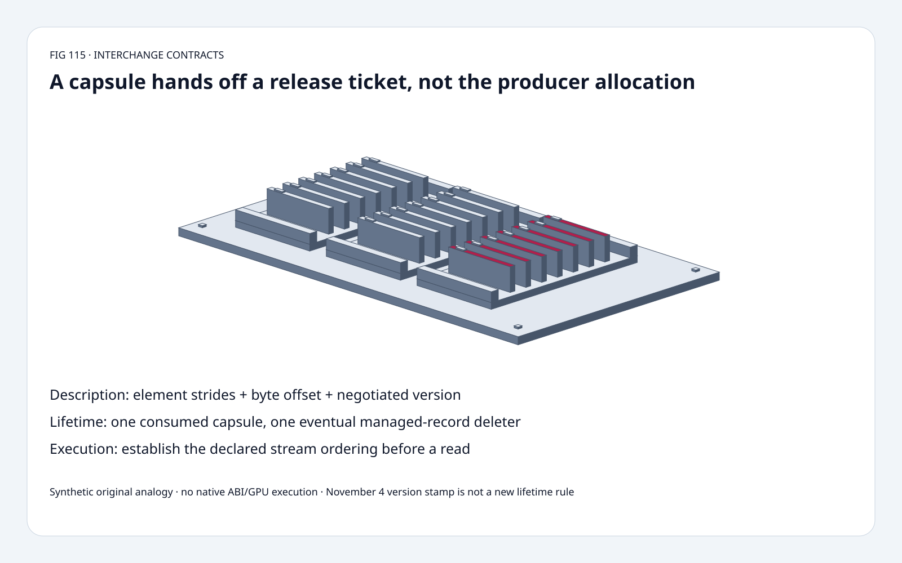
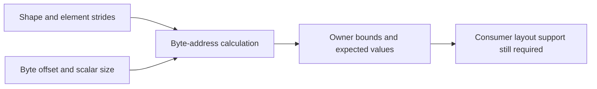
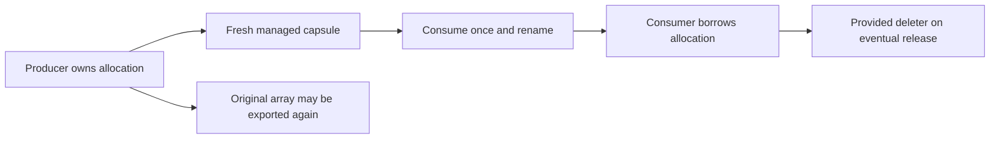
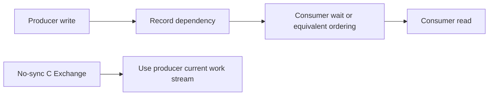

# DLPack FAQ: versioned capsules, element strides, borrowed lifetime and stream order

> **Language**: [中文](dlpack-versioned-capsule-strides-stream-lifetime-selection-faq.md) | English
>
> **Round 115 · 2026-11-14 (night round 24)** · [SVG](../../assets/svg/dlpack-versioned-capsule-strides-stream-lifetime-selection-faq-summary.svg) · [7 cards](../reports/dlpack-versioned-capsule-strides-stream-lifetime-selection-cards.html) · [H5](../reports/dlpack-versioned-capsule-strides-stream-lifetime-sizer.html) · [Report](../../experiments/dlpack_lifetime_stream_selection/report.json)
>
> **Synthetic, `independently_reproduced=false`.** Original descriptor/state/schedule models and separately measured Python buffer operations. No native PyCapsule, DLPack C ABI, framework interoperability, GPU stream or autograd execution.



## 1. Executive summary: zero-copy still needs three independent contracts

The verified **November 4, 2026** DLPack commit changes the minor-version
macro from **1.3 to 1.4 only**. Existing ownership, stream and C Exchange
rules are not newly invented in that release.

This study separates memory description, managed-record lifetime and
execution order. In the original int32 fixture, confusing element
strides with byte strides corrupts **five of six values**. Transferring
a capsule does not transfer the producer's allocation. Removing one
cross-stream wait edge permits a stale read in **one of six enumerated
orderings**, not a measured race probability.

| Contract | Must agree | Does not establish |
| :--- | :--- | :--- |
| Description | Device, version, dtype, shape, element strides, byte offset | Consumer support for every layout/device |
| Lifetime | One-shot capsule and eventual managed-record release | Allocation ownership magically moves |
| Execution | Declared stream context or required dependency | A pointer or capsule establishes synchronization |
| Mutability | Read-only and copy flags | Read-only access is an immutable snapshot |

## 2. Architect Q&A: what crosses the framework boundary?

### Q1: Are DLPack strides measured in bytes?

No. The pinned header defines strides **in elements** and byte_offset
**in bytes**. For byte-addressable scalar data:

`address = base + byte_offset + itemsize * sum(index[d] * stride[d])`.

The original owner has 16 little-endian int32 values, 64 bytes.
Shape `(2,3)`, element strides `(4,1)` and byte offset four give
addresses `[4,8,12,20,24,28]` and values `[1,2,3,5,6,7]`.
Logical payload is **24 bytes**; the addressed span is **28 bytes**.
Reading strides as bytes changes five results even though all resulting
reads remain inside the owner. Bounds-only checking therefore misses it.

The prototype supports byte-addressable scalar widths 1/2/4/8 and
explicit signed strides, including reverse traversal with a valid offset.
It does not implement packed FP4/FP6, dtype enumerations, endian
conversion or device-pointer dereferencing. Address enumeration is
limited to 100,000 scalar entries; H5 accounting does not enumerate
or allocate the selected tensor.

### Q2: Can strides be null for a compact tensor?

Version matters. The pinned header explicitly says that **since 1.2**,
strides cannot be null when `ndim!=0`; the zero-dimensional case may
use null shape/stride pointers. Its older Python-spec paragraph still
describes null strides as compact row-major.

The original model accepts implicit compact strides for version 1.1,
but rejects them for nonzero-dimensional version 1.2+. It models
scalar and empty logical arrays separately. Real empty data pointers
and ABI structures are not instantiated here.

For versioned managed tensors, check **major compatibility before
interpreting the payload**. The header allows a safe deleter call on a
major mismatch while other fields must not be accessed. A minor
mismatch does not automatically make a tensor unusable, but the
consumer still must understand the particular fields and enum values.

### Q3: What does consuming a capsule transfer?

The Python protocol transfers **responsibility for the managed tensor
record** from the capsule to the consumer object, normally renaming
`dltensor_versioned` to `used_dltensor_versioned`. The producer still
owns the backing allocation being borrowed.

The same capsule is consumed once. Re-exporting the original array
can create another capsule; “one-shot” does not forbid using or
exporting that array again.

The original explicit state machine tests capsule-first destruction,
consumer-first destruction, unconsumed release and major-version
rejection. Each invokes the fixture's **provided** deleter once.
The source also permits a null deleter, so this is not a claim that
every native managed tensor necessarily invokes a callback.
No actual Python/C destructor, interpreter-finalization or GIL path
is executed.

### Q4: Does read-only mean a snapshot? Is every exchange guaranteed zero-copy?

No. A read-only consumer handle can forbid writes through that handle
while the producer's alias remains mutable. The original owner
changes from three to nine: the read-only alias observes nine, but
the explicit copied buffer retains three.

The versioned flags distinguish READ_ONLY and IS_COPIED. The pinned
Python specification describes `copy=True/False/None` negotiation;
if a required exchange cannot avoid a copy, `copy=False` is a
constraint to reject, not permission for a hidden copy. Unsupported
devices need explicit handling and may raise `BufferError`.

The prototype demonstrates same-owner aliasing and explicit
bytearray copying only. It does not negotiate native devices,
framework dtype support or autograd graphs. DLPack interchange by
itself is not an autograd bridge.

### Q5: Does capsule handoff establish GPU stream synchronization?

No. For the Python protocol, the consumer supplies the stream it
will use; the producer must arrange the needed synchronization or
wait. When ordering is already guaranteed, additional waits may
be unnecessary.

For the source's **C Exchange no-sync path**, the consumer queries
the producer's current work stream and launches on it. Its temporary
non-owning DLTensor interface guarantees the data/shape/stride
liveness only until control returns. It must not be mistaken for an
arbitrarily retained owning exchange.

The original two-stream partial-order model fixes producer
`write→record` and consumer `wait→read`. Adding `record→wait`
leaves one legal ordering with no stale read. Removing that edge
allows six orderings; one places read before write.
The fraction **1/6 is an enumeration result**, not a scheduler
distribution, GPU race frequency or measured synchronization latency.

### Q6: What does the H5 byte budget mean?

For 1024×768 two-byte elements, pitched row stride 800, offset 64
and selected owner 2,097,152 bytes:

- Logical compact payload: **1,572,864 bytes**.
- Addressed span: **1,638,336 bytes**, including **65,472 bytes** of gaps.
- First address/end: **64 / 1,638,400**; selected retained owner: **2,097,152 bytes**.

These are descriptor arithmetic and selected owner assumptions, not
allocator overhead, actual retained framework storage, RSS or peak HBM.
For empty rows, no address is accessed; first/end outputs remain null.
The calculator selects positive, nonoverlapping pitched rows, while
the independent descriptor tests also cover negative strides.

## 3. Visual architecture: describe, hand off and order separately







## 4. Selection matrix: choose the exchange contract, not just pointer access

| Path | Good fit | Adoption gate |
| :--- | :--- | :--- |
| Python versioned exchange | Ingestion and retained borrowing | Version/name, one-shot record, lifetime and copy negotiation |
| C Exchange managed no-sync | Supported extension integration | API-table compatibility and current stream |
| C Exchange temporary descriptor | Immediate synchronous call scope | Do not retain borrowed shape/strides/data beyond contract |
| Explicit compact copy | Needed independent storage/layout | Explicit copy policy and copied flag |
| Read-only alias | No writes through consumer handle | Producer alias can still change |
| Pointer-only shortcut | Insufficient as a complete interop contract | Description, lifetime and execution order still required |

## 5. Hands-on evidence: independent walks and original CPU buffer timing

```powershell
python -m experiments.dlpack_lifetime_stream_selection.run --check
python -m unittest discover -s tests -p test_dlpack_lifetime_stream_selection.py -q
```

Eight focused tests compare address enumeration with an independent
recursive walk; cover scalar/empty/legacy/reversed layouts, bounds,
byte-stride negative control, release order, one-shot rejection,
major mismatch without payload access, read-only alias versus copy,
independent full-permutation schedule enumeration and Node/Python budgets.

| Selected buffer | Read-only Python view (ms) | Immutable Python copy (ms) |
| :--- | ---: | ---: |
| 4,096 bytes | 0.000164 | 0.000360 |
| 65,536 bytes | 0.000176 | 0.001896 |
| 1,048,576 bytes | 0.000236 | 0.312416 |
| 4,194,304 bytes | 0.000440 | 1.306040 |

Two warmups, seven alternating repeats, 25 constructions per sample,
median repeat means. Previous-path result cleanup occurs outside the
next path's timing; within-path result replacement remains included.
Owner construction and final content checks are excluded.
These are original Python buffer operations, **not DLPack transport,
GPU bandwidth or C Exchange speedup**. No browser visual inspection.

## 6. Sources, provenance and readiness

- [Pinned 1.4 header](https://github.com/dmlc/dlpack/blob/c1954b9becbd37d6c04e705cfb13e09331a9d762/include/dlpack/dlpack.h): element strides, byte offsets, version compatibility, flags and no-sync function-table contracts.
- [Pinned Python specification](https://github.com/dmlc/dlpack/blob/c1954b9becbd37d6c04e705cfb13e09331a9d762/docs/source/python_spec.rst): capsule renaming, borrowing, copy and stream negotiation; distinguish its older null-stride prose.
- [November 4 version edit](https://github.com/dmlc/dlpack/commit/c1954b9becbd37d6c04e705cfb13e09331a9d762): only `DLPACK_MINOR_VERSION 3→4`; no invented new ownership algorithm.
- [Apache-2.0 license](https://github.com/dmlc/dlpack/blob/c1954b9becbd37d6c04e705cfb13e09331a9d762/LICENSE): upstream rights retained.

Original scalar data, Python state machine, schedule enumeration,
budgets, CPU operations and artwork; no upstream implementation copied.
Native DLPack latency, GPU synchronization latency, peak memory and
model quality remain null. Source API inspection is not independent
native failure/fix reproduction.
