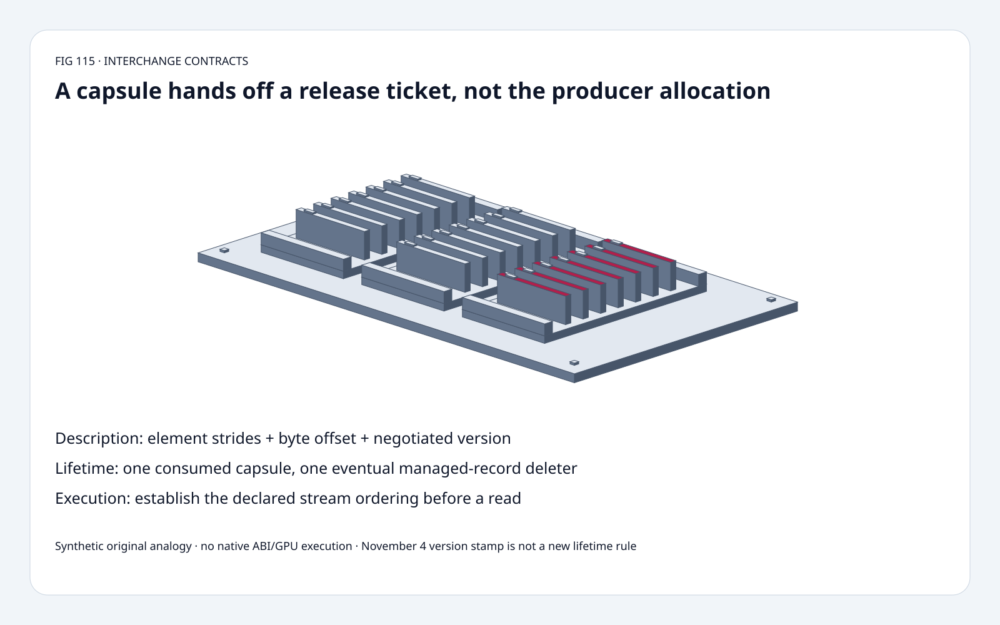
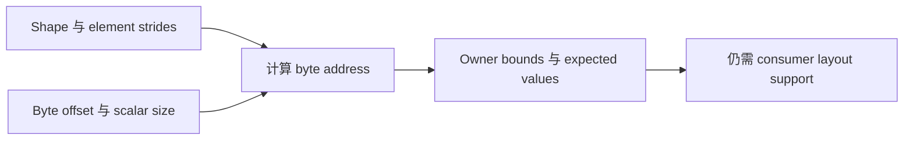
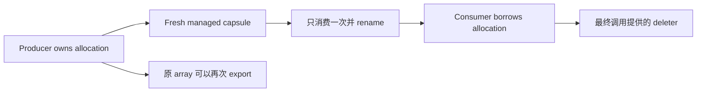
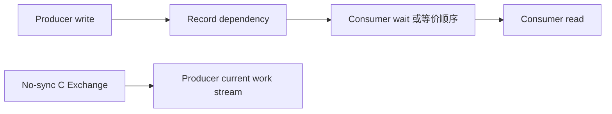

# DLPack FAQ：Versioned Capsule、Element Strides、借用生命周期与 Stream 顺序

> **语言**：中文 | [English](dlpack-versioned-capsule-strides-stream-lifetime-selection-faq.en.md)
>
> **Round 115 · 2026-11-14（夜班第 24 轮）** · [高清 SVG](../../assets/svg/dlpack-versioned-capsule-strides-stream-lifetime-selection-faq-summary.svg) · [七卡](../reports/dlpack-versioned-capsule-strides-stream-lifetime-selection-cards.html) · [H5](../reports/dlpack-versioned-capsule-strides-stream-lifetime-sizer.html) · [封存数据](../../experiments/dlpack_lifetime_stream_selection/report.json)
>
> **Synthetic，`independently_reproduced=false`。** 原创 descriptor/state/schedule models 与单独实测 Python buffer 操作；不执行 native PyCapsule、DLPack C ABI、真实框架互操作、GPU stream 或 autograd。



## 一、先看结论：Zero-Copy 仍需要三份独立契约

核验 **2026-11-04** DLPack 提交：只将 minor-version macro 从 **1.3 改为 1.4**。
已有 ownership、stream 与 C Exchange 规则不是该版本新发明。

本文分开验证 memory description、managed-record lifetime、execution order。
原创 int32 样例把 element strides 当 byte strides 后，**六个值错五个**；
capsule handoff 不转移 producer allocation 所有权；删除一条跨流 wait edge 后，
**六个枚举顺序中一个允许 stale read**，不冒充实测竞态概率。

| 契约 | 必须对齐 | 不代表 |
| :--- | :--- | :--- |
| 描述 | Device、version、dtype、shape、element strides、byte offset | Consumer 支持所有 layout/device |
| 生命周期 | One-shot capsule、最终 managed-record release | Allocation 所有权自动转移 |
| 执行 | Stream context 或必要 dependency | Pointer/capsule 自带同步 |
| 可变性 | Read-only、copy flags | Read-only 等于不可变 snapshot |

## 二、架构师 Q&A：跨框架边界到底传递什么？

### Q1：DLPack Strides 的单位是 Bytes 吗？

不是。固定 header 定义 strides **以 elements 计**，byte_offset **以 bytes 计**。
对 byte-addressable scalar：

`address = base + byte_offset + itemsize * sum(index[d] * stride[d])`。

原创 owner 为 16 个 little-endian int32，共 64 bytes。
Shape `(2,3)`、element strides `(4,1)`、offset=4，
地址为 `[4,8,12,20,24,28]`，值为 `[1,2,3,5,6,7]`。
Logical payload=**24 bytes**，addressed span=**28 bytes**。
错把 strides 当 bytes 时，六个值错五个，但读取仍在 owner 内：
只查 bounds 不足以发现错误。

原型只支持 1/2/4/8 字节 scalar 与显式 signed strides，包括 offset 合法的反向遍历。
不实现 packed FP4/FP6、dtype enums、endian conversion 或 device-pointer 解引用。
地址枚举上限 100,000 项；H5 只做字节算术，不枚举或实际分配所选张量。

### Q2：Compact Tensor 的 Strides 可以是 Null 吗？

取决于版本。固定 header 明确：**1.2 起 ndim!=0 时 strides 不可为 null**；
零维情形可使用 null shape/stride pointers。该版本较旧 Python-spec 段落仍称
null strides 代表 compact row-major，不能忽略版本差异直接套用。

原创模型接受 1.1 的 implicit compact strides，拒绝 1.2+ 非零维 null strides，
并区分 scalar/empty logical arrays；不实例化真实 empty pointer 或 ABI structure。

Versioned managed tensor 要在解释 payload 前检查 **major compatibility**。
Header 允许 major mismatch 时安全调用 deleter，不可读取其他字段。
Minor mismatch 不一定不可用，但 consumer 必须理解具体 fields/enums。

### Q3：Consume Capsule 转移什么？

Python 协议转移的是**managed tensor record 的释放责任**，
通常把 `dltensor_versioned` 改名为 `used_dltensor_versioned`；
producer 仍拥有被借用的 backing allocation。

同一个 capsule 只能消费一次。重新 export 原 array 可产生新 capsule；
one-shot 不是禁止继续使用或再次 export 原 array。

原创显式状态机测试 capsule-first、consumer-first、unconsumed release、
major-version rejection，样例**提供的** deleter 均调用一次。
上游允许 null deleter，因此不是所有 native managed tensor 都必须触发 callback。
不执行实际 Python/C destructor、interpreter finalization 或 GIL 路径。

### Q4：Read-Only 等于 Snapshot 吗？每次交换都保证 Zero-Copy 吗？

不是。Read-only consumer handle 只限制经该 handle 写入；
producer alias 仍可能可变。原创 owner 的值从 3 改为 9，
只读 alias 读到 9，显式 copy 仍为 3。

Versioned flags 区分 READ_ONLY 与 IS_COPIED。
固定 Python spec 描述 `copy=True/False/None` negotiation；
若无法避免 copy，`copy=False` 是要拒绝的约束，不能偷偷 copy。
不支持的 device 需要明确处理，可能报 `BufferError`。

原型只演示同 owner alias 与显式 bytearray copy，
不做 native device negotiation、框架 dtype 支持或 autograd graph。
DLPack 交换本身不是 autograd bridge。

### Q5：Capsule Handoff 会建立 GPU Stream 同步吗？

不会。Python 协议由 consumer 传使用的 stream，producer 安排必要 synchronization/wait。
已有顺序保障时不一定需要额外等待。

源码 **C Exchange no-sync path** 要求 consumer 查询 producer current work stream，
在该 stream 启动。其 temporary non-owning DLTensor 只保证控制返回前
data/shape/strides 存活，不能误当可任意长期保留的 owning exchange。

原创双流偏序固定 producer `write→record`、consumer `wait→read`。
增加 `record→wait` 后，唯一合法顺序没有 stale read；
删掉该 edge 后有六种顺序，其中一种 read 在 write 前。
**1/6 是枚举比例，不是 scheduler 分布、GPU 竞态频率或同步延迟。**

### Q6：H5 的字节预算意味着什么？

默认 1024×768 两字节元素、row stride=800、offset=64、owner=2,097,152 bytes：

- Logical compact payload：**1,572,864 bytes**。
- Addressed span：**1,638,336 bytes**，包含 **65,472 bytes** gaps。
- First/end：**64 / 1,638,400**；selected retained owner：**2,097,152 bytes**。

仅 descriptor 算术与选定 owner 假设，不是 allocator overhead、
实测 retained framework storage、RSS 或 peak HBM。
Empty rows 不访问地址，first/end 保留 null。
计算器选择正向不重叠 pitched rows；独立 descriptor tests 另测 negative strides。

## 三、三张架构图：描述、交接与顺序各自成立







## 四、选型矩阵：选择 Exchange 契约，而不只是 Pointer

| 路径 | 适合 | 上线 Gate |
| :--- | :--- | :--- |
| Python versioned exchange | Ingestion / retained borrowing | Version/name、one-shot、lifetime、copy negotiation |
| C Exchange managed no-sync | 支持的 extension integration | API table compatibility 与 current stream |
| Temporary descriptor | Immediate call scope | 不超期保存 shape/strides/data |
| Explicit compact copy | 独立 storage/layout | 明确 copy policy 与 flag |
| Read-only alias | Consumer 不写入 | Producer alias 仍可能变化 |
| Pointer-only shortcut | 不构成完整 interop contract | 仍需描述、生命周期与顺序 |

## 五、动手证据：独立 Walk 与原创 CPU Buffer 计时

```powershell
python -m experiments.dlpack_lifetime_stream_selection.run --check
python -m unittest discover -s tests -p test_dlpack_lifetime_stream_selection.py -q
```

8 项 tests：地址枚举对照独立 recursive walk；scalar/empty/legacy/reverse/bounds；
byte-stride 负对照；释放顺序、one-shot、major mismatch 不读 payload；
只读 alias/copy；独立全排列 schedule oracle；Node/Python 字节一致性。

| Buffer | Python read-only view（ms） | Python immutable copy（ms） |
| :--- | ---: | ---: |
| 4,096 bytes | 0.000164 | 0.000360 |
| 65,536 bytes | 0.000176 | 0.001896 |
| 1,048,576 bytes | 0.000236 | 0.312416 |
| 4,194,304 bytes | 0.000440 | 1.306040 |

2 warmups、7 次交替 repeats、每 sample 25 次构造，报告 repeat means 的 median。
上一条 path 结果清理在下一条计时外；同 path 内的结果替换仍计入。
排除 owner 构造和最终内容检查。
只是原创 Python buffer 操作，**不是 DLPack transport、GPU bandwidth 或 C Exchange speedup**。
未做浏览器视觉验收。

## 六、来源、许可、溯源与 Readiness

- [固定 1.4 Header](https://github.com/dmlc/dlpack/blob/c1954b9becbd37d6c04e705cfb13e09331a9d762/include/dlpack/dlpack.h)：element strides、offset、version、flags、no-sync table。
- [固定 Python Spec](https://github.com/dmlc/dlpack/blob/c1954b9becbd37d6c04e705cfb13e09331a9d762/docs/source/python_spec.rst)：rename、borrowing、copy/stream；与较旧 null-stride 段落区分。
- [11 月 4 日版本提交](https://github.com/dmlc/dlpack/commit/c1954b9becbd37d6c04e705cfb13e09331a9d762)：只有 `DLPACK_MINOR_VERSION 3→4`，不杜撰新 ownership 算法。
- [Apache-2.0 LICENSE](https://github.com/dmlc/dlpack/blob/c1954b9becbd37d6c04e705cfb13e09331a9d762/LICENSE)：上游权利保留。

Scalar data、Python state machine、schedule enumeration、budgets、CPU 操作与视觉均原创，
不复制上游实现。Native DLPack latency、GPU synchronization latency、
peak memory、model quality 均保留 null；源码检查不等于 native failure/fix 复现。
