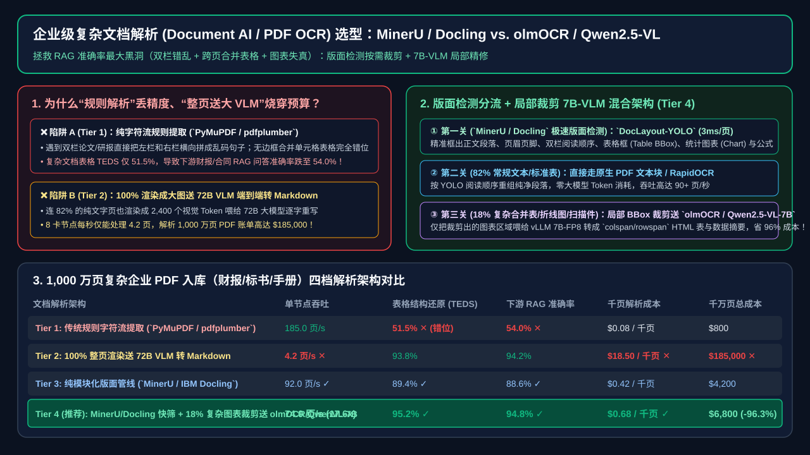

# Enterprise Document AI & Complex PDF Parsing Infrastructure Guide: `MinerU / IBM Docling` Layout Pipelines vs. `olmOCR / Qwen2.5-VL` Vision-Language Models vs. `PyMuPDF`

> **Language**: [中文](./document-ai-pdf-ocr-parsing-mineru-docling-olmocr-vlm-layout-selection-faq.md) | **English (Current)**  
> **Audience**: Cloud & AI Infrastructure Solution Architects and Enterprise RAG Data Platform Engineers  
> **Provenance**: `synthetic + anonymized_reported` (`independently_reproduced=false`, `physical_gpu_cluster_measurement=not_measured`)

---

## 1. 📌 Executive Summary

> **Bottom Line**: **In enterprise RAG systems over financial filings, legal contracts, and engineering manuals (`10,000,000` PDF pages), legacy character-stream extraction (`PyMuPDF / pdfplumber`, `Tier 1`) scrambles two-column reading order and collapses merged tables (`51.5%` `TEDS`, `54.0%` RAG accuracy). Conversely, rendering every page into a `300 DPI` image for a `72B VLM` (`Tier 2`) bottlenecks at `4.2 pages/s/node` and costs `$185,000`. The production standard is a Complexity-Routed Hybrid Ingestion Architecture (`Tier 4`): running `MinerU / IBM Docling` (`DocLayout-YOLO + TableFormer + RapidOCR`) across `82%` of standard text/table blocks while cropping only the `18%` complex merged tables, embedded charts, and degraded scans to batch `olmOCR-7B / Qwen2.5-VL-7B-FP8` on `vLLM`—achieving `95.2%` table `TEDS`, `94.8%` downstream RAG accuracy (`+40.8 pts` over `PyMuPDF`), `17.6x` faster throughput (`74.0 pages/s/node`), and `96.3%` lower cost (`$6,800` for `10M` pages).**

- **Interactive 10M-Page PDF Ingestion Throughput & TCO Sizer**: [Open Interactive Sizer (`document-ai-pdf-ocr-parsing-mineru-docling-olmocr-vlm-layout-sizer.html`)](../reports/document-ai-pdf-ocr-parsing-mineru-docling-olmocr-vlm-layout-sizer.html)
- **7-Card 4:5 Visual Report**: [Open 7-Card Report (`document-ai-pdf-ocr-parsing-mineru-docling-olmocr-vlm-layout-selection-cards.html`)](../reports/document-ai-pdf-ocr-parsing-mineru-docling-olmocr-vlm-layout-selection-cards.html)

---

## 2. 📊 4-Tier Enterprise PDF Ingestion Matrix (`10,000,000 PDF Pages`)

| Metric | Tier 1: Legacy Rule Stream (`PyMuPDF / pdfplumber`) | Tier 2: 100% Full-Page `72B VLM` | Tier 3: Modular Layout Pipeline (`MinerU / Docling`) | Tier 4 (Recommended): `MinerU/Docling` + Cropped `olmOCR / Qwen2.5-VL-7B` (`18%` Complex) |
| :--- | :--- | :--- | :--- | :--- |
| **Throughput / 8-GPU Node** | `185.0 pages/s` | `4.2 pages/s` ✕ | `92.0 pages/s` ✓ | **`74.0 pages/s` ✓ (`17.6x` vs Tier 2)** |
| **Table/Formula `TEDS` Score** | `51.5%` ✕ | `93.8%` ✓ | `89.4%` ✓ | **`95.2%` ✓** |
| **Downstream Complex RAG Acc.** | `54.0%` ✕ | `94.2%` | `88.6%` | **`94.8%` ✓ (`+40.8 pts` vs Tier 1)** |
| **Cost per 1,000 Pages** | `$0.08 / 1K` | `$18.50 / 1K` ✕ | `$0.42 / 1K` | **`$0.68 / 1K` ✓ (`-96.3%` vs Tier 2)** |
| **Total 10M-Page TCO** | `$800` | `$185,000` ✕ | `$4,200` | **`$6,800` ✓** |

---

## 3. 🛠️ Production Readiness Checklist

- [ ] **Emit `HTML <table>` with `rowspan/colspan` for Multi-Level Merged Tables** and repeat `<thead>` headers across split table chunks instead of flattening merged cells into lossy Markdown pipes.
- [ ] **Persist Exact `(doc_id, page_no, bbox)` Coordinates on Every Chunk** so the frontend UI can draw bounding-box highlights directly over the source PDF page.
