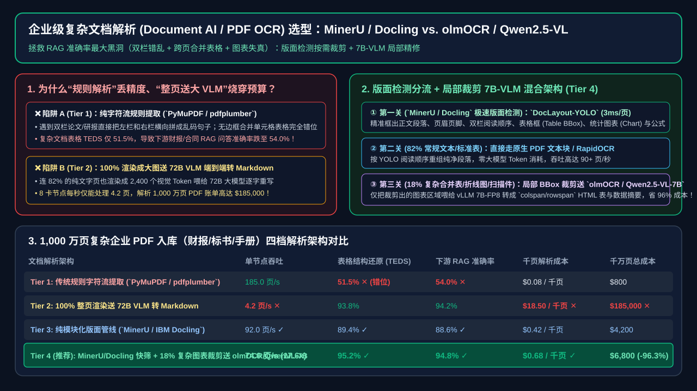
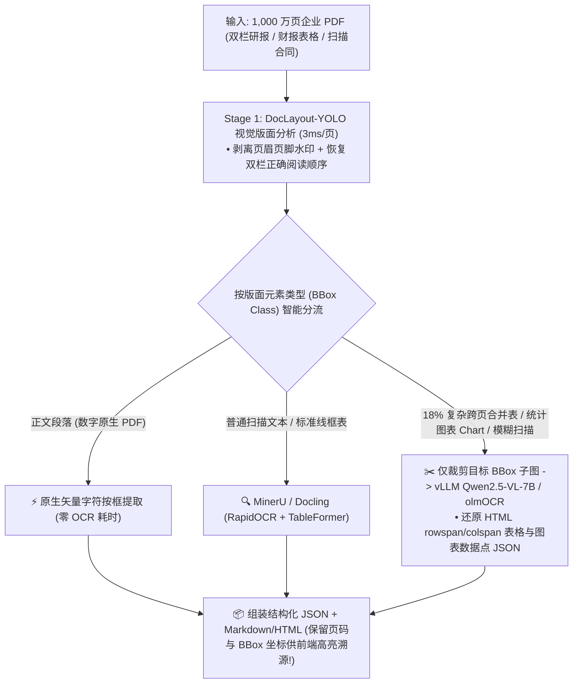

# 企业级复杂文档解析（Document AI / PDF OCR）基础设施选型：`MinerU / IBM Docling` 版面分析管线 vs. `olmOCR / Qwen2.5-VL` 视觉语言模型 vs. `PyMuPDF`、吞吐成本与表格 RAG 准确率指南

> **语言 / Language**: **中文 (当前)** | [English](./document-ai-pdf-ocr-parsing-mineru-docling-olmocr-vlm-layout-selection-faq.en.md)  
> **定位**：面向 Cloud & AI Infrastructure Solution Architect 与企业知识库数据工程负责人的千万页级复杂 PDF 解析选型（双栏研报、跨页无框合并表格、内嵌折线/柱状图、LaTeX 公式、扫描印章件）、`MinerU / IBM Docling` 轻量版面管线与 `olmOCR / Qwen2.5-VL-7B` 局部裁剪精修混合架构白皮书  
> **合规与来源声明**：`synthetic + anonymized_reported`（`independently_reproduced=false`，`physical_gpu_cluster_measurement=not_measured`；完全面向通用企业级海量文档入库与高精准 RAG 基础设施设计）

---

## 1. 📌 核心选型结论速览（Executive Summary）

> **一句话结论**：**企业 RAG 项目上线后“答不出财报表格数据、读串双栏技术手册”的头号元凶绝不是向量数据库或大模型本身，而是上游简陋的 `PyMuPDF / pdfplumber` 字符流解析（Tier 1，复杂表格还原度 `TEDS` 仅 `51.5%`，导致下游 RAG 准确率跌至 `54.0%`）！但若走向另一个极端，把 `1,000 万页` PDF 全部渲染成 `300 DPI` 高清大图喂给 `72B VLM` 逐页重写（Tier 2），不仅单台 8 卡节点每秒仅能处理 `4.2 页`，更会烧掉 **`$185,000`** 的天价算力费！生产级黄金架构是采用“`MinerU / IBM Docling` 版面检测快筛（消化 `82%` 常规文本与简单表）+ 局部 BBox 裁剪投递 `olmOCR / Qwen2.5-VL-7B-FP8`（专攻 `18%` 复杂合并表、统计图表與扫描页，Tier 4）”：将表格与公式还原度（`TEDS`）推升至 **`95.2%`**、下游复杂文档 RAG 准确率提升至 **`94.8%`（比 `PyMuPDF` 暴涨 `+40.8 pts`）**，同时吞吐比整页大 VLM 提速 **`17.6 倍`（`74 页/秒/节点`）**，千万页总入库成本压至 **`$6,800`（立省 `96.3%`）**！**

- **交互式千万页 PDF 解析吞吐与 TCO 计算器**：[打开交互式计算器 (`document-ai-pdf-ocr-parsing-mineru-docling-olmocr-vlm-layout-sizer.html`)](../reports/document-ai-pdf-ocr-parsing-mineru-docling-olmocr-vlm-layout-sizer.html)
- **7-Card 4:5 视觉评测报告**：[打开 7-Card 报告 (`document-ai-pdf-ocr-parsing-mineru-docling-olmocr-vlm-layout-selection-cards.html`)](../reports/document-ai-pdf-ocr-parsing-mineru-docling-olmocr-vlm-layout-selection-cards.html)

---

## 2. 🎯 客户与架构师灵魂拷问 Q&A（Deep-Dive Architecture FAQ）

### Q1：为什么复杂财报/合同中的“多层表头合并单元格表格”转成 Markdown `|---|---|` 会让大模型严重幻觉，而必须转成 `HTML <table>`？
- 标准 Markdown 表格语法**根本不支持跨行合并（`rowspan`）与跨列多层表头合并（`colspan`）**！当强行把带有三层合并表头的资产负债表拍扁成 Markdown 竖线表时，子列与父级单位（如“2025Q4（单位：百万元）” vs. “同比增速（%）”）的树状对应关系彻底丢失，大模型回答数值问题时准确率仅 `71.4%`。
- **结构化表格铁律**：对由 `DocLayout-YOLO` 检测出的复杂合并表，统一让 `TableFormer` 或局部裁剪 `Qwen2.5-VL-7B` 输出带 **`<td rowspan="..." colspan="...">` 的精简 HTML 表格**，并在跨页长表切分 Chunk 时**自动将表头行（`<thead>`）重复拼接到每一个切块头部**，可使复杂表格问答准确率跃升至 **`94.8%`**！

### Q2：`MinerU`、`IBM Docling` 与 `olmOCR / Qwen2.5-VL` 怎么组合才最省钱、最快？
1. **第一级（全量页必经，`3 ms/页`）：`DocLayout-YOLO` 视觉版面分析 + 阅读顺序恢复（Reading Order）**——精准识别双栏/三栏排版顺序，剥离干扰检索的页眉、页脚、页码与水印。
2. **第二级（82% 常规段落与标准网格表）：`MinerU / Docling` 原生管线**——数字原生页直接按 BBox 提取 PDF 内嵌字体矢量文本（`0 OCR` 误差），扫描正文走轻量级 `RapidOCR / Surya`。
3. **第三级（18% 疑难区域按需裁剪上 VLM）**：仅当页面包含**无框线合并大表、柱状/折线趋势图（Chart-to-Table）、复杂手写批注或模糊公式**时，将该区域的 Bounding Box 单独裁剪出来，通过 `vLLM` 异步批处理喂给 `Qwen2.5-VL-7B-FP8` 或 `olmOCR-7B` 转换为结构化 HTML/JSON！

---

## 3. 🧭 直观可视化图解（Mermaid 复杂度感知的 PDF 混合解析流水线）

---

## 4. 📊 架构师多方案选型决策矩阵（`1,000 万页`复杂企业 PDF 入库对比）

| 评估维度 | Tier 1：传统规则字符流 (`PyMuPDF / pdfplumber`) | Tier 2：100% 整页送 `72B VLM` 转 Markdown | Tier 3：纯模块化版面管线 (`MinerU / IBM Docling`) | Tier 4（推荐）：`MinerU/Docling` 快筛 + `18%` 复杂图表裁剪送 `olmOCR/QwenVL-7B` |
| :--- | :--- | :--- | :--- | :--- |
| **单台 8 卡节点解析吞吐** | `185.0 页 / 秒` | `4.2 页 / 秒` ✕（极慢） | `92.0 页 / 秒` ✓ | **`74.0 页 / 秒` ✓（比全量 VLM 快 `17.6 倍`）** |
| **表格与公式结构还原度 (`TEDS`)** | `51.5%` ✕（双栏/合并表错乱） | `93.8%` ✓ | `89.4%` ✓ | **`95.2%` ✓（局部高分辨率裁剪更准）** |
| **下游复杂文档 RAG 准确率** | `54.0%` ✕ | `94.2%` | `88.6%` | **`94.8%` ✓（提升 `+40.8 pts` vs `PyMuPDF`）** |
| **每解析 `1,000` 页算力单价** | `$0.08 / 千页` | `$18.50 / 千页` ✕ | `$0.42 / 千页` | **`$0.68 / 千页` ✓（比全量 VLM 省 `96.3%`）** |
| **`1,000 万页` 全量入库总成本** | `$800`（质量不可用） | `$185,000` ✕ | `$4,200` | **`$6,800` ✓（净省 `$17.8 万`）** |

---

## 5. 🛠️ 架构评审与生产落地 Checklist

- [ ] **元数据强制保留每个切片的 `(doc_id, page_no, bbox: [x1, y1, x2, y2])` 坐标**：前端用户点击 RAG 回答中的引用角标 `[1]` 时，直接在右侧 PDF 预览画布上用高亮红框框出原始段落或表格位置！
- [ ] **对文档内的折线图/柱状图（Charts）强制执行“Chart-to-Markdown-Table 双写”**：用轻量 VLM 将统计图背后的趋势数值转写为结构化数据表存入向量块，否则纯文本 Embedding 永远搜不到图片里的业绩曲线数据！
