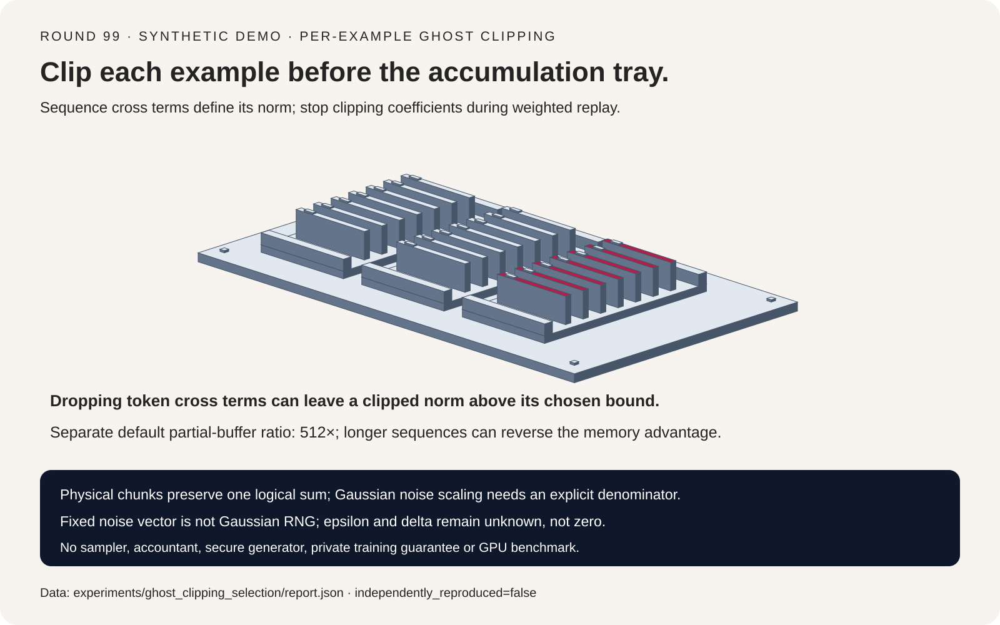
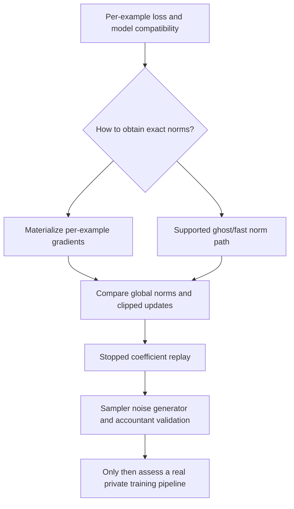
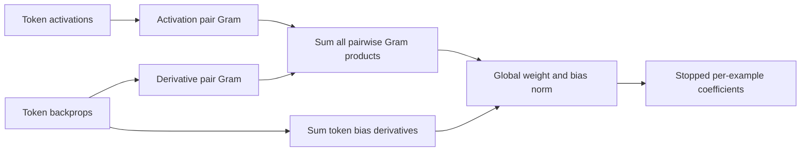
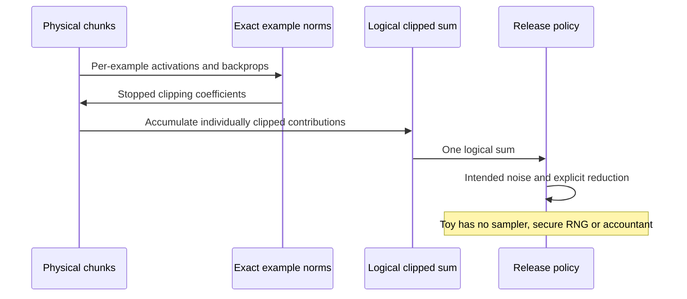

# DP-SGD systems FAQ: per-example clipping, sequence ghost norms and logical batches

> **Language**: [中文](dp-sgd-ghost-clipping-per-example-sequence-norm-selection-faq.md) | English
>
> **Round 99 · 2026-11-14 (eighth round of the November 13 night)** · [SVG](../../assets/svg/dp-sgd-ghost-clipping-per-example-sequence-norm-selection-faq-summary.svg) · [7-card report](../reports/dp-sgd-ghost-clipping-per-example-sequence-norm-selection-cards.html) · [H5 workbench](../reports/dp-sgd-ghost-clipping-per-example-sequence-norm-sizer.html) · [Sealed report](../../experiments/ghost_clipping_selection/report.json)
>
> **Synthetic, `independently_reproduced=false`. This is not private training.** Original scalar arithmetic only: no Opacus/PyTorch execution, Poisson sampler, accountant, Gaussian random draw, secure generator, epsilon/delta guarantee or measured GPU performance.



## 1. Executive summary: clip before example identity disappears

Ordinary gradient accumulation preserves only a sum. The selected DP-SGD
mechanism first bounds **each example's full parameter gradient**, then
accumulates clipped contributions, adds calibrated noise and applies the
intended reduction. Ghost clipping changes how norms are obtained; it must
not silently change that chosen update.

| Choice | Intended contract | Main risk |
| :--- | :--- | :--- |
| Materialized per-example gradients | Direct global norm and flat clipping | Large per-example parameter tensors |
| Exact sequence Gram norms | Same norms without materializing weight gradients | Missing cross-token terms |
| Stopped weighted replay | Same clipped sum from a second backward | Differentiating clipping coefficients |
| Physical chunking | One logical sum and release policy | Changing clipping/noise/denominator per chunk |

The fixture has three examples, two tokens per example and six parameters.
Exact sequence Gram norms match all materialized norms. Omitting cross
terms leaves an individual clipped norm `2.3094006054`, above the chosen
bound `C=2`. A whole-sequence Frobenius-product bound instead overclips
another example: it is not exact, but is not automatically a privacy violation.

First-party context is pinned
[Opacus linear norm sampling](https://github.com/pytorch/opacus/blob/a196a93a8326089242d738e7110fbb625608f114/opacus/grad_sample/linear.py).
The June 30, 2025 commit added mixed/low-precision support; this study
explains established mechanics and does not reproduce that GPU behavior
or claim a new November 2026 release.

## 2. Architect Q&A: what must ghost clipping preserve?

### Q1: Why can ordinary accumulated gradients not replace per-example clipping?

For chosen global bound `C`, the flat-clipped sum is:

```text
c_i = min(1, C / (||gradient_i|| + 1e-6))
clipped_sum = SUM_i c_i * gradient_i
```

Different examples can reinforce or cancel. Clipping their sum loses the
individual norms and generally produces another update. The original
clip-after-aggregation control differs from the reference by
`0.7952997280`.

The small epsilon follows the pinned coefficient policy. It keeps an
exactly zero gradient unchanged and places clipped nonzero norms slightly
below `C`. Replacing the whole algorithm with another release mechanism
would require its own sensitivity/accounting analysis; this report does
not claim every aggregate-clipping mechanism is necessarily nonprivate.

### Q2: Why does the simple product-of-norms formula fail on sequences?

For one linear-layer activation vector `a` and output derivative `d`,
the weight gradient is an outer product:

```text
G = outer(d,a)
||G||F = ||d||2 * ||a||2
```

For a sequence within one example:

```text
G_i = SUM_t outer(d_it,a_it)
||G_i||F² = SUM_t,u dot(d_it,d_iu) * dot(a_it,a_iu)
bias_gradient_i = SUM_t d_it
global_norm_i² = ||G_i||F² + ||bias_gradient_i||2²
```

The pinned three-dimensional sampler computes both token-pair Gram
matrices. Keeping only `t=u` terms loses reinforcement/cancellation.
Two aligned token derivatives in the fixture underclip to norm
`2.3094006054`; another example has exact cancellation and zero gradient.

Multiplying the entire activation/backprop Frobenius norms is only a
bound for a multi-token sequence. It changes the clipped sum by
`0.2608647014` here. Norms for weight and bias must also be combined
before the chosen flat clipping. Giving each its own bound `C=2` leaves
a combined norm `2.8284264176`; that is a different clipping policy.

This toy covers one linear invocation. Tied weights, repeated module calls,
inter-example coupling and mixed precision are not validated.

### Q3: Why must the second backward stop gradients through clip coefficients?

After obtaining norms, fast/ghost clipping can form a weighted loss:

```text
weighted_loss = SUM_i stop_gradient(c_i) * loss_i
gradient(weighted_loss) = SUM_i c_i * gradient(loss_i)
```

Differentiating `c_i(parameters)` adds extra derivative terms and changes
the update. The original stopped-coefficient replay matches the clipped
sum to `9.14e-11` by independent central differences. Recomputing and
differentiating coefficients changes it by `1.1731460422`.

The inspected source captures detached activations/backprops and performs
a weighted second backward. Our implementation checks the math with a
scalar model; it does not demonstrate framework memory savings or the
complete hook lifecycle.

### Q4: Can a physical microbatch change the noise or averaging denominator?

Not silently. Four partitions—`[3]`, `[1,2]`, `[2,1]`, `[1,1,1]`—give the
same sum when every example is clipped first. A physical boundary does
not itself create a new logical release.

The pinned optimizer adds noise with sum-space scale `sigma*C`, then
uses `expected_batch_size * accumulated_iterations` for mean reduction.
With Poisson sampling, the expected denominator cannot simply be inferred
from the actual sampled count.

The toy fixes **one logical release**, explicit expected denominator four,
and actual fixture count three. Replacing four with three multiplies the
same synthetic release by `4/3`. Its fixed six-value noise vector is
**not a Gaussian draw**.

If `K` independent noise vectors, each with variance `(sigma*C)^2`, are
added to the same sum and the final denominator remains `E`, the resulting
standard deviation is `sqrt(K)*sigma*C/E`, not `sigma*C/E`.
This is a variance identity, not a validated implementation of virtual
batching or a statement about every optimizer's accumulation policy.

### Q5: Does choosing C and sigma determine the privacy budget?

No. Accounting also depends on the sampling mechanism/probability, number
of logical releases, adjacency assumptions, target delta and the chosen
accountant. Model operations and randomness must satisfy their required
conditions. None of those end-to-end checks is performed here.

**Epsilon and delta remain null, not zero.** `sigma=0` adds no noise and
the workbench explicitly supplies no privacy guarantee. A deterministic
fixed noise vector is useful for arithmetic tests only, never for a
private training release.

## 3. Visual architecture: selection, norm calculation and logical release







## 4. Selection matrix and partial-memory crossover

| Requirement | Evaluate | Do not assume |
| :--- | :--- | :--- |
| Exact flat-clipped update | All-parameter per-example norm | Per-parameter bounds are identical |
| Sequence ghost norms | All token-pair terms | Vector outer-product identity applies unchanged |
| Smaller physical chunks | Same logical clipped sum | More physical chunks imply more releases |
| Memory savings | Layer and sequence dimensions | Ghost clipping always uses less memory |
| Private-training readiness | Sampler, randomness, accountant and model | This calculator certifies privacy |

For physical chunk size `B`, sequence length `T`, input/output dimensions
`Din,Dout`, and scalar width `s`:

```text
materialized per-example weight bytes = B * Din * Dout * s
two sequence Gram bytes = 2 * B * T² * s
activation/backprop bytes = B * T * (Din+Dout) * s
```

Default `B=64`, `T=128`, `Din=Dout=4096`, `s=4`:

| Selected buffer | Bytes |
| :--- | ---: |
| Per-example weight gradients | `4,294,967,296` |
| Two sequence Gram matrices | `8,388,608` |
| Activations and backprops | `268,435,456` |

The selected dense/Gram ratio is `512×`, not peak-memory reduction.
At `T=4096`, the two Grams become `8,589,934,592` bytes, larger than the
same `4,294,967,296` dense-gradient bytes. Bias scratch, other layers,
optimizer, retained autograd graph, allocator and replay lifecycle are
excluded. **Peak HBM remains null.**

## 5. Worked evaluation and seven-card report

| Case | Maximum clipped-sum error | Interpretation |
| :--- | ---: | :--- |
| Exact sequence Gram | `0` | Same norm and update |
| Token-diagonal only | `0.2187795161` | Cross terms lost; exceeds selected norm bound |
| Whole-sequence norm product | `0.2608647014` | Conservative bound, not exact |
| Clip after summing examples | `0.7952997280` | Different aggregation/clipping order |
| Separate weight/bias bounds | `1.1551063952` | Different clipping policy |
| Stopped coefficient replay | `9.14e-11` | Independent finite differences pass |
| Differentiate coefficients | `1.1731460422` | Extra derivative changes update |

The workbench's separate default logical batch has 512 examples in eight
physical chunks, with `C=2`, `sigma=1`, expected denominator 512.
Under the stated Gaussian assumption, one-release mean-noise standard
deviation is `0.00390625`; eight independent same-scale additions at the
same final denominator give `0.0110485435`. Neither is a measured random
sample statistic or an epsilon result.

Card 6 shows one-pass buffer-read formulas over sequence lengths
64/128/1024/4096. At assumed `1000 GB/s` and `5 µs` setup, the default
dense/Gram reads are `4.299967296 ms` and `0.013388608 ms`.
They omit norm computation, replay and other storage traffic; they are
not GPU timing or a training speedup. Median/repeats are not applicable.

The original sorter figure keeps each example card separate until the
clipping gate. H5 supplies bilingual fields and explicit validation.
No browser visual check was performed; the earlier refusal was respected.

## 6. Reproduction, sources and readiness boundaries

```powershell
python -m experiments.ghost_clipping_selection.run
python -m experiments.ghost_clipping_selection.run --check
python -m unittest tests.test_ghost_clipping_selection
python scripts\validate_research.py
```

Eight tests cover independent per-example derivatives; sequence
reinforcement/cancellation and single-token identity; stopped replay;
physical partitions; explicit synthetic release scaling; buffer crossover
and invalid inputs; sealed output/CSP/SVG; and Python/Node formula parity.

Inspected first-party source at `a196a93a8326089242d738e7110fbb625608f114`:
[linear norms](https://github.com/pytorch/opacus/blob/a196a93a8326089242d738e7110fbb625608f114/opacus/grad_sample/linear.py),
[global norms/detached capture](https://github.com/pytorch/opacus/blob/a196a93a8326089242d738e7110fbb625608f114/opacus/grad_sample/grad_sample_module_fast_gradient_clipping.py),
[weighted replay](https://github.com/pytorch/opacus/blob/a196a93a8326089242d738e7110fbb625608f114/opacus/utils/fast_gradient_clipping_utils.py),
[optimizer scaling](https://github.com/pytorch/opacus/blob/a196a93a8326089242d738e7110fbb625608f114/opacus/optimizers/optimizer.py)
and [Apache-2.0 license](https://github.com/pytorch/opacus/blob/a196a93a8326089242d738e7110fbb625608f114/LICENSE).
No implementation or model weights were copied.
Static cards use `default-src 'none'; style-src 'unsafe-inline'` with no
external fonts, scripts or requests.

**Ready for:** reviewing clipping arithmetic and partial-buffer assumptions.
**Not ready for:** releasing private models, certifying privacy, selecting
an accountant or predicting production GPU memory/throughput.
