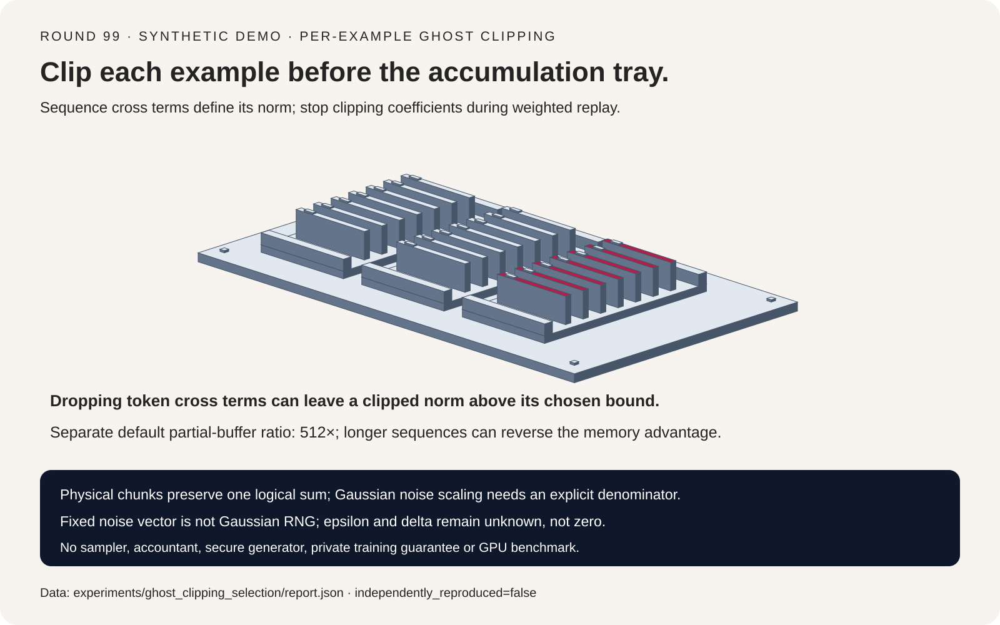
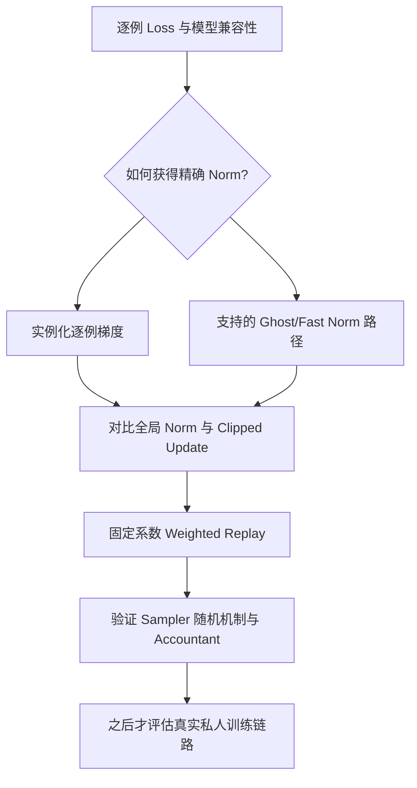
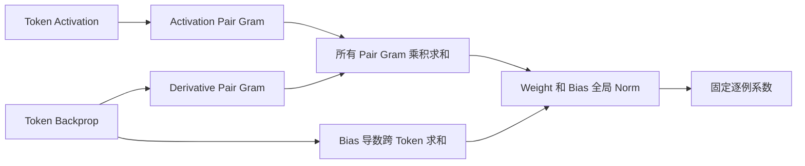
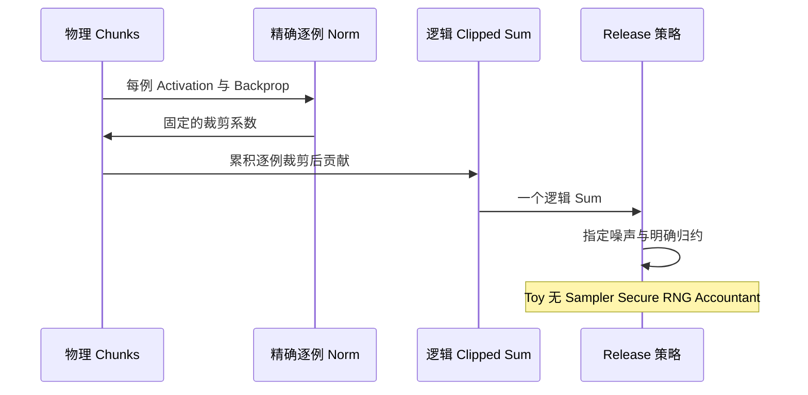

# DP-SGD 系统选型 FAQ：逐样本裁剪、序列 Ghost Norm 与逻辑批边界

> **语言**：中文 | [English](dp-sgd-ghost-clipping-per-example-sequence-norm-selection-faq.en.md)
>
> **Round 99 · 2026-11-14（11 月 13 日夜班第八轮）** · [SVG](../../assets/svg/dp-sgd-ghost-clipping-per-example-sequence-norm-selection-faq-summary.svg) · [七卡报告](../reports/dp-sgd-ghost-clipping-per-example-sequence-norm-selection-cards.html) · [H5 工作台](../reports/dp-sgd-ghost-clipping-per-example-sequence-norm-sizer.html) · [封存数据](../../experiments/ghost_clipping_selection/report.json)
>
> **Synthetic，`independently_reproduced=false`。本实验不是私人训练。** 仅原创标量算术；没有执行 Opacus/PyTorch，没有 Poisson sampler、accountant、Gaussian 随机抽样、secure RNG、epsilon/delta 保证或 GPU 实测。



## 一、先说结论：不要在裁剪前丢掉样本身份

普通梯度累积只保留和。所选 DP-SGD 机制先约束 **每例完整参数梯度**，
再累积、加所需噪声并按明确策略归约。Ghost clipping 改变 norm 的
获取方法，不能暗中改变选定 update。

| 选择 | 目标契约 | 主要风险 |
| :--- | :--- | :--- |
| Materialized per-example gradients | 直接计算全局 norm 并 flat clipping | 每例参数张量大 |
| 精确序列 Gram norm | 不实例化 weight gradient，保持同一 norm | 丢 token 交叉项 |
| 固定系数 weighted replay | 第二次 backward 得到同一 clipped sum | 对裁剪系数求导 |
| Physical chunking | 保持一个逻辑 sum 与 release 策略 | 每 chunk 偷改裁剪、噪声或分母 |

Fixture 三例、每例两个 token、六个参数。精确 Gram norm 与 materialized
norm 相同；漏交叉项使某例裁剪后 norm 达 `2.3094006054`，超过本轮
`C=2`。整段 Frobenius norm 乘积则过度裁剪另一例：不精确，但不能据此
自动判断其侵犯隐私。

一手背景为 [Opacus 固定 Linear norm sampler](https://github.com/pytorch/opacus/blob/a196a93a8326089242d738e7110fbb625608f114/opacus/grad_sample/linear.py)。
2025-06-30 提交支持 mixed/low precision；本轮解释成熟机制，不复现
那次 GPU 行为，也不冒充 2026 年 11 月新发布。

## 二、架构师 Q&A：Ghost clipping 到底必须保持什么？

### Q1：为什么不能用普通累计梯度代替逐例裁剪？

对选定全局阈值 `C`：

```text
c_i = min(1, C / (||gradient_i|| + 1e-6))
clipped_sum = SUM_i c_i * gradient_i
```

不同例会增强或抵消，先求和后裁剪丢掉各例 norm，一般得到另一种 update。
本 control 与参考最大差异 `0.7952997280`。

小 epsilon 对齐固定源码系数策略：零梯度不变，非零被裁剪 norm 稍低于
`C`。若换另一种 release 机制，需单独敏感度/会计分析；不能笼统说所有
aggregate-clipping 机制必然不具隐私性。

### Q2：简单 norm 乘积为什么不能直接套序列？

单个 activation `a`、输出导数 `d` 对应：

```text
G = outer(d,a)
||G||F = ||d||2 * ||a||2
```

同一例含多个 token 时：

```text
G_i = SUM_t outer(d_it,a_it)
||G_i||F² = SUM_t,u dot(d_it,d_iu) * dot(a_it,a_iu)
bias_gradient_i = SUM_t d_it
global_norm_i² = ||G_i||F² + ||bias_gradient_i||2²
```

固定 3D sampler 计算两份 token-pair Gram。仅保留 `t=u` 会丢增强/
抵消项：两对齐 token 在 fixture 中裁剪后仍有 `2.3094006054` norm；
另一例则完全抵消，真实梯度为零。

整段 activation/backprop Frobenius norm 相乘只是上界，本例改变 update
`0.2608647014`，不等于精确 norm。Weight/bias 还需先合成全局 norm：
分别给各自 `C=2`，完整 norm 可达 `2.8284264176`，属于另一裁剪策略。

只验证一次 Linear invocation；不覆盖 tied weights、重复模块调用、
跨例耦合或 mixed precision。

### Q3：为什么二次 backward 必须固定 clipping coefficients？

```text
weighted_loss = SUM_i stop_gradient(c_i) * loss_i
gradient(weighted_loss) = SUM_i c_i * gradient(loss_i)
```

若对 `c_i(parameters)` 也求导，会增加额外项。固定系数的独立有限差分
与 clipped sum 误差 `9.14e-11`；重算并对系数求导则相差 `1.1731460422`。

阅读的上游路径捕获 detached activation/backprop，再进行 weighted
second backward。原创 toy 只验证数学，不证明框架内存节省或完整 hook
生命周期正确。

### Q4：物理 microbatch 能改变噪声或平均分母吗？

不能默改。`[3]`、`[1,2]`、`[2,1]`、`[1,1,1]` 四种物理划分，在
每例先裁剪时得到相同 sum；物理边界不自动产生一次新逻辑 release。

固定 optimizer 在 sum 空间加 `sigma*C` 噪声，再按
`expected_batch_size * accumulated_iterations` 做 mean。Poisson sampling
下，期望分母不能直接从实际抽到多少例推断。

Toy 固定 **一次逻辑 release**、期望分母四、实际三例。将分母四换为三，
同一合成 release 整体放大 `4/3`。这里六维 noise vector 是固定数，
**不是 Gaussian 随机样本**。

若对同一 sum 加 `K` 个独立噪声，每个方差 `(sigma*C)^2`，最终仍除以
`E`，标准差为 `sqrt(K)*sigma*C/E`，而非 `sigma*C/E`。这是方差恒等式，
不是 virtual batching 完整实现，也不能推广为所有 optimizer 的累积规则。

### Q5：给定 C 和 sigma，就能知道隐私预算吗？

不能。还依赖 sampling 机制/概率、逻辑 release 次数、邻接假设、目标
delta、accountant，以及模型与随机数条件。本轮未做这些端到端检查。

**Epsilon/delta 保持 null，不是零**。`sigma=0` 不加噪声，工作台明确
不提供隐私保证。确定性 noise vector 只能做算术测试，不能作为私人训练
release 的随机机制。

## 三、可视化架构：选型、范数与逻辑 release







## 四、选型矩阵与部分内存 crossover

| 需求 | 应评估 | 不可默认 |
| :--- | :--- | :--- |
| 同一 flat-clipped update | 全参数逐例 norm | 每参数阈值与全局阈值相同 |
| Sequence ghost norm | 完整 token-pair 项 | 向量 outer-product 恒等式可直接套整段 |
| 小物理批 | 同一逻辑 clipped sum | 更多 chunk 就是更多 release |
| 节省内存 | Layer 维度和序列长度 | Ghost 一定更省 |
| 私人训练就绪 | Sampler、随机机制、会计与模型 | 本计算器能认证隐私 |

物理批 `B`、序列长 `T`、输入输出维度 `Din,Dout`、标量字节 `s`：

```text
materialized per-example weight bytes = B * Din * Dout * s
two sequence Gram bytes = 2 * B * T² * s
activation/backprop bytes = B * T * (Din+Dout) * s
```

默认 `B=64`、`T=128`、`Din=Dout=4096`、`s=4`：

| 选定 Buffer | Bytes |
| :--- | ---: |
| 逐例 weight gradients | `4,294,967,296` |
| 两份 sequence Gram | `8,388,608` |
| Activation 与 Backprop | `268,435,456` |

Dense/Gram 部分 buffer 比为 `512×`，不代表 peak memory 降幅。
当 `T=4096`，两份 Gram 达 `8,589,934,592` bytes，超过仍为
`4,294,967,296` 的 dense gradient。未含 bias scratch、其他层、optimizer、
autograd 保留图、allocator 与 replay 生命周期。**Peak HBM 为 null**。

## 五、可复现实例与七卡报告

| Case | 最大 Clipped-sum 误差 | 解释 |
| :--- | ---: | :--- |
| 完整序列 Gram | `0` | 同一 norm/update |
| 仅 token 对角项 | `0.2187795161` | 丢 cross terms，超过所选 norm 阈值 |
| 整段 Frobenius 乘积 | `0.2608647014` | 保守上界，不精确 |
| 先跨例求和后裁剪 | `0.7952997280` | 顺序改变 |
| Weight/bias 各自阈值 | `1.1551063952` | 裁剪策略改变 |
| 固定系数 Replay | `9.14e-11` | 独立有限差分通过 |
| 对系数求导 | `1.1731460422` | 额外导数改变 update |

工作台另一个默认配置为逻辑 512 例、8 个物理 chunk、`C=2`、
`sigma=1`、期望分母 512。给定 Gaussian 假设，单次 mean-noise std 为
`0.00390625`；同分母下独立加八次同强度噪声为 `0.0110485435`。
这不是随机样本实测统计，也不是 epsilon。

第六卡比较序列长 64/128/1024/4096 的一次 buffer 读取公式；假设
`1000 GB/s`、启动 `5 µs`，默认 dense/Gram 为
`4.299967296 ms` / `0.013388608 ms`。不含 norm compute、replay 和其他
访存，不是 GPU 延迟或训练 speedup，median/repeats 不适用。

原创分拣机让例卡在裁剪闸门前保持独立；H5 双语字段、显式校验。此前
浏览器拒绝仍被遵守，未做浏览器视觉验收。

## 六、复现、来源与生产就绪边界

```powershell
python -m experiments.ghost_clipping_selection.run
python -m experiments.ghost_clipping_selection.run --check
python -m unittest tests.test_ghost_clipping_selection
python scripts\validate_research.py
```

八项测试覆盖独立逐例导数、序列增强/抵消与单 token 恒等式、固定系数
replay、物理划分、合成 release 缩放、buffer crossover/非法输入、
封存产物/CSP/SVG 与 Python/Node parity。

阅读的一手代码均固定在 `a196a93a8326089242d738e7110fbb625608f114`：
[Linear norms](https://github.com/pytorch/opacus/blob/a196a93a8326089242d738e7110fbb625608f114/opacus/grad_sample/linear.py)、
[全局 Norm/Detached Capture](https://github.com/pytorch/opacus/blob/a196a93a8326089242d738e7110fbb625608f114/opacus/grad_sample/grad_sample_module_fast_gradient_clipping.py)、
[Weighted Replay](https://github.com/pytorch/opacus/blob/a196a93a8326089242d738e7110fbb625608f114/opacus/utils/fast_gradient_clipping_utils.py)、
[Optimizer Scaling](https://github.com/pytorch/opacus/blob/a196a93a8326089242d738e7110fbb625608f114/opacus/optimizers/optimizer.py)
及 [Apache-2.0 LICENSE](https://github.com/pytorch/opacus/blob/a196a93a8326089242d738e7110fbb625608f114/LICENSE)。
未复制实现或模型权重；静态七卡 CSP
`default-src 'none'; style-src 'unsafe-inline'`，无外部字体、脚本、请求。

**适用**：检查裁剪算术与部分 buffer 假设。
**不适用**：发布私人模型、认证隐私、选择 accountant 或预测生产 GPU
内存与吞吐。
