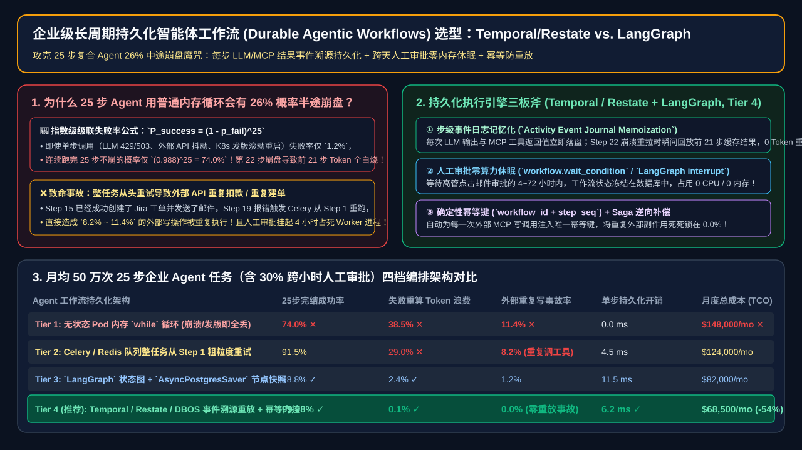

# Enterprise Durable Agentic Workflows Infrastructure Guide: `Temporal / Restate / DBOS` Event-Sourced Replay vs. `LangGraph Postgres Checkpointer` vs. Stateless In-Memory Loops

> **Language**: [中文](./durable-agentic-workflows-temporal-langgraph-dbos-checkpoint-replay-selection-faq.md) | **English (Current)**  
> **Audience**: Cloud & AI Infrastructure Solution Architects and Enterprise Autonomous Agent Platform Engineers  
> **Provenance**: `synthetic + anonymized_reported` (`independently_reproduced=false`, `physical_gpu_cluster_measurement=not_measured`)

---

## 1. 📌 Executive Summary

> **Bottom Line**: **In a `25`-step enterprise AI Agent workflow (`500,000` runs/month across deep research, PR coding loops, and multi-hour human-in-the-loop approvals), even a `1.2%` per-step transient interruption rate (API `429/503`, network blip, or K8s rolling deployment) causes stateless in-memory `while` loops (`Tier 1`) to fail `26.0%` of the time ($0.988^{25} = 74.0\%$) while wasting `38.5%` of LLM tokens on aborted runs. Worse, coarse task-queue retries (`Celery / Redis`, `Tier 2`) restart failed workflows from Step 1, triggering an `8.2%` duplicate external tool mutation rate (double emails, duplicate Jira tickets, or double charges). Production agent platforms combine `LangGraph` cognitive state graphs with Durable Execution Engines (`Temporal / Restate / DBOS` + Deterministic Idempotency Keys, `Tier 4`): memoizing every completed LLM and MCP step in an append-only event journal (`6.2 ms/step` overhead), hibernating human-approval waits at `0 MB` worker RAM, lifting 25-step completion rate to `99.98%`, eliminating duplicate tool side-effects (`0.0%`), and cutting monthly TCO by `53.7%` (`$68,500/month`).**

- **Interactive Durable Agent Workflow Reliability & TCO Sizer**: [Open Interactive Sizer (`durable-agentic-workflows-temporal-langgraph-dbos-checkpoint-replay-sizer.html`)](../reports/durable-agentic-workflows-temporal-langgraph-dbos-checkpoint-replay-sizer.html)
- **7-Card 4:5 Visual Report**: [Open 7-Card Report (`durable-agentic-workflows-temporal-langgraph-dbos-checkpoint-replay-selection-cards.html`)](../reports/durable-agentic-workflows-temporal-langgraph-dbos-checkpoint-replay-selection-cards.html)

---

## 2. 📊 4-Tier Agent Workflow Orchestration Matrix (`500K Workflows/Mo` · `25 Steps/Run`)

| Metric | Tier 1: Stateless In-Memory `while` Loop | Tier 2: `Celery / Redis` Whole-Task Retry | Tier 3: `LangGraph` + `AsyncPostgresSaver` | Tier 4 (Recommended): `Temporal / Restate / DBOS` Event Replay + Idempotency Keys |
| :--- | :--- | :--- | :--- | :--- |
| **25-Step Completion Rate** | `74.0%` ✕ | `91.5%` | `98.8%` ✓ | **`99.98%` ✓** |
| **Failed-Run Token Recompute Waste** | `38.5%` ✕ | `29.0%` ✕ | `2.4%` ✓ | **`0.1%` ✓ (Step-memoized)** |
| **Duplicate Tool Side-Effect Rate** | `11.4%` ✕ | `8.2%` ✕ | `1.2%` | **`0.0%` ✓ (`wf_id:step_seq` key)** |
| **Per-Step Persistence Overhead** | `0.0 ms` | `4.5 ms` | `11.5 ms` | **`6.2 ms` ✓** |
| **Monthly Total Platform TCO** | `$148,000 / mo` ✕ | `$124,000 / mo` | `$82,000 / mo` | **`$68,500 / mo` ✓ (`-53.7%`)** |

---

## 3. 🛠️ Production Readiness Checklist

- [ ] **Wrap Every Non-Deterministic LLM Call and MCP Tool Invocation Inside a Durable Activity / Step Checkpoint** so worker crashes or rolling deployments resume from the exact failed step without re-billing prior LLM turns.
- [ ] **Attach Deterministic Idempotency Keys (`sha256(workflow_id + step_index)`) to All External Write Tools**, and dehydrate Human-in-the-Loop approval waits to persistent storage rather than blocking worker threads.
