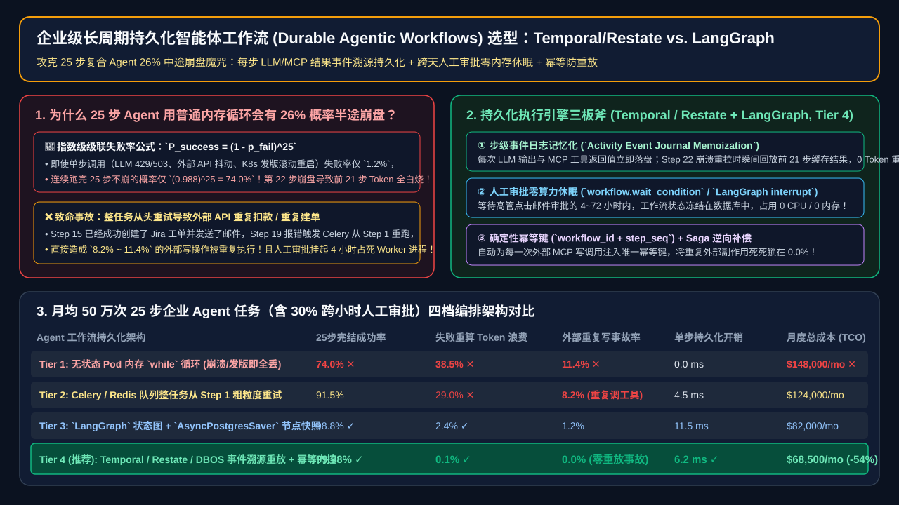
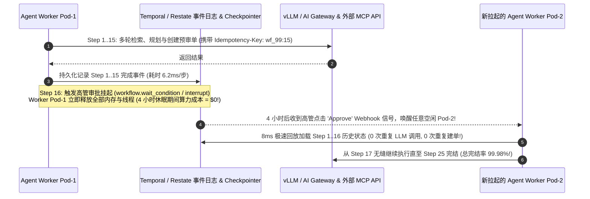

# 企业级长周期持久化智能体工作流（Durable Agentic Workflows）编排选型：`Temporal / Restate / DBOS 事件溯源重放` vs. `LangGraph Postgres Checkpointer` vs. 内存无状态循环指南

> **语言 / Language**: **中文 (当前)** | [English](./durable-agentic-workflows-temporal-langgraph-dbos-checkpoint-replay-selection-faq.en.md)  
> **定位**：面向 Cloud & AI Infrastructure Solution Architect 与企业自治智能体平台负责人的多步长周期 Agent 工作流（`25 ~ 100` 步深度调研、自主编码修 Bug、跨天人工审批 Human-in-the-Loop）持久化容错编排（`Temporal`、`Restate`、`DBOS`、`LangGraph AsyncPostgresSaver`）、步级记忆化重放（Step Memoization）与外部工具 `0%` 重复写幂等架构白皮书  
> **合规与来源声明**：`synthetic + anonymized_reported`（`independently_reproduced=false`，`physical_gpu_cluster_measurement=not_measured`；完全面向通用企业级高可靠自治 Agent 运行时架构设计）

---

## 1. 📌 核心选型结论速览（Executive Summary）

> **一句话结论**：**当企业 AI Agent 从“单轮 3 秒问答”演进为“连续执行 `25 ~ 100 步` LLM 推理与外部工具调用、甚至中途挂起等待数小时高管审批”的复杂业务流程时，直接在一个无状态 `FastAPI` 进程里写内存 `while` 循环（Tier 1）是必崩架构——即便每一步调用遇到限流 `429/503`、网络闪断或 K8s 滚动发版的概率只有 `1.2%`，连续跑完 25 步不崩的概率也仅剩 $(1-0.012)^{25} = \mathbf{74.0\%}$！更可怕的是，若用普通队列（如 Celery，Tier 2）在第 20 步报错时从第 1 步重头重试，不仅白白重算前 19 步昂贵的 LLM Token（浪费 `29%~38.5%` 账单），还会导致前 19 步已经执行成功的“发邮件/建工单/扣款”被重复触发（`8.2% ~ 11.4%` 重复副作用事故）！生产环境黄金标准是采用“持久化执行引擎（`Temporal / Restate / DBOS`）+ `LangGraph Checkpointer` 协同架构（Tier 4）”：将每一步非确定性 LLM 与 MCP 工具调用封装为带唯一幂等键（`workflow_id + step_seq`）的持久化 Activity——崩溃重拉时 `8ms` 瞬间从事件日志回放前 21 步结果（`0 Token` 重算），等待人工审批时 `0 MB` 内存冻结休眠，实现 **`99.98%` 端到端完结率**、**`0.0%` 重复写事故**，并将月度总成本降低 **`53.7%`（`$68,500/月`）**！**

- **交互式长周期 Agent 工作流可靠性与 TCO 计算器**：[打开交互式计算器 (`durable-agentic-workflows-temporal-langgraph-dbos-checkpoint-replay-sizer.html`)](../reports/durable-agentic-workflows-temporal-langgraph-dbos-checkpoint-replay-sizer.html)
- **7-Card 4:5 视觉评测报告**：[打开 7-Card 报告 (`durable-agentic-workflows-temporal-langgraph-dbos-checkpoint-replay-selection-cards.html`)](../reports/durable-agentic-workflows-temporal-langgraph-dbos-checkpoint-replay-selection-cards.html)

---

## 2. 🎯 客户与架构师灵魂拷问 Q&A（Deep-Dive Architecture FAQ）

### Q1：既然大模型的输出天生是“非确定性的（Non-Deterministic）”，为什么还能用 `Temporal / Restate` 的“确定性重放（Deterministic Replay）”？
这是无数初学架构师最容易混淆的核心概念：
1. **`Temporal / Restate` 要求“确定性”的只是外层的编排控制流壳（Workflow Code），而非 Activity 内部的计算**：
   - **严禁直接在 Workflow 主函数里裸调 `openai.chat.completions.create()`**！
   - **正确做法是将每一次 LLM 调用和每一次 MCP 工具调用都封装为一个独立的 `Activity`（或 Restate `ctx.run` / DBOS `@DBOS.step`）**。
2. **故障重放时到底发生了什么？**
   - 当第 1~21 步的 LLM Activity 执行成功时，引擎已把大模型当时生成的确切 JSON 字符串作为 `ActivityTaskCompleted` 事件永久写入了追加日志（Append-Only Event Journal）；
   - 当 Worker Pod 在第 22 步因 OOM 或 K8s 发版重启时，新 Pod 重新跑这段代码：遇到第 1~21 步的 Activity 调用时，**引擎根本不会再去请求 GPU，而是直接从事件日志里把那 21 条历史返回值在 `8 ms` 内原封不动地注入回来**，然后精准地从第 22 步继续往下跑！

### Q2：`LangGraph (PostgresCheckpointer)` 与 `Temporal / Restate / DBOS` 是二选一还是组合用？
- **纯认知推理状态图（选 `LangGraph + AsyncPostgresSaver`，Tier 3）**：非常适合需要保存对话上下文图状态、支持分支回溯（Time-Travel Debugging）与前端流式 Token 输出的交互式 Agent。
- **涉及跨系统事务写操作、数天级定时器与百万级并发队列（选 `Temporal / Restate` 包裹 `LangGraph`，Tier 4）**：用 `LangGraph` 定义 Agent 的思考与 Prompt 状态转换，而把底层的外部 API 写操作、长周期休眠定时器（Durable Timers）、分布式指数退避重试与 Saga 逆向回滚交给 `Temporal / Restate`！

---

## 3. 🧭 直观可视化图解（Mermaid 持久化事件重放与人工审批零算力休眠时序图）

---

## 4. 📊 架构师多方案选型决策矩阵（月均 `50 万次` `25 步`企业 Agent 工作流）

| 评估维度 | Tier 1：无状态 Pod 内存 `while` 循环 | Tier 2：`Celery / Redis` 整任务从头重试 | Tier 3：`LangGraph` + `AsyncPostgresSaver` 节点快照 | Tier 4（推荐）：`Temporal / Restate / DBOS` 事件重放 + 幂等键 |
| :--- | :--- | :--- | :--- | :--- |
| **25 步长链路端到端完结率** | `74.0%` ✕（单步小抖动即全盘皆输） | `91.5%` | `98.8%` ✓ | **`99.98%` ✓（步级精准断点续跑）** |
| **失败重跑浪费的 LLM Token 占比** | `38.5%` ✕（前功尽弃） | `29.0%` ✕（从 Step 1 重算） | `2.4%` ✓ | **`0.1%` ✓（已完成步 100% 记忆化）** |
| **外部写工具重复触发事故率** | `11.4%` ✕ | `8.2%` ✕（重复发信/建单） | `1.2%` | **`0.0%` ✓（确定性幂等键强门控）** |
| **每步持久化附加延迟开销** | `0.0 ms` | `4.5 ms` | `11.5 ms` | **`6.2 ms` ✓（相比 1.5s LLM 耗时可忽略）** |
| **月度平台总成本（含重算浪费）** | `$148,000 / 月` ✕ | `$124,000 / 月` | `$82,000 / 月` | **`$68,500 / 月` ✓（节省 `53.7%`）** |

---

## 5. 🛠️ 架构评审与生产落地 Checklist

- [ ] **禁止在 K8s Worker 进程内使用 `time.sleep()` 或保持长连接等待人工审批（Human-in-the-Loop）**：超过 `30 秒` 的外部等待必须通过 `LangGraph interrupt()` 或 `Temporal Signal / Restate Awakeable` 将状态序列化落盘并立即释放 Worker 线程。
- [ ] **所有具有外部副作用的 MCP 工具调用必须自动注入确定性幂等键 `Idempotency-Key = sha256(workflow_id + ":" + step_id)`**，确保网络超时重试时下游 ERP/CRM/支付系统绝不发生二次扣款或重复写入！
