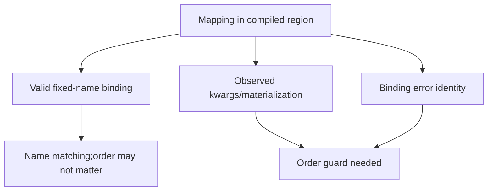
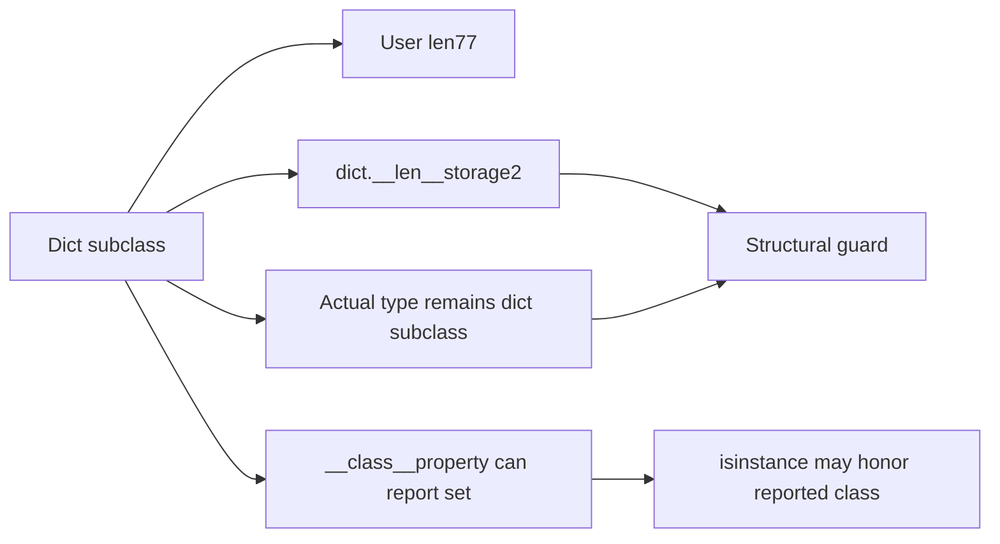
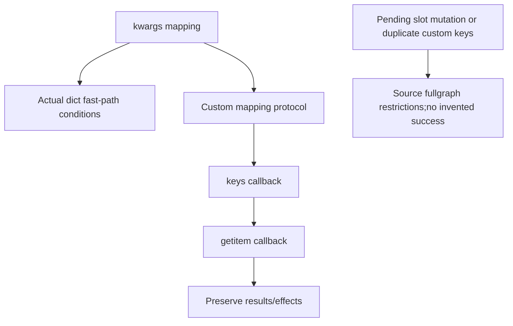

# AI Infra compilation-contract FAQ: Dynamo dictionary order,actual type,structural length and kwargs guards

> **Language**: English | [中文](dynamo-dictionary-order-type-length-kwargs-guards-selection-faq.md)  
> **Round152 · 2026-11-14daytime**: same-day semantic-guard correction;original cache plans/CPython-only oracle,not torch.compile benchmarking.

**Finding:** A key set does not preserve observed order,type or exception identity.But valid fixed-name kwargs binding need not guard every insertion order.Original12calls yield5key-set-only misses versus0selective misses,with6/11model plans.Native CPython custom mapping produces73instead of a28storage shortcut;userlen77also differs from structural dictlength2.

**Artifacts**: [H5cache](../reports/dynamo-dictionary-order-type-length-kwargs-guards-sizer.html) · [seven cards](../reports/dynamo-dictionary-order-type-length-kwargs-guards-selection-cards.html) · [1600px SVG](../../assets/svg/dynamo-dictionary-order-type-length-kwargs-guards-selection-faq-summary.svg) · [sealed report](../../experiments/dictionary_guard_contract_selection/report.json) · [CPython oracle](../../experiments/dictionary_guard_contract_selection/native_oracle.json)

## Q1: Why guard order selectively rather than every kwargs call?

The pinned **Nov14,04:00UTC=12:00BJT**correction selects order guards for observed`**kwargs`,binding errors and materialization.Valid fixed-name binding can match names without observing order.Actual type,structural dict length and custom mapping protocols are also corrected.



Source also covers partial/positional binding,mutable iteration slots,OrderedDictandempty mappings.Our small original model **does not import PyTorch or measure native recompilation**.

## Q2: Which reversed-insertion behaviors change?

Original`base3+10×alpha2+beta5=28`binds byname and is invariant to reversal.Observing kwargs order or`dict(**mapping)`changes key sequence.Unexpected omega/sigma order changes the exposed error key;duplicates against two positional-bound parameters do too.

Six programs×two calls give12calls:named,order,unexpected,duplicate,type,constructor.Key-set-only misses5/12;semantic model0/12with11versus6plans.**Fewer plans alone is not correctness or native performance.**

## Q3: Why cannot storage guards call overridden user len?



Original native CPython fixtures return overriddenlen77but two stored entries.Another reports`__class__=set`,makingisinstance-setTruewhile actualtype remains a dictsubclass.Source structural guards use realtype/base length.

Applicationlenmust still observe77.**Bypassing user code is a structural-guard operation,not deleting application semantics.**Model kind labels do not validate actual class/slot objects.

## Q4: When must kwargs preserve mapping callbacks and effects?

Original CPython Projection storesalpha2/beta5but custom iteration slot/keys exposes onlyalphaandgetitem7.`target(3,**mapping)`returns73and events`["keys","get:alpha"]`;reading backing storage yields28.Not every dictsubclass takes the same protocol;iteration-slot conditions matter.



Source explicitly handles unsupported/fallback for pending iteration-slot mutation and custom duplicate keys.Our CPython oracle does not execute these Dynamo fullgraph paths.Callback bypass or treating unsupported as success is not justified.

## Q5: What limits the model and CPUguard timer?

Original guard keys contain kind,storage key count and ordered keys when observed,otherwise key set.Scalar values bind dynamically;**native Python-int value guards,slot/identity/factory/custom hash-equality guards are not simulated**.Native frames remain unknown/null.

| Same-order keys | Tuple comparison(ms) | Scalar zip(ms) |
| ---: | ---: | ---: |
| 64 | 0.000433 | 0.004067 |
| 256 | 0.000867 | 0.014800 |
| 1024 | 0.002500 | 0.059167 |
| 4096 | 0.009467 | 0.235500 |

Both paths check length/ordered equality.Prebuild expected/input keys;two warmups,seven alternating repeats,three operations/sample,median repeat means.Excludes key preparation,dict/type/slot guards,compiler/cache execution,PyTorch/C++guards/GPU.Not native compile latency or measured recompilation reduction.

## Q6: How can real compiled dictionary behavior be accepted?

```powershell
python -m unittest discover -s tests -p test_dictionary_guard_contract_selection.py -q
python -m experiments.dictionary_guard_contract_selection.run --check
# --measure seals CPython-only observations/CPU equality;no torch.compile.
```

Eight tests cover named/order selection,error identity,native protocol/length/type,independent CPython outputs,dynamic scalar/type gates,invalid pairs/length boundaries,32random-order oracles/38Node sequences,and the full12callmatrix.CPython observations separately`measured`;main`synthetic`, `independently_reproduced=false`.

Sources:[Nov14correction](https://github.com/pytorch/pytorch/commit/f407abb11f88c3b04bffba64a8f8d61e7c0207e2),[guards](https://github.com/pytorch/pytorch/blob/f407abb11f88c3b04bffba64a8f8d61e7c0207e2/torch/_dynamo/guards.py),[DICT_MERGE](https://github.com/pytorch/pytorch/blob/f407abb11f88c3b04bffba64a8f8d61e7c0207e2/torch/_dynamo/symbolic_convert.py),[dictionary variables](https://github.com/pytorch/pytorch/blob/f407abb11f88c3b04bffba64a8f8d61e7c0207e2/torch/_dynamo/variables/dicts.py),[regression scope](https://github.com/pytorch/pytorch/blob/f407abb11f88c3b04bffba64a8f8d61e7c0207e2/test/dynamo/test_dicts.py),[LICENSE](https://github.com/pytorch/pytorch/blob/f407abb11f88c3b04bffba64a8f8d61e7c0207e2/LICENSE).Rights preserved,no implementation mirrored.

Acceptance needs real Dynamo/Pythonversions,values/types/slots,mutation/error behavior,eager-versus-compiled outputs and actual frame counts/latency.Native Torch compilation/count/latency are unmeasured,not zeros.Original60-solid guard cabinet is not hardware.Prior browser refusal remains respected;no visual browser acceptance.
